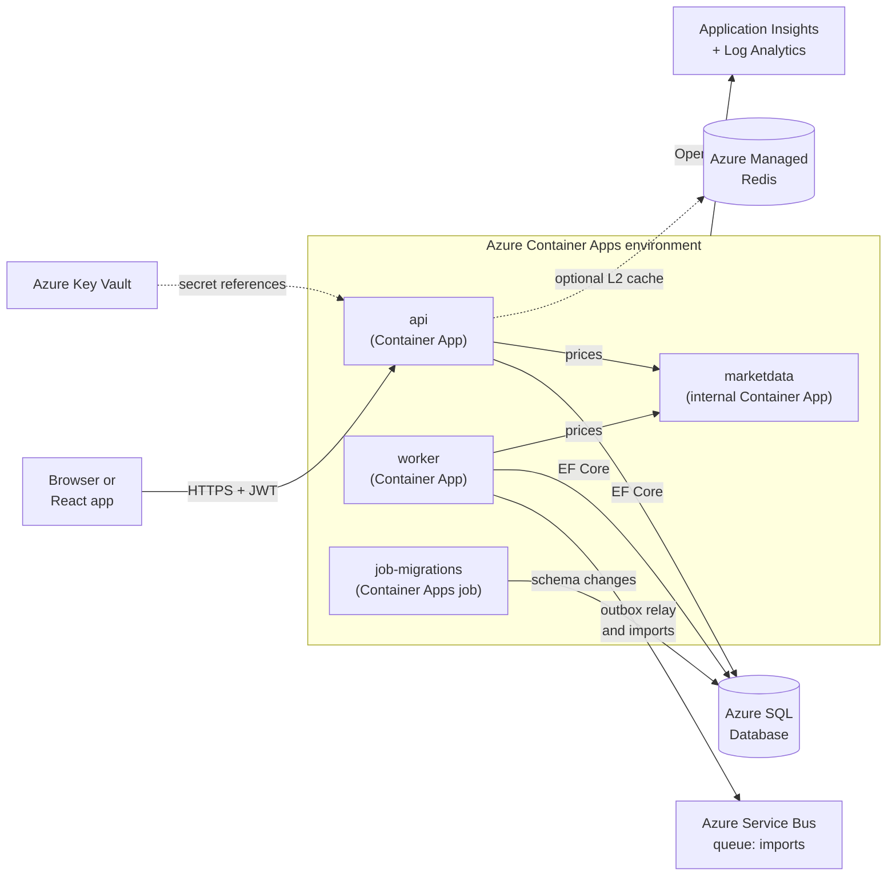
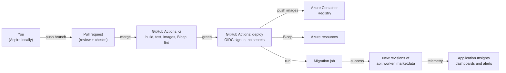
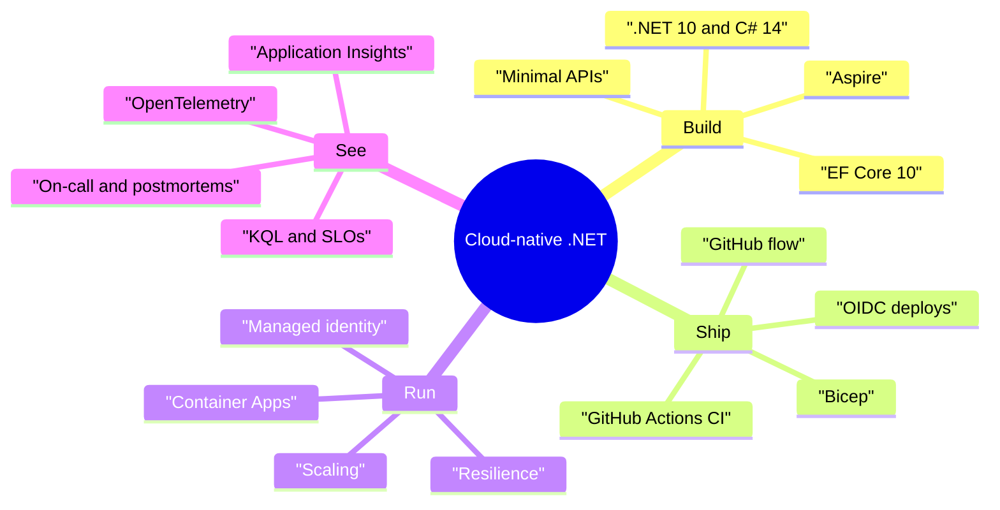

# Chapter 1: From legacy to cloud-native

> ⏱ About 25 min · You'll learn: what "cloud-native .NET" actually changes for a senior developer, the Ledgerly architecture you will build in this course, and how the 21 chapters fit together.

---

## 📖 Story: The whiteboard with no servers on it

It is your first Monday at Ledgerly. Last month you were still at Nordbank Insurance, where "production" meant six Windows Server VMs behind a hardware load balancer, a shared drive full of `web.config` transforms, and a Thursday-night deployment window where you copied files over Remote Desktop. When something broke, you opened three RDP sessions and searched `C:\inetpub\logs` and a folder of NLog text files until you found the stack trace.

Maya Okafor, Ledgerly's tech lead, hands you a coffee and walks you to a whiteboard. It shows a few boxes: an API, a worker, a database, a queue, a cache. There are no server names on it, no IP addresses, and no drive letters. "Three rules," she says. "One: there are no servers you can log in to. Two: logs are queries, not files. Three: deploys are boring. They happen on every merge, many times a day, and nobody stays late for them."

You open a new notebook and write a title on the first page: **Habits I brought with me**. Over the next weeks you will look at each habit honestly, keep the good ones and replace the rest. Maya smiles when she sees it. "Good. Most of your habits are right. The places where they live have changed."

> Numbers in the Ledgerly story (team size, timelines, traffic, latency, costs) are **illustrative**. They make the story concrete; they are not benchmarks.

---

## 🏚️ Old way → 🚀 New way

| What you did before | What you do now | Why it changed |
|---|---|---|
| .NET Framework 4.x on Windows Server and IIS | .NET 10 (LTS) on Linux containers in Azure Container Apps | Cross-platform runtime, much faster, a new major version every November, and no OS to patch yourself |
| Deploy by RDP, Web Deploy or xcopy on a Thursday night | Every merge to `main` builds, tests and deploys through GitHub Actions | Small, frequent, automated deploys are safer than big, rare, manual ones |
| `web.config` transforms with passwords in them | Environment variables, Key Vault references and managed identities (no passwords at all) | Secrets in files leak; identities can't be copied into a chat message |
| Text log files on each server, read with RDP and Notepad++ | Structured logs, traces and metrics through OpenTelemetry, queried with KQL | With many short-lived replicas there is no "server" to log in to, and you need to follow one request across services |
| Windows Services and SQL Agent jobs for background work | Background services, queues (Azure Service Bus) and Container Apps jobs | Work survives restarts, scales with load and retries on its own |
| Servers sized for peak load, running all year | Autoscaling from zero (or one) replica to many, based on traffic or queue length | You pay for what you use, and a traffic spike doesn't need a purchase order |
| Infrastructure created by hand in a console or by a ticket to the ops team | Infrastructure as code (Bicep) reviewed in pull requests | Reproducible environments, and the history of every change is in git |
| "It works on my machine" | One command starts the whole system locally (Aspire), and CI proves it on a clean machine | New team members are productive on day one, and environment drift shows up early |

> 💡 Most of your instincts (clean design, careful SQL, defensive code) still apply. What changed is **where** the code runs, **how** it gets there and **how you see** what it is doing.

---

## 🧠 What "cloud-native" means for a .NET developer

"Cloud-native" is used for marketing, so here is a practical definition you can work with. An application is cloud-native when it is **designed for an environment where machines are disposable, failures are normal and change is constant**. In practice that means a handful of properties:

| Property | What it means in practice | Where you learn it |
|---|---|---|
| **Disposable processes** | Any replica can be killed at any time (scale-in, new revision, host maintenance). Startup is fast, shutdown is graceful, and no state lives on local disk. | Chapters 7, 14 |
| **Configuration from the environment** | The same container image runs in every environment. Only configuration differs, and secrets are not in config at all. | Chapters 3, 13 |
| **Everything as code** | Application, infrastructure, pipelines, policies and dashboards live in git and change through pull requests. | Chapters 8, 9, 11 |
| **Automated delivery** | A merge triggers build, test, image, deploy, migration and smoke test with no manual steps. | Chapters 9, 12 |
| **Designed for failure** | Dependencies will be slow or down. Retries, timeouts, circuit breakers and graceful degradation are part of the design. | Chapter 14 |
| **Observable by default** | Every request produces traces, metrics and structured logs that you can query across all services. | Chapters 15, 16 |
| **Elastic** | Capacity follows demand automatically, including scaling to zero where it makes sense. | Chapters 10, 18 |
| **Identity instead of secrets** | Services prove who they are with managed identities and tokens, not with passwords in connection strings. | Chapter 13 |

None of these properties needs Kubernetes, microservices or a specific vendor. Ledgerly is a small system on purpose: one API, one worker, one fake vendor service and one migration job. That is enough to practice every property above without the complexity of fifty services.

> 💡 Cloud-native is a set of habits, not a technology list. You can build a cloud-native monolith and a very fragile set of microservices.

---

## 🧠 What changed in .NET while you were busy

If your last big project was on .NET Framework 4.8, the gap is large but not mysterious. Microsoft rebuilt .NET as a cross-platform, open-source runtime (.NET Core, now just ".NET"), and all new investment goes there.

| Topic | Fact | Why it matters for you |
|---|---|---|
| Current version | **.NET 10 is the current LTS release**, supported until **2028-11-14** 🔧 | This course targets `net10.0` everywhere |
| Older modern versions | **.NET 8 and .NET 9 both reach end of support on 2026-11-10** 🔧 | If you start something new, don't start on 8 or 9 |
| Release rhythm | A new major version every November. Even numbers are LTS (3 years), odd numbers are STS (2 years) 🔧 | Plan one upgrade per year or one every two years, as normal maintenance |
| .NET Framework | 4.8 and 4.8.1 are Windows components with no announced end date, but get no new features 🔧 | Your old apps are not on fire, but new work belongs on .NET 10 |
| Language | C# 14 ships with .NET 10 | Records, pattern matching, primary constructors and collection expressions change how idiomatic code looks (chapter 2) |

Sources: [.NET support policy](https://dotnet.microsoft.com/en-us/platform/support/policy/dotnet-core) and [.NET Framework lifecycle](https://learn.microsoft.com/en-us/lifecycle/products/microsoft-net-framework).

The other big shift is **the hosting model**. ASP.NET on .NET Framework was tied to IIS and `System.Web`. ASP.NET Core runs on its own web server (Kestrel) inside your process. IIS can still front it on Windows, but in a container it is just a process listening on port 8080. That one change explains a lot of this course: once your app is a self-contained process, it can run in a container, on Linux, anywhere.

### The hosting model, then and now

| Concern | IIS + .NET Framework | Container + .NET 10 |
|---|---|---|
| Web server | IIS + `System.Web` pipeline | Kestrel inside your process |
| Process lifetime | App pool recycles on a schedule or memory limit | The platform starts and stops replicas, you handle `SIGTERM` gracefully |
| Configuration | `web.config` + transforms | `appsettings.json` + environment variables + Key Vault |
| Health | "Is the app pool running?" | `/alive` and `/health` endpoints that the platform probes |
| Scaling | Add a VM to the load balancer | Change `maxReplicas` or add a scale rule |
| Logs | Files on the server's disk | OpenTelemetry to Application Insights |

---

## 🧠 Ledgerly: the product and the team

**Ledgerly** is a small fintech start-up of about 25 people. It is building a personal investment portfolio tracker, also called Ledgerly. Users can:

- create portfolios and record buys and sells,
- **import broker CSV statements** (the slow, bursty part),
- see their holdings and a **live valuation** based on market prices from a third-party vendor,
- set **price alerts** and get notified.

Version 1 launches as a public beta in about 12 weeks. There is no legacy code: you start greenfield, which is exactly why the team wants to do it "the modern way" from day one.

### Your teammates

| Name | Role | What they will push you on |
|---|---|---|
| **Maya Okafor** | Tech lead / architect | "What happens when it fails?" She writes the ADRs and pairs with you often. |
| **Tomás Varga** | Platform / DevOps engineer | "If it's not in git, it doesn't exist." He owns GitHub Actions, Bicep and the Azure subscription. |
| **Priya Raman** | Site reliability engineer | Observability, SLOs, on-call. She hates alerts that wake people up for nothing. |
| **Jonas Berg** | Security engineer | Managed identities, no secrets in config, least privilege, supply chain. Friendly but strict. |
| **Elena Rossi** | Product manager | "What does the user see?" and "What does it cost?" She owns the beta launch. |
| **Leo Park** | Frontend developer | He will build the React app later, so he cares about API contracts, OpenAPI, CORS and error shapes. |

And **you**: the senior .NET developer with nine years of IIS, WCF and MVC behind you, and a notebook of habits to examine.

---

## 🗺️ The target architecture

This is what you will have running in Azure by chapter 12. Every box is real code or real Bicep in the sample.



And this is how a change gets from your laptop to that environment:



### Who does what

| Piece | Responsibility | Old-world equivalent |
|---|---|---|
| `Ledgerly.Api` | HTTP API for portfolios, transactions, valuation, imports, alerts | Your ASP.NET Web API 2 site on IIS |
| `Ledgerly.Worker` | Processes imports from the queue, relays the outbox, evaluates price alerts | A Windows Service plus a couple of SQL Agent jobs |
| `Ledgerly.MarketData` | A fake market-data vendor with "chaos" switches to make it slow or failing | The flaky third-party SOAP service everyone complained about |
| `Ledgerly.MigrationService` | Applies EF Core migrations, then exits | The DBA running a script on Thursday night |
| `Ledgerly.AppHost` | Starts everything locally with Aspire: SQL Server, Redis, the Service Bus emulator and all services | A 14-step wiki page called "Developer setup" |
| `Ledgerly.ServiceDefaults` | Shared OpenTelemetry, health checks, resilience and service discovery | Copy-pasted `Global.asax` and logging config |

### 💻 In Ledgerly: the whole system in one file

You don't need to understand this file yet (chapter 6 explains it line by line). Just notice that the entire local topology, including containers for SQL Server, Redis and a Service Bus emulator, is a C# file you can read and review.

📄 [`sample/src/Ledgerly.AppHost/AppHost.cs`](https://github.com/vygantas-meskauskis/cloud-native-dotnet/blob/main/sample/src/Ledgerly.AppHost/AppHost.cs)
```csharp
var builder = DistributedApplication.CreateBuilder(args);

// ── Infrastructure (containers locally; real Azure services in the cloud, see infra/) ──────────
var sql = builder.AddSqlServer("sql")
    .WithLifetime(ContainerLifetime.Persistent)   // keep the container (and data) between runs
    .WithDataVolume();
var db = sql.AddDatabase("ledgerlydb");

var cache = builder.AddRedis("cache");

var messaging = builder.AddAzureServiceBus("messaging").RunAsEmulator();
messaging.AddServiceBusQueue("imports");
// ...
```

Compare that with the wiki page you used to maintain about which SQL instance, which MSMQ queue and which IIS site bindings a new developer needed.

---

## 🧠 The stack you will learn, and why each piece is there

| Layer | Choice in this course | Why this one | Chapter |
|---|---|---|---|
| Runtime and language | .NET 10 (LTS), C# 14, ASP.NET Core 10, EF Core 10 | Current LTS, longest support window | 2, 4, 5 |
| Local orchestration | Aspire (AppHost, service defaults, dashboard) 🔧 | One command starts the system, with telemetry from the first run | 6 |
| Source control and collaboration | GitHub: pull requests, rulesets, CODEOWNERS, Dependabot, CodeQL, GitHub Copilot | Where the team works, reviews and automates | 8, 20 |
| CI/CD | GitHub Actions with OIDC to Azure | No stored cloud secrets, build once and deploy the same image | 9, 12 |
| Compute | Azure Container Apps | Containers and scale-to-zero without running Kubernetes yourself | 10 |
| Data | Azure SQL Database (serverless) | Your SQL Server skills transfer directly | 5, 10 |
| Messaging | Azure Service Bus | Durable queues with dead-lettering and duplicate detection | 7 |
| Caching | HybridCache, optionally backed by Azure Managed Redis 🔧 | Fast reads with stampede protection | 18 |
| Secrets and identity | Microsoft Entra ID, managed identities, Azure Key Vault | No passwords to leak or rotate | 13 |
| Infrastructure | Bicep | Readable, Azure-native infrastructure as code | 11 |
| Observability | OpenTelemetry, Application Insights, Azure Monitor, KQL | One standard for traces, metrics and logs, and one place to query them | 15, 16 |

A note on two names that may surprise you:

- **Aspire** used to be called ".NET Aspire". The product is now just "Aspire" 🔧.
- **Azure Managed Redis** is the Redis service for new work. Azure Cache for Redis is being retired in stages 🔧 (chapter 10 has the dates).



---

## 🧠 How this course works

The course has four parts:

| Part | Chapters | What you get |
|---|---|---|
| **Part 1 · Foundations** | 1-3 | The mental model, modern C# and .NET, and a solution set up like a pro |
| **Part 2 · Build, ship, run** | 4-16 | The API, data, local dev, messaging, GitHub, CI, Azure choices, Bicep, CD, identity, reliability and observability |
| **Part 3 · Everyday practice** | 17-20 | Testing, performance, running production and AI-assisted development |
| **Part 4 · Toolkit** | 21 | Cheat sheets, checklists and templates to reuse |

Every chapter follows the same shape, so you always know where to look:

| Section | What it gives you |
|---|---|
| 📖 Story | The problem, as it shows up at Ledgerly |
| 🏚️ Old way → 🚀 New way | Your old habit next to the modern practice, and why it changed |
| 🧠 Concepts | The ideas, in tables and decision guides |
| 💻 In Ledgerly | Real code from the sample, with the lines that matter explained |
| 🗺️ Diagrams | Who does what, where things live and how it flows |
| ⚠️ Common traps | Mistakes that are easy to make, and what to do instead |
| 🧰 Helpers | Copy-ready snippets plus "make it permanent" advice |
| 🧪 Try it yourself | Optional hands-on steps against the sample |
| ✅ Recap | Three lines to remember |

### Markers you will see

| Marker | Meaning |
|---|---|
| 🔧 | Volatile fact (version, limit, date, SKU name, preview status). Correct as of October 2026; check the linked docs before relying on it. |
| 💰 | Has a cost impact. The course explains the cost driver, not exact prices. |
| 🧪 Not run by the author | Azure steps written from the docs and validated with `bicep build` and linting, but not deployed end to end by the author. Expect small differences. |

### The sample

Everything the chapters quote lives in the [`sample/`](https://github.com/vygantas-meskauskis/cloud-native-dotnet/tree/main/sample) folder of the course repository. It builds with warnings as errors, and its 23 tests (15 unit, 8 integration against a real SQL Server) pass. The CI workflow runs on every push. The deploy workflow stays switched off until you configure your own Azure subscription in chapter 12.

### Pace

| Pace | Plan |
|---|---|
| Steady | Two chapters a week, about 10 weeks, doing most "Try it yourself" sections |
| Fast | One part per week, about 4 weeks, reading only and trying the sample at the end |
| Reference | Read chapters 1, 2 and 21 first, then jump to whatever you need this week |

---

## 🧠 Your habits notebook

Maya was right: most of your habits are good. The notebook is a tool for sorting them. Here is the first page, as you write it on day one:

| Habit | Keep, change or drop? | Where it is examined |
|---|---|---|
| "I want to see the logs" | **Change.** You still want evidence, but you'll get it from queries over structured telemetry, not files | 15, 16 |
| "Test it in staging before Thursday" | **Change.** Test on every pull request, deploy small changes often, and roll back fast | 9, 12, 17 |
| "The DBA runs the migration script" | **Change.** Migrations are a pipeline step with a job that must succeed before the new code starts | 5, 12 |
| "Put the password in `web.config` and encrypt the section" | **Drop.** Use managed identities, so there is no password | 13 |
| "Retry in a loop with `Thread.Sleep`" | **Change.** Use standard resilience handlers with jitter, timeouts and circuit breakers | 14 |
| "Careful SQL and indexes" | **Keep.** Azure SQL is still SQL Server underneath, and EF Core still needs your judgment | 5, 18 |
| "Read the code before you approve it" | **Keep.** It matters even more when an AI wrote part of it | 8, 20 |

> 💡 The goal is not to forget what you know. It is to move each habit to the place where it works in the cloud.

---

## ⚠️ Common traps

| Trap | What happens | Do this instead |
|---|---|---|
| "Lift and shift" thinking: one container that behaves like a VM | You write logs to local disk, keep session state in memory and SSH in to debug. The first scale-in or restart loses data | Treat replicas as disposable from day one: state in the database or cache, telemetry out of the process |
| Starting with microservices | Ten services, ten pipelines and distributed transactions for a product with no users yet | Start with a few deployable units with clear jobs (like Ledgerly) and split only when there's a real reason |
| Learning Kubernetes first | Weeks on cluster plumbing before shipping any feature | Use a managed platform (Container Apps) and learn the concepts (replicas, probes, revisions) that transfer anywhere |
| Copying old patterns into new code | `async void`, `.Result`, static `HttpClient` hacks and string-concatenated SQL show up in a modern codebase | Use chapter 2 as a translation guide and let analyzers enforce it (chapter 3) |
| Treating "the cloud" as one big decision | Analysis paralysis over every service | Use the decision tables in chapter 10, and accept that most choices can be changed later through infrastructure as code |
| Trusting version numbers from memory | Last year's blog post says a feature is preview, or a service is current, when it changed | Check the 🔧 items against the linked docs before you rely on them |

---

## 🧰 Helpers

**Get the sample on your machine:**

```bash
git clone https://github.com/vygantas-meskauskis/cloud-native-dotnet.git
cd cloud-native-dotnet/sample
dotnet --list-sdks        # you need a 10.0.x SDK
dotnet build Ledgerly.slnx
```

**What to install before chapter 6:**

| Tool | Why |
|---|---|
| .NET 10 SDK | Build and run everything |
| Docker Desktop or Podman | Aspire runs SQL Server, Redis and the Service Bus emulator as containers |
| Aspire CLI 🔧 | `aspire run` starts the whole system (installation is covered in chapter 6) |
| Git + a GitHub account | Chapters 8 and 9 |
| An IDE: Visual Studio 2026, VS Code with C# Dev Kit, or Rider 🔧 | Any of them works with the sample |
| An Azure subscription (later) | Only from chapter 11 on. 💰 Most resources in the sample are serverless or have free monthly grants, but not all |

**Make it permanent:** keep your own "Habits I brought with me" page. The toolkit has an old-to-new cheat sheet that you can extend as you go. See [the toolkit](../toolkit/README.md) and the [glossary](../GLOSSARY.md) for any term you don't recognize.

---

## 🧪 Try it yourself (optional, ~15 min)

1. Clone the repository and build the sample:
   ```bash
   cd cloud-native-dotnet/sample
   dotnet build Ledgerly.slnx
   ```
2. Look at the solution layout. Open `Ledgerly.slnx` in your editor and match each project to the "Who does what" table above.
3. Open `src/Ledgerly.AppHost/AppHost.cs` and find, without reading the docs, the line that tells the API to wait for the migrations to finish. (Hint: `WaitForCompletion`.)
4. Run the unit tests (they don't need a database):
   ```bash
   dotnet test --solution Ledgerly.slnx
   ```
   Observe: without a container runtime or the `LEDGERLY_TEST_SQL` variable, the integration tests are **skipped**, not failed. Chapter 17 explains why.
5. Write the first page of your own habits notebook: three habits you suspect will change, and one you are sure you'll keep.

---

## ✅ Recap

1. Cloud-native means disposable processes, configuration from the environment, everything as code, automated delivery, designed for failure and observable by default.
2. Ledgerly is a small, realistic system (API, worker, fake vendor, migration job) that you will build, ship and run on .NET 10, GitHub and Azure.
3. Your experience still counts. The course moves each habit to where it works today.

**Next → [Chapter 2: Modern .NET in one sitting](02-modern-dotnet-in-one-sitting.md)**
