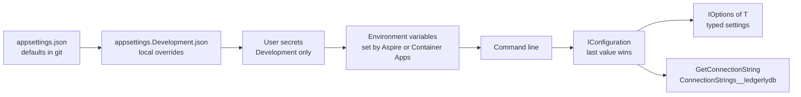

# Chapter 2: Modern .NET in one sitting

> ⏱ About 30 min · You'll learn: how the hosting model, DI and configuration replaced `Global.asax` and `web.config`, which C# features you will meet in every Ledgerly file, and which small modern APIs (`TimeProvider`, `Guid.CreateVersion7()`, `[LoggerMessage]`) replace old habits.

---

## 📖 Story: "This reads like C# 5"

Your first pull request at Ledgerly is small: a service that values a portfolio. You wrote it the way you wrote hundreds of classes at Nordbank Insurance. A constructor that assigns six private fields. A `new HttpClient()` inside a `using` block. `DateTime.Now` for the timestamp. A `.Result` on one call because the method above it wasn't async. A log line built with `string.Format`. And a null check at the top of every method.

Maya's review has one comment at the top, and it is friendly: "This works, and the logic is right. But it reads like C# 5. Let's pair for an hour and I'll show you what changed. Most of it is less code, not more." Below that are twelve inline suggestions, and each one deletes lines.

You open your notebook, **Habits I brought with me**, and write a new heading: *Things the compiler and the framework now do for me*. This chapter is that hour with Maya. It is a translation guide, not a tutorial: you already know how to program, so the focus is on what moved and why.

---

## 🏚️ Old way → 🚀 New way

| What you did before | What you do now | Why it changed |
|---|---|---|
| `Global.asax` `Application_Start`, HTTP modules and handlers in IIS | `Program.cs` with `WebApplication.CreateBuilder`, middleware and endpoints | One explicit startup file you can read top to bottom, with no IIS pipeline hidden behind it |
| Unity, Autofac or Ninject wired up by hand | Built-in dependency injection (`builder.Services`) | Every framework component already uses it, so your code plugs into the same container |
| `ConfigurationManager.AppSettings["Key"]` and `web.config` transforms | `IConfiguration` from layered providers, bound to options classes | The same build runs everywhere, and environment variables override files without transforms |
| `new HttpClient()` per call, or one static instance | `IHttpClientFactory` with typed clients | Handler lifetimes and resilience are managed for you, configured once at registration |
| `.Result`, `.Wait()` and `async void` mixed with sync code | `async` all the way, with a `CancellationToken` passed down | No thread-pool starvation under load, and work stops when the caller gives up |
| Null checks at the top of every method | Nullable reference types plus `required` members | The compiler tells you where nulls can flow, before the code runs |
| `DateTime.Now` and `Guid.NewGuid()` in domain code | `TimeProvider` and `Guid.CreateVersion7()` | Time becomes testable, and IDs sort by creation time |
| `log.InfoFormat("Order {0} placed", id)` into a text file | Structured logging with `[LoggerMessage]` source generation | Placeholders become queryable fields, and disabled log levels cost nothing |

> 💡 The biggest change isn't a language feature. It's that the framework owns startup, DI, configuration and logging, and your code joins that model instead of building its own.

---

## 🧠 The hosting model: from IIS to a process you own

On .NET Framework, IIS owned your process. It loaded `System.Web`, ran `Global.asax`, pushed the request through HTTP modules and finally reached your controller. You configured half of the behavior in IIS Manager and the other half in `web.config`.

In ASP.NET Core, your app **is** the process. The web server, Kestrel, runs inside it. In a Linux container, that process listens on **port 8080** by default 🔧 (it used to be 80; set it with `ASPNETCORE_HTTP_PORTS`). IIS can still sit in front on Windows, but nothing in Ledgerly needs it.

### Translation table

| .NET Framework concept | .NET 10 equivalent | Notes |
|---|---|---|
| `Global.asax` `Application_Start` | Top of `Program.cs`, before `builder.Build()` | Register services and read configuration here |
| HTTP modules (`IHttpModule`) | Middleware (`app.UseXyz()`) | Order in `Program.cs` is the order requests flow through |
| HTTP handlers and controllers | Endpoints: minimal APIs or controllers | Ledgerly uses minimal APIs with route groups (chapter 4) |
| `HttpContext.Current` (static) | `HttpContext` passed or injected where needed | No static ambient context, which also makes code testable |
| Windows Service with `OnStart`/`OnStop` | `BackgroundService` hosted by the generic host | Same host, same DI, same logging as the web app (chapter 7) |
| App pool recycle | The platform starts and stops replicas, and you shut down gracefully | `HostOptions.ShutdownTimeout` defaults to **30 s** 🔧 |
| Console app with a `Main` that news everything up | `Host.CreateApplicationBuilder(args)` | You get configuration, DI and logging even in a console tool |

There are two builders, and both come from the same **generic host** ([docs](https://learn.microsoft.com/en-us/aspnet/core/fundamentals/host/generic-host)): `WebApplication.CreateBuilder(args)` for anything that serves HTTP (the API, the worker and the market-data service, even if only for health endpoints), and `Host.CreateApplicationBuilder(args)` for processes with no HTTP surface (the migration service).

### 💻 In Ledgerly: the API's composition root

📄 [`sample/src/Ledgerly.Api/Program.cs`](https://github.com/vygantas-meskauskis/cloud-native-dotnet/blob/main/sample/src/Ledgerly.Api/Program.cs)
```csharp
var builder = WebApplication.CreateBuilder(args);

// ── Cross-cutting: OpenTelemetry, health checks, resilience, service discovery ────────────────
builder.AddServiceDefaults();

// ── Data: Aspire client integration = DbContext pooling + retries + health check + tracing ──────
builder.AddSqlServerDbContext<LedgerlyDbContext>("ledgerlydb");
// ...
var app = builder.Build();

app.UseExceptionHandler();
app.UseStatusCodePages();
app.UseCors(ApiPolicies.Spa);
app.UseAuthentication();
app.UseAuthorization();
app.UseRateLimiter();
// ...
app.MapPortfolioEndpoints();
app.MapImportEndpoints();
app.MapAlertEndpoints();
app.MapDefaultEndpoints();

app.Run();
```

Read it as two phases:

1. **Before `Build()`**: you describe services. Nothing runs yet. This is where `Application_Start` code goes.
2. **After `Build()`**: you describe the request pipeline. Each `Use...` line is a middleware, in order. The `Map...` lines attach endpoints. `app.Run()` starts Kestrel and blocks until shutdown.

Notice the file is short. Cross-cutting concerns (OpenTelemetry, health checks, retries) come from one call, `AddServiceDefaults()`, which lives in a shared project (chapter 6). That's the modern answer to the `Global.asax` you used to copy from project to project.

The migration runner shows the same model without HTTP:

📄 [`sample/src/Ledgerly.MigrationService/Program.cs`](https://github.com/vygantas-meskauskis/cloud-native-dotnet/blob/main/sample/src/Ledgerly.MigrationService/Program.cs)
```csharp
var builder = Host.CreateApplicationBuilder(args);

builder.AddServiceDefaults();
builder.AddSqlServerDbContext<LedgerlyDbContext>("ledgerlydb");
builder.Services.Configure<AppDatabaseUserOptions>(builder.Configuration.GetSection(AppDatabaseUserOptions.Section));
builder.Services.AddHostedService<Migrator>();

builder.Build().Run();
```

Same configuration, same DI, same telemetry, no web server. Chapter 5 explains what `Migrator` does.

> 💡 If you can find it in `Program.cs`, it happens. If it isn't there, it doesn't. There is no hidden IIS configuration anymore.

---

## 🗺️ How a request flows through the API

This is the middleware order from `Program.cs`, drawn as the path one request takes:

```mermaid
flowchart LR
    Client["Client<br/>browser or SPA"] -- "HTTPS" --> Kestrel["Kestrel<br/>inside the process"]
    Kestrel --> Ex["UseExceptionHandler<br/>errors become ProblemDetails"]
    Ex --> Status["UseStatusCodePages<br/>bare 4xx get a body"]
    Status --> Cors["UseCors<br/>SPA origins only"]
    Cors --> AuthN["UseAuthentication<br/>JWT bearer"]
    AuthN --> AuthZ["UseAuthorization<br/>RequireAuthorization"]
    AuthZ --> Rate["UseRateLimiter<br/>per-user policies"]
    Rate --> Endpoint["Endpoint handler<br/>services injected"]
    Endpoint -- "DbContext" --> Db[("SQL")]
```



Compare it with the IIS pipeline you knew: the same idea (a chain of steps around your code), but you can see every step, and you choose the order.

---

## 🧠 DI, configuration, options and HttpClient

### Dependency injection is built in

You don't choose a container anymore, unless you have a strong reason. `builder.Services` is an `IServiceCollection`, and every framework feature registers itself there. Three lifetimes cover nearly everything:

| Lifetime | Meaning | Ledgerly example |
|---|---|---|
| Singleton | One instance for the process | `TimeProvider.System` |
| Scoped | One instance per request (or per scope you create) | `LedgerlyDbContext`, `ValuationService` |
| Transient | New instance every time | Rarely needed in Ledgerly |

The one trap that bites experienced developers: a singleton (like a `BackgroundService`) must not hold a scoped service such as a `DbContext`. Create a scope instead. `AlertEvaluator` takes an `IServiceScopeFactory` for exactly this reason (chapter 7).

### Configuration is layered, not transformed

`WebApplication.CreateBuilder` reads configuration from several providers, and later ones override earlier ones. A key such as `MarketData:BaseUrl` in JSON becomes `MarketData__BaseUrl` as an environment variable (double underscore instead of a colon). That's how the same container image gets different settings in every environment, with no transforms and no rebuild.



Locally, Aspire injects connection strings as environment variables (chapter 6). In Azure, Bicep sets them on the Container App (chapter 11). Secrets don't go in any of these files at all: chapter 13 replaces them with managed identities.

### Options instead of magic strings

The **options pattern** binds a configuration section to a class once, and code receives a typed object. No more `int.Parse(ConfigurationManager.AppSettings["AlertInterval"])` scattered across the codebase.

### IHttpClientFactory and typed clients

You probably remember the advice to "make `HttpClient` static" and then the DNS problems that came with it. The factory manages the underlying handlers for you. A **typed client** is a class that takes an `HttpClient` in its constructor, and the registration decides its base address and behavior.

### 💻 In Ledgerly: the worker's registrations

📄 [`sample/src/Ledgerly.Worker/Program.cs`](https://github.com/vygantas-meskauskis/cloud-native-dotnet/blob/main/sample/src/Ledgerly.Worker/Program.cs)
```csharp
builder.Services.AddHttpClient<IMarketDataClient, MarketDataClient>(client =>
    client.BaseAddress = new Uri(builder.Configuration["MarketData:BaseUrl"] ?? "https+http://marketdata"));

builder.Services.AddSingleton(TimeProvider.System);
builder.Services.Configure<AlertOptions>(builder.Configuration.GetSection("Alerts"));

builder.Services.AddHostedService<OutboxRelay>();
builder.Services.AddHostedService<ImportProcessor>();
builder.Services.AddHostedService<AlertEvaluator>();

// Give in-flight messages time to finish when Container Apps stops a replica (SIGTERM).
builder.Services.Configure<HostOptions>(o => o.ShutdownTimeout = TimeSpan.FromSeconds(25));
```

| Line | Old-world equivalent |
|---|---|
| `AddHttpClient<IMarketDataClient, MarketDataClient>` | A static `HttpClient` plus a hand-written retry loop |
| `"https+http://marketdata"` | A hard-coded URL per environment in `web.config`. Here service discovery resolves a logical name (chapter 6) |
| `Configure<AlertOptions>(...GetSection("Alerts"))` | `AppSettings["AlertIntervalSeconds"]` parsed by hand |
| `AddHostedService<...>` | Three Windows Services, each with its own installer |
| `ShutdownTimeout = 25 s` | Nothing: IIS just recycled and in-flight work was lost |

The typed client itself is now almost nothing but HTTP:

📄 [`sample/src/Ledgerly.Core/Market/MarketDataClient.cs`](https://github.com/vygantas-meskauskis/cloud-native-dotnet/blob/main/sample/src/Ledgerly.Core/Market/MarketDataClient.cs)
```csharp
/// <summary>
/// Typed HttpClient for the market-data service. Base address, retries, timeouts and the circuit breaker
/// are configured at registration time (see ServiceDefaults), not here. This class just speaks HTTP.
/// </summary>
public sealed class MarketDataClient(HttpClient http) : IMarketDataClient
{
    public async Task<IReadOnlyDictionary<string, Quote>> GetQuotesAsync(IReadOnlyCollection<string> symbols, CancellationToken cancellationToken)
    {
        // ...
        var query = Uri.EscapeDataString(string.Join(',', symbols));
        var quotes = await http.GetFromJsonAsync<Quote[]>($"/prices?symbols={query}", cancellationToken) ?? [];
        return quotes.ToDictionary(q => q.Symbol, StringComparer.OrdinalIgnoreCase);
    }
}
```

Retries, timeouts and the circuit breaker are not in this class. They are added to **every** `HttpClient` by `ConfigureHttpClientDefaults` in the service defaults, using the standard resilience handler (chapter 14).

> 💡 Configuration says *what* and *where*. DI decides *who gets it*. Your classes just declare what they need in a constructor.

---

## 🧠 Async all the way, cancellation and nullability

### Async is the default, not an optimization

At Nordbank, async was something you added to a hot path. In ASP.NET Core, the whole stack is async: EF Core, `HttpClient`, Service Bus, file uploads. Blocking on async code with `.Result` or `.Wait()` ties up a thread-pool thread while it waits, and under load that's how you get a service that is "up" but doesn't answer.

| Old habit | Modern rule |
|---|---|
| `.Result` or `.Wait()` on a `Task` | `await` it, and make the caller async too |
| `async void` methods | `async Task`, except for real event handlers |
| `ConfigureAwait(false)` everywhere | Not needed in ASP.NET Core app code. The sample turns off CA2007 for this reason |
| No way to stop work when the client leaves | Accept a `CancellationToken` and pass it to every async call |
| `Thread.Sleep` in a polling loop | `PeriodicTimer` or `Task.Delay` with a token |

### CancellationToken: the parameter you'll type a thousand times

In a minimal API handler, a `CancellationToken` parameter is bound to the request: if the client disconnects, the token fires. In a `BackgroundService`, the token passed to `ExecuteAsync` fires on shutdown (`SIGTERM` from Container Apps). Pass it down to EF Core, `HttpClient` and the Service Bus SDK, and your app stops cleanly instead of finishing work nobody is waiting for.

### 💻 In Ledgerly: a loop that stops when the host stops

📄 [`sample/src/Ledgerly.Worker/AlertEvaluator.cs`](https://github.com/vygantas-meskauskis/cloud-native-dotnet/blob/main/sample/src/Ledgerly.Worker/AlertEvaluator.cs)
```csharp
public sealed partial class AlertEvaluator(
    IServiceScopeFactory scopes, IMarketDataClient marketData, IOptions<AlertOptions> options, TimeProvider clock,
    ILogger<AlertEvaluator> logger) : BackgroundService
{
    protected override async Task ExecuteAsync(CancellationToken stoppingToken)
    {
        using var timer = new PeriodicTimer(TimeSpan.FromSeconds(options.Value.IntervalSeconds), clock);
        while (await timer.WaitForNextTickAsync(stoppingToken))
        {
            try
            {
                await EvaluateAsync(stoppingToken);
            }
            catch (Exception ex) when (ex is not OperationCanceledException)
            {
                // One bad tick (market data down, DB failover) must not kill the loop.
                LogEvaluationFailed(logger, ex);
            }
        }
    }
    // ...
}
```

Five modern ideas in twenty lines: a primary constructor, an options object, a `TimeProvider`-driven `PeriodicTimer`, a token that ends the loop on shutdown, and an exception filter that lets cancellation through while it logs everything else.

### Nullable reference types

Every Ledgerly project has `<Nullable>enable</Nullable>` (chapter 3). `string` means "never null" and `string?` means "might be null". The compiler warns when you dereference something that might be null, and with warnings as errors, that warning stops the build.

| Before | After |
|---|---|
| `if (name == null) throw new ArgumentNullException(...)` in every method | `string name` in the signature, and the compiler checks the callers |
| Comments like "may return null" | `Task<PortfolioValuation?>` in the return type |
| Guard analyzers such as CA1062 | Turned off in the sample's `.editorconfig`, because "nullable reference types already cover argument null checks" |

> 💡 Nullable annotations are documentation that the compiler enforces. Treat a `?` like a contract, not decoration.

---

## 🧠 The C# you will see in every Ledgerly file

`net10.0` projects use **C# 14** by default ([what's new](https://learn.microsoft.com/en-us/dotnet/csharp/whats-new/csharp-14)). You skipped a lot of versions. Here are the features that change how everyday code looks, with the version that introduced them and where they show up in Ledgerly.

| Feature | Since | What it replaces | Where in Ledgerly |
|---|---|---|---|
| Records | C# 9 | Hand-written DTOs with `Equals`/`GetHashCode` | Request and response types, `Holding`, `Quote` |
| `init`-only setters, target-typed `new()` | C# 9 | Mutable DTOs, repeated type names | Entities such as `Portfolio` |
| Top-level statements | C# 9 | `class Program { static void Main }` | Every `Program.cs` |
| File-scoped namespaces | C# 10 | One extra level of indentation in every file | Every file, enforced by `.editorconfig` |
| `global using`, implicit usings | C# 10 | 15 `using` lines at the top of each file | `<ImplicitUsings>enable</ImplicitUsings>` |
| Raw string literals `"""..."""` | C# 11 | Escaped SQL and JSON strings | The SQL in `EnsureAppUserAsync` |
| `required` members | C# 11 | Constructors with ten parameters, or forgotten properties | `Portfolio.OwnerId`, `Transaction.Symbol` |
| List and relational patterns | C# 9 to 11 | `if` chains with `&&` and `||` | `file.Length is 0 or > MaxFileBytes` |
| Primary constructors | C# 12 | Constructor plus private readonly fields | Services, typed clients, `DbContext` |
| Collection expressions `[...]` and spread `..` | C# 12 | `new List<T>()`, `ToArray()`, `Concat` | `[]` defaults, `[.. portfolio.Transactions, transaction]` |
| `System.Threading.Lock` | C# 13 | `lock` on a private `object` | `ChaosState` in the fake market-data service |

Source for the versions: [C# version history](https://learn.microsoft.com/en-us/dotnet/csharp/whats-new/csharp-version-history), [C# 12](https://learn.microsoft.com/en-us/dotnet/csharp/whats-new/csharp-12) and [C# 13](https://learn.microsoft.com/en-us/dotnet/csharp/whats-new/csharp-13).

### 💻 In Ledgerly: records, primary constructors and collection expressions

📄 [`sample/src/Ledgerly.Core/Domain/Holdings.cs`](https://github.com/vygantas-meskauskis/cloud-native-dotnet/blob/main/sample/src/Ledgerly.Core/Domain/Holdings.cs)
```csharp
namespace Ledgerly.Core.Domain;

public sealed record Holding(string Symbol, decimal Quantity, decimal AverageCost)
{
    public decimal CostBasis => Quantity * AverageCost;
}

public sealed class HoldingsException(string message) : Exception(message);
```

A positional record gives you a constructor, init-only properties, value equality and a readable `ToString()` in one line. The exception is a whole class in one line too: the primary constructor passes `message` to the base class.

One detail that surprises people: in a **class** with a primary constructor, the parameters are captured, not turned into properties. Only records generate public properties. So `MarketDataClient(HttpClient http)` keeps `http` private, which is what you want.

📄 [`sample/src/Ledgerly.Core/Domain/Portfolio.cs`](https://github.com/vygantas-meskauskis/cloud-native-dotnet/blob/main/sample/src/Ledgerly.Core/Domain/Portfolio.cs)
```csharp
public sealed class Portfolio
{
    public Guid Id { get; init; } = Guid.CreateVersion7();
    public required string OwnerId { get; init; }
    public required string Name { get; set; }
    public string BaseCurrency { get; init; } = "EUR";
    // ...
    public List<Transaction> Transactions { get; init; } = [];
}
```

`required` means an object initializer that forgets `OwnerId` doesn't compile. `= []` is a collection expression: the compiler picks the right construction for `List<Transaction>`.

### 💻 In Ledgerly: patterns and raw strings

Pattern matching replaces many small `if` chains. From the import endpoint:

📄 [`sample/src/Ledgerly.Api/Endpoints/ImportEndpoints.cs`](https://github.com/vygantas-meskauskis/cloud-native-dotnet/blob/main/sample/src/Ledgerly.Api/Endpoints/ImportEndpoints.cs)
```csharp
        if (file.Length is 0 or > MaxFileBytes)
        {
            return TypedResults.ValidationProblem(new Dictionary<string, string[]> { ["file"] = [$"File must be between 1 byte and {MaxFileBytes} bytes."] });
        }
```

And a property pattern that checks two optional settings and extracts them in one expression, from the migrator:

📄 [`sample/src/Ledgerly.MigrationService/Program.cs`](https://github.com/vygantas-meskauskis/cloud-native-dotnet/blob/main/sample/src/Ledgerly.MigrationService/Program.cs)
```csharp
            if (appUser.Value is { Name: { Length: > 0 } name, ClientId: { Length: > 0 } clientId })
            {
                await strategy.ExecuteAsync(async () => await EnsureAppUserAsync(db, name, Guid.Parse(clientId), stoppingToken));
                LogAppUserEnsured(logger, name);
            }
```

The same file builds a SQL batch with a raw string literal, so the T-SQL reads like T-SQL:

```csharp
        var sql = $"""
            IF NOT EXISTS (SELECT 1 FROM sys.database_principals WHERE name = N'{user.Replace("'", "''", StringComparison.Ordinal)}')
                CREATE USER [{user}] WITH SID = {sid}, TYPE = E;
            ALTER ROLE db_datareader ADD MEMBER [{user}];
            ALTER ROLE db_datawriter ADD MEMBER [{user}];
            """;
```

### Two C# 14 features worth knowing

The sample doesn't use these yet, but you will see them in new code. Both are from the [C# 14 notes](https://learn.microsoft.com/en-us/dotnet/csharp/whats-new/csharp-14).

```csharp
// illustrative, not in the sample
public sealed class Position
{
    // `field` is the compiler-generated backing field: no private _symbol needed.
    public required string Symbol
    {
        get;
        set => field = value.Trim().ToUpperInvariant();
    }
}

public static class EnumerableExtensions
{
    // Extension members: properties (and static members) on types you don't own.
    extension<T>(IEnumerable<T> source)
    {
        public bool IsEmpty => !source.Any();
    }
}
```

Use `field` when a property needs one small rule, and extension members when you want `items.IsEmpty` instead of `items.IsEmpty()`. If the logic grows beyond a line, make it a method or a value object instead.

> 💡 Modern C# mostly removes ceremony. If a feature makes the line shorter and the intent clearer, use it. If it only makes the line shorter, don't.

---

## 🧠 Small APIs that replace big habits

### TimeProvider: time as a dependency

`DateTime.Now` in domain code makes tests depend on the clock. `TimeProvider` is an abstract class in the base library. Production registers `TimeProvider.System`, and tests pass a `FakeTimeProvider` that you can move forward.

📄 [`sample/tests/Ledgerly.UnitTests/PriceTests.cs`](https://github.com/vygantas-meskauskis/cloud-native-dotnet/blob/main/sample/tests/Ledgerly.UnitTests/PriceTests.cs)
```csharp
        // TimeProvider makes "time" a dependency you can control in tests. No more DateTime.Now in domain code.
        var clock = new FakeTimeProvider(new DateTimeOffset(2026, 10, 28, 12, 0, 0, TimeSpan.Zero));
        var generator = new PriceGenerator(clock);

        var first = generator.GetQuote("aapl");
        clock.Advance(TimeSpan.FromSeconds(20));
        var sameMinute = generator.GetQuote("AAPL");
        clock.Advance(TimeSpan.FromHours(3));
        var later = generator.GetQuote("AAPL");
```

No `Thread.Sleep`, no flaky test that fails at midnight.

### Guid.CreateVersion7(): IDs that sort

Every Ledgerly entity gets its ID in C#, not from the database: `Guid.CreateVersion7()`. A version 7 GUID starts with a timestamp, so new IDs are roughly in creation order. You get IDs you can generate before saving (useful for outbox messages and `Location` headers) without the random insert pattern that made you avoid GUID keys in SQL Server.

There is one sharp edge with client-generated keys in EF Core, and you will hit it in chapter 5.

### [LoggerMessage]: structured logs, generated

Old habit: `log.InfoFormat("Price for {0} unavailable", symbol)`. That produces a string, and strings are hard to query. Modern logging uses **message templates** with named placeholders, and the `[LoggerMessage]` source generator writes the fast code for you ([docs](https://learn.microsoft.com/en-us/dotnet/core/extensions/logger-message-generator)).

📄 [`sample/src/Ledgerly.Api/Services/ValuationService.cs`](https://github.com/vygantas-meskauskis/cloud-native-dotnet/blob/main/sample/src/Ledgerly.Api/Services/ValuationService.cs)
```csharp
public sealed partial class ValuationService(
    LedgerlyDbContext db, IMarketDataClient marketData, HybridCache cache, TimeProvider clock, ILogger<ValuationService> logger)
{
    // ...
    [LoggerMessage(Level = LogLevel.Warning, Message = "Price for {Symbol} unavailable ({Reason}); returning partial valuation")]
    private static partial void LogPriceUnavailable(ILogger logger, string symbol, string reason);
}
```

| What you get | Why it matters |
|---|---|
| `Symbol` and `Reason` become separate, queryable fields | In chapter 16 you filter on them with KQL instead of grepping text |
| No allocations when the level is disabled | Debug logging in hot paths stops costing you |
| Compile-time checks | A method parameter that isn't referenced in the template is flagged (SYSLIB1015), and with warnings as errors, that's a broken build |

The class must be `partial` so the generator can add the method body. Chapter 15 goes deeper.

### What's gone, and where it went

Some things you relied on simply don't exist in .NET 10. This list is from experience, not an exhaustive compatibility matrix. Before you plan a real port of a Nordbank-style app, check the docs for each technology.

| What you used | In .NET 10 | Where Ledgerly does it instead |
|---|---|---|
| `System.Web`: `HttpContext.Current`, HTTP modules, `Global.asax` | Not part of ASP.NET Core | Middleware and endpoints in `Program.cs` |
| WCF services (server side) | Not part of .NET 10. Check the docs for current options before porting a WCF service | HTTP APIs with OpenAPI for request/response, Azure Service Bus for messages |
| AppDomains for isolation and unloading | You can't create extra AppDomains for isolation | Separate processes or containers |
| .NET Remoting | Not available | HTTP APIs or messaging |
| `web.config` for app settings | Only relevant if you host behind IIS | `appsettings.json`, environment variables, Key Vault (chapter 13) |
| Windows-only assumptions (registry, event log, `C:\` paths) | The app runs on Linux in a container | Configuration, OpenTelemetry, and no local disk state |

.NET Framework 4.8 and 4.8.1 have no announced end date 🔧: they are supported as long as they're installed on a supported Windows version. They just aren't where new features land ([lifecycle](https://learn.microsoft.com/en-us/lifecycle/products/microsoft-net-framework)). Your old apps are fine where they are. New work, like Ledgerly, belongs on .NET 10, which is supported until **2028-11-14** 🔧 ([support policy](https://dotnet.microsoft.com/en-us/platform/support/policy/dotnet-core)).

> 💡 Most "missing" features were ways to share one big process. In the cloud you share nothing in-process: you split by process, and talk over HTTP or messages.

---

## ⚠️ Common traps

| Trap | What happens | Do this instead |
|---|---|---|
| Injecting a `DbContext` into a `BackgroundService` constructor | A scoped service is captured by a singleton. You get stale tracking and threading bugs, or a startup error from scope validation | Inject `IServiceScopeFactory` and create a scope per unit of work, as `AlertEvaluator` does |
| `.Result` "just this once" in a request path | Thread-pool starvation under load, and the service hangs while health checks still pass | Make the call chain async. Analyzers and code review catch the rest |
| Forgetting to pass the `CancellationToken` | Shutdown waits for work nobody needs, and requests keep running after the client left | Accept `CancellationToken ct` in every async method and pass it on |
| Reading `IConfiguration["Some:Key"]` all over the code | Typos fail at runtime, and there's no single place that lists the settings | Bind a section to an options class once, inject `IOptions<T>` |
| `new HttpClient()` per call | Socket and DNS problems under load, and no retries or timeouts | Typed clients via `AddHttpClient<TClient, TImpl>` and the service defaults |
| `DateTime.Now` in domain logic | Tests that depend on the time of day, and local-time bugs on servers in UTC | `TimeProvider` (inject it) and `DateTimeOffset` |
| String-interpolated log messages | Every value is baked into one string, so nothing is queryable | Message templates, ideally `[LoggerMessage]` |

---

## 🧰 Helpers

**Your translation checklist for code review** (copy it into your notes):

- [ ] No `.Result`, `.Wait()` or `async void` outside event handlers
- [ ] Every async method takes and passes a `CancellationToken`
- [ ] Services get dependencies through a (primary) constructor, never `new` or a static
- [ ] Settings come from an options class, not raw `IConfiguration` lookups in business code
- [ ] Outbound HTTP uses a typed client registered with `AddHttpClient`
- [ ] Time comes from `TimeProvider`, IDs from `Guid.CreateVersion7()`
- [ ] Logs use templates with named placeholders, and hot paths use `[LoggerMessage]`
- [ ] DTOs are records, required members are marked `required`, and nullability is honest

**A minimal modern host**, if you want to see the bare shape without Ledgerly around it:

```csharp
// illustrative, not in the sample
var builder = Host.CreateApplicationBuilder(args);
builder.Services.AddSingleton(TimeProvider.System);
builder.Services.AddHostedService<Heartbeat>();
builder.Build().Run();

internal sealed partial class Heartbeat(TimeProvider clock, ILogger<Heartbeat> logger) : BackgroundService
{
    protected override async Task ExecuteAsync(CancellationToken stoppingToken)
    {
        using var timer = new PeriodicTimer(TimeSpan.FromSeconds(5), clock);
        while (await timer.WaitForNextTickAsync(stoppingToken))
        {
            LogTick(logger, clock.GetUtcNow());
        }
    }

    [LoggerMessage(Level = LogLevel.Information, Message = "Tick at {Now}")]
    private static partial void LogTick(ILogger logger, DateTimeOffset now);
}
```

**Make it permanent:** don't rely on memory. Chapter 3 turns most of this checklist into build rules: nullable enabled everywhere, file-scoped namespaces and primary constructors in `.editorconfig`, analyzers at `latest-recommended`, and warnings as errors. The toolkit's `cheat-sheet-old-to-new.md` has the old-to-new tables from this chapter on one page (see [the toolkit](../toolkit/README.md)), and the [glossary](../GLOSSARY.md) explains terms like *generic host* and *typed client*.

---

## 🧪 Try it yourself (optional, ~20 min)

1. Read the composition root and map it to your old world:
   ```bash
   cd sample
   ```
   Open `src/Ledgerly.Api/Program.cs`. For each line before `builder.Build()`, write down what you would have done in `Global.asax` or `web.config`. For each `Use...` line after it, name the IIS module or `web.config` section it replaces.
2. Find the modern C# features from the table in the real code. Open `src/Ledgerly.Api/Endpoints/PortfolioEndpoints.cs` and find a record with validation attributes, a collection expression with a spread, and a handler that takes a `CancellationToken`.
3. Try the C# 14 features in a file-based app. In a scratch folder **outside** `sample/` (so the sample's strict build settings don't apply), create `scratch.cs` with the `Position` class and the `extension` block from this chapter, plus these top-level lines at the top of the file:
   ```csharp
   // illustrative, not in the sample
   var p = new Position { Symbol = "  vwce " };
   Console.WriteLine(p.Symbol);
   int[] none = [];
   Console.WriteLine(none.IsEmpty);
   Console.WriteLine(Guid.CreateVersion7());
   ```
   Then run it:
   ```bash
   dotnet run scratch.cs
   ```
   Observe: `VWCE`, `True`, and a GUID. Run it twice and compare the first characters of the two GUIDs: version 7 GUIDs created later sort later.
4. Build the sample and check that it's clean:
   ```bash
   cd sample
   dotnet build Ledgerly.slnx
   ```

---

## ✅ Recap

1. Your app is now the process: `Program.cs` builds the host (services first, then the middleware pipeline), and DI, configuration and logging are built in.
2. Async with cancellation, nullable reference types, records, primary constructors and collection expressions are the everyday shape of modern C#, and they mostly remove code.
3. Small APIs retire old habits: typed `HttpClient`s, options classes, `TimeProvider`, `Guid.CreateVersion7()` and `[LoggerMessage]`.

**Next → [Chapter 3: A solution set up like a pro](03-a-solution-set-up-like-a-pro.md)**
