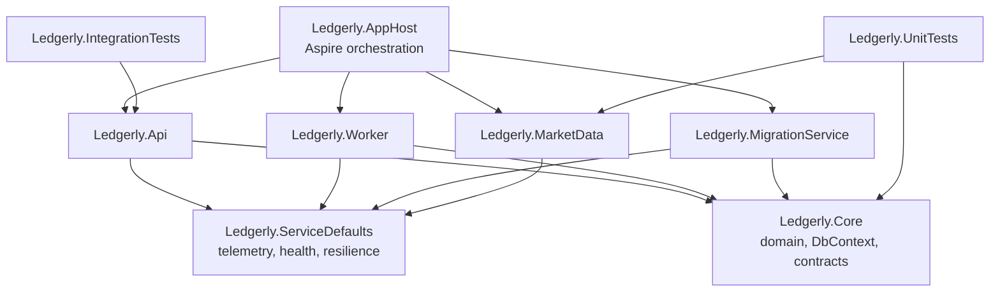
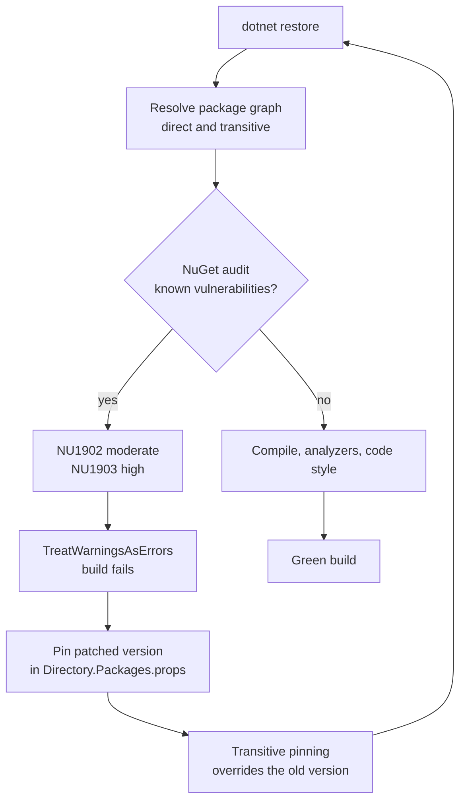
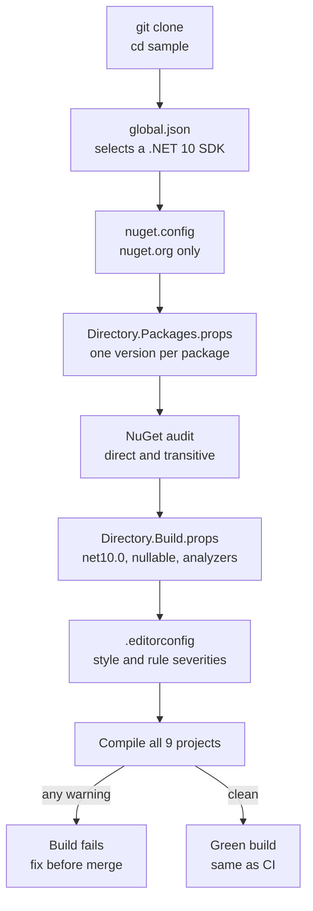

# Chapter 3: A solution set up like a pro

> ⏱ About 30 min · You'll learn: how Ledgerly's repo-wide files (`Ledgerly.slnx`, `Directory.Build.props`, `Directory.Packages.props`, `global.json`, `nuget.config`, `.editorconfig`, local tools) make a fresh clone build the same way everywhere, and why a vulnerable package you never referenced can fail the build.

---

## 📖 Story: "Clone it and build it, or it's broken"

On your second day, Tomás hands you a brand-new laptop that has nothing on it but the .NET 10 SDK, Git and Docker. "Ledgerly has one rule," he says. "Clone it and build it on a fresh laptop in one command, or it's broken. No wiki page with twelve setup steps. No 'works on my machine.' If you need a step, it goes in the repo."

You think of Nordbank. The build server had a hand-installed SDK nobody dared to upgrade. Each project had its own `packages.config` with slightly different versions of Newtonsoft.Json. The analyzers were "on" in one project and silently off in the others. Getting a new developer productive took two days and a senior engineer.

You clone, `cd sample`, run `dotnet build Ledgerly.slnx`, and it's green. Then Tomás tells you about the morning it wasn't: nobody had touched a single package, and the build went red with `NU1903`. A package Ledgerly never referenced directly had a known high-severity vulnerability. "That's the setup working," he says. "I'd rather the build tell me than an auditor." You write in your habits notebook: *Build settings are code. They live in the repo, and they fail loudly.*

---

## 🏚️ Old way → 🚀 New way

| What you did before | What you do now | Why it changed |
|---|---|---|
| A `.sln` file full of GUIDs that merges badly | `Ledgerly.slnx`: short, readable XML | Starting with .NET 10, `slnx` is the default format 🔧, and diffs make sense |
| The same settings copy-pasted into every `.csproj` | One `Directory.Build.props` at the root | Every project inherits nullable, analyzers and warnings as errors, and none can drift |
| `packages.config` or versions in every project file | Central Package Management in `Directory.Packages.props` | One version per package for the whole solution, upgraded in one place |
| Whatever SDK the build server happened to have | `global.json` pins the SDK band | Your laptop, CI and teammates use the same compiler |
| Machine-wide NuGet feeds nobody remembers adding | `nuget.config` with `<clear />` and package source mapping | Restores only from the sources the repo names, which blocks dependency confusion |
| Style rules in a wiki, enforced in code review | `.editorconfig` plus analyzers that run on build | The build rejects style violations, so reviews talk about design |
| "Install dotnet-ef globally, version whatever" | `.config/dotnet-tools.json` and `dotnet tool restore` | Tool versions are pinned in git like packages |
| Security scans once a quarter | NuGet audit on every restore, with warnings as errors | A vulnerable transitive package fails the build the day it's disclosed |

> 💡 A pro setup isn't about clever MSBuild. It's about making the right thing the default, so nobody has to remember it.

---

## 🧠 The solution layout and `.slnx`

Ledgerly has nine projects. The layout is deliberately boring: `src/` for things that ship, `tests/` for things that verify them, and a handful of repo-wide files at the root.

```text
sample/
├── Ledgerly.slnx
├── Directory.Build.props        compiler and quality settings for every project
├── Directory.Packages.props     every NuGet version, in one place
├── global.json                  SDK pin and test runner
├── nuget.config                 package sources
├── .editorconfig                code style and analyzer severities
├── .config/dotnet-tools.json    local tools (dotnet-ef)
├── src/
│   ├── Ledgerly.AppHost/            Aspire orchestration (chapter 6)
│   ├── Ledgerly.ServiceDefaults/    telemetry, health, resilience
│   ├── Ledgerly.Core/               domain, DbContext, migrations, contracts
│   ├── Ledgerly.Api/                minimal API (chapter 4)
│   ├── Ledgerly.Worker/             background processing (chapter 7)
│   ├── Ledgerly.MarketData/         fake price service
│   └── Ledgerly.MigrationService/   runs migrations, then exits (chapter 5)
└── tests/
    ├── Ledgerly.UnitTests/
    └── Ledgerly.IntegrationTests/
```

### 💻 In Ledgerly: the whole solution file

📄 [`sample/Ledgerly.slnx`](https://github.com/vygantas-meskauskis/cloud-native-dotnet/blob/main/sample/Ledgerly.slnx)
```xml
<Solution>
  <Folder Name="/src/">
    <Project Path="src/Ledgerly.AppHost/Ledgerly.AppHost.csproj" />
    <Project Path="src/Ledgerly.ServiceDefaults/Ledgerly.ServiceDefaults.csproj" />
    <Project Path="src/Ledgerly.Core/Ledgerly.Core.csproj" />
    <Project Path="src/Ledgerly.Api/Ledgerly.Api.csproj" />
    <Project Path="src/Ledgerly.Worker/Ledgerly.Worker.csproj" />
    <Project Path="src/Ledgerly.MarketData/Ledgerly.MarketData.csproj" />
    <Project Path="src/Ledgerly.MigrationService/Ledgerly.MigrationService.csproj" />
  </Folder>
  <Folder Name="/tests/">
    <Project Path="tests/Ledgerly.UnitTests/Ledgerly.UnitTests.csproj" />
    <Project Path="tests/Ledgerly.IntegrationTests/Ledgerly.IntegrationTests.csproj" />
  </Folder>
  <Folder Name="/Solution Items/">
    <File Path=".editorconfig" />
    <File Path="Directory.Build.props" />
    <File Path="Directory.Packages.props" />
    <File Path="global.json" />
    <File Path="nuget.config" />
  </Folder>
</Solution>
```

That's the entire file. No project-type GUIDs, no per-configuration platform matrix, no `GlobalSection` blocks. When two people add a project on the same day, Git can merge it. `dotnet new sln` creates `.slnx` by default from .NET 10 🔧, and Visual Studio 2026 opens it ([SDK what's new](https://learn.microsoft.com/en-us/dotnet/core/whats-new/dotnet-10/sdk)). To convert an existing `.sln`, the SDK has a `dotnet sln migrate` command 🔧 (check the docs for the exact syntax on your SDK).

### Project references: who may depend on whom

The layout also encodes the architecture. `Ledgerly.Core` has no web dependencies, so the API, the worker and the migration runner can all share the domain model and the `DbContext`.



| Rule the graph enforces | Why it matters |
|---|---|
| Nothing references `Ledgerly.Api` except the AppHost and the integration tests | The API is an edge, not a library. Shared logic goes to `Core` |
| `Ledgerly.MarketData` doesn't reference `Core` | It plays an external vendor, so it may share nothing but HTTP |
| Every service references `ServiceDefaults` | Telemetry, health checks and resilience are identical everywhere (chapter 6) |

> 💡 A project reference is an architectural decision. If a new arrow in this graph surprises you, it should surprise the reviewer too.

---

## 🧠 `Directory.Build.props`: one place for compiler and quality settings

MSBuild automatically imports `Directory.Build.props` from the project folder upward, and the first one it finds wins ([docs](https://learn.microsoft.com/en-us/visualstudio/msbuild/customize-by-directory)). Put one at the solution root and every project gets its settings. You never see `<Nullable>` or `<TargetFramework>` in a Ledgerly `.csproj`.

### 💻 In Ledgerly: the quality gates

📄 [`sample/Directory.Build.props`](https://github.com/vygantas-meskauskis/cloud-native-dotnet/blob/main/sample/Directory.Build.props)
```xml
<Project>
  <!-- Applies to every project under this folder. One place for compiler and quality settings. -->
  <PropertyGroup>
    <TargetFramework>net10.0</TargetFramework>
    <LangVersion>latest</LangVersion>
    <Nullable>enable</Nullable>
    <ImplicitUsings>enable</ImplicitUsings>

    <!-- Quality gates: warnings fail the build, analyzers and code style run in every build (also in CI). -->
    <TreatWarningsAsErrors>true</TreatWarningsAsErrors>
    <AnalysisLevel>latest-recommended</AnalysisLevel>
    <EnforceCodeStyleInBuild>true</EnforceCodeStyleInBuild>
    <!-- Needed so IDE0005 (unused usings) runs on build. CS1591 = "missing XML comment", not wanted for apps. -->
    <GenerateDocumentationFile>true</GenerateDocumentationFile>
    <NoWarn>$(NoWarn);CS1591</NoWarn>

    <!-- Reproducible, CI-friendly builds. -->
    <Deterministic>true</Deterministic>
    <ContinuousIntegrationBuild Condition="'$(GITHUB_ACTIONS)' == 'true'">true</ContinuousIntegrationBuild>
    <RestorePackagesWithLockFile>false</RestorePackagesWithLockFile>
  </PropertyGroup>
</Project>
```

| Setting | What it does | Old-world equivalent |
|---|---|---|
| `TargetFramework` `net10.0` | Every project targets .NET 10 LTS | A different `TargetFrameworkVersion` in each project |
| `Nullable` `enable` | Nullable reference types everywhere (chapter 2) | Null checks by hand |
| `ImplicitUsings` `enable` | Common namespaces are imported globally | 15 `using` lines per file |
| `TreatWarningsAsErrors` | Every warning, including analyzer and NuGet audit warnings, fails the build | A warnings list that grew to 400 and was ignored |
| `AnalysisLevel` `latest-recommended` | Turns on the recommended set of .NET analyzer rules for the latest SDK | FxCop, if someone remembered to install it |
| `EnforceCodeStyleInBuild` | Runs the IDE code-style rules (`IDExxxx`) during `dotnet build`, not just in the editor | Style rules that only showed up as squiggles |
| `GenerateDocumentationFile` | Produces the XML doc file. Also required for IDE0005 to run on build | Nothing |
| `ContinuousIntegrationBuild` | Normalizes paths in builds on GitHub Actions | Build-server-specific hacks |

Analyzers ship with the SDK and are on by default for .NET 5 and later, but only a few rules are warnings out of the box ([docs](https://learn.microsoft.com/en-us/dotnet/fundamentals/code-analysis/overview)). `latest-recommended` raises a curated set to warnings, and `TreatWarningsAsErrors` turns those into errors. If you ever need CA rules to warn without blocking, `CodeAnalysisTreatWarningsAsErrors=false` exempts them. Ledgerly doesn't use it.

### The IDE0005 lesson

When the team first set this up, the `.editorconfig` said unused usings (IDE0005) should be a warning. In the editor, they were. On `dotnet build`, nothing happened. The rule depends on information the compiler only produces when it generates the XML documentation file, so IDE0005 only runs on build with `GenerateDocumentationFile=true`.

Turning that on fixed IDE0005 and broke everything else: now every public type without an XML comment raised **CS1591**, "missing XML comment", and with warnings as errors, that's an error. Ledgerly is an app, not a library, so the fix was `<NoWarn>$(NoWarn);CS1591</NoWarn>`. The comment in the file records why, so the next person doesn't "clean it up."

> 💡 Every line in `Directory.Build.props` that isn't obvious gets a comment. Build settings are code that people will be tempted to delete.

---

## 🧠 Central Package Management, transitive pinning and NuGet audit

With **Central Package Management** (CPM), `Directory.Packages.props` holds every package version, and project files only name the package ([docs](https://learn.microsoft.com/en-us/nuget/consume-packages/central-package-management)). Upgrading EF Core is now a one-line change, and two projects can't end up on different versions by accident.

### 💻 In Ledgerly: one file for every version

📄 [`sample/Directory.Packages.props`](https://github.com/vygantas-meskauskis/cloud-native-dotnet/blob/main/sample/Directory.Packages.props)
```xml
<Project>
  <!-- Central Package Management: every NuGet version lives here, projects only name the package. -->
  <PropertyGroup>
    <ManagePackageVersionsCentrally>true</ManagePackageVersionsCentrally>
    <!-- Lets a PackageVersion below also override a TRANSITIVE dependency (used for security patches). -->
    <CentralPackageTransitivePinningEnabled>true</CentralPackageTransitivePinningEnabled>
  </PropertyGroup>

  <ItemGroup Label="Security pins for transitive dependencies (NuGet audit, NU1902/NU1903)">
    <PackageVersion Include="System.Security.Cryptography.Pkcs" Version="10.0.14" />
  </ItemGroup>
  <!-- ... -->
  <ItemGroup Label="ASP.NET Core and EF Core">
    <PackageVersion Include="Microsoft.AspNetCore.Authentication.JwtBearer" Version="10.0.14" />
    <PackageVersion Include="Microsoft.AspNetCore.OpenApi" Version="10.0.14" />
    <PackageVersion Include="Microsoft.EntityFrameworkCore.SqlServer" Version="10.0.14" />
    <PackageVersion Include="Microsoft.EntityFrameworkCore.Design" Version="10.0.14" />
    <!-- ... -->
  </ItemGroup>
  <!-- ... -->
</Project>
```

And the project side, with no versions at all:

📄 [`sample/src/Ledgerly.Core/Ledgerly.Core.csproj`](https://github.com/vygantas-meskauskis/cloud-native-dotnet/blob/main/sample/src/Ledgerly.Core/Ledgerly.Core.csproj)
```xml
  <ItemGroup>
    <PackageReference Include="Microsoft.EntityFrameworkCore.SqlServer" />
    <PackageReference Include="Microsoft.EntityFrameworkCore.Design" PrivateAssets="all" />
  </ItemGroup>
```

`PrivateAssets="all"` keeps the EF design-time package (used by `dotnet ef`) from flowing to projects that reference `Core`. The `ItemGroup` labels group packages by purpose, which makes upgrade pull requests easier to review: everything Aspire moves together, and everything ASP.NET Core and EF Core moves together.

Two CPM features Ledgerly doesn't need, but you should know exist:

```xml
<!-- illustrative, not in the sample -->
<!-- In one .csproj: an approved exception to the central version -->
<PackageReference Include="Some.Package" VersionOverride="2.0.0" />

<!-- In Directory.Packages.props: added to every project, e.g. an analyzer package -->
<GlobalPackageReference Include="Some.Analyzers" Version="1.0.0" />
```

Only the **nearest** `Directory.Packages.props` applies to a project. If you nest one deeper in the tree, it replaces the root one for that subtree instead of adding to it.

### The day NuGet audit failed the build

Here is what Tomás meant. During restore, NuGet checks your packages, including **transitive** ones (the packages your packages depend on), against known vulnerabilities and reports them as warnings. One morning a transitive dependency, `System.Security.Cryptography.Pkcs` (versions 9.0.11 and 10.0.12 were in the graph), was flagged: **NU1902** (moderate) and **NU1903** (high). With `TreatWarningsAsErrors`, the build failed.

Nobody at Ledgerly had referenced that package. It came in underneath other packages. Without CPM, the usual fix is to add a direct `PackageReference` to a patched version in every affected project, and to remember to remove it later. With CPM, `CentralPackageTransitivePinningEnabled` lets a `PackageVersion` entry override a transitive dependency too. One line in `Directory.Packages.props`, under a label that says why it's there, and the whole graph moves to the patched version.



| Without the setup | With the setup |
|---|---|
| The vulnerable package ships, and an auditor or attacker finds it months later | The first build after disclosure fails, with the package name and advisory |
| The fix is a direct reference copied into several projects | The fix is one pinned line, labeled with its reason |
| Nobody remembers why that odd reference is there | The `ItemGroup` label documents it, and Dependabot proposes upgrades later (chapter 9) |

🔧 NuGet audit has settings for severity levels and audit modes. Ledgerly uses the defaults, and this course doesn't depend on any specific value. Check the docs before you tune them. To see what audit sees, list vulnerable packages yourself (the command is in Try it).

> 💡 A red build caused by a vulnerability is a feature. Pin the fix centrally, label it, and let your dependency bot remove the pin when upstream catches up.

---

## 🧠 `global.json` and `nuget.config`: same SDK, same sources

### Pinning the SDK

📄 [`sample/global.json`](https://github.com/vygantas-meskauskis/cloud-native-dotnet/blob/main/sample/global.json)
```json
{
  "sdk": {
    "version": "10.0.100",
    "rollForward": "latestFeature"
  },
  "test": {
    "runner": "Microsoft.Testing.Platform"
  }
}
```

`version` sets the minimum SDK and `rollForward` decides how far the CLI may move from it ([docs](https://learn.microsoft.com/en-us/dotnet/core/tools/global-json)). `latestFeature` means "any .NET 10 SDK at or above 10.0.100, preferring the newest installed feature band." That's a pragmatic middle: everyone builds with .NET 10, but you don't have to install one exact patch to work.

| `rollForward` value | Behavior in short | When to use it |
|---|---|---|
| `latestFeature` | Newest installed feature band and patch of the same major and minor | Ledgerly's choice for app repos |
| `latestPatch` | Same feature band, newest patch | You want tighter control and install SDKs deliberately |
| `disable` | Exactly the version in the file | Rarely: reproducing a specific compiler bug |
| `latestMajor` | Whatever newest SDK is installed | Almost never in a team repo |

The `test` section is new in the .NET 10 SDK. It switches `dotnet test` to **Microsoft.Testing.Platform**, which xUnit v3 test projects need. Without it, `dotnet test` on the .NET 10 SDK failed with "Testing with VSTest target is no longer supported by Microsoft.Testing.Platform on .NET 10 SDK." Chapter 17 tells that story in full.

CI uses the same file: the `actions/setup-dotnet` step reads `sample/global.json` through its `global-json-file` input, so the build server can't drift from your laptop (chapter 8).

### Locking down package sources

📄 [`sample/nuget.config`](https://github.com/vygantas-meskauskis/cloud-native-dotnet/blob/main/sample/nuget.config)
```xml
<?xml version="1.0" encoding="utf-8"?>
<configuration>
  <!-- Only nuget.org, no machine-wide feeds leaking in. Package source mapping blocks dependency-confusion attacks. -->
  <packageSources>
    <clear />
    <add key="nuget.org" value="https://api.nuget.org/v3/index.json" />
  </packageSources>
  <packageSourceMapping>
    <packageSource key="nuget.org">
      <package pattern="*" />
    </packageSource>
  </packageSourceMapping>
</configuration>
```

Jonas from security cares about this file more than any other in the repo:

- **`<clear />`** throws away every feed inherited from user-level or machine-level NuGet config. On a laptop that once had a corporate feed configured, restore results no longer depend on that history.
- **Package source mapping** says which source each package ID may come from. Here it's simple, everything from nuget.org. The value shows up the day you add a private feed: map your internal prefix (say, `Ledgerly.*`) to the private feed, and an attacker who publishes a package with the same name on a public feed can't sneak in. That attack is called *dependency confusion*.

> 💡 `global.json` decides *which compiler* builds your code, and `nuget.config` decides *where the code you didn't write* comes from. Both belong in git.

---

## 🧠 Style, analyzers and local tools

### `.editorconfig`: decisions, not opinions

The `.editorconfig` at the root sets formatting, naming and analyzer severities for every file. Because `EnforceCodeStyleInBuild` is on, rules set to `warning` are checked during build, and with warnings as errors, they block it.

📄 [`sample/.editorconfig`](https://github.com/vygantas-meskauskis/cloud-native-dotnet/blob/main/sample/.editorconfig)
```ini
[*.cs]
# Namespaces and usings
csharp_style_namespace_declarations = file_scoped:warning
dotnet_sort_system_directives_first = true

# Prefer modern syntax
csharp_style_var_for_built_in_types = true:suggestion
csharp_style_var_when_type_is_apparent = true:suggestion
csharp_prefer_simple_using_statement = true:suggestion
csharp_style_prefer_primary_constructors = true:suggestion
dotnet_style_prefer_collection_expression = when_types_loosely_match:suggestion
# ...
# Analyzer tuning (each line is a deliberate team decision)
dotnet_diagnostic.CA1848.severity = suggestion   # LoggerMessage delegates: we use [LoggerMessage] where it matters
dotnet_diagnostic.CA1515.severity = none         # 'make types internal' is noisy for app code
dotnet_diagnostic.CA1062.severity = none         # nullable reference types already cover argument null checks
dotnet_diagnostic.CA2007.severity = none         # ConfigureAwait(false) is not needed in ASP.NET Core apps
dotnet_diagnostic.CA1716.severity = none
dotnet_diagnostic.IDE0005.severity = warning     # remove unnecessary usings

[**/Migrations/*.cs]
generated_code = true
dotnet_diagnostic.IDE0005.severity = none

[tests/**.cs]
dotnet_diagnostic.CA1707.severity = none         # underscores in test method names are fine
dotnet_diagnostic.CA2000.severity = none
```

Notice the pattern. Each rule that's turned off has a reason in a comment, so turning a rule off is a reviewed team decision, not a quiet `#pragma`. Generated code (EF migrations) is marked as generated, so it doesn't fight the style rules. Tests get their own section, because `Stale_version_gets_409_conflict` is a better test name than `StaleVersionGets409Conflict`.

| Severity | Effect in the editor | Effect on `dotnet build` here |
|---|---|---|
| `none` | Hidden | Nothing |
| `suggestion` | Dots under the code, with a quick fix | Nothing |
| `warning` | Green squiggle | Error, because of `TreatWarningsAsErrors` |
| `error` | Red squiggle | Error |

Suggestions are the gentle nudge for modern syntax (primary constructors, collection expressions). Warnings are the rules the team agreed are non-negotiable.

### `dotnet format`

`dotnet format` applies `.editorconfig` style and analyzer fixes to the code, and `dotnet format --verify-no-changes` fails if anything would change ([docs](https://learn.microsoft.com/en-us/dotnet/core/tools/dotnet-format)). Ledgerly's CI doesn't run it as a separate step, because `EnforceCodeStyleInBuild` already fails the build on the rules that matter. Run it locally to fix a batch of style issues in one go.

### Local tools: pinned like packages

`dotnet ef` is a .NET tool. Installing it globally means every developer has a different version, and some have none. A **tool manifest** pins it in the repo.

📄 [`sample/.config/dotnet-tools.json`](https://github.com/vygantas-meskauskis/cloud-native-dotnet/blob/main/sample/.config/dotnet-tools.json)
```json
{
  "version": 1,
  "isRoot": true,
  "tools": {
    "dotnet-ef": {
      "version": "10.0.14",
      "commands": [
        "dotnet-ef"
      ],
      "rollForward": false
    }
  }
}
```

`dotnet tool restore` installs exactly these versions for this repo, and `dotnet ef` then works inside `sample/`. The tool version matches the EF Core package version in `Directory.Packages.props` (10.0.14 🔧), which avoids "tools version is older than runtime" warnings. Keep them in sync when you upgrade.

For a one-off tool you don't want in the manifest, the .NET 10 SDK can run a tool without installing it: `dnx <tool>` or `dotnet tool exec` 🔧, for example `dnx dotnet-counters` when you need runtime counters once.

> 💡 If a command is part of the workflow, its tool belongs in the manifest. If it's a one-off, use `dnx` and leave no trace.

---

## 🗺️ A fresh clone, end to end

This is Tomás's "one command" rule as a flow. Every box is driven by a file in the repo, not by the machine.



The CI workflow runs exactly the same steps. Its comment says it plainly: "Warnings are errors, analyzers + code style run, NuGet audit fails on vulnerable packages." There is no separate "CI configuration" for quality, which is why a green build on your laptop predicts a green build in CI (chapter 8).

---

## ⚠️ Common traps

| Trap | What happens | Do this instead |
|---|---|---|
| Adding `Version="..."` to a `PackageReference` in a project | With CPM on, restore reports an error instead of quietly using two versions | Add or change the `PackageVersion` in `Directory.Packages.props`. Use `VersionOverride` only for a reviewed exception |
| Fixing a vulnerable transitive package with direct references in each project | Pins scatter, nobody removes them, and versions drift | Use `CentralPackageTransitivePinningEnabled` and one labeled pin |
| Setting `IDE0005` to warning and expecting the build to enforce it | It only shows in the editor | Turn on `GenerateDocumentationFile` (and suppress CS1591 for apps) |
| Silencing a rule with `#pragma warning disable` in code | The decision is invisible and spreads by copy-paste | Change severity in `.editorconfig` with a comment, or fix the code. Keep `#pragma` for narrow, commented cases (the migrator's raw SQL is one) |
| Nesting a second `Directory.Packages.props` or `Directory.Build.props` | The nearest one wins, and the root settings silently stop applying to that subtree | Keep one of each at the root, or import the parent explicitly |
| Installing `dotnet-ef` globally | Version mismatches between developers and CI | Use the tool manifest and `dotnet tool restore` |
| A `nuget.config` without `<clear />` | Machine-level feeds join the restore, and results differ per laptop | `<clear />`, then list exactly the sources you need, with source mapping |

---

## 🧰 Helpers

**A starter `Directory.Build.props` for a new app repo:**

```xml
<!-- illustrative, not in the sample -->
<Project>
  <PropertyGroup>
    <TargetFramework>net10.0</TargetFramework>
    <Nullable>enable</Nullable>
    <ImplicitUsings>enable</ImplicitUsings>
    <TreatWarningsAsErrors>true</TreatWarningsAsErrors>
    <AnalysisLevel>latest-recommended</AnalysisLevel>
    <EnforceCodeStyleInBuild>true</EnforceCodeStyleInBuild>
    <GenerateDocumentationFile>true</GenerateDocumentationFile>
    <NoWarn>$(NoWarn);CS1591</NoWarn>
  </PropertyGroup>
</Project>
```

**Commands you'll use for repo hygiene** (run from `sample/`):

| Task | Command |
|---|---|
| Which SDK does this folder use? | `dotnet --version` |
| Build everything with all gates | `dotnet build Ledgerly.slnx` |
| Restore pinned local tools | `dotnet tool restore` |
| Show vulnerable packages, including transitive | `dotnet list package --vulnerable --include-transitive` |
| Fix style issues in bulk | `dotnet format` |
| Check style without changing files | `dotnet format --verify-no-changes` |

**Checklist for a new repo:**

- [ ] `.slnx` solution, `src/` and `tests/` folders
- [ ] `Directory.Build.props` with nullable, analyzers, code style in build, warnings as errors
- [ ] `Directory.Packages.props` with CPM and transitive pinning enabled
- [ ] `global.json` with an SDK version and `rollForward`
- [ ] `nuget.config` with `<clear />` and package source mapping
- [ ] `.editorconfig` with commented severity decisions
- [ ] `.config/dotnet-tools.json` for every tool the workflow needs
- [ ] CI runs the same `dotnet build` you run locally

**Make it permanent:** copy these files from `sample/` into your next repo on day one, before the first feature, because tightening rules later means fixing hundreds of warnings at once. Add a Dependabot config (chapter 9) so pinned versions don't rot. The toolkit has ready-to-copy `Directory.Build.props`, `Directory.Packages.props`, `.editorconfig` and `dependabot.yml` files, and `cheat-sheet-old-to-new.md` repeats the command table (see [the toolkit](../toolkit/README.md)). Terms like *CPM* and *transitive dependency* are in the [glossary](../GLOSSARY.md).

---

## 🧪 Try it yourself (optional, ~20 min)

1. Check which SDK the repo selects, and build:
   ```bash
   cd sample
   dotnet --version
   dotnet build Ledgerly.slnx
   ```
   The version should be a 10.0 SDK at or above 10.0.100, and the build should end with 0 warnings and 0 errors.
2. Watch a quality gate work. Open `src/Ledgerly.Core/Domain/Holdings.cs` and add an unused `using System.Text;` below the namespace line. Build again:
   ```bash
   dotnet build Ledgerly.slnx
   ```
   You should get `error IDE0005` (unnecessary using). It's a warning in `.editorconfig`, and warnings are errors here. Remove the line.
3. Restore the pinned tools and check the EF tool version:
   ```bash
   dotnet tool restore
   dotnet ef --version
   ```
   It should report 10.0.14, the version in `.config/dotnet-tools.json`.
4. See what NuGet audit sees:
   ```bash
   dotnet list package --vulnerable --include-transitive
   ```
   With the Pkcs pin in place, you should see no vulnerable packages, unless something new was disclosed since this was written 🔧. If something shows up, you know what to do.
5. Open `Ledgerly.slnx` and an old `.sln` from one of your own projects side by side. Count the lines. Write the difference in your habits notebook.

---

## ✅ Recap

1. Repo-wide files (`Directory.Build.props`, `Directory.Packages.props`, `global.json`, `nuget.config`, `.editorconfig`, the tool manifest) make every clone build the same way on any machine and in CI.
2. Warnings as errors plus `latest-recommended` analyzers and code style in build turn team agreements into rules the compiler enforces, with every exception commented.
3. CPM with transitive pinning lets NuGet audit fail the build on a vulnerable package you never referenced, and lets you fix it with one labeled line.

**Next → [Chapter 4: Designing the API](04-designing-the-api.md)**
