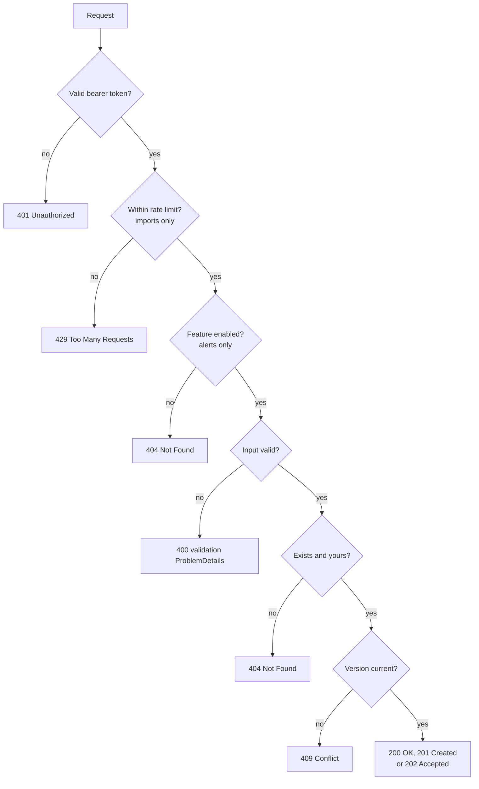
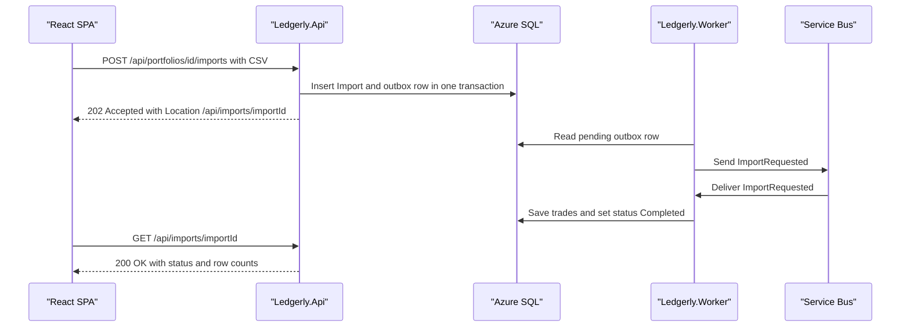

# Chapter 4: Designing the API

> ⏱ About 35 min · You'll learn: how to build a clear HTTP contract with minimal APIs, route groups and `TypedResults`, how validation, ProblemDetails and OpenAPI 3.1 come almost for free in ASP.NET Core 10, and how CORS, rate limiting, concurrency, async imports and feature flags each map to a status code the frontend can rely on.

---

## 📖 Story: Leo needs a contract

Leo, the frontend developer, sits down next to you with a coffee and a list. "I'm starting the React app next sprint. I don't need your code. I need a contract. What are the URLs? What do I send? What comes back when it works, and, more important, what comes back when it doesn't? If one endpoint returns `{ error: "..." }`, another returns plain text and a third returns an HTML error page, I'll write three error handlers and hate you."

At Nordbank, your contract was a Word document with screenshots, and it was out of date the week after it was written. Errors were whatever the controller happened to throw. Leo wants something different: a machine-readable document generated from the code, one error format for everything, and status codes that mean the same thing on every endpoint.

You open your habits notebook and write: *The API is a product. Its users are developers, and status codes are part of the UI.* Maya adds one rule before you start: "Every response the client can get must be visible in the handler's signature. If it isn't in the type, it doesn't exist."

---

## 🏚️ Old way → 🚀 New way

| What you did before | What you do now | Why it changed |
|---|---|---|
| Web API controllers with attribute routing, one class per resource | Minimal APIs: route groups and static handler methods | Less ceremony, and shared prefixes, tags and policies are set once per group |
| `IHttpActionResult` and `return Ok(x)` with no compile-time contract | `TypedResults` and `Results<Ok<T>, NotFound, ...>` | The possible responses are in the method signature, so OpenAPI and tests can see them |
| `if (!ModelState.IsValid)` in every action | `AddValidation()` with DataAnnotations on records | One registration validates every handler's input and returns a standard 400 |
| Custom error JSON per team, or HTML error pages | ProblemDetails (`application/problem+json`, RFC 9457) everywhere | One error shape for every failure, including unhandled exceptions |
| A Word document or Swashbuckle bolted on | Built-in OpenAPI 3.1 at `/openapi/v1.json`, Scalar as a dev UI | The contract is generated from the code, so it can't drift |
| No protection against a client hammering one endpoint | Built-in rate limiting with per-user partitions and 429 | Expensive endpoints stay usable for everyone |
| "Last write wins" on updates | Optimistic concurrency with a version and 409 Conflict | Two users editing the same thing can't silently overwrite each other |
| Long uploads processed inside the request | 202 Accepted plus a status URL, work done by the worker | Requests stay fast, and the heavy work survives a restart |

> 💡 A good API contract is mostly about the unhappy paths. The happy path is easy to agree on.

---

## 🧠 Minimal APIs, route groups and typed results

Minimal APIs map a route straight to a method. There's no controller base class and no attribute routing. What you lose in convention you gain in clarity: every endpoint and every policy on it is visible in one place ([docs](https://learn.microsoft.com/en-us/aspnet/core/fundamentals/minimal-apis)).

A **route group** applies a prefix, OpenAPI tags, authorization and filters to every endpoint in it. Ledgerly keeps each group in its own file, as an extension method that `Program.cs` calls.

### 💻 In Ledgerly: the portfolio routes

📄 [`sample/src/Ledgerly.Api/Endpoints/PortfolioEndpoints.cs`](https://github.com/vygantas-meskauskis/cloud-native-dotnet/blob/main/sample/src/Ledgerly.Api/Endpoints/PortfolioEndpoints.cs)
```csharp
public static class PortfolioEndpoints
{
    public static IEndpointRouteBuilder MapPortfolioEndpoints(this IEndpointRouteBuilder app)
    {
        var group = app.MapGroup("/api/portfolios")
            .WithTags("Portfolios")
            .RequireAuthorization();

        group.MapGet("/", ListPortfolios);
        group.MapPost("/", CreatePortfolio);
        group.MapGet("/{id:guid}", GetPortfolio).WithName("GetPortfolio");
        group.MapPut("/{id:guid}", RenamePortfolio);
        group.MapPost("/{id:guid}/transactions", RecordTransaction);
        group.MapGet("/{id:guid}/valuation", GetValuation);

        return app;
    }
    // ...
}
```

You can read the whole resource from this block, like a table of contents. `RequireAuthorization()` on the group means no endpoint in it can be forgotten. `{id:guid}` is a route constraint: `/api/portfolios/abc` doesn't match, so it returns 404 without reaching your code.

Handlers are plain static methods. Parameters are bound by type and source: route values, the JSON body, `ClaimsPrincipal` for the user, services from DI and the request's `CancellationToken`.

```csharp
    private static async Task<Results<Ok<PortfolioDetails>, NotFound>> GetPortfolio(
        Guid id, ClaimsPrincipal user, LedgerlyDbContext db, CancellationToken ct)
    {
        var ownerId = user.GetOwnerId();
        var portfolio = await db.Portfolios.AsNoTracking()
            .Include(p => p.Transactions)
            .SingleOrDefaultAsync(p => p.Id == id && p.OwnerId == ownerId, ct);

        if (portfolio is null)
        {
            return TypedResults.NotFound();
        }
        // ...
    }
```

### Why `Results<...>` matters

The return type `Results<Ok<PortfolioDetails>, NotFound>` is Maya's rule in code. The compiler only allows those two outcomes, OpenAPI documents both automatically, and a unit test can assert on the result type without an HTTP server. Compare it with the old `IHttpActionResult`, which could be anything at all.

| Return type | Meaning for Leo |
|---|---|
| `Ok<PortfolioSummary[]>` | Always 200 with an array |
| `CreatedAtRoute<PortfolioSummary>` | 201 with a `Location` header pointing at `GetPortfolio` |
| `Results<Ok<PortfolioDetails>, NotFound>` | 200, or 404 if it doesn't exist **or isn't yours** |
| `Results<Ok<PortfolioSummary>, NotFound, ProblemHttpResult>` | 200, 404, or a ProblemDetails error (409 here) |
| `Results<Created<TransactionResponse>, NotFound, ValidationProblem, ProblemHttpResult>` | 201, 404, 400 with field errors, or 409 |

Notice the ownership check: `p.Id == id && p.OwnerId == ownerId`. Another user's portfolio returns **404, not 403**, so the API doesn't even confirm that the ID exists. An integration test (`Users_cannot_see_each_others_portfolios`) guards this.

The owner ID comes from the token, through one small extension method:

📄 [`sample/src/Ledgerly.Api/ApiConventions.cs`](https://github.com/vygantas-meskauskis/cloud-native-dotnet/blob/main/sample/src/Ledgerly.Api/ApiConventions.cs)
```csharp
    /// <summary>
    /// Stable user id. Entra ID puts the object id in "oid"; dev tokens from `dotnet user-jwts` use "sub"
    /// (mapped to NameIdentifier by the JWT handler).
    /// </summary>
    public static string GetOwnerId(this ClaimsPrincipal user) =>
        user.FindFirstValue("oid")
        ?? user.FindFirstValue("http://schemas.microsoft.com/identity/claims/objectidentifier")
        ?? user.FindFirstValue(ClaimTypes.NameIdentifier)
        ?? user.FindFirstValue("sub")
        ?? throw new InvalidOperationException("Authenticated user has no id claim.");
```

The same code works with local dev tokens and with Entra ID tokens in Azure. Chapter 13 covers the identity side.

> 💡 If a status code isn't in the handler's return type, the client should never see it, except for the cross-cutting ones (401, 429, 500) that middleware owns.

---

## 🧠 Validation and ProblemDetails: one error shape for everything

### Validation with `AddValidation()`

In ASP.NET Core 10, one line turns on validation for minimal APIs: `builder.Services.AddValidation()`. A source generator finds the types your handlers take, validates DataAnnotations attributes (and `IValidatableObject`), and returns **400** with a validation ProblemDetails when something fails. Records are supported, and you can opt an endpoint out with `.DisableValidation()` ([release notes](https://learn.microsoft.com/en-us/aspnet/core/release-notes/aspnetcore-10.0)). The validation APIs now live in the `Microsoft.Extensions.Validation` namespace, so you can reuse them outside ASP.NET Core.

### 💻 In Ledgerly: requests are records with attributes

📄 [`sample/src/Ledgerly.Api/Endpoints/PortfolioEndpoints.cs`](https://github.com/vygantas-meskauskis/cloud-native-dotnet/blob/main/sample/src/Ledgerly.Api/Endpoints/PortfolioEndpoints.cs)
```csharp
public sealed record CreatePortfolioRequest(
    [Required, StringLength(100, MinimumLength = 1)] string Name,
    [RegularExpression("^[A-Z]{3}$")] string? BaseCurrency);

public sealed record RenamePortfolioRequest(
    [Required, StringLength(100, MinimumLength = 1)] string Name,
    [Required] string Version);
// ...
public sealed record RecordTransactionRequest(
    [Required, StringLength(12, MinimumLength = 1)] string Symbol,
    TransactionType Type,
    [Range(typeof(decimal), "0.000001", "1000000000")] decimal Quantity,
    [Range(typeof(decimal), "0.000001", "1000000000")] decimal Price,
    DateOnly TradeDate);
```

The handler never sees an invalid `CreatePortfolioRequest`. There's no `ModelState` check, because validation runs before the handler.

Attribute validation covers the *shape* of input. Business rules still live in the domain. "You cannot sell what you do not hold" needs the portfolio's history, so `RecordTransaction` checks it and returns the **same 400 format** by hand:

```csharp
        try
        {
            // Domain rule: you cannot sell what you do not hold (at that date).
            HoldingCalculator.Calculate([.. portfolio.Transactions, transaction]);
        }
        catch (HoldingsException ex)
        {
            return TypedResults.ValidationProblem(new Dictionary<string, string[]> { ["quantity"] = [ex.Message] });
        }
```

For Leo, both kinds of failure look identical: a 400 with an `errors` object keyed by field name. He writes one function that shows field errors next to inputs.

### ProblemDetails for every other error

Three registrations in `Program.cs` give you RFC 9457 `application/problem+json` responses everywhere ([docs](https://learn.microsoft.com/en-us/aspnet/core/fundamentals/error-handling-api)):

📄 [`sample/src/Ledgerly.Api/Program.cs`](https://github.com/vygantas-meskauskis/cloud-native-dotnet/blob/main/sample/src/Ledgerly.Api/Program.cs)
```csharp
// ── API surface: validation, ProblemDetails, OpenAPI, JSON ─────────────────────────────────────
builder.Services.AddValidation();
builder.Services.AddProblemDetails();
builder.Services.AddOpenApi();
builder.Services.ConfigureHttpJsonOptions(o => o.SerializerOptions.Converters.Add(new JsonStringEnumConverter()));
// ...
app.UseExceptionHandler();
app.UseStatusCodePages();
```

| Registration | What it covers |
|---|---|
| `AddProblemDetails()` | Registers the service that writes ProblemDetails bodies |
| `UseExceptionHandler()` | An unhandled exception becomes a 500 ProblemDetails, with no stack trace leaked to the client |
| `UseStatusCodePages()` | A bare 401 or 404 with no body gets a ProblemDetails body too |
| `JsonStringEnumConverter` | Enums travel as `"Buy"` and `"Sell"`, not `0` and `1`, which is friendlier for a TypeScript client |

The integration tests pin this down, so nobody can break it by accident:

📄 [`sample/tests/Ledgerly.IntegrationTests/PortfolioApiTests.cs`](https://github.com/vygantas-meskauskis/cloud-native-dotnet/blob/main/sample/tests/Ledgerly.IntegrationTests/PortfolioApiTests.cs)
```csharp
    [Fact]
    public async Task Invalid_input_returns_problem_details()
    {
        var client = ClientFor("alice");

        var response = await client.PostAsJsonAsync("/api/portfolios", new { name = "", baseCurrency = "euro" }, Ct);

        Assert.Equal(HttpStatusCode.BadRequest, response.StatusCode);
        Assert.Equal("application/problem+json", response.Content.Headers.ContentType?.MediaType);
    }
```

> 💡 Errors are part of the contract. One format (ProblemDetails), one place to produce it (the framework), and a test that asserts the content type.

---

## 🗺️ The status code map Leo gets

Every Ledgerly endpoint follows the same map. Leo prints it and pins it above his desk.



Anything unexpected becomes a 500 ProblemDetails from the exception handler. Chapter 14 covers the other kind of failure, when a dependency rather than your code is the problem.

---

## 🧠 OpenAPI 3.1, Scalar and the versioning decision

### The contract, generated

`builder.Services.AddOpenApi()` plus `app.MapOpenApi()` serves an OpenAPI document at **`/openapi/v1.json`**, and .NET 10 generates **OpenAPI 3.1** by default ([docs](https://learn.microsoft.com/en-us/aspnet/core/fundamentals/openapi/aspnetcore-openapi)). Your `Results<...>` return types become the documented responses, the route group's `WithTags` becomes the grouping, and XML doc comments flow into descriptions. That's one more reason chapter 3 turned on `GenerateDocumentationFile`: a `/// <summary>` on a handler like `RenamePortfolio` ("Optimistic concurrency: the client sends back the Version it read; a stale version gets 409.") shows up in the docs Leo reads.

Swashbuckle is no longer in the project templates 🔧. For a browsable UI, Ledgerly uses **Scalar**, a third-party package that renders the document at `/scalar`.

### 💻 In Ledgerly: docs in development only

📄 [`sample/src/Ledgerly.Api/Program.cs`](https://github.com/vygantas-meskauskis/cloud-native-dotnet/blob/main/sample/src/Ledgerly.Api/Program.cs)
```csharp
if (app.Environment.IsDevelopment())
{
    app.MapOpenApi();                 // /openapi/v1.json
    app.MapScalarApiReference();      // /scalar  (interactive API explorer)
}
```

The interactive explorer stays off in production: there's no reason to hand an attacker a map with a "try it" button. Leo doesn't need production to get the contract. He can generate a TypeScript client from the JSON on a dev machine, or the team can generate the document at build time with `Microsoft.Extensions.ApiDescription.Server` and commit it.

| Option | Pros | Cons |
|---|---|---|
| Serve `/openapi/v1.json` and `/scalar` in Development only (Ledgerly) | Zero setup, always current | Clients need a running dev instance |
| Generate the document at build time | Reviewable in pull requests, contract diffs are visible | One more package and build step |
| Serve docs in production behind auth | Partners can explore the live API | Extra surface to protect |

### Versioning: a decision, not a package

Leo asks, "Is it `/api/v1/portfolios`?" It isn't, and that's deliberate. ASP.NET Core has no built-in API versioning. The common choice is the .NET Foundation package `Asp.Versioning.Http` (10.2.3 🔧) for minimal APIs.

Ledgerly's only client is its own SPA, deployed from the same repo. The team decided to **not version yet**, keep changes backward compatible (add fields, never rename or remove them), and add `Asp.Versioning.Http` the day a third party depends on the API. The sample uses no versioning package. Maya asks you to write that down as an architecture decision record using the toolkit's ADR template, so the "why" survives the people who made it.

> 💡 Versioning has a cost. Pay it when you have consumers you can't redeploy, not before.

---

## 🧠 Protecting the API: CORS and rate limiting

### CORS for the SPA

Leo's React dev server runs at `http://localhost:5173`, and the API runs on a different origin. Browsers block that kind of cross-origin call unless the API says the origin is allowed. Ledgerly reads the allowed origins from configuration, so each environment can list its own front end.

📄 [`sample/src/Ledgerly.Api/Program.cs`](https://github.com/vygantas-meskauskis/cloud-native-dotnet/blob/main/sample/src/Ledgerly.Api/Program.cs)
```csharp
// ── Ready for a React SPA later: allowed origins come from configuration ────────────────────────
var spaOrigins = builder.Configuration.GetSection("Cors:AllowedOrigins").Get<string[]>() ?? [];
builder.Services.AddCors(o => o.AddPolicy(ApiPolicies.Spa, p => p.WithOrigins(spaOrigins).AllowAnyHeader().AllowAnyMethod()));
```

`appsettings.json` has an empty list, and `appsettings.Development.json` adds `http://localhost:5173`. An empty list by default means "no browser origin is allowed" until someone decides otherwise, which is the safe default. In Azure, the origin comes from an environment variable (`Cors__AllowedOrigins__0`) set by Bicep (chapter 11).

CORS is a browser rule, not a security boundary for the API. A script or `curl` ignores it. Authentication (the bearer token) is what protects the data.

### Rate limiting the expensive endpoint

Importing a broker CSV is the most expensive thing a user can do. Ledgerly limits it per user with the built-in rate-limiting middleware ([docs](https://learn.microsoft.com/en-us/aspnet/core/performance/rate-limit)).

```csharp
// ── Protection: per-user rate limit for the expensive import endpoint ──────────────────────────
builder.Services.AddRateLimiter(options =>
{
    options.RejectionStatusCode = StatusCodes.Status429TooManyRequests;
    options.AddPolicy(ApiPolicies.Imports, http => RateLimitPartition.GetFixedWindowLimiter(
        partitionKey: http.User.Identity?.Name ?? http.Connection.RemoteIpAddress?.ToString() ?? "anonymous",
        factory: _ => new FixedWindowRateLimiterOptions { PermitLimit = 5, Window = TimeSpan.FromMinutes(1) }));
});
```

Three decisions are hiding in those lines:

| Decision | Why |
|---|---|
| `RejectionStatusCode = 429` | **The default is 503 Service Unavailable.** A 503 tells clients and monitors that the *server* is in trouble, which triggers retries and alerts. 429 says "you, slow down." |
| Partition by user name, then IP, then `"anonymous"` | Each user gets their own five imports per minute. One noisy user can't use up everyone's budget |
| Fixed window, 5 per minute | The simplest of the four built-in algorithms (fixed window, sliding window, token bucket, concurrency). Good enough for an upload endpoint |

The policy is attached to just the import endpoint, with `.RequireRateLimiting(ApiPolicies.Imports)`. Policy names live in `ApiConventions.cs` as constants (`"imports"`, `"spa"`), so a typo is a compile error, not a policy that silently doesn't apply.

> 💡 Always set `RejectionStatusCode` explicitly. A rate limiter that answers 503 makes your own monitoring think the service is down.

---

## 🧠 Concurrency, async imports and feature flags

Three endpoints show three more contract patterns Leo will meet.

### 409 Conflict: optimistic concurrency

Every portfolio response includes a `Version` string: the database's `rowversion`, Base64-encoded. To rename, the client sends that version back. If someone else changed the portfolio in between, the update affects zero rows, EF Core throws, and the API returns **409**.

```csharp
        db.Entry(portfolio).Property(p => p.RowVersion).OriginalValue = Convert.FromBase64String(request.Version);
        portfolio.Name = request.Name.Trim();
        portfolio.UpdatedAt = DateTimeOffset.UtcNow;

        try
        {
            await db.SaveChangesAsync(ct);
        }
        catch (DbUpdateConcurrencyException)
        {
            return TypedResults.Problem("Portfolio was changed by someone else. Reload and try again.", statusCode: StatusCodes.Status409Conflict);
        }
```

For Leo, the rule is simple: on 409, reload and show the user the current data. Chapter 5 explains the database side, and why recording a trade uses the same mechanism to stop a double "sell all."

### 202 Accepted: work that takes a while

A CSV import can take seconds or minutes. Holding an HTTP request open that long is fragile: a deployment or a scale-in kills it halfway. Instead, the API stores the file, queues the work and answers immediately.

📄 [`sample/src/Ledgerly.Api/Endpoints/ImportEndpoints.cs`](https://github.com/vygantas-meskauskis/cloud-native-dotnet/blob/main/sample/src/Ledgerly.Api/Endpoints/ImportEndpoints.cs)
```csharp
        group.MapPost("/portfolios/{id:guid}/imports", StartImport)
            .RequireRateLimiting(ApiPolicies.Imports)
            // Bearer-token APIs are not vulnerable to CSRF (browsers never attach the token automatically).
            .DisableAntiforgery();
        // ...
    private static async Task<Results<AcceptedAtRoute<ImportStatusResponse>, NotFound, ValidationProblem>> StartImport(
        Guid id, IFormFile file, ClaimsPrincipal user, LedgerlyDbContext db, CancellationToken ct)
    {
        if (file.Length is 0 or > MaxFileBytes)
        {
            return TypedResults.ValidationProblem(new Dictionary<string, string[]> { ["file"] = [$"File must be between 1 byte and {MaxFileBytes} bytes."] });
        }
        // ...
        db.Imports.Add(import);
        db.EnqueueOutboxMessage(Queues.Imports, new ImportRequested(import.Id, id));
        await db.SaveChangesAsync(ct); // one transaction: both rows or neither

        return TypedResults.AcceptedAtRoute(ToResponse(import), "GetImport", new { importId = import.Id });
    }
```

| Detail | Why |
|---|---|
| `IFormFile` parameter | Minimal APIs bind a multipart upload directly |
| `MaxFileBytes = 1_000_000` | Rejects empty and oversized files with the standard 400 |
| `.DisableAntiforgery()` | Opts the upload out of antiforgery checks. As the comment says, browsers never attach a bearer token automatically, so CSRF doesn't apply |
| Import row and outbox message in one `SaveChangesAsync` | Both rows commit or neither does. Chapter 7 explains the outbox |
| `AcceptedAtRoute(..., "GetImport", ...)` | 202 with a `Location` header pointing at `/api/imports/{importId}` |



Leo polls the `Location` URL every couple of seconds until the status is `Completed` or `Failed`. Later the team may push a notification instead, but the contract stays the same.

### 404 when a feature is off

Price alerts are new, and Elena wants to turn them off without a deployment if something goes wrong. Ledgerly uses `Microsoft.FeatureManagement.AspNetCore` (4.8.0 🔧), with flags read from the `FeatureManagement` configuration section. `appsettings.json` has `"PriceAlerts": true`.

For MVC, the library has a `[FeatureGate]` attribute that returns 404 when a feature is off. Minimal APIs have no attribute, so Ledgerly wrote a small **endpoint filter** that does the same for the whole group:

📄 [`sample/src/Ledgerly.Api/Endpoints/AlertEndpoints.cs`](https://github.com/vygantas-meskauskis/cloud-native-dotnet/blob/main/sample/src/Ledgerly.Api/Endpoints/AlertEndpoints.cs)
```csharp
        var alerts = app.MapGroup("/api/alerts")
            .WithTags("Alerts")
            .RequireAuthorization()
            .AddEndpointFilter(RequireFeature(Features.PriceAlerts));
        // ...
    /// <summary>Feature flag gate: when the flag is off the endpoints behave as if they do not exist.</summary>
    private static Func<EndpointFilterInvocationContext, EndpointFilterDelegate, ValueTask<object?>> RequireFeature(string feature) =>
        async (context, next) =>
        {
            var features = context.HttpContext.RequestServices.GetRequiredService<IFeatureManager>();
            return await features.IsEnabledAsync(feature) ? await next(context) : TypedResults.NotFound();
        };
```

404 is the honest answer: with the flag off, the feature doesn't exist. Leo's app hides the alerts menu on 404. Chapter 19 uses flags like this one as kill switches during an incident.

> 💡 Every pattern in this section is a status code with a documented client reaction: 409 means reload, 202 means poll, 404 on a flagged feature means hide it.

---

## ⚠️ Common traps

| Trap | What happens | Do this instead |
|---|---|---|
| Returning `IResult` or `Task<IResult>` from handlers | OpenAPI can't see the responses, and nothing stops a handler from returning anything | Use `TypedResults` and `Results<...>` so the contract is in the signature |
| Leaving the rate limiter's rejection code at the default | Clients get **503**, retry harder, and your alerts say the service is down | Set `RejectionStatusCode = StatusCodes.Status429TooManyRequests` |
| Returning 403 for another user's resource | You confirm the ID exists, which leaks information | Filter by owner in the query and return 404 |
| `WithOrigins("*")` or `AllowAnyOrigin()` "just for now" | Any website can call your API from a user's browser | Read allowed origins from configuration, empty by default |
| Mapping Scalar or OpenAPI in every environment | A browsable attack map in production | Map them inside `IsDevelopment()`, or protect them |
| Doing the CSV import inside the request | Timeouts, half-finished imports when a replica stops, and angry retries | 202 plus a status URL, with the work done by the worker via the outbox |
| `UseCors` after `UseAuthorization`, or `UseRateLimiter` before authentication | Preflight requests fail, or per-user partitions see no user | Keep the order from `Program.cs`: exception handler, status pages, CORS, authentication, authorization, rate limiter |

---

## 🧰 Helpers

**A route group template** to copy for a new resource:

```csharp
// illustrative, not in the sample
public static class WatchlistEndpoints
{
    public static IEndpointRouteBuilder MapWatchlistEndpoints(this IEndpointRouteBuilder app)
    {
        var group = app.MapGroup("/api/watchlists").WithTags("Watchlists").RequireAuthorization();
        group.MapGet("/{id:guid}", GetWatchlist).WithName("GetWatchlist");
        return app;
    }

    private static async Task<Results<Ok<WatchlistResponse>, NotFound>> GetWatchlist(
        Guid id, ClaimsPrincipal user, LedgerlyDbContext db, CancellationToken ct)
    {
        // Filter by owner in the query, return NotFound otherwise.
        await Task.CompletedTask;
        return TypedResults.NotFound();
    }
}

public sealed record WatchlistResponse(Guid Id, string Name);
```

**Status codes and what the client should do** (share this with your frontend team):

| Code | When Ledgerly returns it | Client reaction |
|---|---|---|
| 200 / 201 | Success, with `Location` on 201 | Show the result |
| 202 | Import accepted | Poll the `Location` URL |
| 400 | Validation or business rule failed | Show `errors` next to the fields |
| 401 | Missing or expired token | Sign in again |
| 404 | Not found, not yours, or feature off | Show "not found" or hide the feature |
| 409 | Stale version | Reload, then let the user retry |
| 429 | Rate limit hit | Wait, then retry, and tell the user |
| 500 | Bug or unexpected failure | Generic error, and report it |

**API review checklist:**

- [ ] Every handler returns `TypedResults` with a `Results<...>` signature
- [ ] Request records carry DataAnnotations, and business rules return `ValidationProblem`
- [ ] Every error is ProblemDetails (`application/problem+json`)
- [ ] Ownership is enforced in the query, so other users' data returns 404
- [ ] Expensive endpoints have a rate-limit policy, and the rejection code is 429
- [ ] Long work returns 202 with a status URL
- [ ] Updates to shared data carry a version and can return 409

**Make it permanent:** add the checklist to your pull request template (the toolkit has `pr-review-checklist.md` and `pull_request_template.md`, see [the toolkit](../toolkit/README.md)), and back each rule with an integration test like `Invalid_input_returns_problem_details` and `Stale_version_gets_409_conflict`. Record the versioning decision with `adr-template.md`. Terms like *ProblemDetails* and *route group* are in the [glossary](../GLOSSARY.md).

---

## 🧪 Try it yourself (optional, ~30 min)

You need a container runtime (Docker Desktop or Podman) for Aspire.

1. Start everything:
   ```bash
   cd sample
   aspire run
   ```
   (Without the Aspire CLI: `dotnet run --project src/Ledgerly.AppHost`.) Open the dashboard link from the console, and find the API's HTTPS URL on the resources page.
2. Browse the contract: open `<api-url>/scalar` and `<api-url>/openapi/v1.json`. Find the responses listed for `PUT /api/portfolios/{id}` and match them to the `Results<...>` type in `PortfolioEndpoints.cs`.
3. Create a dev token in a second terminal:
   ```bash
   cd sample
   dotnet user-jwts create --project src/Ledgerly.Api
   ```
   Paste the token into `src/Ledgerly.Api/Ledgerly.Api.http` (the `@token` line) and set `@api` to the API URL from the dashboard.
4. Send the requests in the `.http` file from Visual Studio, Rider or VS Code with an HTTP client extension: create a portfolio (201 with a `Location` header), then send it again with an empty `name` (400, `application/problem+json`).
5. Trigger a 409: get the portfolio, copy its `version`, and send the same rename twice with that version:
   ```http
   # illustrative, not in the sample
   PUT {{api}}/api/portfolios/<id>
   Authorization: Bearer {{token}}
   Content-Type: application/json

   { "name": "Renamed", "version": "<version from GET>" }
   ```
   The first returns 200, the second 409.
6. Trigger a 429: send the "Import a broker CSV" request from the `.http` file six times within a minute. The first five return 202 (or 404 if you didn't replace the portfolio ID), the sixth returns 429.
7. Turn the feature off: stop the app, set `"PriceAlerts": false` in `src/Ledgerly.Api/appsettings.json`, run it again, and call `POST /api/alerts`. You get 404. Set it back to `true`.

---

## ✅ Recap

1. Minimal APIs with route groups and `TypedResults` put the contract in the code: every possible response is in the handler's `Results<...>` type, and OpenAPI 3.1 documents it.
2. `AddValidation()`, ProblemDetails and a fixed status code map (400, 401, 404, 409, 429, 202) give the frontend one error shape and predictable reactions.
3. Protection and evolution are explicit decisions: CORS from configuration, rate limiting with 429 instead of the default 503, Scalar only in development, feature flags as 404, and no versioning until a real consumer needs it.

**Next → [Chapter 5: Data: EF Core and Azure SQL](05-data-ef-core-and-azure-sql.md)**
