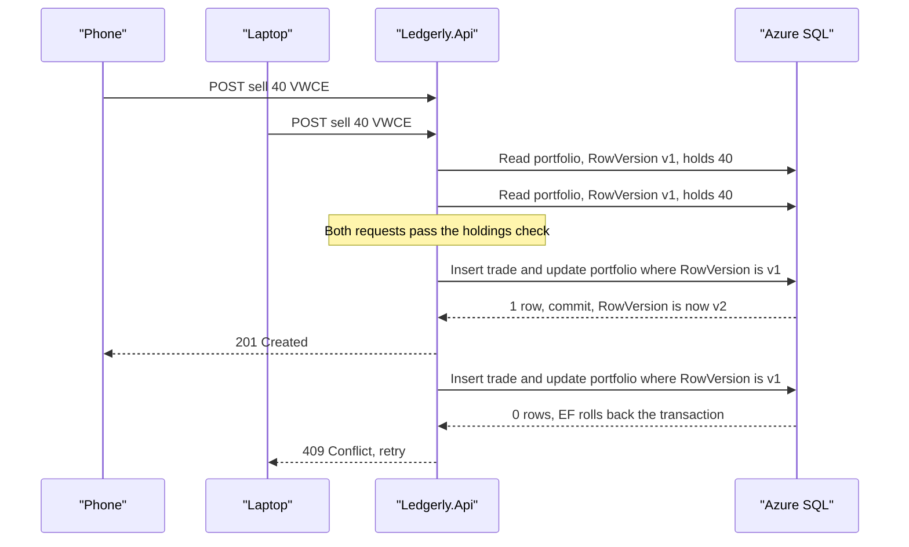
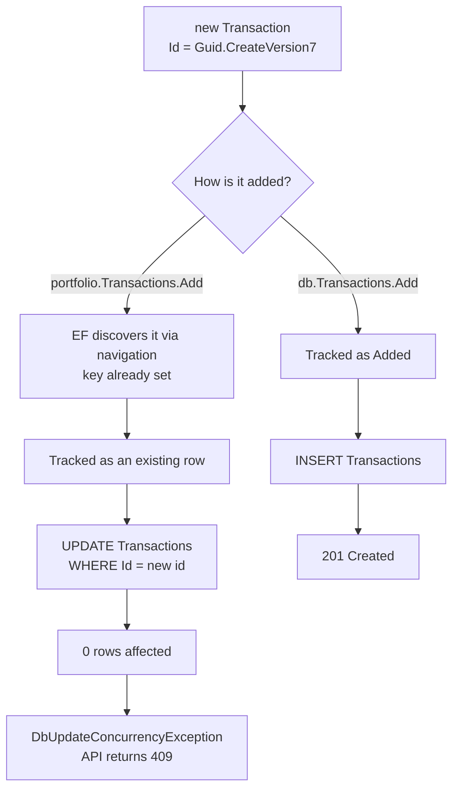
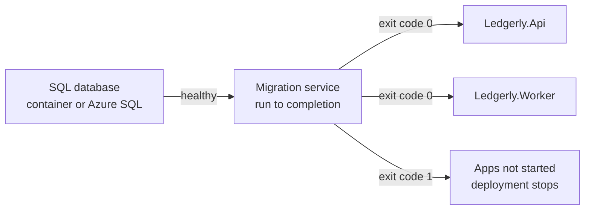

# Chapter 5: Data: EF Core and Azure SQL

> ⏱ About 35 min · You'll learn: how Ledgerly wires EF Core 10 through Aspire, how a `rowversion` turns a double "sell all" into a 409, the EF trap with client-generated keys that the team really hit, why migrations run as their own short-lived process, and how Azure SQL serverless with Entra-only auth removes both idle cost and passwords.

---

## 📖 Story: "We sold twice?"

Elena forwards a support ticket with the subject line in capitals. A beta tester had Ledgerly open on her phone and her laptop, tapped **Sell All** on one, got impatient and clicked it on the other. Her portfolio now shows **minus** 40 shares of VWCE. "Two clicks at once and we sold twice?" Elena asks. "How is that even possible? We check that you own the shares before selling."

You know exactly how. Both requests read the portfolio at the same moment. Both saw 40 shares. Both passed the check. Both inserted a sell. Each request was correct on its own, and together they were wrong. At Nordbank you would have fixed it with a stored procedure and `WITH (UPDLOCK)`, or by accepting "last write wins" and hoping nobody noticed.

Maya has a different plan: let the database tell you when someone else got there first, and turn that into a clear answer for the second request. In your habits notebook, under *Data*, you write: *Never trust a check you did before someone else's write.* This chapter is the fix, plus everything around it: the `DbContext`, migrations as a deploy step, the EF Core trap that cost the team an afternoon, and the Azure SQL setup that pauses when nobody is using it.

---

## 🏚️ Old way → 🚀 New way

| What you did before | What you do now | Why it changed |
|---|---|---|
| EDMX designer or hand-written ADO.NET, stored procedures for writes | EF Core 10 code-first model, configured in `OnModelCreating` | The model, the schema and the migrations live in one codebase and one pull request |
| Pessimistic locks (`UPDLOCK`) or "last write wins" | Optimistic concurrency with a `rowversion` column, conflicts become 409 | No locks held across requests, and the loser gets a clear answer instead of silent data loss |
| `IDENTITY` integer keys from the database | `Guid.CreateVersion7()` keys generated in C# | IDs exist before the insert (for outbox messages and `Location` headers) and still sort by time |
| A DBA runs a script by hand, or `Database.Migrate()` at startup | Migrations run in a separate process that runs to completion before the apps start | Ten replicas don't race to change the schema, and a failed migration stops the deployment |
| Hand-rolled retry loops, or none | An execution strategy that retries transient faults | A cloud database that fails over or wakes from pause is a normal event, not an outage |
| A SQL Server VM running 24/7 | Azure SQL serverless that auto-pauses, on the free offer 💰 | You pay for compute when it's used, and a beta with little traffic can cost very little |
| SQL logins with passwords in `web.config` | Microsoft Entra-only authentication with managed identities | There's no password to leak, rotate or paste into Slack |

> 💡 Most of what changed is about time and concurrency: many replicas, many requests and a database that can briefly disappear. The SQL itself is the part you already know.

---

## 🧠 The DbContext, the model and the indexes

### Registering the DbContext through Aspire

In the old world, you'd pass a connection string name to a `DbContext` constructor and hope `web.config` had it. In Ledgerly, the API, the worker and the migration service each register the same `DbContext` with one line:

📄 [`sample/src/Ledgerly.Api/Program.cs`](https://github.com/vygantas-meskauskis/cloud-native-dotnet/blob/main/sample/src/Ledgerly.Api/Program.cs)
```csharp
// ── Data: Aspire client integration = DbContext pooling + retries + health check + tracing ──────
builder.AddSqlServerDbContext<LedgerlyDbContext>("ledgerlydb");
```

`AddSqlServerDbContext` comes from the Aspire client integration `Aspire.Microsoft.EntityFrameworkCore.SqlServer`. It reads the connection string named `ledgerlydb` (locally from Aspire, in Azure from an environment variable), and it adds retries, a health check and telemetry 🔧. You get a retrying execution strategy without writing `EnableRetryOnFailure()` yourself, and every query shows up as a span in the traces (chapter 15).

### The model, in one place

📄 [`sample/src/Ledgerly.Core/Data/LedgerlyDbContext.cs`](https://github.com/vygantas-meskauskis/cloud-native-dotnet/blob/main/sample/src/Ledgerly.Core/Data/LedgerlyDbContext.cs)
```csharp
public sealed class LedgerlyDbContext(DbContextOptions<LedgerlyDbContext> options) : DbContext(options)
{
    public DbSet<Portfolio> Portfolios => Set<Portfolio>();
    public DbSet<Transaction> Transactions => Set<Transaction>();
    // ...
    protected override void OnModelCreating(ModelBuilder modelBuilder)
    {
        modelBuilder.Entity<Portfolio>(e =>
        {
            e.Property(p => p.OwnerId).HasMaxLength(128);
            e.Property(p => p.Name).HasMaxLength(100);
            e.Property(p => p.BaseCurrency).HasMaxLength(3).IsFixedLength();
            e.Property(p => p.RowVersion).IsRowVersion();
            e.HasIndex(p => p.OwnerId);
            e.HasMany(p => p.Transactions).WithOne().HasForeignKey(t => t.PortfolioId);
        });

        modelBuilder.Entity<Transaction>(e =>
        {
            e.Property(t => t.Symbol).HasMaxLength(12);
            e.Property(t => t.Type).HasConversion<string>().HasMaxLength(4);
            e.Property(t => t.Quantity).HasPrecision(18, 6);
            e.Property(t => t.Price).HasPrecision(18, 6);
            e.Property(t => t.ExternalRef).HasMaxLength(64);
            e.HasIndex(t => new { t.PortfolioId, t.ExternalRef })
                .IsUnique()
                .HasFilter("[ExternalRef] IS NOT NULL");
        });
        // ...
    }
}
```

The domain classes stay free of EF attributes (they live in `Ledgerly.Core/Domain`). Everything about storage is here, in fluent configuration a DBA can review:

| Configuration | What it becomes in SQL | Why |
|---|---|---|
| `HasMaxLength(128)`, `IsFixedLength()` | `nvarchar(128)`, `nchar(3)` | No accidental `nvarchar(max)` columns |
| `HasPrecision(18, 6)` | `decimal(18,6)` | Money and quantities never use floating point |
| `HasConversion<string>()` | `nvarchar(4)` holding `Buy` or `Sell` | Readable data, and reordering the enum can't corrupt rows |
| `IsRowVersion()` | `rowversion` | The concurrency token, next section |
| `HasIndex(p => p.OwnerId)` | A nonclustered index | Every query filters by owner |

### A filtered unique index for idempotent imports

The last index deserves a second look. An imported broker row carries an `ExternalRef` (the broker's own reference, like `BRK-1001`), and the domain comment says why it matters: "Unique per portfolio, so a re-imported file cannot double-count." Trades typed in by hand have no reference, so the index only applies where one exists. EF Core turns `HasFilter` into exactly that in the migration:

📄 [`sample/src/Ledgerly.Core/Data/Migrations/20261028152017_Initial.cs`](https://github.com/vygantas-meskauskis/cloud-native-dotnet/blob/main/sample/src/Ledgerly.Core/Data/Migrations/20261028152017_Initial.cs)
```csharp
            migrationBuilder.CreateIndex(
                name: "IX_Transactions_PortfolioId_ExternalRef",
                table: "Transactions",
                columns: new[] { "PortfolioId", "ExternalRef" },
                unique: true,
                filter: "[ExternalRef] IS NOT NULL");
```

If a user uploads the same CSV twice, the database rejects the duplicates, however the code above it behaves. Chapter 7 shows how the worker uses this for idempotent imports.

> 💡 Put invariants in the database when you can. Code checks can race, but a unique index can't.

---

## 🧠 Optimistic concurrency: how one "sell all" loses

### The rowversion column

SQL Server's `rowversion` is a value the database changes on every update of the row. EF Core includes the value it originally read in the `WHERE` clause of each `UPDATE`. If another write got there first, the row no longer matches, zero rows are affected, and EF Core throws `DbUpdateConcurrencyException` ([docs](https://learn.microsoft.com/en-us/ef/core/saving/concurrency)).

📄 [`sample/src/Ledgerly.Core/Domain/Portfolio.cs`](https://github.com/vygantas-meskauskis/cloud-native-dotnet/blob/main/sample/src/Ledgerly.Core/Domain/Portfolio.cs)
```csharp
    // Touched on every change (including new trades) so the rowversion check below protects the whole aggregate.
    public DateTimeOffset UpdatedAt { get; set; } = DateTimeOffset.UtcNow;

    // SQL Server rowversion: EF Core uses it for optimistic concurrency.
    public byte[] RowVersion { get; set; } = [];
```

Here's the subtle part. A new trade is an `INSERT` into `Transactions`. Nothing about the `Portfolios` row changes, so on its own a rowversion on `Portfolios` would protect nothing. That's why recording a trade also touches `UpdatedAt` on the portfolio. Now every trade is also an `UPDATE` of the portfolio row, guarded by its rowversion, in the same transaction.

### 💻 In Ledgerly: recording a trade

📄 [`sample/src/Ledgerly.Api/Endpoints/PortfolioEndpoints.cs`](https://github.com/vygantas-meskauskis/cloud-native-dotnet/blob/main/sample/src/Ledgerly.Api/Endpoints/PortfolioEndpoints.cs)
```csharp
        // EF trap: the Id is already set (Guid v7, generated in C#). Adding via portfolio.Transactions would make EF
        // assume the row EXISTS and send an UPDATE (0 rows -> DbUpdateConcurrencyException). Add it explicitly.
        db.Transactions.Add(transaction);
        portfolio.UpdatedAt = DateTimeOffset.UtcNow; // bumps rowversion: two parallel "sell all" requests cannot both win

        try
        {
            await db.SaveChangesAsync(ct);
        }
        catch (DbUpdateConcurrencyException)
        {
            return TypedResults.Problem("Portfolio changed while recording the trade. Retry the request.", statusCode: StatusCodes.Status409Conflict);
        }
```

Here is the race from Elena's ticket, with the fix in place:



When the laptop retries, it reads the new state (0 shares), and the holdings check rejects the sell with a 400. The user sees "you don't hold these shares", which is the truth.

### Two flavors of the same mechanism

Ledgerly uses the rowversion in two ways, and it helps to name them:

| Scenario | Where the expected version comes from | Endpoint |
|---|---|---|
| **Stale client**: the user edited an old copy | The client sends back the `Version` it read (Base64 of the rowversion) | `PUT /api/portfolios/{id}` (rename) sets `OriginalValue` from the request |
| **Racing requests**: two writes in flight at once | The version EF read at the start of this request | `POST .../transactions` relies on the tracked value |

Both end in `DbUpdateConcurrencyException` and a 409 ProblemDetails, the contract from chapter 4. If you ever need to show the user what changed, `entry.GetDatabaseValues()` gives you the current row.

> 💡 Optimistic concurrency doesn't prevent the race. It makes sure exactly one side wins and the other side *knows* it lost.

---

## 🧠 The EF trap you will hit: client keys added through a navigation

This one is a real story from building Ledgerly, and it will probably happen to you.

Every entity gets its ID in C#: `public Guid Id { get; init; } = Guid.CreateVersion7();`. The first version of `RecordTransaction` added the new trade the natural object-oriented way:

```csharp
// illustrative, not in the sample: the version that failed
portfolio.Transactions.Add(transaction);
portfolio.UpdatedAt = DateTimeOffset.UtcNow;
await db.SaveChangesAsync(ct);
```

Unit tests were green. Then the integration test against a real SQL Server failed: the buy returned **409**, on a portfolio nobody else was touching.

What happened: when EF Core finds a new object through a navigation of a tracked entity, it has to guess whether that object is new or already in the database. For a key that EF expects to generate, a key that's *already set* means "this row exists." So EF tracked the transaction as an existing row and sent an `UPDATE Transactions ... WHERE Id = @id`. No such row existed, the update affected **0 rows**, and EF reported that the same way it reports a concurrency conflict: `DbUpdateConcurrencyException`. The endpoint caught it and returned 409, so the bug looked like a concurrency problem when it was really a tracking problem.



The fix is one line: add the entity through its `DbSet`, which tells EF explicitly that it's new. The comment in `PortfolioEndpoints.cs` (in the excerpt above) records why, so nobody "simplifies" it back.

| Option | Effect | Ledgerly's choice |
|---|---|---|
| `db.Transactions.Add(transaction)` | Explicitly `Added`, so EF sends an `INSERT` | ✅ Used, with a comment |
| Configure the key as never generated by EF | EF stops treating a set key as "exists" (check the docs for how this changes graph handling) | Not used |
| Let the database generate keys | No client-side IDs, so you lose IDs before insert | Not used: the outbox and `Location` headers need them |

If you want to try the second option, it looks like this:

```csharp
// illustrative, not in the sample
modelBuilder.Entity<Transaction>().Property(t => t.Id).ValueGeneratedNever();
```

The bigger lesson is about tests. Only a test that talked to a real SQL Server could catch this, because the in-memory unit tests never sent SQL. Chapter 17 builds those tests with Testcontainers.

> 💡 With client-generated keys, add new entities through their `DbSet`. And when a 409 shows up with no second user in sight, suspect tracking before concurrency.

---

## 🧠 Migrations as a deploy step

### Adding a migration

Migrations live in `Ledgerly.Core/Data/Migrations`, next to the model. The `dotnet ef` tool comes from the repo's tool manifest (chapter 3), so everyone uses the same version:

```bash
cd sample
dotnet tool restore
dotnet ef migrations add <Name> --project src/Ledgerly.Core --output-dir Data/Migrations
```

Adding a migration doesn't need a database. The tool builds the `DbContext` through a design-time factory with a placeholder connection string:

📄 [`sample/src/Ledgerly.Core/Data/DesignTimeDbContextFactory.cs`](https://github.com/vygantas-meskauskis/cloud-native-dotnet/blob/main/sample/src/Ledgerly.Core/Data/DesignTimeDbContextFactory.cs)
```csharp
/// <summary>
/// Used only by the `dotnet ef` tool at design time (adding migrations, building bundles).
/// The connection string is a placeholder: no database is contacted when adding a migration.
/// </summary>
public sealed class DesignTimeDbContextFactory : IDesignTimeDbContextFactory<LedgerlyDbContext>
```

Review the generated migration like any other code. The `Initial` migration shows the rowversion column exactly as configured: `RowVersion = table.Column<byte[]>(type: "rowversion", rowVersion: true, nullable: false)`.

### Why not `Database.Migrate()` at startup?

It's tempting: the app starts, migrates and serves. With one instance on one server, it even works. In the cloud, the API might start as ten replicas at once, and the docs advise against migrating at startup in multi-instance production ([docs](https://learn.microsoft.com/en-us/ef/core/managing-schemas/migrations/applying)). Even though EF9 and later take a migration lock, you still have problems: every replica needs schema-change rights, a slow migration delays every replica's readiness, and a failed migration leaves you with half-started apps.

Ledgerly runs migrations in **their own process**, `Ledgerly.MigrationService`, which migrates and then exits. The apps don't start until it has finished successfully.

📄 [`sample/src/Ledgerly.MigrationService/Program.cs`](https://github.com/vygantas-meskauskis/cloud-native-dotnet/blob/main/sample/src/Ledgerly.MigrationService/Program.cs)
```csharp
            // The execution strategy retries transient failures (e.g. Azure SQL serverless waking up).
            var strategy = db.Database.CreateExecutionStrategy();
            await strategy.ExecuteAsync(async () => await db.Database.MigrateAsync(stoppingToken));
            LogMigrated(logger);
            // ...
        catch (Exception ex)
        {
            activity?.AddException(ex);
            activity?.SetStatus(ActivityStatusCode.Error);
            LogMigrationFailed(logger, ex);
            Environment.ExitCode = 1; // a failed job execution blocks the deployment pipeline
        }

        lifetime.StopApplication();
```

Three details matter:

1. **The execution strategy.** A retrying strategy can't safely replay work it didn't start, so work you run yourself must go through `CreateExecutionStrategy().ExecuteAsync(...)` ([docs](https://learn.microsoft.com/en-us/ef/core/miscellaneous/connection-resiliency)). Here it covers the migration and the database-user step, so a paused Azure SQL database that takes a moment to resume isn't a failed deployment.
2. **The exit code.** On failure, the process exits with code 1. Locally, Aspire shows the resource as failed. In Azure, the migration runs as a Container Apps job, and a failed job execution stops the pipeline before new app revisions roll out (chapter 12).
3. **`StopApplication()`**: success or failure, the process ends. A migration runner that keeps running is a bug.

### 💻 In Ledgerly: the apps wait for completion

📄 [`sample/src/Ledgerly.AppHost/AppHost.cs`](https://github.com/vygantas-meskauskis/cloud-native-dotnet/blob/main/sample/src/Ledgerly.AppHost/AppHost.cs)
```csharp
var migrations = builder.AddProject<Projects.Ledgerly_MigrationService>("migrations")
    .WithReference(db)
    .WaitFor(db);

builder.AddProject<Projects.Ledgerly_Api>("api")
    .WithReference(db)
    .WithReference(cache)
    .WithReference(marketData)
    .WaitFor(cache)
    .WaitForCompletion(migrations)
    .WithHttpHealthCheck("/health")
    .WithExternalHttpEndpoints();
```

`WaitFor(db)` means "start when the database is healthy." `WaitForCompletion(migrations)` means "start only after the migrator has *exited successfully*." The worker has the same line. Locally and in Azure, the order is the same:



### Other ways to ship migrations

| Approach | How | When it fits |
|---|---|---|
| Migration service (Ledgerly) | A small app that calls `MigrateAsync`, run as a job | You want the same path locally and in Azure, plus extra steps like creating the DB user |
| Migration bundle | `dotnet ef migrations bundle --self-contained -r linux-x64 -o efbundle`, then run `./efbundle --connection "<cs>"` | A single executable in CI, with no SDK or source needed |
| Idempotent SQL script | `dotnet ef migrations script --idempotent -o migrate.sql` | A DBA must review and run the SQL |

Whatever you choose, add `dotnet ef migrations has-pending-model-changes` to CI. It fails when someone changed the model and forgot to add a migration.

> 💡 A schema change is a deployment step with its own success or failure, not a side effect of an app starting up.

---

## 🧠 Azure SQL: serverless, free to start, and no passwords

### Serverless and auto-pause

For the beta, Ledgerly uses an Azure SQL **serverless** database in the General Purpose tier ([docs](https://learn.microsoft.com/en-us/azure/azure-sql/database/serverless-tier-overview)). Compute scales between a minimum (as low as 0.5 vCore) and a maximum, and you're billed per vCore-second of use 💰. When nobody connects for the **auto-pause delay** (default 60 minutes, minimum 15, `-1` disables it), the database pauses and compute billing stops. The first connection after a pause triggers a resume with a short delay, which is why every data access in Ledgerly goes through a retrying execution strategy.

On top of that, the **Azure SQL free offer** 🔧 gives each database, per month, 100,000 vCore-seconds, 32 GB of data and 32 GB of backup storage, for up to 10 serverless databases per subscription ([docs](https://learn.microsoft.com/en-us/azure/azure-sql/database/free-offer)). When the monthly allowance is used up, the database either auto-pauses until next month or continues and bills the overage, depending on a setting 💰.

📄 [`sample/infra/modules/sql.bicep`](https://github.com/vygantas-meskauskis/cloud-native-dotnet/blob/main/sample/infra/modules/sql.bicep)
```bicep
    administrators: {
      administratorType: 'ActiveDirectory'
      principalType: 'Application'
      login: adminIdentityName
      sid: adminIdentityClientId // 🔧 for a managed identity, the Learn Bicep sample uses the client id
      tenantId: subscription().tenantId
      azureADOnlyAuthentication: true
    }
// ...
  sku: {
    name: 'GP_S_Gen5_2'
    tier: 'GeneralPurpose'
    family: 'Gen5'
    capacity: 2
  }
  properties: {
    autoPauseDelay: 60
    minCapacity: json('0.5')
    useFreeLimit: useFreeLimit // 💰 100,000 vCore-seconds per month, then pause until next month
    freeLimitExhaustionBehavior: useFreeLimit ? 'AutoPause' : null
  }
```

| Setting | Value | Effect |
|---|---|---|
| `GP_S_Gen5_2` | General Purpose, serverless, up to 2 vCores | Small, and scales down when idle |
| `minCapacity` | 0.5 | The lowest compute while running |
| `autoPauseDelay` | 60 minutes | Pauses after an idle hour |
| `useFreeLimit` and `AutoPause` on exhaustion | On by default | A runaway month pauses instead of producing a surprise bill 💰 |

For a production system with steady traffic, auto-pause's resume delay may be unacceptable. Chapter 10 compares the options.

### Entra-only authentication

`azureADOnlyAuthentication: true` disables SQL authentication on the server. There are no SQL logins and no passwords: only Microsoft Entra identities can connect ([docs](https://learn.microsoft.com/en-us/azure/azure-sql/database/authentication-azure-ad-only-authentication)). That's Jonas's favorite line in the whole infrastructure.

The apps connect with their **managed identity**. This is the connection string the Bicep sets on the Container Apps:

📄 [`sample/infra/modules/apps.bicep`](https://github.com/vygantas-meskauskis/cloud-native-dotnet/blob/main/sample/infra/modules/apps.bicep)
```bicep
var sqlConnection = 'Server=tcp:${sqlServerFqdn},1433;Database=${databaseName};Authentication=Active Directory Managed Identity;User Id=${identityClientId};Encrypt=True;Connect Timeout=60'
```

| Part | Meaning |
|---|---|
| `Authentication=Active Directory Managed Identity` | Microsoft.Data.SqlClient gets a token for the app's managed identity, with no secret ([docs](https://learn.microsoft.com/en-us/sql/connect/ado-net/sql/azure-active-directory-authentication)) |
| `User Id=<client id>` | Which **user-assigned** identity to use |
| `Connect Timeout=60` | Gives a paused database time to resume on the first connection |
| No `Password` | There's nothing to leak |

You may see `Authentication=Active Directory Default` in tutorials. It tries a chain of credentials, which is convenient on a laptop, but the docs note it can be slow and isn't recommended for production. Use the explicit managed identity form in Azure.

### Who creates the database user?

An identity that can sign in still needs a user in the database with the right roles. Ledgerly uses two identities: the migration job runs as the SQL admin identity, and the apps run as a separate identity with read and write rights only. After migrating, the migration service creates the app's database user idempotently (`EnsureAppUserAsync`, with `CREATE USER ... WITH SID = ..., TYPE = E`) when the `Database:AppUser` settings are present. Locally those settings aren't set, so the step is skipped. Chapter 11 explains why it uses a SID instead of `FROM EXTERNAL PROVIDER`, and chapter 13 covers the identities themselves.

> 💡 The cheapest database is the one that's paused, and the safest password is the one that doesn't exist. Azure SQL serverless with Entra-only auth gives you both.

---

## ⚠️ Common traps

| Trap | What happens | Do this instead |
|---|---|---|
| Adding a new entity with a client-generated key through a navigation | EF assumes the row exists, sends an `UPDATE`, affects 0 rows and throws `DbUpdateConcurrencyException` | Add it via its `DbSet` (`db.Transactions.Add`), and keep the comment that explains why |
| A rowversion on the parent, but child inserts don't touch the parent | Two requests both insert children, and nothing conflicts | Touch the parent (`UpdatedAt`) in the same `SaveChanges`, so the parent's rowversion guards the aggregate |
| `Database.Migrate()` in `Program.cs` of every app | Replicas race, every app needs DDL rights, and a failed migration half-starts the system | A run-to-completion migration process, with the apps waiting for its success |
| Your own transaction or multi-step work with a retrying strategy | An exception explaining that the strategy doesn't support user-initiated transactions, or a half-retried operation | Wrap the whole unit in `db.Database.CreateExecutionStrategy().ExecuteAsync(...)` |
| No retries against serverless Azure SQL | The first request after an idle hour fails while the database resumes | Use the Aspire integration (retries included) and a generous connect timeout |
| `Authentication=Active Directory Default` in production | Slow connections while it walks the credential chain | `Active Directory Managed Identity` with `User Id=<client id>` |
| Testing data access only with in-memory fakes | Tracking and SQL-translation bugs like the one in this chapter reach production | Integration tests against a real SQL Server (chapter 17) |

---

## 🧰 Helpers

**EF Core commands** (from `sample/`, after `dotnet tool restore`):

| Task | Command |
|---|---|
| Add a migration | `dotnet ef migrations add <Name> --project src/Ledgerly.Core --output-dir Data/Migrations` |
| List migrations | `dotnet ef migrations list --project src/Ledgerly.Core` (connects to the database to show which are applied) |
| Check for a forgotten migration | `dotnet ef migrations has-pending-model-changes --project src/Ledgerly.Core` |
| SQL script for review | `dotnet ef migrations script --idempotent --project src/Ledgerly.Core -o migrate.sql` |
| Self-contained bundle | `dotnet ef migrations bundle --self-contained -r linux-x64 -o efbundle --project src/Ledgerly.Core` |

**A concurrency-safe write**, the pattern from this chapter in one place:

```csharp
// illustrative, not in the sample
var order = await db.Orders.SingleOrDefaultAsync(o => o.Id == id && o.OwnerId == ownerId, ct);
if (order is null)
{
    return TypedResults.NotFound();
}

db.Entry(order).Property(o => o.RowVersion).OriginalValue = Convert.FromBase64String(request.Version);
db.OrderLines.Add(new OrderLine { OrderId = order.Id, Sku = request.Sku }); // via the DbSet, not order.Lines
order.UpdatedAt = clock.GetUtcNow();                                         // touch the parent

try
{
    await db.SaveChangesAsync(ct);
}
catch (DbUpdateConcurrencyException)
{
    return TypedResults.Problem("Changed by someone else. Reload and try again.", statusCode: StatusCodes.Status409Conflict);
}
```

**Data checklist for a new service:**

- [ ] `DbContext` registered via the Aspire integration (retries, health check, tracing)
- [ ] Explicit lengths and precision for every string and decimal
- [ ] Business invariants backed by unique (or filtered unique) indexes
- [ ] A `rowversion` on every aggregate that can be edited concurrently, with 409 on conflict
- [ ] New child entities added via their `DbSet`
- [ ] Migrations run as a separate step, and the apps wait for it
- [ ] `has-pending-model-changes` in CI
- [ ] Entra-only auth and a managed identity connection string in Azure

**Make it permanent:** add `dotnet ef migrations has-pending-model-changes` as a CI step, and keep at least one integration test that records a trade against real SQL (chapter 17), because that's the test that caught the trap. The toolkit's `production-readiness-checklist.md` repeats the key ones (migrations as a separate step, managed identities for Azure SQL, 409 on conflicts) (see [the toolkit](../toolkit/README.md)). Terms like *rowversion*, *execution strategy* and *auto-pause* are in the [glossary](../GLOSSARY.md).

---

## 🧪 Try it yourself (optional, ~25 min)

None of these steps need a running database, except step 5.

1. Restore the EF tool and look at the migrations:
   ```bash
   cd sample
   dotnet tool restore
   dotnet ef --version
   ```
   Open `src/Ledgerly.Core/Data/Migrations/20261028152017_Initial.cs` and find the `rowversion` column and the filtered index `IX_Transactions_PortfolioId_ExternalRef`.
2. Generate the SQL a DBA would review:
   ```bash
   dotnet ef migrations script --idempotent --project src/Ledgerly.Core -o migrate.sql
   ```
   Open `migrate.sql`. Find `CREATE UNIQUE INDEX ... WHERE [ExternalRef] IS NOT NULL` and the `IF NOT EXISTS` checks that make the script safe to run twice. Delete the file when you're done.
3. Catch a forgotten migration. Add a property to `Portfolio` in `src/Ledgerly.Core/Domain/Portfolio.cs`, for example `public string? Notes { get; set; }`, then run:
   ```bash
   dotnet ef migrations has-pending-model-changes --project src/Ledgerly.Core
   ```
   It reports pending changes (a CI step would fail here). Remove the property and run it again: no changes.
4. Read the trap: open `src/Ledgerly.Api/Endpoints/PortfolioEndpoints.cs`, find the "EF trap" comment in `RecordTransaction`, and follow the sequence diagram above against the code.
5. Optional, needs Docker: reproduce the trap. Change `db.Transactions.Add(transaction);` to `portfolio.Transactions.Add(transaction);` and run the tests:
   ```bash
   dotnet test --solution Ledgerly.slnx
   ```
   The integration tests that record a trade fail, because the setup buy returns 409 instead of 201. Revert the line and run the tests again: all green.

---

## ✅ Recap

1. EF Core 10, registered through Aspire's `AddSqlServerDbContext`, gives you a configured model, retries, health checks and tracing, and invariants like duplicate imports belong in (filtered) unique indexes.
2. A `rowversion` plus a touched parent turns racing writes into exactly one success and one 409, and client-generated keys must be added via their `DbSet` to avoid a fake concurrency error.
3. Migrations run as a separate process that the apps wait for, against an Azure SQL serverless database that auto-pauses, uses the free offer, and only accepts Entra identities.

**Next → [Chapter 6: Local development with Aspire](06-local-dev-with-aspire.md)**
