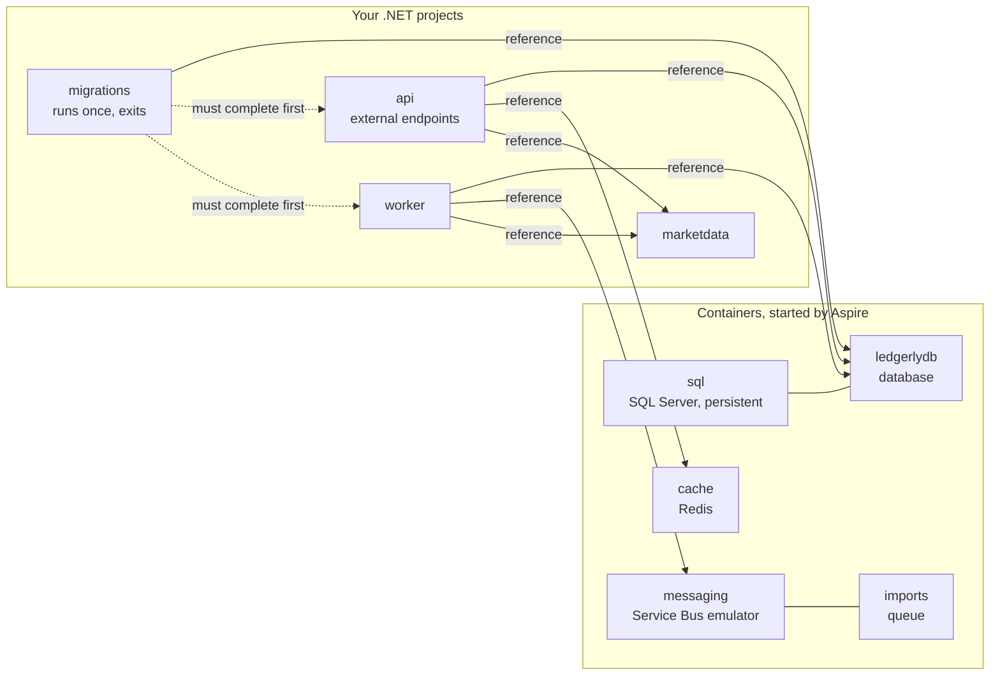
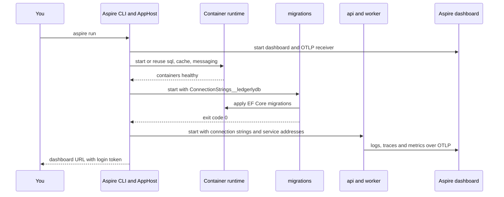

# Chapter 6: Local development with Aspire

> ⏱ About 30 min · You'll learn: how one C# file (the AppHost) starts SQL Server, Redis, the Service Bus emulator and every Ledgerly service, how connection strings and service addresses reach your code as environment variables, and what the Aspire dashboard and service defaults give you from the first run.

---

## 📖 Story: The 14-step wiki page

Your import feature needs everything at once: SQL Server for the data, Redis for the cache, a Service Bus queue for the work, the fake market-data vendor for prices, the API, the worker, and the migrations in front of all of them. At Nordbank Insurance this was the moment you opened the wiki page called "Developer setup". It had 14 steps. Step 4 was "Ask the DBA for a login on DEVSQL02", the shared dev server. Step 9 was "Enable MSMQ in Windows Features and create the private queues by hand". Step 12 said "If the service doesn't start, ask Lars". New joiners lost two days to it, and because everyone shared one SQL Server, one person's half-finished migration broke everybody's afternoon.

Tomás Varga sees you open a blank text file to start your own list. "Don't," he says. "Clone the repo, run `aspire run`, and the whole system is up. If it takes more than that, it's a bug, and we fix it in the repo, not on a wiki." Maya Okafor pulls up a chair. "And once it's up, you'll see every log, trace and metric from every service in one place. Then we can talk about what happens when the market-data vendor falls over."

In your notebook, under **Habits I brought with me**, you write: *"The dev environment is a document."* Then you add a question mark.

---

## 🏚️ Old way → 🚀 New way

| What you did before | What you do now | Why it changed |
|---|---|---|
| A wiki page with 14 manual setup steps | An AppHost project in the repo, started with `aspire run` | Code is reviewed and versioned, so it can't drift from reality the way a wiki does |
| A shared dev SQL Server that everyone migrated against | A SQL Server container per developer, with a data volume that survives restarts | Your experiments don't break your teammates, and a reset is one command |
| MSMQ enabled by hand in Windows Features | The Azure Service Bus emulator as a container, with the queue declared in C# | Same SDK and same queue semantics as production, no machine setup |
| Connection strings copied into `web.config` on every machine | Aspire injects connection strings and service addresses as environment variables | Nothing to copy or commit, and the same code reads Azure settings later |
| Starting four Visual Studio instances in the right order | `WaitFor` and `WaitForCompletion` express the start order in code | The migrations finish before the API starts, every time |
| Reading NLog files in three folders | The Aspire dashboard: console logs, structured logs, traces and metrics for every service | One request is one trace across the API, the database and the vendor |
| Copy-pasted logging and retry setup in each project | One `AddServiceDefaults()` call from a shared project | OpenTelemetry, health checks, resilience and service discovery are the same everywhere |

---

## 🧠 What Aspire is, and what it is not

Aspire is a set of tools for describing, running and observing a distributed application. It started as a .NET-only stack and, since version 13, also hosts JavaScript, Python, Java and Rust apps. You will use three parts every day:

| Part | What it is | In Ledgerly |
|---|---|---|
| **AppHost** | A small .NET project that describes your resources (containers, projects, cloud services) and how they connect, in C# | `src/Ledgerly.AppHost` |
| **Service defaults** | A shared project with one extension method that adds OpenTelemetry, health checks, resilience and service discovery | `src/Ledgerly.ServiceDefaults` |
| **Aspire dashboard** | A web UI with resources, console logs, structured logs, traces and metrics | Opens when you run `aspire run` |

A few facts changed recently, so check them before you rely on them (all 🔧):

- The product used to be called ".NET Aspire". The ".NET" prefix was dropped with **Aspire 13** (November 2025), and the docs moved to aspire.dev.
- Aspire 13 requires the **.NET 10 SDK**. The current release line is **13.6**, and the sample uses packages and the AppHost SDK at **13.6.4**.
- The old `dotnet workload install aspire` is gone. You install the **Aspire CLI** instead.

```powershell
# Windows (PowerShell)
irm https://aspire.dev/install.ps1 | iex
```

```bash
# macOS or Linux
curl -sSL https://aspire.dev/install.sh | bash

# Alternatives: winget install Microsoft.Aspire   or   dotnet tool install -g Aspire.Cli
```

Source: [Install the Aspire CLI](https://aspire.dev/get-started/install-cli/).

You also need a **container runtime: Docker Desktop or Podman**. Aspire runs SQL Server, Redis and the Service Bus emulator as containers. Without a runtime, your projects can start, but their dependencies can't.

### Local orchestration first, deployment optional

Aspire can do more than run things on your laptop. `aspire publish` emits deployment artifacts such as Bicep, and **`aspire deploy` is now the recommended way to deploy an Aspire app** to Azure 🔧 ([Deploy with Aspire](https://aspire.dev/deployment/deploy-with-aspire/)). The Azure Developer CLI (`azd`) still works, but it is no longer the recommended default for Aspire.

This course uses Aspire for local development only and deploys with **hand-written Bicep** (chapter 11). That is a teaching choice, not a verdict on `aspire deploy`:

| Use `aspire deploy` when | Use hand-written Bicep (this course) when |
|---|---|
| You want the fastest path from AppHost to Azure Container Apps | You want to see and review every Azure resource, role assignment and setting |
| The team is small and the generated defaults fit | A platform team owns infrastructure separately from application code |
| You are prototyping or running a demo environment | A security reviewer needs every line explained, or you need settings the generator doesn't cover |

> 💡 The AppHost describes your system for development. It is not your production configuration, even though it can generate one.

---

## 🧠 The AppHost, line by line

The AppHost is an ordinary .NET project with a special SDK. The version lives in the `Sdk` attribute, and the four service projects are plain project references:

📄 [`sample/src/Ledgerly.AppHost/Ledgerly.AppHost.csproj`](https://github.com/vygantas-meskauskis/cloud-native-dotnet/blob/main/sample/src/Ledgerly.AppHost/Ledgerly.AppHost.csproj)
```xml
<Project Sdk="Aspire.AppHost.Sdk/13.6.4">
  <!-- ... -->
  <ItemGroup>
    <ProjectReference Include="..\Ledgerly.Api\Ledgerly.Api.csproj" />
    <ProjectReference Include="..\Ledgerly.Worker\Ledgerly.Worker.csproj" />
    <ProjectReference Include="..\Ledgerly.MarketData\Ledgerly.MarketData.csproj" />
    <ProjectReference Include="..\Ledgerly.MigrationService\Ledgerly.MigrationService.csproj" />
  </ItemGroup>

  <ItemGroup>
    <PackageReference Include="Aspire.Hosting.SqlServer" />
    <PackageReference Include="Aspire.Hosting.Redis" />
    <PackageReference Include="Aspire.Hosting.Azure.ServiceBus" />
  </ItemGroup>
</Project>
```

The `Aspire.Hosting.*` packages are **hosting integrations**: they teach the AppHost how to run a resource. The services use separate **client integrations** (for example `Aspire.Microsoft.EntityFrameworkCore.SqlServer`) to consume it. The versions come from `Directory.Packages.props` (chapter 3).

### 💻 In Ledgerly: the infrastructure

📄 [`sample/src/Ledgerly.AppHost/AppHost.cs`](https://github.com/vygantas-meskauskis/cloud-native-dotnet/blob/main/sample/src/Ledgerly.AppHost/AppHost.cs)
```csharp
// The whole Ledgerly system, described in C#. `aspire run` (or F5 on this project) starts everything.
var builder = DistributedApplication.CreateBuilder(args);

// ── Infrastructure (containers locally; real Azure services in the cloud, see infra/) ──────────
var sql = builder.AddSqlServer("sql")
    .WithLifetime(ContainerLifetime.Persistent)   // keep the container (and data) between runs
    .WithDataVolume();
var db = sql.AddDatabase("ledgerlydb");

var cache = builder.AddRedis("cache");

var messaging = builder.AddAzureServiceBus("messaging").RunAsEmulator();
messaging.AddServiceBusQueue("imports");
```

| Line | What it does | Why it matters |
|---|---|---|
| `AddSqlServer("sql")` | Runs a SQL Server container named `sql` | No shared dev server, no install, and no password written in the repo |
| `.WithLifetime(ContainerLifetime.Persistent)` | Keeps the container running after you stop the AppHost, and reuses it next time | SQL Server is slow to start. The second `aspire run` is much faster |
| `.WithDataVolume()` | Stores the database files in a named container volume | Your data survives even if the container is recreated. Delete the volume to reset |
| `sql.AddDatabase("ledgerlydb")` | Declares a database on that server | `ledgerlydb` is the **name** the services ask for, here and in Azure |
| `AddRedis("cache")` | Runs a Redis container | The API uses it as the shared second level of HybridCache (chapter 18) |
| `AddAzureServiceBus("messaging").RunAsEmulator()` | Declares a Service Bus namespace and, locally, runs the official emulator container instead | Same SDK and same peek-lock semantics as production (chapter 7) |
| `messaging.AddServiceBusQueue("imports")` | Declares the `imports` queue | The queue is code. Nobody creates it by hand |

The Service Bus emulator is honest about what it is. It is a Linux container for **local development and testing only**, it brings its own SQL backing store, and it has limits 🔧: 50 entities, 100 MB per entity, **no Entra ID authentication** (it uses a connection string with `UseDevelopmentEmulator=true`) and **no persistence**, so messages are lost when it restarts ([Service Bus emulator overview](https://learn.microsoft.com/en-us/azure/service-bus-messaging/overview-emulator)).

Notice the asymmetry: SQL Server is persistent, the queue is not. If you stop the AppHost while messages are still waiting in `imports`, they are gone and those imports stay `Pending`. That is fine for development, and a good reminder that the emulator proves your code paths, not your durability.

### 💻 In Ledgerly: the services

```csharp
// ── Services ────────────────────────────────────────────────────────────────────────────────────
var marketData = builder.AddProject<Projects.Ledgerly_MarketData>("marketdata")
    .WithHttpHealthCheck("/health");

var migrations = builder.AddProject<Projects.Ledgerly_MigrationService>("migrations")
    .WithReference(db)
    .WaitFor(db);

builder.AddProject<Projects.Ledgerly_Api>("api")
    .WithReference(db)
    .WithReference(cache)
    .WithReference(marketData)
    .WaitFor(cache)
    .WaitForCompletion(migrations)
    .WithHttpHealthCheck("/health")
    .WithExternalHttpEndpoints();

builder.AddProject<Projects.Ledgerly_Worker>("worker")
    .WithReference(db)
    .WithReference(messaging)
    .WithReference(marketData)
    .WaitFor(messaging)
    .WaitForCompletion(migrations)
    .WithHttpHealthCheck("/health");

builder.Build().Run();
```

| Call | What it means |
|---|---|
| `AddProject<Projects.Ledgerly_Api>("api")` | `Projects.Ledgerly_Api` is generated from the project reference, so a renamed or missing project is a compile error, not a runtime surprise |
| `.WithReference(db)` | Give this project the connection information for `ledgerlydb` |
| `.WithReference(marketData)` | Give this project the address of `marketdata`, for service discovery |
| `.WaitFor(cache)` | Don't start until the dependency is running and reports healthy |
| `.WaitForCompletion(migrations)` | Don't start until the `migrations` process has **exited successfully** |
| `.WithHttpHealthCheck("/health")` | The AppHost polls this endpoint. The dashboard shows the result, and anything that waits for this resource waits for "healthy" |
| `.WithExternalHttpEndpoints()` | Marks the API's endpoints as public. It matters when Aspire generates deployment artifacts. Locally everything is on `localhost` anyway |

Two details are worth a second look.

First, the **reference graph is your architecture**. The API references the cache but not Service Bus. The worker references Service Bus but not the cache. That is not an accident: the API never talks to the queue directly; it writes an outbox row in SQL, and the worker publishes it (chapter 7). Anyone reviewing a pull request that adds `.WithReference(messaging)` to the API should ask why.

Second, **`WaitForCompletion` turns the migration service into a gate**. The migrator is a run-to-completion process. If it fails, it sets a non-zero exit code, and the API and worker never start:

📄 [`sample/src/Ledgerly.MigrationService/Program.cs`](https://github.com/vygantas-meskauskis/cloud-native-dotnet/blob/main/sample/src/Ledgerly.MigrationService/Program.cs)
```csharp
        catch (Exception ex)
        {
            activity?.AddException(ex);
            activity?.SetStatus(ActivityStatusCode.Error);
            LogMigrationFailed(logger, ex);
            Environment.ExitCode = 1; // a failed job execution blocks the deployment pipeline
        }

        lifetime.StopApplication();
```

This is the same contract the Container Apps job follows in Azure (chapter 12): new code never runs against an old schema. You practice the production deployment order every time you press F5.

> 💡 `WaitFor` means "is it up?". `WaitForCompletion` means "did it finish, and did it succeed?". Use the second one for anything that is supposed to exit.

---

## 🗺️ The Ledgerly resource graph

This is `AppHost.cs` drawn as a picture. Solid arrows are references (configuration flows along them). Dotted arrows are start-order gates.



---

## 🧠 How configuration flows: environment variables, not files

`WithReference` doesn't do anything magical. When the AppHost starts a project, it sets **environment variables** on that process. Your code reads them through the normal .NET configuration system, where a double underscore `__` in a variable name means `:` in a configuration key. So `ConnectionStrings__ledgerlydb` is the same key as `"ConnectionStrings": { "ledgerlydb": ... }` in `appsettings.json`.

| AppHost line | What the service receives | Code that reads it |
|---|---|---|
| `.WithReference(db)` | `ConnectionStrings__ledgerlydb` | `builder.AddSqlServerDbContext<LedgerlyDbContext>("ledgerlydb")` |
| `.WithReference(cache)` | `ConnectionStrings__cache` | `GetConnectionString("cache")`, then `AddRedisDistributedCache("cache")` |
| `.WithReference(messaging)` | `ConnectionStrings__messaging`, an emulator connection string with `UseDevelopmentEmulator=true` | `builder.AddAzureServiceBusClient("messaging")` |
| `.WithReference(marketData)` | Endpoint variables named like `services__marketdata__https__0` | Service discovery resolves `https+http://marketdata` |
| Every project | `OTEL_EXPORTER_OTLP_ENDPOINT`, `OTEL_SERVICE_NAME` and related OTLP settings | `ConfigureOpenTelemetry()` in service defaults |

You don't need to memorize the exact names. Click a resource in the dashboard and its environment variables are listed there, which is the fastest way to answer "what does this service actually see?".

The address `https+http://marketdata` reads as: "find the service called `marketdata`, prefer its HTTPS endpoint, fall back to HTTP". The handler that resolves it is added once, in service defaults, for every `HttpClient` in the process.

### 💻 In Ledgerly: the same code reads Azure settings

The services never mention containers, ports or passwords. They ask for **names**:

📄 [`sample/src/Ledgerly.Api/Program.cs`](https://github.com/vygantas-meskauskis/cloud-native-dotnet/blob/main/sample/src/Ledgerly.Api/Program.cs)
```csharp
// ── Data: Aspire client integration = DbContext pooling + retries + health check + tracing ──────
builder.AddSqlServerDbContext<LedgerlyDbContext>("ledgerlydb");
// ...
// ── Outbound HTTP: typed client. Resilience + discovery come from ConfigureHttpClientDefaults. ───
builder.Services.AddHttpClient<IMarketDataClient, MarketDataClient>(client =>
    client.BaseAddress = new Uri(builder.Configuration["MarketData:BaseUrl"] ?? "https+http://marketdata"));
```

In Azure there is no AppHost. Bicep sets the same variable names on the Container App instead:

📄 [`sample/infra/modules/apps.bicep`](https://github.com/vygantas-meskauskis/cloud-native-dotnet/blob/main/sample/infra/modules/apps.bicep)
```bicep
          env: concat(commonEnv, [
            { name: 'OTEL_SERVICE_NAME', value: 'worker' }
            { name: 'ConnectionStrings__ledgerlydb', value: sqlConnection }
            { name: 'ConnectionStrings__messaging', value: serviceBusFqns } // a namespace, not a key: Entra auth
            { name: 'MarketData__BaseUrl', value: marketDataUrl }
          ])
```

| Setting | Locally (AppHost) | In Azure (Bicep) |
|---|---|---|
| `ledgerlydb` | Connection string to the local container, supplied by the AppHost | Azure SQL with `Authentication=Active Directory Managed Identity`, no password (chapter 13) |
| `messaging` | Emulator connection string | The namespace host name only. The sample's comment says it: "a namespace, not a key: Entra auth" |
| Market data address | Service discovery from Aspire's endpoint variables | `MarketData__BaseUrl`, the internal HTTPS address of the `marketdata` Container App |
| Telemetry | OTLP to the Aspire dashboard | `APPLICATIONINSIGHTS_CONNECTION_STRING` to Application Insights (chapter 16) |

> 💡 Code asks for names. Environments supply values. That is how the same container image runs on your laptop and in production.

---

## 🗺️ What happens when you type `aspire run`



---

## 🧠 The dashboard: your new log folder

At Nordbank, "looking at the logs" meant RDP, a file share and Notepad++. The Aspire dashboard is the local version of what Application Insights will give you in Azure, and it receives the same OpenTelemetry data.

| View | What you see | Old-world equivalent | Use it when |
|---|---|---|---|
| **Resources** | Every container and project, its state, health, endpoints and environment variables | Services console plus IIS Manager | Something didn't start, or you want a service's URL |
| **Console logs** | Raw stdout and stderr per resource | Tailing a log file | A process crashes on startup before telemetry is wired |
| **Structured logs** | OpenTelemetry log records with their properties, filterable by resource, level and value | `grep` over three servers | "Show me every warning for import X" |
| **Traces** | One request as a tree of spans across services, with timings and errors | Nothing; you correlated IDs by hand | "Why was this valuation slow?" |
| **Metrics** | Counters and histograms, including ASP.NET Core's built-in `http.server.request.duration` and Ledgerly's own `Ledgerly` meter | Performance Monitor | "Is the import duration growing?" |

Two things to know 🔧:

- Aspire 13.6 added **SQLite-backed dashboard history** ([What's new in Aspire 13.6](https://aspire.dev/whats-new/aspire-13-6/)).
- The dashboard is also available as a **standalone container image**, which is handy when you want an OTLP viewer without an AppHost.

The data on the dashboard is only as good as what your services emit. That is the job of service defaults.

---

## 🧠 Service defaults: one line of cross-cutting code

Every Ledgerly service starts with `builder.AddServiceDefaults()`. The method lives in a shared project that started from the Aspire template and was then adapted.

### 💻 In Ledgerly: what one line adds

📄 [`sample/src/Ledgerly.ServiceDefaults/Extensions.cs`](https://github.com/vygantas-meskauskis/cloud-native-dotnet/blob/main/sample/src/Ledgerly.ServiceDefaults/Extensions.cs)
```csharp
    public static TBuilder AddServiceDefaults<TBuilder>(this TBuilder builder) where TBuilder : IHostApplicationBuilder
    {
        builder.ConfigureOpenTelemetry();
        builder.AddDefaultHealthChecks();

        builder.Services.AddServiceDiscovery();

        builder.Services.ConfigureHttpClientDefaults(http =>
        {
            // Retries with jittered back-off, per-attempt + total timeouts, circuit breaker, rate limiter.
            http.AddStandardResilienceHandler();

            // Resolves "https+http://marketdata" to a real address (Aspire locally, config or DNS in Azure).
            http.AddServiceDiscovery();
        });

        return builder;
    }
```

| Piece | What it gives you | Where you go deeper |
|---|---|---|
| `ConfigureOpenTelemetry()` | Logs, metrics and traces for ASP.NET Core, `HttpClient`, the runtime and Ledgerly's own `ActivitySource` and `Meter`. Export goes to OTLP when `OTEL_EXPORTER_OTLP_ENDPOINT` is set (locally) and to Azure Monitor when `APPLICATIONINSIGHTS_CONNECTION_STRING` is set (in Azure) | Chapter 15 |
| `AddDefaultHealthChecks()` | A `self` check tagged `live`. Aspire client integrations add their own checks (database, Redis, Service Bus) | Chapter 14 |
| `AddServiceDiscovery()` | Logical names such as `marketdata` become real addresses | This chapter |
| `AddStandardResilienceHandler()` | For every `HttpClient`: rate limiter, total timeout (30 s), retries (3, exponential back-off with jitter), circuit breaker, attempt timeout (10 s) 🔧 | Chapter 14 |

The tracing setup also filters out the health endpoints, because probes call them every few seconds and would drown the real traffic:

```csharp
                .AddAspNetCoreInstrumentation(options =>
                    // Probes hit these every few seconds: keep them out of traces.
                    options.Filter = context =>
                        !context.Request.Path.StartsWithSegments(ReadinessPath)
                        && !context.Request.Path.StartsWithSegments(LivenessPath))
```

One deliberate difference from the template: the template maps `/health` and `/alive` **only in Development**. Ledgerly maps them **in every environment**, because Container Apps probes need them, and they return a status without details:

```csharp
    public static WebApplication MapDefaultEndpoints(this WebApplication app)
    {
        // Readiness: all checks (including DB, Redis, Service Bus registered by Aspire integrations).
        app.MapHealthChecks(ReadinessPath).DisableHttpMetrics();

        // Liveness: only checks tagged "live".
        app.MapHealthChecks(LivenessPath, new HealthCheckOptions
        {
            Predicate = r => r.Tags.Contains("live"),
        }).DisableHttpMetrics();

        return app;
    }
```

### 💻 In Ledgerly: the chaos switches

`Ledgerly.MarketData` is the fake vendor. It starts from the `Chaos` section in its `appsettings.json` (failure rate 0, latency 0), and in Development it exposes an endpoint that changes those values at runtime:

📄 [`sample/src/Ledgerly.MarketData/Program.cs`](https://github.com/vygantas-meskauskis/cloud-native-dotnet/blob/main/sample/src/Ledgerly.MarketData/Program.cs)
```csharp
// Chaos controls. Only exposed in Development: never ship a "break me" button to production.
if (app.Environment.IsDevelopment())
{
    app.MapGet("/chaos", (ChaosState chaos) => chaos.Current);
    app.MapPost("/chaos", (ChaosOptions options, ChaosState chaos) =>
    {
        chaos.Set(options);
        return Results.Ok(chaos.Current);
    });
}
```

`ChaosState.Set` clamps the values (failure rate between 0 and 1, latency up to 60,000 ms). With chaos on, the `/prices` endpoint adds latency and returns 503 for a share of requests. Because the API's `HttpClient` has the standard resilience handler, you can watch the retries happen in the Traces view. Priya will use this switch in chapter 14 to prove the API degrades gracefully instead of failing.

> 💡 Service defaults make "observable, resilient and discoverable" the default state of a new service instead of a task someone has to remember.

---

## ⚠️ Common traps

| Trap | What happens | Do this instead |
|---|---|---|
| No container runtime running | Containers never start, and the API and worker wait forever behind them | Start Docker Desktop or Podman first, then check the Resources view for the stuck resource |
| Editing a migration that the persistent SQL container already applied | The database keeps the old schema, and you get errors that don't match the code | Add a new migration instead. To start clean, stop the AppHost and delete the SQL container and its data volume |
| Hard-coding `https://localhost:7180` in another service | It works on your machine, breaks for a teammate whose port differs, and breaks in Azure | Use a reference plus a logical name (`https+http://marketdata`) or a configuration key such as `MarketData:BaseUrl` |
| Using `WaitFor(migrations)` instead of `WaitForCompletion(migrations)` | The API starts while the migration is still running and hits missing tables | Use `WaitForCompletion` for anything that is supposed to exit |
| Tagging a database check as `live` | One database blip fails liveness, and the platform restarts every replica | Keep only `self` in liveness. Dependencies belong in readiness (chapter 14) |
| Treating the emulator as production-like | You assume messages survive restarts and that Entra ID auth works, and both assumptions fail | Use the emulator for code paths. Prove durability and identity in Azure (chapters 12 and 13) |
| Putting real cloud secrets in the AppHost "just for local" | They end up in git history | Let the AppHost supply local connection strings, and keep cloud credentials out of the repo entirely (chapter 13) |

---

## 🧰 Helpers

**Install and run:**

```bash
# once: install the Aspire CLI (see the PowerShell variant above)
curl -sSL https://aspire.dev/install.sh | bash

# every day
cd sample
aspire run                                   # finds the AppHost through aspire.config.json
dotnet run --project src/Ledgerly.AppHost    # same thing without the CLI
```

**Checklist: adding a new service to the system**

1. Reference `Ledgerly.ServiceDefaults`, call `builder.AddServiceDefaults()` and `app.MapDefaultEndpoints()`.
2. Add the project to `AppHost.cs` with `AddProject<Projects.X>("name")`.
3. Add `.WithReference(...)` for each dependency and `.WaitFor(...)` or `.WaitForCompletion(...)` for each one that must be ready first.
4. Add `.WithHttpHealthCheck("/health")`.
5. In the service, read connection strings and addresses **by name only**.

```csharp
// illustrative, not in the sample: a hypothetical notifications service
builder.AddProject<Projects.Ledgerly_Notifications>("notifications")
    .WithReference(db)
    .WaitForCompletion(migrations)
    .WithHttpHealthCheck("/health");
```

**Reset local data:** stop the AppHost, then remove the SQL Server container and its volume with your container tool (`docker ps -a`, `docker volume ls`, then `docker rm` and `docker volume rm`, or the Podman equivalents). The next `aspire run` creates a fresh database and the migrator rebuilds the schema.

**Make it permanent:**

- Replace the "Developer setup" wiki with three lines in the README: install the .NET 10 SDK, install a container runtime and the Aspire CLI, run `aspire run`. Anything else is a bug to fix in the AppHost.
- The AppHost is part of `Ledgerly.slnx`, so CI builds it on every pull request (chapter 9). A broken AppHost can't be merged.
- Copy the toolkit's `ServiceDefaults.Extensions.cs` into new solutions so every service starts observable (see [the toolkit](../toolkit/README.md)).
- In chapter 17 you'll see how the Aspire testing builder starts the whole AppHost inside a test. Terms you don't recognize are in the [glossary](../GLOSSARY.md).

---

## 🧪 Try it yourself (optional, ~25 min)

1. Start Docker Desktop or Podman, install the Aspire CLI, then run:
   ```bash
   cd sample
   aspire run
   ```
   Open the dashboard link the CLI prints.
2. In **Resources**, watch the order: `sql`, `cache` and `messaging` start first, `migrations` runs and finishes, and only then do `api` and `worker` start. That is `WaitForCompletion` at work.
3. Click `api` and look at its environment variables. Find `ConnectionStrings__ledgerlydb` and the `services__marketdata__...` entries.
4. Create a development token and copy it:
   ```bash
   dotnet user-jwts create --project src/Ledgerly.Api
   ```
5. Open the API's URL from the dashboard and add `/scalar` (or use `src/Ledgerly.Api/Ledgerly.Api.http` in your IDE). Create a portfolio, record a buy, then request `/api/portfolios/{id}/valuation`.
6. In **Traces**, open the valuation request. Find the span for the call from `api` to `marketdata`.
7. Turn on chaos. Take the `marketdata` URL from the dashboard and send:
   ```bash
   curl -X POST https://localhost:<marketdata-port>/chaos -H "Content-Type: application/json" -d '{"failureRate":0.7,"latencyMs":500}'
   ```
   Quotes are cached for 30 seconds, so wait a moment (or value a portfolio with a different symbol), then request the valuation again. Observe the retry spans in **Traces**, and `isComplete: false` when retries run out. Set both values back to `0` when you are done.
8. Stop the AppHost with Ctrl+C and run `aspire run` again. The SQL container is reused and your portfolio is still there.

---

## ✅ Recap

1. The AppHost describes the whole local system in C#: containers, projects, references and start order, so `aspire run` replaces the setup wiki.
2. References become environment variables, and services read connection strings and addresses by name, which is why the same code runs against containers locally and Azure services in production.
3. Service defaults and the dashboard make every service observable, healthy-checked and resilient from its first run.

**Next → [Chapter 7: Background work and messaging](07-background-work-and-messaging.md)**
