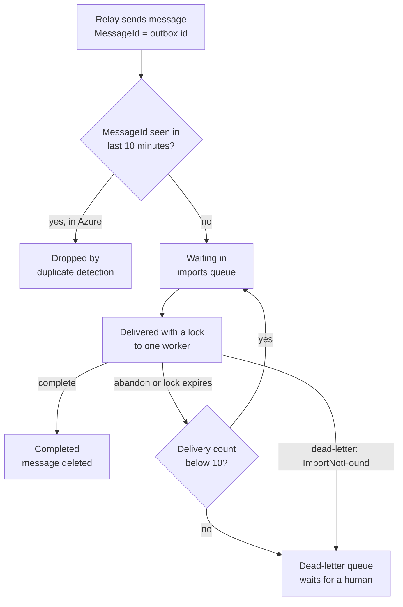
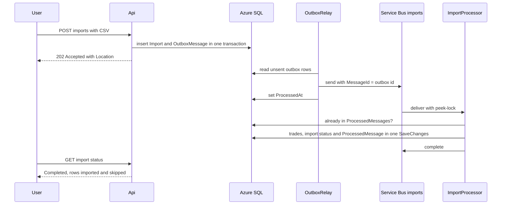

# Chapter 7: Background work and messaging

> ⏱ About 35 min · You'll learn: how to move slow work out of the HTTP request with hosted services and an Azure Service Bus queue, how the transactional outbox and an idempotent consumer make "at-least-once" safe, what peek-lock, dead-lettering and duplicate detection do for you, and how a worker shuts down without losing work.

---

## 📖 Story: The import that timed out

Elena Rossi forwards a support ticket on Monday morning. A beta user tried to import five years of broker statements, a file of about 15,000 rows (numbers in this story are illustrative). The first prototype parsed the CSV inside the HTTP request, the request ran past the 30-second timeout, and the browser showed an error. So the user clicked **Upload** again. And again. "What does the user see?" Elena asks. "Right now: an error, and then three copies of some of their trades."

Maya Okafor draws two boxes on the whiteboard, "API" and "worker", and a pipe between them. "The API accepts the file and answers in milliseconds. The worker does the heavy lifting. Now tell me what happens when it fails halfway." You start to answer, and she keeps going: "When the worker crashes after writing half the trades. When the queue delivers the same message twice. When the platform stops the worker in the middle of a file. Every one of those happens in the cloud, and every one has to be boring."

At Nordbank Insurance, background work meant a Windows Service with a `System.Timers.Timer` polling a "jobs" table, plus a SQL Agent job at 02:00 that nobody dared to touch. In your **Habits I brought with me** notebook, you write: *"Background work runs on one special server that never restarts."* Then you cross out "never".

---

## 🏚️ Old way → 🚀 New way

| What you did before | What you do now | Why it changed |
|---|---|---|
| Long work inside the HTTP request, with a bigger timeout | The API stores the request and returns `202 Accepted`, and a worker processes it | Users get an answer immediately, and the slow part can retry without the user |
| A Windows Service with a timer on one server, plus a SQL Agent job at 02:00 | `BackgroundService` classes in a worker container with `PeriodicTimer`, or a scheduled Container Apps job | Same hosting, DI, configuration and telemetry as the API, and it lives in the repo |
| MSMQ on the same box, or a "jobs" table polled every few seconds | An Azure Service Bus queue with peek-lock, retries and a dead-letter queue | Failed messages are retried and then parked for a human, not lost or retried forever |
| "Save to the database, then send the message" in two steps | A transactional outbox: the business row and the message row in one transaction | No more "saved but message lost" or "message sent but save rolled back" |
| Hoping a message is processed only once | An idempotent consumer: a `ProcessedMessages` table and a unique index | At-least-once delivery is safe when processing twice changes nothing |
| Stopping the service and hoping the current job finished | Graceful shutdown: stop taking new work, finish in-flight work within a timeout | Containers are stopped all the time (scale-in, new revisions), so stopping must be safe |

---

## 🧠 Hosted services: the Windows Service, rebuilt

> 💡 A `BackgroundService` is a Windows Service that shares hosting, DI, logging and telemetry with the rest of your app, and that can be stopped at any time.

.NET's generic host runs **hosted services** (`IHostedService`) next to everything else in the process. `BackgroundService` is the convenient base class: you override `ExecuteAsync`, and the host starts it, passes it a `CancellationToken`, and signals that token when the process must stop. Ledgerly's worker is three of them in one process:

### 💻 In Ledgerly: the worker's composition root

📄 [`sample/src/Ledgerly.Worker/Program.cs`](https://github.com/vygantas-meskauskis/cloud-native-dotnet/blob/main/sample/src/Ledgerly.Worker/Program.cs)
```csharp
var builder = WebApplication.CreateBuilder(args);

builder.AddServiceDefaults();
builder.AddSqlServerDbContext<LedgerlyDbContext>("ledgerlydb");
builder.AddAzureServiceBusClient("messaging");
// ...
builder.Services.AddHostedService<OutboxRelay>();
builder.Services.AddHostedService<ImportProcessor>();
builder.Services.AddHostedService<AlertEvaluator>();

// Give in-flight messages time to finish when Container Apps stops a replica (SIGTERM).
builder.Services.Configure<HostOptions>(o => o.ShutdownTimeout = TimeSpan.FromSeconds(25));

var app = builder.Build();
app.MapDefaultEndpoints();
app.Run();
```

Notice `WebApplication`, not `Host`: the worker has no API, but it exposes `/health` and `/alive` for Container Apps probes (chapter 14). `AddAzureServiceBusClient("messaging")` is the Aspire client integration. It registers one `ServiceBusClient` as a singleton, which is what the SDK wants: clients, senders and processors are thread-safe and meant to be reused. Compared with the Windows Service, the biggest change is scaling: there can be more than one replica, so you must design for "more than one".

### 💻 In Ledgerly: a periodic job with `PeriodicTimer`

`AlertEvaluator` checks price alerts every 30 seconds (`AlertOptions.IntervalSeconds` defaults to 30). It is the replacement for the SQL Agent job:

📄 [`sample/src/Ledgerly.Worker/AlertEvaluator.cs`](https://github.com/vygantas-meskauskis/cloud-native-dotnet/blob/main/sample/src/Ledgerly.Worker/AlertEvaluator.cs)
```csharp
/// <summary>
/// Periodically checks active price alerts against live quotes.
/// Run the worker with ONE replica (or move this to a scheduled Container Apps job) so alerts are not evaluated twice.
/// </summary>
public sealed partial class AlertEvaluator(
    IServiceScopeFactory scopes, IMarketDataClient marketData, IOptions<AlertOptions> options, TimeProvider clock,
    ILogger<AlertEvaluator> logger) : BackgroundService
{
    protected override async Task ExecuteAsync(CancellationToken stoppingToken)
    {
        using var timer = new PeriodicTimer(TimeSpan.FromSeconds(options.Value.IntervalSeconds), clock);
        while (await timer.WaitForNextTickAsync(stoppingToken))
        {
            try
            {
                await EvaluateAsync(stoppingToken);
            }
            catch (Exception ex) when (ex is not OperationCanceledException)
            {
                // One bad tick (market data down, DB failover) must not kill the loop.
                LogEvaluationFailed(logger, ex);
            }
        }
    }
```

Four habits are packed into those lines:

1. **`PeriodicTimer` instead of `System.Timers.Timer`.** You `await` the next tick, so a slow tick can't overlap the next one, and cancellation ends the loop cleanly.
2. **`TimeProvider clock`** is injected, so tests can control time instead of waiting 30 seconds (chapter 17).
3. **A new DI scope per tick** (`scopes.CreateAsyncScope()` inside `EvaluateAsync`). A hosted service is a singleton, and a `DbContext` must not live that long.
4. **Catch everything except cancellation.** An exception that escapes `ExecuteAsync` ends the loop for good (and by default the host stops too), and one failed market-data call must not end alert checking.

### Two replicas, two evaluations

Read the comment again: a timer loop runs in **every** replica, so two replicas can trigger the same alert at nearly the same moment and create two notifications. The Windows Service never had this problem because there was only one of it. In Azure, the worker has `minReplicas: 1` (so the timers always run) and scales out on queue length, which is exactly when a second `AlertEvaluator` appears. You have three options:

| Option | How | Trade-off |
|---|---|---|
| Keep one replica | `maxReplicas: 1` for the worker | Simple, but imports can't scale out |
| Split the periodic job out | A **Container Apps job** with a **Schedule** (cron) trigger | Runs once per schedule wherever it lands, and finishes. Cron can't express "every 30 seconds" |
| Make the job safe to run twice | A concurrency token on the alert, or a unique constraint on the notification | The most robust choice, at the price of more code |

Container Apps jobs run finite tasks and support three trigger types: **Manual**, **Schedule** (cron) and **Event** (a KEDA scaler such as a Service Bus queue) ([Jobs in Azure Container Apps](https://learn.microsoft.com/en-us/azure/container-apps/jobs)). Ledgerly already runs its migrations as a job with `triggerType: 'Manual'` (📄 [`sample/infra/modules/migration-job.bicep`](https://github.com/vygantas-meskauskis/cloud-native-dotnet/blob/main/sample/infra/modules/migration-job.bicep)). A scheduled alert job would change only the trigger:

```bicep
// illustrative, not in the sample: run the alert check every 5 minutes as a job
    configuration: {
      triggerType: 'Schedule'
      replicaTimeout: 300
      replicaRetryLimit: 0
      scheduleTriggerConfig: { cronExpression: '*/5 * * * *', parallelism: 1, replicaCompletionCount: 1 }
    }
```

💰 A job that runs for a few seconds every few minutes costs less than a replica that is always on. It also needs its own entry point (a console app that runs one evaluation and exits), which is the price of the split.

---

## 🧠 Azure Service Bus queues: peek-lock, retries and the dead-letter queue

> 💡 A queue doesn't make failures go away. It gives every failure a defined next step: try again, or park the message for a human.

A Service Bus **queue** is point-to-point: senders put messages in, and **competing consumers** take them out, so you can add workers to drain it faster. That is load leveling, and it is why a burst of imports doesn't hurt the API.

The important part is how a message is received. In **PeekLock** mode (the default) the receiver gets the message with a lock, and must then **settle** it:

| Settle action | Meaning | Ledgerly uses it when |
|---|---|---|
| **Complete** | "Done, delete it." | The import was applied, or the message was a duplicate |
| **Abandon** | "I failed, give it to someone else." The delivery count goes up | An unexpected exception (database blip, bug) |
| **Dead-letter** | "This will never work. Park it." | The import row doesn't exist: a poison message |

(A fourth action, **Defer**, sets a message aside to fetch later. Ledgerly doesn't use it.)

That gives you **at-least-once** delivery: a message is only removed when someone completes it. The alternative, **ReceiveAndDelete**, removes the message on receipt (at-most-once), so a crash loses it. For imports, losing work is worse than doing it twice, as long as doing it twice is harmless.

Three queue settings turn this into a safety net:

- **MaxDeliveryCount** (default **10**). After that many deliveries, Service Bus moves the message to the **dead-letter queue (DLQ)**, a sub-queue at `<entity>/$deadletterqueue`, with a reason such as `MaxDeliveryCountExceeded`. DLQ messages are **never deleted automatically**, so somebody has to watch them (chapter 16 covers alerting) ([Dead-letter queues](https://learn.microsoft.com/en-us/azure/service-bus-messaging/service-bus-dead-letter-queues)).
- **Duplicate detection.** The queue remembers every `MessageId` it saw within a time window (default **10 minutes**, configurable from 20 seconds to 7 days) and drops repeats. It must be enabled **when the queue is created** ([Duplicate detection](https://learn.microsoft.com/en-us/azure/service-bus-messaging/duplicate-detection)).
- **Dead-lettering on expiration.** Messages whose time-to-live runs out go to the DLQ instead of disappearing.

### 💻 In Ledgerly: the queue, as code

📄 [`sample/infra/modules/servicebus.bicep`](https://github.com/vygantas-meskauskis/cloud-native-dotnet/blob/main/sample/infra/modules/servicebus.bicep)
```bicep
// Service Bus Standard (needed for duplicate detection). Local (SAS key) auth is disabled:
// only Entra identities with a data role can send or receive.
// ...
  sku: { name: 'Standard', tier: 'Standard' }
  properties: {
    disableLocalAuth: true
    // ...
resource imports 'Microsoft.ServiceBus/namespaces/queues@2024-01-01' = {
  parent: namespace
  name: 'imports'
  properties: {
    lockDuration: 'PT1M'
    maxDeliveryCount: 10 // after 10 failed attempts the message moves to imports/$deadletterqueue
    requiresDuplicateDetection: true // the same MessageId within the window is dropped
    duplicateDetectionHistoryTimeWindow: 'PT10M'
    deadLetteringOnMessageExpiration: true
  }
}
```

`lockDuration: 'PT1M'` is how long the worker holds a message before Service Bus assumes it died and offers the message to someone else. `disableLocalAuth: true` means no connection-string keys at all: the worker's managed identity gets the **Azure Service Bus Data Sender** and **Data Receiver** roles further down the same file (chapter 13).

The tier matters 🔧 💰. **Basic** has no duplicate detection, sessions or transactions, so Ledgerly uses **Standard** (shared capacity, pay per operation). **Premium** adds dedicated Messaging Units, VNet and Private Link, and messages up to 100 MB, at a fixed cost even when idle.

One honest gap: locally, the AppHost declares the queue with `messaging.AddServiceBusQueue("imports")` and no extra settings, so **the emulator queue has no duplicate detection window**. The idempotent consumer below is what keeps local runs correct, which is a good argument for never relying on duplicate detection alone.

---

## 🗺️ The life of an import message



---

## 🧠 The transactional outbox: never lose the message

> 💡 If the database and the queue can't share a transaction, put the message in the database and send it later.

Here is the bug you would write by habit:

```csharp
// illustrative, not in the sample: the dual-write bug
db.Imports.Add(import);
await db.SaveChangesAsync(ct);                                   // 1. committed
await sender.SendMessageAsync(new ServiceBusMessage(json), ct);  // 2. what if this throws?
```

If step 2 fails (a network blip, a throttled namespace, a deployment that kills the process), the import row exists but no message does. The import stays `Pending` forever. Swap the order, and you get the opposite bug: a message about an import that was rolled back. SQL Server and Service Bus can't take part in one transaction, so you need a different shape.

The **transactional outbox** writes the message as a **row in the same database**, in the **same transaction** as the business change. A separate relay reads unsent rows and publishes them. `EnqueueOutboxMessage` only adds the row: it is saved by the caller's next `SaveChangesAsync`.

### 💻 In Ledgerly: the outbox row

📄 [`sample/src/Ledgerly.Core/Messaging/Outbox.cs`](https://github.com/vygantas-meskauskis/cloud-native-dotnet/blob/main/sample/src/Ledgerly.Core/Messaging/Outbox.cs)
```csharp
public sealed class OutboxMessage
{
    public Guid Id { get; init; } = Guid.CreateVersion7();
    public required string Type { get; init; }
    public required string Destination { get; init; }
    public required string Payload { get; init; }
    public DateTimeOffset OccurredAt { get; init; } = DateTimeOffset.UtcNow;
    public DateTimeOffset? ProcessedAt { get; set; }
    public int Attempts { get; set; }
    public string? LastError { get; set; }

    // W3C trace context of the request that created the message, so the trace continues in the worker.
    public string? TraceParent { get; init; }
}
// ...
    public static void EnqueueOutboxMessage<T>(this LedgerlyDbContext db, string destination, T message)
    {
        db.OutboxMessages.Add(new OutboxMessage
        {
            Type = typeof(T).Name,
            Destination = destination,
            Payload = JsonSerializer.Serialize(message),
            TraceParent = System.Diagnostics.Activity.Current?.Id,
        });
    }
```

`Guid.CreateVersion7()` gives time-ordered IDs, which index well. `TraceParent` captures the current trace, so the worker's spans appear under the original HTTP request in the dashboard (chapter 15).

### 💻 In Ledgerly: the API side, one `SaveChanges`

📄 [`sample/src/Ledgerly.Api/Endpoints/ImportEndpoints.cs`](https://github.com/vygantas-meskauskis/cloud-native-dotnet/blob/main/sample/src/Ledgerly.Api/Endpoints/ImportEndpoints.cs)
```csharp
        db.Imports.Add(import);
        db.EnqueueOutboxMessage(Queues.Imports, new ImportRequested(import.Id, id));
        await db.SaveChangesAsync(ct); // one transaction: both rows or neither

        return TypedResults.AcceptedAtRoute(ToResponse(import), "GetImport", new { importId = import.Id });
```

EF Core wraps one `SaveChangesAsync` in one transaction, so either both rows exist or neither does. The endpoint returns **202 Accepted** with a `Location` header pointing at `GET /api/imports/{importId}`, which the client polls. The endpoint is also rate-limited (five uploads per user per minute) and rejects files over 1,000,000 bytes, so the "click Upload three times" problem can't turn into a flood.

### 💻 In Ledgerly: the relay

📄 [`sample/src/Ledgerly.Worker/OutboxRelay.cs`](https://github.com/vygantas-meskauskis/cloud-native-dotnet/blob/main/sample/src/Ledgerly.Worker/OutboxRelay.cs)
```csharp
    private const int BatchSize = 20;
    private const int MaxAttempts = 10;
    // ...
        var pending = await db.OutboxMessages
            .Where(m => m.ProcessedAt == null && m.Attempts < MaxAttempts)
            .OrderBy(m => m.OccurredAt)
            .Take(BatchSize)
            .ToListAsync(ct);
        // ...
                var sender = _senders.GetOrAdd(message.Destination, serviceBus.CreateSender);
                await sender.SendMessageAsync(
                    new ServiceBusMessage(message.Payload)
                    {
                        MessageId = message.Id.ToString(),
                        Subject = message.Type,
                        ContentType = "application/json",
                    },
                    ct);

                message.ProcessedAt = clock.GetUtcNow();
```

Every 2 seconds (`PeriodicTimer`, again), the relay takes up to 20 unsent rows in order, sends each one, and marks it processed. A failed send increments `Attempts` and stores `LastError`. After 10 attempts the row is skipped, so one broken message can't block the rest, and the row stays in the table for someone to investigate.

The class comment names the weak spot: delivery is at-least-once, because if the worker crashes **after** `SendMessageAsync` but **before** `SaveChangesAsync`, the next tick sends the same row again. The same happens if two worker replicas pick up the same batch. That is why `MessageId = message.Id.ToString()` matters: the duplicate carries the same ID, so Service Bus duplicate detection drops it in Azure, and the consumer recognizes it everywhere.

---

## 🗺️ From upload to processed import



---

## 🧠 The idempotent consumer: processing twice changes nothing

> 💡 You can't get exactly-once delivery, but you can get exactly-once effects.

At-least-once delivery means your handler **will** see some messages twice: relay re-sends, abandoned messages, a lock that expired while a slow import was still running. The handler's job is to make the second time a no-op.

### 💻 In Ledgerly: the handler

📄 [`sample/src/Ledgerly.Worker/ImportProcessor.cs`](https://github.com/vygantas-meskauskis/cloud-native-dotnet/blob/main/sample/src/Ledgerly.Worker/ImportProcessor.cs)
```csharp
    private async Task HandleAsync(ProcessMessageEventArgs args)
    {
        var messageId = args.Message.MessageId;
        // ...
        if (await db.ProcessedMessages.AnyAsync(p => p.MessageId == messageId, ct))
        {
            LogDuplicate(logger, messageId);
            await args.CompleteMessageAsync(args.Message, ct);
            return;
        }
        // ...
        if (import is null)
        {
            // Poison message: retrying will never help. Park it in the DLQ for a human to look at.
            await args.DeadLetterMessageAsync(args.Message, "ImportNotFound", $"No import for message {messageId}", ct);
            return;
        }

        try
        {
            var outcome = await ApplyImportAsync(db, import, ct);
            db.ProcessedMessages.Add(new ProcessedMessage { MessageId = messageId, Handler = HandlerName });
            await db.SaveChangesAsync(ct); // trades + import status + idempotency record in ONE transaction
            await args.CompleteMessageAsync(args.Message, ct);
            // ...
        }
        catch (Exception ex) when (ex is not OperationCanceledException)
        {
            // ...
            await args.AbandonMessageAsync(args.Message, cancellationToken: ct); // Service Bus will redeliver
        }
    }
```

Walk through it the way Maya would:

| What happens | What the code does | Result |
|---|---|---|
| A duplicate arrives (relay re-send, emulator without duplicate detection) | `ProcessedMessages` already has this `MessageId` | Complete it, log it, do nothing else |
| The import row doesn't exist | `DeadLetterMessageAsync(..., "ImportNotFound", ...)` | Retrying can't help, so it goes straight to the DLQ |
| The database blips during `SaveChangesAsync` | Nothing was committed, then `AbandonMessageAsync` | Delivered again, up to 10 times, then the DLQ |
| The worker crashes after `SaveChangesAsync`, before `Complete` | The lock expires and the message comes back | The `ProcessedMessages` check finds it: complete, no second import |
| The file breaks a business rule (selling more than you hold) | `ApplyImportAsync` marks the import `Failed` and returns `"rejected"` | Saved and completed. A business failure is an outcome, not a retry |

Three design choices make this work:

1. **`AutoCompleteMessages = false`** in the `ServiceBusProcessorOptions`. The processor never completes a message on your behalf. You complete it only **after** the transaction committed.
2. **The idempotency record is in the same transaction as the work.** Trades, import status and the `ProcessedMessage` row are saved by one `SaveChangesAsync`. There is no moment where the trades exist but the record doesn't.
3. **The database enforces it, not just the code.** `ProcessedMessage` uses `MessageId` as its **primary key**. If two replicas handle the same message at the same moment, both pass the `AnyAsync` check, but only one insert can succeed. The other gets an exception, abandons, and on redelivery completes as a duplicate.

There is a third layer, in the data model itself. Each broker row's `reference` is stored as `Transaction.ExternalRef`, with a **filtered unique index** on `(PortfolioId, ExternalRef)` (chapter 5), and `ApplyImportAsync` skips references the portfolio already has. Re-uploading the **same file** imports zero new rows and reports them as skipped. That fixes Elena's ticket from the user's side.

The processor also sets `MaxConcurrentCalls = 4`, so one replica handles four imports in parallel. Each call gets its own DI scope and `DbContext`, because a `DbContext` is not thread-safe.

---

## 🧠 Graceful shutdown and boring parsing

> 💡 In the cloud, your process is stopped on purpose many times a day. Make stopping a normal code path.

Container Apps stops replicas when it scales in and when it rolls out a new revision. It sends **SIGTERM**, and the .NET host then stops accepting new work, signals the `CancellationToken` passed to `ExecuteAsync`, and calls `StopAsync` on every hosted service. `HostOptions.ShutdownTimeout` caps how long that may take: the default is **30 seconds**, and Ledgerly sets **25** so it finishes inside the platform's termination grace period (❓ Container Apps' default is believed to be 30 seconds but this course hasn't re-verified it) ([.NET Generic Host](https://learn.microsoft.com/en-us/aspnet/core/fundamentals/host/generic-host)).

### 💻 In Ledgerly: stop taking messages, finish the ones in flight

📄 [`sample/src/Ledgerly.Worker/ImportProcessor.cs`](https://github.com/vygantas-meskauskis/cloud-native-dotnet/blob/main/sample/src/Ledgerly.Worker/ImportProcessor.cs)
```csharp
    public override async Task StopAsync(CancellationToken cancellationToken)
    {
        // Graceful shutdown: stop taking new messages, let in-flight handlers finish.
        if (_processor is not null)
        {
            await _processor.StopProcessingAsync(cancellationToken);
            await _processor.DisposeAsync();
        }

        await base.StopAsync(cancellationToken);
    }
```

If an import is still running when the timeout hits, its cancellation token fires, `SaveChangesAsync` never commits, and the message is never completed. Peek-lock then gives the message to another replica after the lock expires, and the idempotent handler starts from a clean state. A Windows Service killed mid-job left half a batch behind. This one leaves nothing behind, which is the point of putting the whole effect in one transaction.

`OutboxRelay.StopAsync` does the same in its own way: it lets the loop end, then disposes its cached senders.

### 💻 In Ledgerly: a parser that doesn't care where it runs

Background work runs on machines you never see, with cultures you didn't choose. `BrokerCsvParser` parses every number and date with the **invariant culture**, and it reports bad rows instead of throwing:

📄 [`sample/src/Ledgerly.Core/Imports/BrokerCsvParser.cs`](https://github.com/vygantas-meskauskis/cloud-native-dotnet/blob/main/sample/src/Ledgerly.Core/Imports/BrokerCsvParser.cs)
```csharp
/// <summary>
/// Parses the broker export format:
/// <c>date,type,symbol,quantity,price,reference</c> (header required, ISO dates, invariant decimals).
/// Bad rows are reported, not thrown: one typo should not reject a 5 000-row file.
/// </summary>
public static class BrokerCsvParser
{
    // ...
            if (!decimal.TryParse(cells[4], NumberStyles.Number, CultureInfo.InvariantCulture, out var price) || price <= 0)
            {
                errors.Add(new ParseError(lineNumber, $"Invalid price '{cells[4]}'."));
                continue;
            }
```

A unit test proves it by switching the thread to `lt-LT`, where the decimal separator is a comma:

📄 [`sample/tests/Ledgerly.UnitTests/BrokerCsvParserTests.cs`](https://github.com/vygantas-meskauskis/cloud-native-dotnet/blob/main/sample/tests/Ledgerly.UnitTests/BrokerCsvParserTests.cs)
```csharp
    public void Decimal_parsing_ignores_server_culture()
    {
        // The old IIS box had lt-LT culture and "190,10" broke imports. Invariant culture, always.
        var previous = Thread.CurrentThread.CurrentCulture;
        Thread.CurrentThread.CurrentCulture = new System.Globalization.CultureInfo("lt-LT");
        try
        {
            var result = BrokerCsvParser.Parse($"{Header}\n2026-09-01,buy,AAPL,5,190.10,BRK-1");
            Assert.Equal(190.10m, Assert.Single(result.Trades).Price);
        }
        // ...
```

"Reported, not thrown" also matters for the queue. A parse error is a **business result**, saved on the import (`completed_with_errors`, with the first five errors in `Error`). If it were an exception, the message would be abandoned and retried 10 times, with the same result every time, and then dead-lettered. Only throw for things a retry can fix.

---

## ⚠️ Common traps

| Trap | What happens | Do this instead |
|---|---|---|
| Saving to the database, then sending the message | A crash between the two loses the message, and the work never happens | Use a transactional outbox: both rows in one `SaveChanges`, and a relay sends later |
| Leaving `AutoCompleteMessages` on and doing work after an `await` | The message is completed even if your save failed, so the work is lost | Set `AutoCompleteMessages = false` and complete only after the commit |
| Checking for duplicates in code only | Two replicas pass the check at the same time and both apply the import | Back the check with a primary key or unique index in the same transaction |
| Nobody watches the dead-letter queue | Messages pile up silently, because DLQ messages are never auto-deleted | Alert on DLQ depth and write a runbook for replaying them (chapters 16 and 19) |
| A timer job in a worker that scales out | Every replica runs the job, so alerts fire twice | Keep that worker at one replica, move the job to a scheduled Container Apps job, or make it idempotent |
| Ignoring the `CancellationToken` in `ExecuteAsync` | Shutdown waits for the timeout and then the process is killed mid-work | Pass `stoppingToken` everywhere, and keep the shutdown timeout below the platform's grace period |

---

## 🧰 Helpers

**Checklist: a new message type**

1. Define the message as a small `record` with IDs, not whole entities (like `ImportRequested(ImportId, PortfolioId)`).
2. Enqueue it with `db.EnqueueOutboxMessage(...)` **before** the one `SaveChangesAsync` of the request.
3. In the consumer: check `ProcessedMessages`, do the work, add the `ProcessedMessage`, save once, then complete.
4. Decide, for each failure, which settle action it gets: abandon for transient faults (timeouts, throttling), dead-letter for messages that can never succeed, complete for business outcomes you recorded.
5. Add a test that delivers the same message twice and asserts that nothing changes the second time (chapter 17).

**Make it permanent:**

- Add "What happens when this message is delivered twice?" to your pull request review checklist, for example the toolkit's `pr-review-checklist.md` (see [the toolkit](../toolkit/README.md)).
- Keep queue settings (`maxDeliveryCount`, duplicate detection, dead-lettering) in Bicep next to the code that depends on them, so a reviewer sees both in one pull request (chapter 11).
- Write down the rule "one `SaveChanges` per message, complete after commit" in your team's ADRs. Terms such as *outbox* and *idempotency* are in the [glossary](../GLOSSARY.md).

---

## 🧪 Try it yourself (optional, ~30 min)

1. Start the system and create a token:
   ```bash
   cd sample
   aspire run
   dotnet user-jwts create --project src/Ledgerly.Api
   ```
2. Open `src/Ledgerly.Api/Ledgerly.Api.http` in your IDE, set `@api` to the API's URL from the dashboard and `@token` to your token, and create a portfolio. Copy its `id`.
3. Save this as `broker.csv`:
   ```text
   date,type,symbol,quantity,price,reference
   2026-09-01,buy,AAPL,5,190.10,BRK-1001
   2026-09-15,buy,MSFT,3,410.00,BRK-1002
   2026-09-20,buy,MSFT,abc,410.00,BRK-1003
   ```
4. Upload it (replace the URL, ID and token):
   ```bash
   curl -i -X POST https://localhost:7180/api/portfolios/<id>/imports -H "Authorization: Bearer <token>" -F "file=@broker.csv"
   ```
   You get `202 Accepted` and a `Location` header right away.
5. Request the `Location` URL (with the same `Authorization` header) until the status is `Completed`. Expect 2 rows imported and 1 skipped, with "Invalid quantity" in `error`.
6. Upload **the same file again**. The second import completes with 0 rows imported and all rows skipped: idempotency by `ExternalRef`.
7. In the dashboard's **Traces** view, find the `POST` request. The worker's `outbox publish imports` span appears in the same trace: that is the `TraceParent` column at work. Then find the `import process` span for the same import (chapter 15 explains how trace context crosses the queue).
8. Stop the AppHost and run the unit tests, including the `lt-LT` parser test:
   ```bash
   dotnet test --solution Ledgerly.slnx
   ```

---

## ✅ Recap

1. Slow work leaves the HTTP request: the API returns 202, and hosted services in the worker do the work with `PeriodicTimer` loops and a Service Bus processor.
2. The transactional outbox guarantees the message is sent if and only if the data was saved, and the idempotent consumer (one transaction plus a primary key) makes at-least-once delivery safe.
3. Peek-lock, `MaxDeliveryCount`, the dead-letter queue and graceful shutdown give every failure a defined next step, so stopping or crashing a worker never leaves half an import behind.

**Next → [Chapter 8: GitHub as the team's home](08-github-as-the-teams-home.md)**
