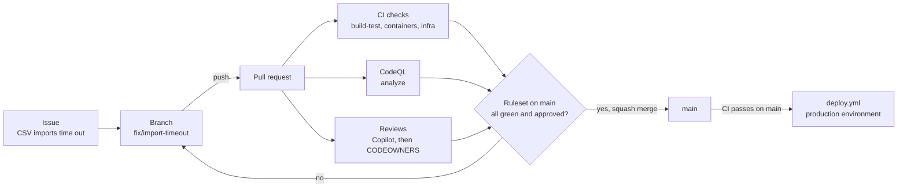
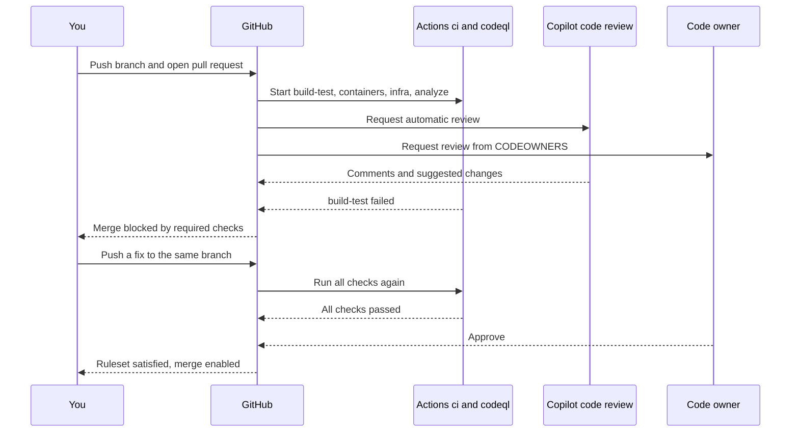

# Chapter 8: GitHub as the team's home

> ⏱ About 30 min · You'll learn: how a change travels from a short-lived branch to `main` through a pull request, how rulesets, required checks and CODEOWNERS turn team rules into settings GitHub enforces, and how Dependabot, CodeQL, secret scanning and Copilot code review keep watch without a meeting.

---

## 📖 Story: Your first pull request

The background import from chapter 7 works on your machine. The Service Bus emulator drains the queue, the duplicate test passes, and Elena's support ticket can finally be closed. At Nordbank Insurance, this is where the waiting began. Your work would sit on a branch called `release/2019-Q3` for weeks. Someone would zip a diff and email it to two senior developers, who would print it and bring it to the Thursday review meeting. Then came the merge weekend, when four long-lived branches met for the first time and nobody went home before midnight.

You ask Maya who you should email for a review.

"Nobody," she says. "Push your branch and open a pull request. CI will build it, CODEOWNERS will ask the right people, and Copilot will leave comments before any of us look. If `main` is red or nobody approved, the merge button stays grey. Not because we're strict: because GitHub won't let it."

Tomás adds from the next desk: "And keep it small. If your PR is open longer than two days, it's two PRs."

Jonas Berg forwards you a link. A Dependabot pull request bumped the OpenTelemetry packages overnight, CI is already green, and it's waiting for one approval. "That's the other half of the job," he says. "The robots open PRs too. We review them like anyone else's."

In your notebook, under **Habits I brought with me**, you write: *"Code review is a meeting."* Then: *"Merging is an event."* You suspect both are about to be crossed out.

---

## 🏚️ Old way → 🚀 New way

| What you did before | What you do now | Why it changed |
|---|---|---|
| Long-lived release branches, merged on a "merge weekend" | Short-lived branches off `main`, merged through a pull request within a day or two (GitHub flow) | Small diffs are easy to review and easy to revert, and conflicts stay small |
| Reviews by email and in a Thursday meeting | Reviews in the pull request, with CODEOWNERS requesting the right people automatically | The discussion lives next to the code, forever, and nobody has to remember who owns what |
| "Never push to trunk" as a line in the wiki | A ruleset on `main`: pull request required, checks required, no force pushes | A rule GitHub enforces can't be forgotten on a Friday evening |
| A build server someone checked "now and then" | Required status checks from GitHub Actions on every PR (chapter 9) | Red means "can't merge", not "someone should look at that" |
| Library upgrades once a year, as a project | Dependabot opens grouped update PRs every week, and CI tests each one | Small, frequent upgrades are cheap. A three-year jump is a migration |
| A security review by another team, just before release | CodeQL on every PR, secret scanning and push protection on every push | Findings arrive while the code is still fresh in your head |
| Commit messages like "fix" and "wip 2" | Conventional commits and PR titles such as `feat(imports): process CSV files in the background` | History you can scan, and release notes you can generate |

---

## 🧠 GitHub flow: one main branch, many short ones

> 💡 `main` is always releasable. Every change reaches it through a pull request, and nothing else does.

GitHub flow is deliberately simple:

1. **Branch** from `main` with a descriptive name (`fix/import-timeout`, `feat/price-alerts`).
2. **Commit** small steps and **push** early. A pushed branch is backed up and visible.
3. **Open a pull request**, as a draft if you want feedback before it's finished.
4. **CI runs** and **reviewers comment.** You push fixes to the same branch, and the PR updates.
5. **Merge** when the checks are green and the required approvals are in. Delete the branch.
6. **Deploy** from `main`. At Ledgerly that happens automatically after CI passes on `main` (chapter 12).

There is no `develop` branch, no `release/*` branch and no merge weekend. Unfinished work either stays on its branch, or it's merged behind a feature flag (the alerts endpoint already does this, see chapter 19). The flag decides what users see. The branch decides nothing.

### 💻 In Ledgerly: what "merged to main" sets in motion

The CI workflow runs on every pull request and every push to `main` that touches the sample:

📄 [`.github/workflows/ci.yml`](https://github.com/vygantas-meskauskis/cloud-native-dotnet/blob/main/.github/workflows/ci.yml)
```yaml
# CI: every push and pull request is built and tested. A red build blocks the merge (see branch protection, chapter 8).
name: ci

on:
  push:
    branches: [main]
    paths: ["sample/**", ".github/workflows/ci.yml"]
  pull_request:
    paths: ["sample/**", ".github/workflows/ci.yml"]
  workflow_dispatch:
```

The deploy workflow doesn't watch branches at all. It waits for CI to finish on `main`:

📄 [`.github/workflows/deploy.yml`](https://github.com/vygantas-meskauskis/cloud-native-dotnet/blob/main/.github/workflows/deploy.yml)
```yaml
on:
  workflow_run:
    workflows: [ci]
    types: [completed]
    branches: [main]
  workflow_dispatch:
```

So the only road to production is: pull request, green CI, merge, green CI on `main`, deploy. Chapter 9 walks through the CI file line by line, and chapter 12 does the same for deploy.

### Issues, projects and commit messages

Work starts as an **issue**, not as an email. Elena writes the "CSV imports time out" issue with the user's words and a sample file. You link your PR to it, and the issue closes when the PR merges. A **project** board (Elena's has the columns *Todo*, *In progress*, *In review* and *Done*) shows the team's work without a status meeting. Leo uses the same board for frontend tasks, so the API change and the UI change sit next to each other.

Ledgerly writes commit messages and PR titles as **conventional commits**: a type, an optional scope and a short summary.

```text
feat(imports): process CSV files in a background worker
fix(worker): complete duplicate messages instead of abandoning them
docs(readme): replace the setup wiki with aspire run
chore(deps): bump the opentelemetry group
```

The team squash-merges, so the PR title becomes the one commit on `main`. Scan `git log --oneline` and you can tell features from fixes from chores at a glance, and a tool can turn the history into release notes later.

---

## 🗺️ The life of a change



---

## 🧠 Protecting main: rulesets, required checks and environments

> 💡 A team rule that lives in a wiki is a suggestion. A team rule that lives in a ruleset is a fact.

GitHub has two ways to protect a branch. **Classic branch protection rules** are the older one. **Rulesets** are the newer mechanism, and the one to reach for today ([About rulesets](https://docs.github.com/en/repositories/configuring-branches-and-merges-in-your-repository/managing-rulesets/about-rulesets)):

- 🔧 **Availability:** rulesets work on public repositories on GitHub Free, and on public and private repositories on Pro, Team and Enterprise Cloud. Organization-wide rulesets and push rulesets need Team or Enterprise.
- A repository can have up to **75 rulesets**. They **layer** with each other and with classic branch protection, and when several apply, the **most restrictive** wins.
- Each ruleset has an **enforcement status**: **Active**, **Evaluate** (report what would have been blocked, without blocking) or **Disabled**. Evaluate is how you roll out a stricter rule without surprising the team.
- A **bypass list** names who may skip the rules, for example a release bot. Keep it short. Every name on it is a way around review.
- Anyone with read access can see the rulesets, so "what are the rules here?" has an answer you can look up.

The rules you can turn on include ([Available rules for rulesets](https://docs.github.com/en/repositories/configuring-branches-and-merges-in-your-repository/managing-rulesets/available-rules-for-rulesets)): require a pull request (with a number of approvals, review from code owners, and dismissing stale approvals when new commits arrive), **require status checks to pass**, require linear history, block force pushes, require signed commits, require deployments to succeed and require code scanning results.

Ledgerly's ruleset on `main` is short:

| Rule | Setting | Why |
|---|---|---|
| Require a pull request | 1 approval, review from code owners, dismiss stale approvals | Nobody merges their own unreviewed code, and approving an old version doesn't count |
| Require status checks | The CI and CodeQL jobs (below), branch up to date | `main` stays green |
| Block force pushes | On | History on `main` is never rewritten |
| Require linear history | On | Squash merges keep one commit per PR |
| Bypass list | Empty | Not even Maya skips review |

### 💻 In Ledgerly: where the check names come from

A **required status check** must have passed on the **latest commit** of the PR, and its name must match the **job name exactly**. The names come straight from the workflow files:

📄 [`.github/workflows/ci.yml`](https://github.com/vygantas-meskauskis/cloud-native-dotnet/blob/main/.github/workflows/ci.yml)
```yaml
jobs:
  build-test:
    runs-on: ubuntu-latest
    timeout-minutes: 20
    # ...
  containers:
    runs-on: ubuntu-latest
    needs: build-test
    timeout-minutes: 20
    strategy:
      matrix:
        project: [Ledgerly.Api, Ledgerly.Worker, Ledgerly.MarketData, Ledgerly.MigrationService]
    # ...
  infra:
    runs-on: ubuntu-latest
    timeout-minutes: 10
```

📄 [`.github/workflows/codeql.yml`](https://github.com/vygantas-meskauskis/cloud-native-dotnet/blob/main/.github/workflows/codeql.yml)
```yaml
jobs:
  analyze:
    runs-on: ubuntu-latest
    timeout-minutes: 30
```

None of the jobs has a `name:`, so the job ID is the check name: `build-test`, `infra` and `analyze`. A matrix job reports one check per matrix value, so `containers` shows up four times, as `containers (Ledgerly.Api)`, `containers (Ledgerly.Worker)` and so on. Rename a job, and the required check waits forever for a name that no longer reports. Change the workflow and the ruleset in the same PR.

### Environments: the gate before production

Rulesets guard `main`. **Environments** guard deployments. Ledgerly's deploy job runs in an environment called `production`:

📄 [`.github/workflows/deploy.yml`](https://github.com/vygantas-meskauskis/cloud-native-dotnet/blob/main/.github/workflows/deploy.yml)
```yaml
    environment:
      name: production # protection rules (reviewers, branch filter) live on the environment
      url: ${{ steps.apps.outputs.apiUrl }}
```

An environment can require **reviewers** (up to **6** users or teams, and only **one** of them needs to approve, optionally never the person who triggered the run), a **wait timer**, **deployment branch** restrictions and custom protection rules. It also holds its own secrets and variables ([Deployments and environments](https://docs.github.com/en/actions/reference/workflows-and-actions/deployments-and-environments)).

🔧 💰 Read the plan small print: on **Free, Pro and Team** plans, required reviewers and wait timers work only for **public** repositories. For a private repository you need Enterprise. Ledgerly's beta repo is private on Team, so the team relies on the `main` ruleset plus a branch filter on the environment, and Priya gets a notification for every deploy.

Tomás has one complaint about all of this: rulesets and environments are **settings**, not files, so they don't show up in a diff. "If it's not in git, it doesn't exist," he says, and writes the ruleset down as an ADR (the toolkit has `adr-template.md`) so the next person can see what was decided and why.

---

## 🧠 Reviews that find the right people: CODEOWNERS, templates and Copilot

> 💡 Let GitHub decide who reviews and what the author must say. Spend human attention on the design.

### CODEOWNERS

A **CODEOWNERS** file maps paths to the people or teams who own them. When a PR touches a path, its owners are **requested for review automatically**. With the "require review from code owners" rule, their approval becomes mandatory ([About code owners](https://docs.github.com/en/repositories/managing-your-repositorys-settings-and-features/customizing-your-repository/about-code-owners)).

Two details matter:

- GitHub looks for the file in `.github/CODEOWNERS`, then `CODEOWNERS` at the root, then `docs/CODEOWNERS`, and uses the **first one it finds**.
- Inside the file, the **last matching pattern wins**. Put the broad rule first and the specific ones below it.

The sample repository doesn't contain a CODEOWNERS file. This is what Ledgerly's looks like:

```text
# illustrative, not in the sample: .github/CODEOWNERS
# The last matching pattern wins, so the catch-all goes first.
*                                   @ledgerly/developers

# Infrastructure and pipelines: Tomás's team reviews every change.
/sample/infra/                      @ledgerly/platform
/.github/workflows/                 @ledgerly/platform

# Supply chain: package sources and versions need a security review.
/sample/nuget.config                @ledgerly/security
/sample/Directory.Packages.props    @ledgerly/security

# Schema changes are hard to undo: the tech lead looks at every migration.
/sample/src/Ledgerly.Core/Data/Migrations/   @maya-okafor
```

Use teams rather than individuals where you can, so a vacation doesn't block a merge. Note what the supply-chain lines mean: every Dependabot NuGet PR touches `Directory.Packages.props`, so Jonas's team approves each one. That's intended.

### The pull request template

A **pull request template** pre-fills the description of every new PR, so the reviewer always gets the same questions answered. The sample doesn't include one, but the toolkit has `pull_request_template.md` ready to copy to `.github/` ([see the toolkit](../toolkit/README.md)). Its shape:

```markdown
<!-- illustrative, not in the sample: .github/pull_request_template.md -->
## What and why
Fixes #

## How I tested it
- [ ] Unit or integration tests added or updated
- [ ] Ran it locally with `aspire run`

## What happens when it fails?
<!-- Retries, timeouts, the dead-letter queue, rollback -->

## Checklist
- [ ] Database migration is backward compatible (old code still runs against the new schema)
- [ ] New settings are documented, and no secrets are in code or config
- [ ] Logs, metrics or traces added for the new path
```

The "What happens when it fails?" heading is Maya's. Every PR answers it before she has to ask.

### Copilot code review and the Copilot cloud agent

**Copilot code review** reviews a pull request the way a teammate would: it leaves comments on the diff, often with a suggested change. You request it like any other reviewer, or make it **automatic** for a repository or organization through settings or a ruleset. Business and Enterprise organizations can enable it even for members who don't have a Copilot license, billed to the organization 💰 ([Copilot on GitHub](https://docs.github.com/en/copilot/concepts/copilot-surfaces/copilot-on-github)).

At Ledgerly, Copilot reviews first and humans second. It's good at the things people skim: a missing `CancellationToken`, a `DbContext` captured in a singleton, a null path nobody tested. Its comment is **not an approval**, and it doesn't count toward the ruleset. A person who understands the design still signs off.

🔧 The **Copilot cloud agent** (GitHub's docs renamed it from "Copilot coding agent") goes one step further. You assign an issue to Copilot, it works in an environment powered by GitHub Actions, and it opens a pull request for review. It's available on paid plans, and for Business and Enterprise an org admin has to enable it. Its PR goes through exactly the same gates as yours: CI, CODEOWNERS, a human approval. Chapter 20 covers how to write issues it can finish, and the `.github/copilot-instructions.md` file that teaches it Ledgerly's conventions.

---

## 🗺️ A pull request meets the gates



---

## 🧠 Supply chain on autopilot: Dependabot, CodeQL and secret scanning

> 💡 The safest dependency update is a small one that CI tested last week, not a big one somebody postponed for a year.

### Dependabot version updates

**Dependabot** reads `.github/dependabot.yml` and opens pull requests when a newer version of a package or an action exists. Every one of those PRs runs CI like yours does, so "is this upgrade safe?" is answered by your tests, not by a hunch.

### 💻 In Ledgerly: grouped updates for NuGet and actions

📄 [`.github/dependabot.yml`](https://github.com/vygantas-meskauskis/cloud-native-dotnet/blob/main/.github/dependabot.yml)
```yaml
# Dependabot opens pull requests for outdated packages and actions. CI tests every one of them.
version: 2
updates:
  - package-ecosystem: nuget
    directory: /sample
    schedule:
      interval: weekly
    groups:
      # One PR per family instead of twenty. Versions inside a family must move together.
      aspire:
        patterns: ["Aspire.*"]
      dotnet-platform:
        patterns: ["Microsoft.AspNetCore.*", "Microsoft.EntityFrameworkCore*", "Microsoft.Extensions.*"]
      opentelemetry:
        patterns: ["OpenTelemetry*", "Azure.Monitor.OpenTelemetry*"]
      testing:
        patterns: ["xunit*", "Microsoft.Testing.*", "Testcontainers*"]

  - package-ecosystem: github-actions
    directory: /
    schedule:
      interval: weekly
    groups:
      actions:
        patterns: ["*"]
```

Read it top to bottom:

- **Two ecosystems.** `nuget` looks in `/sample`, where the solution and `Directory.Packages.props` live. `github-actions` looks at `/`, which means the workflows in `.github/workflows`. Dependabot understands Central Package Management, so it edits the one `PackageVersion` line instead of every project file.
- **Groups.** Without them you'd get one PR per package: six Aspire PRs that must all merge together anyway. With them you get one PR per family. Groups match by `patterns`, and can also be limited with `update-types: [minor, patch]` if you want majors to arrive alone.
- **Weekly.** `schedule.interval` also accepts `daily`, `monthly`, `quarterly`, `semiannually`, `yearly` and `cron`. Weekly is a rhythm a small team can keep.
- 🔧 **Cooldown.** Version updates have a default **cooldown of 3 days**: a new release isn't proposed until it's 3 days old. That gives the ecosystem time to discover a broken release before it reaches you.

Two more ecosystems worth knowing: `dotnet-sdk` updates the SDK version in `global.json`, and `docker` updates base images in Dockerfiles (Ledgerly has none, see chapter 9) ([Dependabot options reference](https://docs.github.com/en/code-security/reference/supply-chain-security/dependabot-options-reference)).

Dependabot is half of the supply-chain story. The other half runs at build time: NuGet audit fails the build when a package has a known vulnerability, which is exactly what happened while building the sample (chapter 9).

### CodeQL code scanning

**CodeQL** is GitHub's static analysis engine. It looks for security bugs (SQL injection, path traversal, unsafe deserialization) and reports them under **Security → Code scanning** and as comments on the pull request ([Configuring code scanning](https://docs.github.com/en/code-security/how-tos/find-and-fix-code-vulnerabilities/configure-code-scanning/configure-code-scanning)).

### 💻 In Ledgerly: the CodeQL workflow

📄 [`.github/workflows/codeql.yml`](https://github.com/vygantas-meskauskis/cloud-native-dotnet/blob/main/.github/workflows/codeql.yml)
```yaml
# Static security analysis (SAST). Findings show up under Security > Code scanning and on pull requests.
name: codeql

on:
  push:
    branches: [main]
    paths: ["sample/**"]
  pull_request:
    paths: ["sample/**"]
  schedule:
    - cron: "17 3 * * 1" # weekly, catches new queries against unchanged code

permissions:
  contents: read
  security-events: write

jobs:
  analyze:
    runs-on: ubuntu-latest
    timeout-minutes: 30
    steps:
      - uses: actions/checkout@v7
      - uses: github/codeql-action/init@v4
        with:
          languages: csharp
          build-mode: none # no build needed for C#, analysis reads the source
      - uses: github/codeql-action/analyze@v4
```

Three choices stand out:

- **`build-mode: none`.** For C#, CodeQL can analyze the source without compiling it (the other modes are `autobuild` and `manual`). It's faster, and a broken build can't hide a finding.
- **The weekly `schedule`.** The queries improve over time, so every Monday at 03:17 UTC the same code gets checked against the new queries, even if nobody pushed.
- **`security-events: write`.** That's the one extra permission the workflow needs, to upload its results. Everything else stays read-only.

This is the **advanced setup**: a workflow file you control. The **default setup** is a one-click setting with no file at all, and for C# it also uses `build-mode: none`. It scans pushes to the default branch, pull requests and weekly. 🔧 💰 CodeQL is free for **public** repositories. Private and internal repositories in an organization need **GitHub Code Security**, sold separately since 2025.

### Secret scanning and push protection

**Secret scanning** finds credentials committed to the repository, and **push protection** blocks a push that contains one before it ever reaches GitHub. Both are free and automatic for public repositories, where push protection for users is on by default. 🔧 For private repositories and repo-level push protection you need **GitHub Secret Protection** ([About push protection](https://docs.github.com/en/code-security/secret-scanning/introduction/about-push-protection)).

Ledgerly's best defense is having almost nothing to leak: no SAS keys (chapter 7), no deployment secrets thanks to OIDC (chapter 12), and managed identities everywhere (chapter 13). Jonas still turns push protection on, because a developer's personal token in a test script is enough to ruin a week.

---

## ⚠️ Common traps

| Trap | What happens | Do this instead |
|---|---|---|
| Renaming a CI job without updating the ruleset | The required check never reports under the old name, and every PR waits forever | Change the job name and the required checks in the same change, and tell the team |
| Making a path-filtered workflow a required check | A PR that doesn't touch `sample/**` never runs CI, so the required check stays pending | Require only checks that run on every PR, or remove the path filter from the required workflow |
| Expecting environment reviewers on a private repo on Team | The `production` approval gate silently doesn't apply 🔧 | Check your plan. Use branch filters and the `main` ruleset, or move to Enterprise |
| A broad CODEOWNERS rule at the bottom of the file | It matches everything and overrides the specific owners above it | Catch-all first, specific paths last, because the last match wins |
| Treating Copilot's review as the approval | Nobody who understands the design looked at the change | Copilot reviews first, a human approves. Its comments don't satisfy the ruleset |
| Ignoring Dependabot PRs for months | They pile up, conflict with each other, and the upgrade becomes a project again | Review the grouped PRs weekly. Green CI plus a release-notes skim is usually enough |
| A long bypass list "just in case" | Anyone on it can merge without checks, and eventually someone does | Keep the bypass list empty or limited to a bot, and use Evaluate mode to trial new rules |

---

## 🧰 Helpers

The pull request loop from the terminal, with the GitHub CLI:

```bash
git switch -c fix/import-timeout          # branch from an up-to-date main
git commit -am "fix(imports): move CSV processing to the worker"
git push -u origin HEAD
gh pr create --fill                       # title and body from your commits
gh pr checks --watch                      # wait for CI and CodeQL
gh pr view --web                          # read the review comments
gh pr merge --squash --delete-branch      # when the ruleset allows it
```

Reviewing someone else's PR locally:

```bash
gh pr list                                # open PRs in this repo
gh pr checkout 42                         # check out PR #42 as a local branch
cd sample
dotnet test --solution Ledgerly.slnx      # run the tests yourself
```

A conventional commit cheat sheet: `feat` (a new feature), `fix` (a bug fix), `docs`, `test`, `refactor` (no behavior change), `ci` (workflows), `chore` (dependencies, tooling). Add a scope in parentheses when it helps: `fix(worker): ...`.

**Make it permanent:**

- Copy the toolkit's `pull_request_template.md` to `.github/` and `dependabot.yml` to `.github/`, then adjust the directory and groups ([toolkit](../toolkit/README.md)).
- Add a CODEOWNERS file with teams, not individuals, and turn on "require review from code owners" in the `main` ruleset.
- Create the ruleset in **Evaluate** mode first, watch a week of PRs, then switch it to **Active**. Record it in an ADR.
- Turn on Copilot code review as automatic for the repository, and add the toolkit's `copilot-instructions.md` so its comments follow your conventions.
- Use the toolkit's `pr-review-checklist.md` when you review. New terms are in the [glossary](../GLOSSARY.md).

---

## 🧪 Try it yourself (optional, ~25 min)

1. Fork the course repository and clone your fork, then make your fork the default for `gh`:
   ```bash
   gh repo fork vygantas-meskauskis/cloud-native-dotnet --clone
   cd cloud-native-dotnet
   gh repo set-default
   ```
   Pick your fork when `gh repo set-default` asks. On GitHub, open your fork's **Actions** tab and enable workflows if GitHub asks you to.
2. Create a branch and make a small change under `sample/` so CI runs, for example improve a comment in `sample/src/Ledgerly.Worker/AlertEvaluator.cs`:
   ```bash
   git switch -c docs/alert-evaluator-comment
   git commit -am "docs(worker): explain why alerts need a single replica"
   git push -u origin HEAD
   ```
3. Open the pull request against your fork and watch the checks:
   ```bash
   gh pr create --fill
   gh pr checks --watch
   ```
   Note the check names: `build-test`, `containers (Ledgerly.Api)` and its siblings, `infra`, `analyze`.
4. In your fork, go to **Settings → Rules → Rulesets** and create a branch ruleset for the default branch. Require a pull request and the `build-test` status check, block force pushes, and set enforcement to **Evaluate**. (Your fork is public, so rulesets work on the Free plan 🔧.)
5. Push another commit to the PR. Then open **Settings → Rules → Insights** and see what the ruleset would have blocked, without anything being blocked.
6. If your plan includes Copilot code review, add **Copilot** as a reviewer on the PR and read its comments. Decide which ones you'd accept.
7. Add an illustrative `.github/CODEOWNERS` with yourself as the owner of `/sample/infra/`, open a second PR that touches a Bicep comment, and watch GitHub request your review automatically.
8. Merge with `gh pr merge --squash --delete-branch` and run `git log --oneline` on `main`: one commit, with your conventional title.

---

## ✅ Recap

1. GitHub flow keeps `main` releasable: short branches, pull requests for every change, and deployment only after CI passes on `main`.
2. Rulesets, required status checks, CODEOWNERS and environments turn the team's rules into settings GitHub enforces, so nothing depends on someone remembering.
3. Dependabot, CodeQL, secret scanning and Copilot code review run on every PR, and humans still give the approval.

**Next → [Chapter 9: CI with GitHub Actions](09-ci-with-github-actions.md)**
