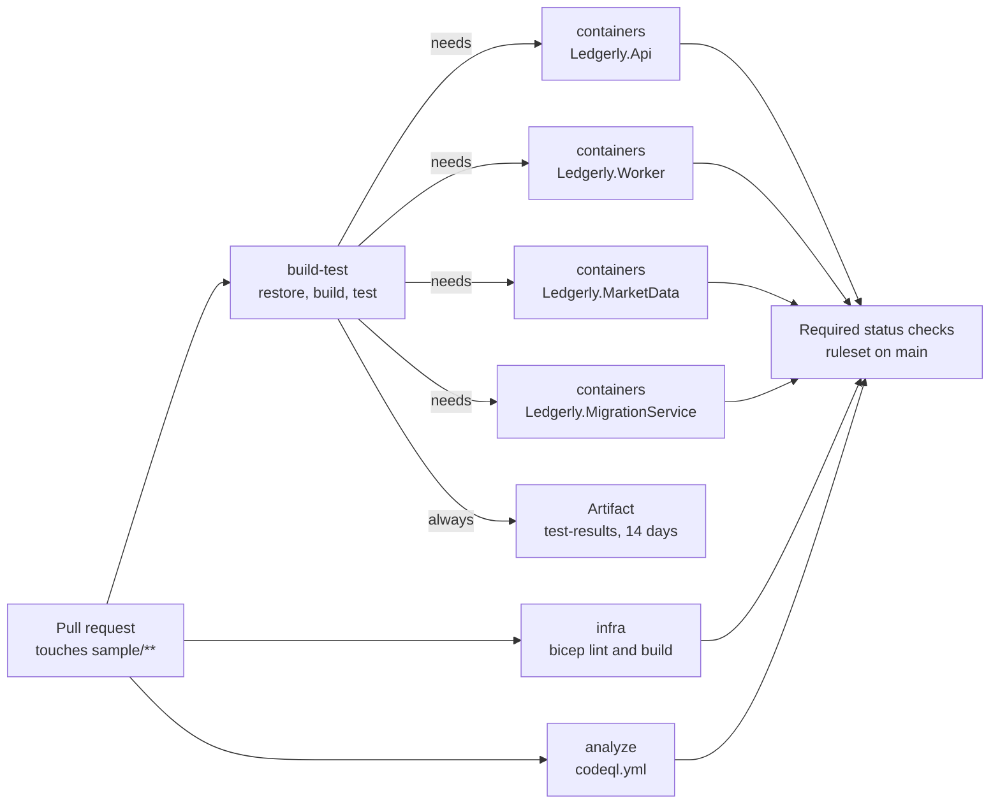
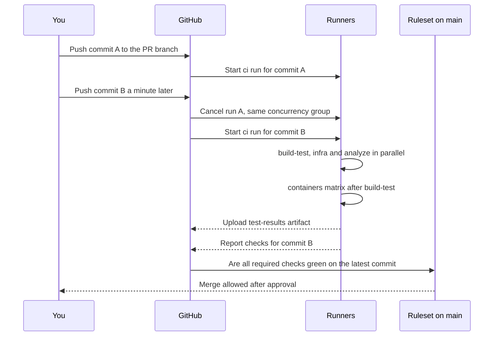

# Chapter 9: CI with GitHub Actions

> ⏱ About 35 min · You'll learn: how Ledgerly's CI workflow builds, tests, packages and lints every pull request on a fresh machine, why it runs the same commands you run locally, how container images get built without a Dockerfile, and the real failures that shaped the workflow.

---

## 📖 Story: Green on my machine, red in CI

Your first week includes a turn on "CI duty", and Tomás starts it by opening the run history. He scrolls back a month to a red cross next to `build-test` on a pull request from Leo, and opens the log:

```text
error NU1903: Package 'System.Security.Cryptography.Pkcs' 10.0.12 has a known high severity vulnerability
```

"Leo's laptop was green," Tomás says. "He hadn't touched a package. CI was red anyway, and CI was right. It's the only machine that counts. Your laptop has a warm cache, an SDK you installed in March and a `bin` folder full of history. The runner starts from nothing, every time."

The cause was a package nobody referenced directly, pulled in by another one, with a newly published vulnerability. NuGet audit flagged it, and because warnings are errors at Ledgerly, the build stopped. One line in `Directory.Packages.props` pinned the patched version. Then Priya tells you about the week the team moved to the .NET 10 SDK and `dotnet test` refused to run at all.

At Nordbank Insurance, "the build" was BUILD01, a tower PC under a desk in the server room. Somebody installed SDKs on it by hand, a scheduled batch file ran every night, and when it broke, the person who knew the batch file was on holiday. In your notebook, under **Habits I brought with me**, you write: *"The build server is a pet."* You don't need a question mark this time.

---

## 🏚️ Old way → 🚀 New way

| What you did before | What you do now | Why it changed |
|---|---|---|
| BUILD01 under a desk, with SDKs installed by hand | A fresh `ubuntu-latest` runner per job, with the SDK version taken from `global.json` | Nothing is left over from the last build, so a green build means the repo is enough |
| A build definition clicked together in a UI | A YAML workflow in `.github/workflows`, reviewed in pull requests | The build changes with the code, in the same PR, with the same review |
| A nightly build | A run on every push and pull request, with outdated runs cancelled | You find out in minutes which commit broke it, not the next morning |
| Test results in a shared folder, or nowhere | TRX results and coverage uploaded as an artifact, even when tests fail | The evidence for a red build is one click away for 14 days |
| A hand-written Dockerfile one person maintains | `dotnet publish /t:PublishContainer`, no Dockerfile | The SDK picks a secure base image, a non-root user and the right port |
| Infrastructure scripts tested by running them in production | `az bicep lint` and `az bicep build` in CI | Mistakes in infrastructure code fail the PR, not the deployment |
| A build service account with admin rights | `permissions: contents: read` for the workflow token | A compromised step can read the repo, and that's all |

---

## 🧠 Anatomy of a workflow

> 💡 A workflow is a file that answers four questions: when does it run, with which permissions, in what order, and where.

GitHub Actions runs **workflows** (YAML files in `.github/workflows`). A workflow has **triggers** (`on:`), one or more **jobs** that each run on a fresh **runner** machine, and **steps** inside each job that either run a shell command (`run:`) or call a reusable **action** (`uses:`). Jobs run in parallel unless one `needs` another.

### 💻 In Ledgerly: the top of ci.yml

📄 [`.github/workflows/ci.yml`](https://github.com/vygantas-meskauskis/cloud-native-dotnet/blob/main/.github/workflows/ci.yml)
```yaml
# CI: every push and pull request is built and tested. A red build blocks the merge (see branch protection, chapter 8).
name: ci

on:
  push:
    branches: [main]
    paths: ["sample/**", ".github/workflows/ci.yml"]
  pull_request:
    paths: ["sample/**", ".github/workflows/ci.yml"]
  workflow_dispatch:

# Least privilege: this workflow only reads the repo.
permissions:
  contents: read

# A new push to the same branch cancels the run that is now outdated.
concurrency:
  group: ci-${{ github.ref }}
  cancel-in-progress: true

defaults:
  run:
    working-directory: sample

env:
  DOTNET_NOLOGO: true
  DOTNET_CLI_TELEMETRY_OPTOUT: true
```

Line by line:

- **`on:`** CI runs on pushes to `main`, on every pull request, and by hand (`workflow_dispatch`, which is what `gh workflow run ci` uses). The **`paths`** filter skips CI when a change touches neither the sample nor the workflow itself. The course text in `chapters/` changes often, and none of it needs a .NET build. Note that the workflow file is in its own filter: a change to CI must run CI.
- **`permissions:`** Every run gets a short-lived `GITHUB_TOKEN`. This block says that token can only **read** the repository. A step that's compromised (a malicious package in a restore, a hijacked action) can't push code, open releases or change settings. Set it at the top of every workflow and widen it per job only when needed, like CodeQL's `security-events: write` in chapter 8.
- **`concurrency:`** Runs in the same group queue up, and `cancel-in-progress: true` cancels the older one. Push three fixes in a row, and only the last one keeps a runner busy. `github.ref` makes the group per branch, so your PR never cancels someone else's ([Control workflow concurrency](https://docs.github.com/en/actions/how-tos/write-workflows/choose-when-workflows-run/control-workflow-concurrency)). Deployments use the opposite setting, as you'll see below.
- **`defaults.run.working-directory: sample`.** Every `run:` step starts in `sample/`, so commands look exactly like the ones in the README. It applies only to `run:` steps, which is why paths given to actions (`sample/global.json`, `sample/TestResults/`) still include the folder.
- **`env:`** Two variables turn off the .NET welcome banner and CLI telemetry. Less noise in the log.

Compare the deploy workflow's concurrency block:

📄 [`.github/workflows/deploy.yml`](https://github.com/vygantas-meskauskis/cloud-native-dotnet/blob/main/.github/workflows/deploy.yml)
```yaml
# Never run two deployments at once, and never cancel one halfway.
concurrency:
  group: deploy-production
  cancel-in-progress: false
```

Cancelling an outdated **build** is free. Cancelling a **deployment** halfway leaves production in a state nobody tested. One fixed group name, no cancellation: deployments wait in line (chapter 12).

---

## 🧠 The build-test job: the commands you already know

> 💡 CI should run the same commands you run locally. If the workflow needs a trick your laptop doesn't, one of them is lying.

### 💻 In Ledgerly: build-test

📄 [`.github/workflows/ci.yml`](https://github.com/vygantas-meskauskis/cloud-native-dotnet/blob/main/.github/workflows/ci.yml)
```yaml
  build-test:
    runs-on: ubuntu-latest
    timeout-minutes: 20
    steps:
      - uses: actions/checkout@v7

      - uses: actions/setup-dotnet@v6
        with:
          global-json-file: sample/global.json

      - name: Restore
        run: dotnet restore Ledgerly.slnx

      # Warnings are errors, analyzers + code style run, NuGet audit fails on vulnerable packages.
      - name: Build
        run: dotnet build Ledgerly.slnx -c Release --no-restore

      # Integration tests start a throwaway SQL Server container with Testcontainers (Docker is on the runner).
      - name: Test
        run: >
          dotnet test --solution Ledgerly.slnx -c Release --no-build
          --coverage --coverage-output-format cobertura
          --report-xunit-trx

      - name: Upload test results
        if: always()
        uses: actions/upload-artifact@v7
        with:
          name: test-results
          path: sample/TestResults/
          retention-days: 14
```

The steps, in order:

1. **`actions/checkout@v7`** clones the commit under test.
2. **`actions/setup-dotnet@v6`** installs the SDK. Instead of a version number in YAML, it reads **`global.json`**, the same file your local `dotnet` reads. Upgrade the SDK in one place and both follow.
3. **Restore, then Build with `--no-restore`, then Test with `--no-build`.** Three steps instead of one so the log shows exactly which phase failed, and nothing is done twice.
4. **`timeout-minutes: 20`.** A hung test (a container that never starts) fails after 20 minutes instead of burning runner time for hours.
5. **`if: always()`** on the upload. Without it, a failed test step skips every later step, and you lose the results exactly when you need them.

The `>` after `run:` is YAML's folded style: the three lines become one command, which keeps a long command readable.

The SDK pin itself:

📄 [`sample/global.json`](https://github.com/vygantas-meskauskis/cloud-native-dotnet/blob/main/sample/global.json)
```json
{
  "sdk": {
    "version": "10.0.100",
    "rollForward": "latestFeature"
  },
  "test": {
    "runner": "Microsoft.Testing.Platform"
  }
}
```

`rollForward: latestFeature` means "10.0.100 or any newer 10.0 SDK", so a patched SDK on the runner is used without a commit. The `test` section is the second real lesson below.

### Lesson 1: NuGet audit failed the build

The Build step's comment promises that warnings are errors and NuGet audit fails on vulnerable packages. Both come from the repo-wide build settings (chapter 3):

📄 [`sample/Directory.Build.props`](https://github.com/vygantas-meskauskis/cloud-native-dotnet/blob/main/sample/Directory.Build.props)
```xml
    <!-- Quality gates: warnings fail the build, analyzers and code style run in every build (also in CI). -->
    <TreatWarningsAsErrors>true</TreatWarningsAsErrors>
    <AnalysisLevel>latest-recommended</AnalysisLevel>
    <EnforceCodeStyleInBuild>true</EnforceCodeStyleInBuild>
```

NuGet audit checks every package in the graph during restore, including the ones you never referenced yourself. While the sample was being built, a **transitive** dependency, `System.Security.Cryptography.Pkcs` (versions 9.0.11 and 10.0.12 came in through other packages), had known vulnerabilities: **NU1902** (moderate) and **NU1903** (high). With `TreatWarningsAsErrors`, those warnings stopped the build.

The tempting fix is to turn audit off or downgrade the warning. The right fix is to pin the patched version with Central Package Management's **transitive pinning**:

📄 [`sample/Directory.Packages.props`](https://github.com/vygantas-meskauskis/cloud-native-dotnet/blob/main/sample/Directory.Packages.props)
```xml
  <PropertyGroup>
    <ManagePackageVersionsCentrally>true</ManagePackageVersionsCentrally>
    <!-- Lets a PackageVersion below also override a TRANSITIVE dependency (used for security patches). -->
    <CentralPackageTransitivePinningEnabled>true</CentralPackageTransitivePinningEnabled>
  </PropertyGroup>

  <ItemGroup Label="Security pins for transitive dependencies (NuGet audit, NU1902/NU1903)">
    <PackageVersion Include="System.Security.Cryptography.Pkcs" Version="10.0.14" />
  </ItemGroup>
```

The label says why the pin exists, so whoever removes it later (when the parent packages ship the fix) knows what to check. This is why a red build with no code change is a feature: the vulnerability was found by a robot during a pull request, not by an attacker.

### Lesson 2: VSTest is gone, Microsoft.Testing.Platform is in

The second failure happened when the team moved to the .NET 10 SDK with xUnit v3 4.x. `dotnet test` stopped with:

```text
Testing with VSTest target is no longer supported by Microsoft.Testing.Platform on .NET 10 SDK
```

Some background. `dotnet test` now has **two modes**. **VSTest mode** is the old one and still the default. **Microsoft.Testing.Platform (MTP) mode** is new in the .NET 10 SDK: the test runner is embedded in the test project, which is an executable. xUnit v3 supports MTP natively, and running MTP test projects through the VSTest bridge is now legacy (MTP v2 drops it on the .NET 10 SDK).

The fix had three parts:

1. **Opt in to MTP** with `"test": { "runner": "Microsoft.Testing.Platform" }` in `global.json` (above).
2. **Use the new command line**: `dotnet test --solution Ledgerly.slnx`. In MTP mode the solution is passed with `--solution`.
3. **Drop the VSTest packages.** `Microsoft.NET.Test.Sdk`, `xunit.runner.visualstudio` and `coverlet.collector` were removed. Coverage now comes from `Microsoft.Testing.Extensions.CodeCoverage`, which provides `--coverage`:

📄 [`sample/tests/Ledgerly.UnitTests/Ledgerly.UnitTests.csproj`](https://github.com/vygantas-meskauskis/cloud-native-dotnet/blob/main/sample/tests/Ledgerly.UnitTests/Ledgerly.UnitTests.csproj)
```xml
  <PropertyGroup>
    <IsPackable>false</IsPackable>
    <IsTestProject>true</IsTestProject>
    <OutputType>Exe</OutputType>
  </PropertyGroup>

  <ItemGroup>
    <PackageReference Include="xunit.v3" />
    <PackageReference Include="Microsoft.Testing.Extensions.CodeCoverage" />
    <PackageReference Include="Microsoft.Extensions.TimeProvider.Testing" />
  </ItemGroup>
```

In the Test step, `--coverage --coverage-output-format cobertura` writes a Cobertura coverage file, and `--report-xunit-trx` writes xUnit's TRX results file. The suite has **23 tests**: 15 unit tests and 8 integration tests against a real SQL Server that Testcontainers starts on the runner (Docker is already installed there). Locally, the integration tests skip themselves when no SQL Server is available (chapter 17).

One more MTP detail bit the team: **when zero tests run, MTP returns exit code 8**, and CI fails. That's usually right, because a filter that matches nothing or a project that isn't discovered should be loud. If a run with no tests is genuinely expected, MTP's `--ignore-exit-code 8` says so explicitly.

### Test results without a test UI

GitHub Actions has **no built-in test results page** beyond job summaries and artifacts. You have three options: upload the TRX files with `actions/upload-artifact` (what Ledgerly does), write a Markdown summary to `$GITHUB_STEP_SUMMARY`, or use a community action that renders TRX files as a check. The artifact keeps the evidence for `retention-days: 14`, long enough to investigate a flaky test without paying to store every run forever 💰.

---

## 🗺️ What one pull request runs



`build-test`, `infra` and `analyze` start in parallel on separate runners. The four `containers` jobs wait for `build-test`, because there's no point packaging code whose tests fail.

---

## 🧠 Container images without a Dockerfile

> 💡 The .NET SDK knows your app better than a Dockerfile does. Let it build the image.

The .NET SDK can build an OCI container image directly: `dotnet publish` with the **`PublishContainer`** target. No Dockerfile, no `docker build`. Without a registry it loads the image into the local Docker or Podman daemon. With `-p:ContainerRegistry=...` it pushes straight to a registry such as Azure Container Registry ([SDK container publishing](https://learn.microsoft.com/en-us/dotnet/core/containers/sdk-publish)). Aspire and azd use the same mechanism for .NET projects.

### 💻 In Ledgerly: the containers matrix

📄 [`.github/workflows/ci.yml`](https://github.com/vygantas-meskauskis/cloud-native-dotnet/blob/main/.github/workflows/ci.yml)
```yaml
  # Proves the deployable images build. Pushing happens only in deploy.yml.
  containers:
    runs-on: ubuntu-latest
    needs: build-test
    timeout-minutes: 20
    strategy:
      matrix:
        project: [Ledgerly.Api, Ledgerly.Worker, Ledgerly.MarketData, Ledgerly.MigrationService]
    steps:
      - uses: actions/checkout@v7
      - uses: actions/setup-dotnet@v6
        with:
          global-json-file: sample/global.json
      - name: Build container image (no Dockerfile needed)
        run: dotnet publish src/${{ matrix.project }} -c Release /t:PublishContainer -p:ContainerImageTag=ci-${{ github.sha }}
```

A **matrix** turns one job definition into one job per value: four projects, four parallel jobs, four checks. Each image is tagged `ci-<commit SHA>`, so you can tell exactly which commit produced it. The image name comes from the project file:

📄 [`sample/src/Ledgerly.Api/Ledgerly.Api.csproj`](https://github.com/vygantas-meskauskis/cloud-native-dotnet/blob/main/sample/src/Ledgerly.Api/Ledgerly.Api.csproj)
```xml
  <PropertyGroup>
    <UserSecretsId>ledgerly-api-6f1d2c</UserSecretsId>
    <!-- SDK container support: `dotnet publish /t:PublishContainer` builds an image without a Dockerfile. -->
    <ContainerRepository>ledgerly-api</ContainerRepository>
  </PropertyGroup>
```

The other three set `ledgerly-worker`, `ledgerly-marketdata` and `ledgerly-migrations`. Without `ContainerRepository`, the name would default to the assembly name.

CI **builds** the images but never pushes them: it has no registry credentials and only `contents: read`. The deploy workflow runs the same command with a registry, after signing in to Azure with OIDC:

📄 [`.github/workflows/deploy.yml`](https://github.com/vygantas-meskauskis/cloud-native-dotnet/blob/main/.github/workflows/deploy.yml)
```yaml
          for project in Ledgerly.Api Ledgerly.Worker Ledgerly.MarketData Ledgerly.MigrationService; do
            dotnet publish "src/$project" -c Release /t:PublishContainer \
              -p:ContainerRegistry="$LOGIN_SERVER" -p:ContainerImageTag="$SHA"
          done
```

### What you get for free

The SDK makes choices that a hand-written Dockerfile often gets wrong:

- **A current base image.** For .NET 10 the default distro is **Ubuntu 24.04 (Noble)**. The images Ledgerly built this way were roughly 120 MB compressed for the default ASP.NET image (illustrative: yours will differ).
- **A non-root user.** Since .NET 8, the Linux images include a non-root user called **`app`**. A container escape lands in an unprivileged account.
- **Port 8080, not 80.** The default ASP.NET Core port in containers is **8080** (it was 80 before .NET 8), configured through `ASPNETCORE_HTTP_PORTS`. That's why every probe and ingress in Ledgerly's Container Apps points at 8080:

📄 [`sample/infra/modules/apps.bicep`](https://github.com/vygantas-meskauskis/cloud-native-dotnet/blob/main/sample/infra/modules/apps.bicep)
```bicep
var probes = [
  {
    type: 'Startup'
    httpGet: { path: '/alive', port: 8080 }
    // ...
  }
  // ...
]
```

### Going smaller: chiseled images

**Chiseled** images (Ubuntu's distroless flavor) have **no shell, no package manager**, run **non-root by default** and contain only the packages the runtime needs. Less inside the image means fewer CVEs to patch. You choose them with `ContainerFamily`, which is appended to the tag (`noble-chiseled` gives `mcr.microsoft.com/dotnet/aspnet:10.0-noble-chiseled`):

```xml
<!-- illustrative, not in the sample: smaller, shell-less base images -->
<PropertyGroup>
  <ContainerFamily>noble-chiseled-extra</ContainerFamily>
</PropertyGroup>
```

Plain chiseled images have no ICU (globalization) or time zone data, so culture-aware formatting and time zone conversions stop behaving like they do on your laptop. Ledgerly would use the **`-extra`** variant, which adds both. The alternative is `InvariantGlobalization=true`, which is only right for apps that never need culture-specific behavior. 🔧 And no shell means no `docker exec ... bash` for debugging, which is exactly the point.

One escaping trap: to set **several** tags, use `ContainerImageTags` (plural), which takes a **semicolon-separated** list. In a shell, an unquoted semicolon ends the command, so quote the value carefully ([Container publish configuration](https://learn.microsoft.com/en-us/dotnet/core/containers/publish-configuration)).

---

## 🧠 Infrastructure is code, so CI lints it

> 💡 Bicep is a compiler. Use it on every pull request, not just on deployment day.

### 💻 In Ledgerly: the infra job

📄 [`.github/workflows/ci.yml`](https://github.com/vygantas-meskauskis/cloud-native-dotnet/blob/main/.github/workflows/ci.yml)
```yaml
  # Infrastructure is code, so it gets linted like code. (Deploying it happens in deploy.yml.)
  infra:
    runs-on: ubuntu-latest
    timeout-minutes: 10
    steps:
      - uses: actions/checkout@v7
      - name: Lint and build Bicep
        run: |
          az bicep install
          az bicep lint --file infra/main.bicep
          az bicep build --file infra/main.bicep --stdout > /dev/null
          az bicep build-params --file infra/main.bicepparam --stdout > /dev/null
```

The job needs no Azure login: linting and compiling are local operations, so it runs with the same read-only token as everything else. `lint` applies the linter rules, `build` compiles `main.bicep` and all its modules to an ARM template (thrown away with `> /dev/null`, since only success matters), and `build-params` checks that `main.bicepparam` matches the template's parameters.

This job exists because of a real lesson. While writing the infrastructure, the Bicep compiler caught two mistakes before Azure did:

- **BCP138**: a `for` expression inside `concat()` in a property, which Bicep doesn't allow. The fix was to move it to a variable.
- **BCP037**: `identity` wasn't a known property on a KEDA scale rule for API version 2024-03-01. The fix was the newer 2025-01-01 API version.

Neither needed a subscription to find. Chapter 11 goes through the Bicep itself.

---

## 🗺️ From push to green



---

## 🧠 Keeping CI fast, current and trustworthy

> 💡 Your workflow runs third-party code with access to your repository. Treat it like a dependency, because it is one.

### Action versions and pinning

Every `uses:` line runs code someone else wrote. Ledgerly uses these versions 🔧:

| Action | Version in the sample |
|---|---|
| `actions/checkout` | `v7` |
| `actions/setup-dotnet` | `v6` |
| `actions/upload-artifact` | `v7` |
| `github/codeql-action` (init and analyze) | `v4` |
| `azure/login` (deploy only) | `v3` |

These are **major version tags**: `@v7` moves to each new 7.x release. You get fixes without editing the file, and you trust the publisher not to break or compromise the tag. The alternative is **pinning to a full commit SHA**, which can never change under you, at the price of less readable files and more update PRs. There's no single right answer. A common split is major tags for actions published by GitHub and Microsoft, and SHA pins for smaller third-party actions. Never use a branch ref like `@master`: for `azure/login`, branch refs aren't supported at all.

Either way, **Dependabot keeps them current**. The `github-actions` ecosystem in `.github/dependabot.yml` (chapter 8) groups every action update into one weekly PR, and CI tests it like any other change.

### Caching and lock files

The sample **doesn't cache** NuGet packages, and `RestorePackagesWithLockFile` is `false` in `Directory.Build.props`. On a fresh runner, restore downloads everything each time. For a solution this size that's a small part of the run, and it keeps the workflow simple. If restore time grows, measure first, then add a cache. A cache needs a stable key, which is the usual reason teams turn on NuGet lock files (`packages.lock.json`) at the same moment. Treat it as an optimization you add with numbers, not a default.

### The rest of the safety net

- **CodeQL** runs as its own workflow on every PR (chapter 8), so CI doesn't need a security step.
- **Required status checks** turn this workflow into a gate. Without them, a red CI is just a red icon next to a merged PR (chapter 8 shows the exact check names).
- **Least privilege** at the top of every workflow. `ci.yml` reads, `codeql.yml` adds `security-events: write`, and only `deploy.yml` asks for `id-token: write` to get an OIDC token (chapter 12).

---

## ⚠️ Common traps

| Trap | What happens | Do this instead |
|---|---|---|
| Running VSTest-style `dotnet test` on the .NET 10 SDK with xUnit v3 4.x | "Testing with VSTest target is no longer supported by Microsoft.Testing.Platform on .NET 10 SDK" | Opt in to MTP in `global.json`, use `dotnet test --solution`, and remove `Microsoft.NET.Test.Sdk`, `xunit.runner.visualstudio` and `coverlet.collector` |
| Silencing NuGet audit when it breaks the build | The vulnerable package ships to production | Pin the patched version with CPM transitive pinning, with a label that says why |
| A test filter or project setup that runs zero tests | MTP exits with code 8 and CI goes red | Fix the filter or discovery. Use `--ignore-exit-code 8` only when zero tests is truly expected |
| Uploading test results without `if: always()` | The upload is skipped when tests fail, the one time you need it | Add `if: always()` to every evidence-gathering step |
| No `permissions:` block | The token gets the repository's default permissions, possibly write access | Start every workflow with `contents: read` and widen per job |
| `cancel-in-progress: true` on a deployment | A newer push kills a deployment halfway | Cancel outdated builds, queue deployments (`cancel-in-progress: false`) |
| Passing several `ContainerImageTags` unquoted in a shell | The shell treats `;` as the end of the command | Quote the property value, or use a single `ContainerImageTag` per publish |

---

## 🧰 Helpers

Run what CI runs, from your machine:

```bash
cd sample
dotnet restore Ledgerly.slnx
dotnet build Ledgerly.slnx -c Release --no-restore
dotnet test --solution Ledgerly.slnx -c Release --no-build --coverage --coverage-output-format cobertura --report-xunit-trx
dotnet publish src/Ledgerly.Api -c Release /t:PublishContainer -p:ContainerImageTag=local
```

Watch and debug runs with the GitHub CLI:

```bash
gh workflow run ci                 # start CI by hand (workflow_dispatch)
gh run list --workflow ci          # recent runs
gh run watch                       # follow a run live
gh run view --log-failed           # only the logs of failed steps
gh run download <run-id> -n test-results   # get the TRX and coverage files
gh pr checks                       # check status for the current PR
```

A job summary, for when the artifact is too far away:

```yaml
# illustrative, not in the sample: a one-line summary on the run page
      - name: Summary
        if: always()
        run: echo "Tests finished for commit ${{ github.sha }}. Results are in the test-results artifact." >> "$GITHUB_STEP_SUMMARY"
```

**Make it permanent:**

- Start new repositories from the toolkit's `ci.yml` and `dependabot.yml` ([toolkit](../toolkit/README.md)). Change the `paths`, the solution name and the matrix, and keep the `permissions`, `concurrency` and `if: always()` lines.
- Keep `global.json` as the single source of the SDK version, for your machine and for `setup-dotnet`.
- Make `build-test`, every `containers (...)` check, `infra` and `analyze` required in the `main` ruleset (chapter 8).
- Add a "CI is red" section to your runbook (the toolkit has `runbook-template.md`): `gh run view --log-failed` first, then reproduce locally with the commands above. Terms are in the [glossary](../GLOSSARY.md).

---

## 🧪 Try it yourself (optional, ~30 min)

1. Run the CI commands locally, in order:
   ```bash
   cd sample
   dotnet restore Ledgerly.slnx
   dotnet build Ledgerly.slnx -c Release --no-restore
   dotnet test --solution Ledgerly.slnx -c Release --no-build --coverage --coverage-output-format cobertura --report-xunit-trx
   ```
   With Docker running, all 23 tests run. Without it, notice which integration tests skip.
2. Build a container image without a Dockerfile:
   ```bash
   dotnet publish src/Ledgerly.Api -c Release /t:PublishContainer -p:ContainerImageTag=local
   docker image inspect ledgerly-api:local
   ```
   In the output, find the user (`Config.User`) and the exposed port (`Config.ExposedPorts`). Compare them with the probes in `apps.bicep`.
3. In your fork from chapter 8, start CI by hand and follow it:
   ```bash
   gh workflow run ci
   gh run watch
   ```
4. Break a test on purpose (change an expected value in a unit test), push to a PR branch, and read the failure with `gh run view --log-failed`. Download the `test-results` artifact and open the TRX file.
5. Push two commits quickly to the same branch. In the Actions tab, watch the first run get cancelled by the concurrency group.
6. Edit only a file under `chapters/` in a separate branch and open a PR. CI doesn't start, because of the `paths` filter. If you made `build-test` a required check in chapter 8, notice that the PR now waits for a check that will never run.
7. Revert the broken test and watch the PR turn green.

---

## ✅ Recap

1. Ledgerly's CI runs the same restore, build and test commands you run locally, on a fresh runner, with least-privilege permissions and cancellation of outdated runs.
2. Real failures shaped it: NuGet audit stopped a vulnerable transitive package, the .NET 10 SDK required Microsoft.Testing.Platform, and Bicep lint catches infrastructure mistakes before Azure does.
3. The SDK builds secure, non-root container images on port 8080 without a Dockerfile, and CI proves every image builds before deploy ever pushes one.

**Next → [Chapter 10: Choosing Azure services](10-choosing-azure-services.md)**
