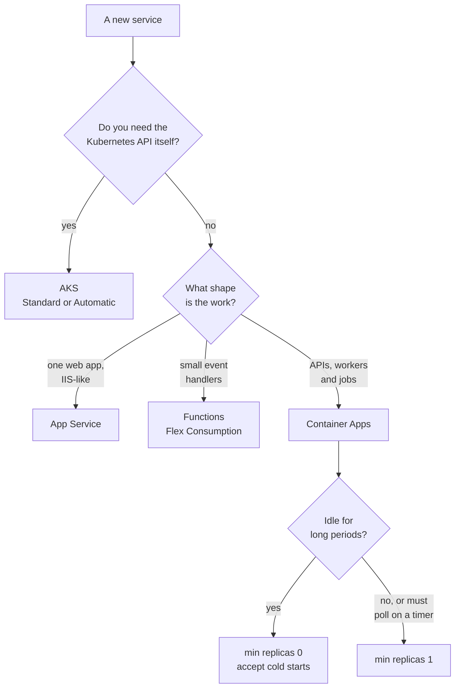
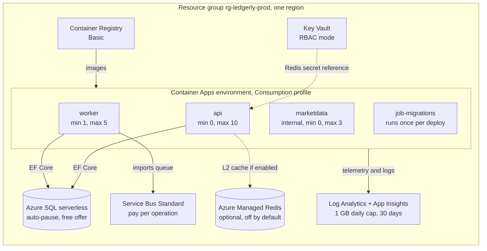

# Chapter 10: Choosing Azure services

> ⏱ About 30 min · You'll learn: how to choose compute, data, messaging, caching, secrets and observability services on Azure with decision tables, why Ledgerly runs on Azure Container Apps, and which cost drivers actually move the monthly bill.

---

## 📖 Story: The Azure menu

Elena Rossi walks into standup with a spreadsheet open on her laptop. "The beta opens in eight weeks. Finance wants to know what it costs per month. I don't need a number to the cent. I need a range, and I need to know what makes it go up."

Maya Okafor books the small meeting room for an hour and writes **AZURE MENU** across the top of the whiteboard. "Azure has a couple of hundred services. We need six kinds." She draws six columns: compute, data, messaging, caching, secrets, observability. "For each column we pick one dish, write down why, and write down what makes it expensive. Elena gets cost drivers, not a guess."

You open your notebook. At Nordbank Insurance, choosing infrastructure meant a ticket, a three-week wait and a VM sized for the one busy week in January. Under **Habits I brought with me** you write: "Size for peak, then forget about it."

> The numbers in this chapter's story (weeks, users, percentages) are **illustrative**. The service limits and free grants are real and marked 🔧.

---

## 🏚️ Old way → 🚀 New way

| What you did before | What you do now | Why it changed |
|---|---|---|
| Order a VM sized for peak load from the ops team | Pick a managed service that bills for use and scales with rules | Idle capacity costs money every hour, and a scale rule reacts faster than a purchase order |
| One IIS site per app on a shared server farm | One Container App per service in a shared Container Apps environment | Same "shared host" idea, but the platform owns the OS, patching, TLS and scaling |
| SQL Server on a VM, looked after by a DBA | Azure SQL Database, serverless tier | Same engine and T-SQL, with backups and patching managed and compute that pauses when idle |
| MSMQ installed on each server | Azure Service Bus queues | One durable queue shared by every replica, with dead-lettering and duplicate detection built in |
| `MemoryCache` per server, or a self-hosted cache cluster | HybridCache in memory, plus Azure Managed Redis only when replicas must share a cache | Two levels with stampede protection, and you pay for a shared cache only when you need one |
| Passwords in `web.config`, encrypted with `aspnet_regiis` | Managed identities for almost everything, Key Vault (RBAC mode) for the few secrets left | A password can leak, an identity can't be pasted into a chat |
| Perfmon counters and log files on each server | Application Insights backed by a Log Analytics workspace | One place to query every replica, with costs you can cap |

> 💡 In the cloud, the size of the bill is decided by your architecture choices, not by a hardware order.

---

## 🧠 How the menu is organized

Before choosing dishes, learn how the menu is laid out. Four concepts decide where a resource lives, who can touch it and who pays for it.

| Concept | What it is | Old-world equivalent | Ledgerly's choice |
|---|---|---|---|
| **Subscription** | A billing and access boundary. Quotas and several free grants are counted per subscription | A cost center with its own budget line | One subscription for the beta |
| **Resource group** | A folder of resources that share a lifecycle. You deploy, grant access to and delete them together | "All the servers for app X" in the CMDB | One resource group per environment, for example `rg-ledgerly-prod` |
| **Region** | The datacenter location of a resource. It affects latency, data residency and which SKUs exist | Your own datacenter | The resource group's region. Everything stays in one region |
| **Tags** | Key/value labels on resources. Cost analysis can group and filter by them | A column in the asset spreadsheet | `app` and `managed-by` on every resource |

Pick a region close to your users and keep every service in it, so calls between them stay short (not every SKU exists in every region, so check before you commit). Put tags in code so they can't be forgotten: cost analysis can group by them ([cost management](https://learn.microsoft.com/en-us/azure/cost-management-billing/costs/tutorial-acm-create-budgets)).

### 💻 In Ledgerly: one region, one name, one set of tags

📄 [`sample/infra/main.bicep`](https://github.com/vygantas-meskauskis/cloud-native-dotnet/blob/main/sample/infra/main.bicep)
```bicep
param location string = resourceGroup().location
// ...
var name = '${appName}-${take(uniqueString(resourceGroup().id), 6)}'
var tags = {
  app: appName
  'managed-by': 'bicep'
}
```

- `location` defaults to the resource group's region, so you choose the region once, when you create the group.
- `uniqueString(resourceGroup().id)` is deterministic: the same resource group always gives the same six characters. Names like `sql-ledgerly-ab12cd` are unique across Azure but stable across deployments.
- Every module receives `tags`, so every resource can be found in cost analysis with `app = ledgerly`. Chapter 11 walks through the whole file.

> 💡 A resource group is a lifecycle boundary: choose its contents by asking "would I delete these together?"

---

## 🧠 Compute: where your code runs

This is the biggest decision on the menu, and the one with the most opinions attached. Microsoft publishes a comparison of its container and compute options ([compare options](https://learn.microsoft.com/en-us/azure/container-apps/compare-options)). Here it is as a decision table.

| Option | What it is | Use it when | Avoid it when |
|---|---|---|---|
| **Azure App Service** | Fully managed hosting optimized for web apps, from code or a container. The closest thing to your IIS mental model | You have one or a few web apps and want "a site" with as little platform thinking as possible | You have several cooperating services, background workers scaled by queue length, and run-to-completion jobs |
| **Azure Container Apps (ACA)** | Serverless containers built on Kubernetes, KEDA, Dapr and Envoy, with no direct Kubernetes API | APIs, microservices, event-driven workers and jobs, including scale to zero | You need the Kubernetes API itself: custom operators, CRDs or cluster-level control |
| **Azure Kubernetes Service (AKS)** | Full Kubernetes API control. Offered as Standard or **AKS Automatic** 🔧 | A platform team already runs Kubernetes, or you need what only the Kubernetes API offers | A small team without Kubernetes skills that just wants to ship an API |
| **Azure Functions, Flex Consumption** 🔧 | Functions as a service. Flex Consumption is the recommended serverless plan: Linux, scale to zero, VNet integration and "always ready" instances. It replaces Linux Consumption for new apps | Small event handlers and glue code: react to a blob, a queue message or a timer | A normal ASP.NET Core API you also run locally with Aspire |

Sources: [compare options](https://learn.microsoft.com/en-us/azure/container-apps/compare-options) and [Flex Consumption plan](https://learn.microsoft.com/en-us/azure/azure-functions/flex-consumption-plan).

### Why Ledgerly chose Container Apps

Maya writes the requirements on the left of the board and the matching ACA feature on the right. The result becomes an ADR (use the ADR template from [the toolkit](../toolkit/README.md)).

| Ledgerly needs | Container Apps gives |
|---|---|
| Three long-running services (api, worker, marketdata) and one run-to-completion task (migrations) | Container apps for the services and a **Container Apps job** with a manual trigger for migrations |
| The worker must scale with the import queue, not with HTTP traffic | **KEDA scale rules**, including a Service Bus queue-length scaler |
| The beta API is idle at night | **Scale to zero**: with min replicas 0 and no traffic, no usage charges 🔧 |
| The fake market-data vendor must not be reachable from the internet | **Internal ingress**, visible only inside the environment |
| Deploys without downtime | **Revisions**: in single revision mode the new revision replaces the old one with zero downtime |
| A small team with no Kubernetes specialists | Kubernetes underneath, but no cluster to run or upgrade |

The trade-off Maya writes underneath: **cold starts.** A service scaled to zero takes a moment to wake up. The sample makes it a parameter (`apiMinReplicas`) so you can change your mind without changing code ([overview](https://learn.microsoft.com/en-us/azure/container-apps/overview), [scaling](https://learn.microsoft.com/en-us/azure/container-apps/scale-app)).

### 💻 In Ledgerly: one environment, the serverless profile

📄 [`sample/infra/modules/environment.bicep`](https://github.com/vygantas-meskauskis/cloud-native-dotnet/blob/main/sample/infra/modules/environment.bicep)
```bicep
resource environment 'Microsoft.App/managedEnvironments@2025-01-01' = {
  name: 'cae-${name}'
  location: location
  tags: tags
  properties: {
    appLogsConfiguration: {
      destination: 'log-analytics'
      // ...
    }
    workloadProfiles: [
      { name: 'Consumption', workloadProfileType: 'Consumption' } // 💰 serverless, pay per use, free monthly grant
    ]
  }
}
```

The **environment** is the shared boundary: one network and one Log Analytics workspace for all apps and jobs inside it. Think of it as the IIS server farm, except that you never see the servers. The **Consumption** workload profile is the serverless option; **Dedicated** profiles reserve hardware when you need it.

> 💡 Choose the platform that matches the shape of your work: one web app, many event handlers, or a handful of services, workers and jobs.

---

## 🗺️ Picking compute in four questions



---

## 🧠 Data, messaging and caching

### Data: Azure SQL Database, serverless

Your SQL Server knowledge transfers directly, which is the main reason Ledgerly didn't look further. The interesting decision is the **purchasing model**.

| Feature | What it means 🔧 | Why it matters |
|---|---|---|
| **Serverless** compute | Compute scales between a min and max vCore count (min can be 0.5 vCore), billed per vCore-second | Light traffic costs little, and there's no instance to size |
| **Auto-pause** | General Purpose serverless databases pause after an idle delay. The default is 60 minutes, the minimum is 15, and `-1` disables it | 💰 Nights and weekends cost only storage. The first connection after a pause waits for a resume, so the app needs retries |
| **Free offer** | Per database, per month: 100,000 vCore-seconds, 32 GB of data and 32 GB of backup storage, for the life of the subscription. Up to 10 free databases per subscription | 💰 A beta can run inside it. When the monthly allowance is used up, the database is either paused until next month or billed for the overage, depending on a setting |
| **Entra-only authentication** | Disables SQL logins, so only Microsoft Entra ID principals can sign in | No database password exists to leak (chapter 13) |

Sources: [serverless tier](https://learn.microsoft.com/en-us/azure/azure-sql/database/serverless-tier-overview), [free offer](https://learn.microsoft.com/en-us/azure/azure-sql/database/free-offer), [Entra-only authentication](https://learn.microsoft.com/en-us/azure/azure-sql/database/authentication-azure-ad-only-authentication). Serverless fits low or bursty traffic. A database that is busy around the clock is more predictable on a provisioned tier.

📄 [`sample/infra/modules/sql.bicep`](https://github.com/vygantas-meskauskis/cloud-native-dotnet/blob/main/sample/infra/modules/sql.bicep)
```bicep
  sku: {
    name: 'GP_S_Gen5_2'
    tier: 'GeneralPurpose'
    family: 'Gen5'
    capacity: 2
  }
  properties: {
    autoPauseDelay: 60
    minCapacity: json('0.5')
    useFreeLimit: useFreeLimit // 💰 100,000 vCore-seconds per month, then pause until next month
    freeLimitExhaustionBehavior: useFreeLimit ? 'AutoPause' : null
  }
```

`GP_S_Gen5_2` reads as General Purpose, **S**erverless, Gen5, max 2 vCores. Elena spots the catch: "Pause until next month means the beta is down until next month?" Yes. Fine for learning, bad once real users depend on it, so Maya adds a launch-checklist item: set `sqlUseFreeLimit = false` before the public beta. The migration service already copes with resume delays: "The execution strategy retries transient failures (e.g. Azure SQL serverless waking up)."

### Messaging: Azure Service Bus tiers

Chapter 7 built the import pipeline on a queue. Here is how to pick the tier.

| | Basic | Standard | Premium |
|---|---|---|---|
| Queues | ✅ | ✅ | ✅ |
| Topics and subscriptions | ❌ | ✅ | ✅ |
| Sessions, transactions, duplicate detection | ❌ | ✅ | ✅ |
| Capacity | Shared | Shared, pay per operation | Dedicated messaging units |
| Max message size 🔧 | 256 KB | 256 KB | Up to 100 MB |
| VNet / Private Link, geo-replication | ❌ | ❌ | ✅ |

Source: [Service Bus Premium and tiers](https://learn.microsoft.com/en-us/azure/service-bus-messaging/service-bus-premium-messaging).

Ledgerly's outbox relay sets `MessageId` to the outbox row id, and the queue drops any message with an id it has seen in the last ten minutes ([duplicate detection](https://learn.microsoft.com/en-us/azure/service-bus-messaging/duplicate-detection)). That one feature rules out Basic. Nothing in the beta needs dedicated capacity, private networking or 100 MB messages, which rules out Premium for now. Standard it is.

📄 [`sample/infra/modules/servicebus.bicep`](https://github.com/vygantas-meskauskis/cloud-native-dotnet/blob/main/sample/infra/modules/servicebus.bicep)
```bicep
// Service Bus Standard (needed for duplicate detection). Local (SAS key) auth is disabled:
// only Entra identities with a data role can send or receive.
// ...
  sku: { name: 'Standard', tier: 'Standard' }
  properties: {
    disableLocalAuth: true
    minimumTlsVersion: '1.2'
  }
```

Duplicate detection is configured on the entity **when it is created**, so this is a decision you want right on day one.

### Caching: HybridCache first, Azure Managed Redis when you need it

Two facts shape this decision.

First, **Azure Cache for Redis is being retired** 🔧 ([retirement FAQ](https://learn.microsoft.com/en-us/azure/azure-cache-for-redis/retirement-faq)):

| Azure Cache for Redis tiers | Retirement date 🔧 | Instances disabled from 🔧 |
|---|---|---|
| Enterprise and Enterprise Flash | 2027-03-31 | 2027-04-01 |
| Basic, Standard and Premium | 2028-09-30 | 2028-10-01 |

New instance creation is being restricted before those dates. Don't start new work on it, even if a blog post from 2023 tells you to.

Second, the replacement is **Azure Managed Redis** 🔧 ([overview](https://learn.microsoft.com/en-us/azure/redis/overview)). It is built on Redis Enterprise, comes in Memory Optimized, Balanced, Compute Optimized and Flash Optimized SKUs, is clustered by default (a non-clustered option exists up to 25 GB), is zone-redundant by default and supports Microsoft Entra ID authentication. `StackExchange.Redis` works with it without special cluster configuration.

But the first question isn't "which Redis?" It's "do we need a shared cache at all?"

| Option | What it is | Use it when | Avoid it when |
|---|---|---|---|
| **HybridCache, L1 only** | In-process memory cache with stampede protection ([HybridCache](https://learn.microsoft.com/en-us/aspnet/core/performance/caching/hybrid)) | Few replicas, short expirations, and a little staleness between replicas is fine | Replicas must agree on cached values, or the cache is expensive to rebuild |
| **HybridCache + Azure Managed Redis as L2** | The same API, with a shared distributed cache behind the memory cache | Many replicas, expensive values, or cache data that should survive a restart | You're adding it "just in case" (💰 it is a paid resource even at its smallest size) |
| **Azure Cache for Redis** | The retiring service 🔧 | Only to keep an existing instance alive while you migrate | Any new work |

### 💻 In Ledgerly: Redis is optional by design

📄 [`sample/src/Ledgerly.Api/Program.cs`](https://github.com/vygantas-meskauskis/cloud-native-dotnet/blob/main/sample/src/Ledgerly.Api/Program.cs)
```csharp
// ── Caching: HybridCache (in-memory L1). Redis becomes the shared L2 when a "cache" connection exists.
if (!string.IsNullOrEmpty(builder.Configuration.GetConnectionString("cache")))
{
    builder.AddRedisDistributedCache("cache");
}

builder.Services.AddHybridCache(options => options.DefaultEntryOptions = new HybridCacheEntryOptions
{
    Expiration = TimeSpan.FromSeconds(30),
    LocalCacheExpiration = TimeSpan.FromSeconds(10),
});
```

The code doesn't care which mode it runs in. Locally, Aspire starts a Redis container and passes a `cache` connection string, so you get both levels. In Azure, `enableRedis` defaults to `false` in `main.bicep`: the API uses memory only, and prices are cached for 30 seconds per replica. If the beta grows, you flip one parameter and the infrastructure creates Azure Managed Redis (Balanced_B0, the smallest size) and wires the connection string through Key Vault.

> 💡 Start with the cheapest option that is correct, and make the expensive option a parameter rather than a rewrite.

---

## 🧠 Secrets and observability

### Secrets: Azure Key Vault in RBAC mode

The best secret is one that doesn't exist. Chapter 13 shows how managed identities remove passwords from SQL, Service Bus and the container registry entirely. Key Vault is for what's left: in Ledgerly, exactly one secret, the Redis access key, and only when Redis is enabled.

| Decision | Choice | Why 🔧 |
|---|---|---|
| Permission model | **Azure RBAC** | RBAC is the recommended model and vault access policies are legacy. Starting with ARM API version 2026-02-01, new vaults default to RBAC |
| Who reads secrets | **Key Vault Secrets User** for the app identity only | Reads secret values and nothing else |
| Who manages secrets | Key Vault Secrets Officer or Administrator, for people or pipelines that need it | Separate "read" from "manage" |
| Scope | The vault, or narrower | Never the whole subscription |

Sources: [RBAC vs access policies](https://learn.microsoft.com/en-us/azure/key-vault/general/rbac-access-policy), [Key Vault RBAC guide](https://learn.microsoft.com/en-us/azure/key-vault/general/rbac-guide).

### Observability: Application Insights and Log Analytics

There is only one shape left for Application Insights: **workspace-based**. Classic Application Insights resources are retired, and all telemetry is stored in a Log Analytics workspace and billed through it ([workspace-based resources](https://learn.microsoft.com/en-us/azure/azure-monitor/app/create-workspace-resource)). Chapters 15 and 16 cover the telemetry itself. The menu decision here is about cost: **Log Analytics ingestion is often the surprise on the bill.** Sampling, a daily cap and a sensible retention period are the levers ([sampling](https://learn.microsoft.com/en-us/azure/azure-monitor/app/opentelemetry-sampling)).

### 💻 In Ledgerly: a hard daily cap

📄 [`sample/infra/modules/monitoring.bicep`](https://github.com/vygantas-meskauskis/cloud-native-dotnet/blob/main/sample/infra/modules/monitoring.bicep)
```bicep
resource workspace 'Microsoft.OperationalInsights/workspaces@2023-09-01' = {
  name: 'log-${name}'
  location: location
  tags: tags
  properties: {
    sku: { name: 'PerGB2018' }
    retentionInDays: 30
    workspaceCapping: { dailyQuotaGb: 1 } // 💰 a hard daily cap keeps a learning subscription safe
  }
}

resource appInsights 'Microsoft.Insights/components@2020-02-02' = {
  // ...
  properties: {
    Application_Type: 'web'
    WorkspaceResourceId: workspace.id
  }
}
```

- `PerGB2018` is pay per GB ingested, and `retentionInDays: 30` keeps a month of data.
- `dailyQuotaGb: 1` stops ingestion for the rest of the day once 1 GB has arrived. Priya objects ("a cap means blind spots during an incident"), so the team records it as a beta setting to revisit with real traffic data.

> 💡 Telemetry is a product with a price per GB: decide what you keep, for how long and at what sample rate.

---

## 🧠 What actually drives the bill

Now you can answer Elena. Not with a number, but with a table of drivers, where each one lives in Ledgerly's code, and the lever that controls it. Prices change and differ by region, so the source of truth is each service's pricing page and the [Azure Pricing Calculator](https://azure.microsoft.com/en-us/pricing/calculator/) 🔧.

| Service | What you pay for 💰 | Where it is in Ledgerly | Lever |
|---|---|---|---|
| Container Apps (Consumption) | vCPU-seconds, GiB-seconds and requests, after a monthly free grant per subscription of **180,000 vCPU-seconds, 360,000 GiB-seconds and 2 million requests** 🔧. Replicas held warm by min replicas > 0 are billed at a reduced idle rate | `apps.bicep`: api min 0, marketdata min 0, worker min 1 | Scale to zero where you can accept a cold start (`apiMinReplicas`) |
| Azure SQL serverless | vCore-seconds while running, plus storage. Free offer covers 100,000 vCore-seconds a month 🔧 | `sql.bicep`: `autoPauseDelay: 60`, `minCapacity: 0.5`, `useFreeLimit` | Auto-pause, free offer, max vCores |
| Service Bus Standard | Shared capacity, pay per operation | `servicebus.bicep` | Fewer, larger messages, and no polling loops against the queue |
| Log Analytics + App Insights | GB ingested and retention | `monitoring.bicep`: 1 GB daily cap, 30 days | Sampling, daily cap, retention, and not logging every probe |
| Azure Managed Redis | A fixed size that runs all month, even when idle | `redis.bicep`, off unless `enableRedis = true` | Leave it off until you need a shared cache |
| Container Registry, Key Vault | Small, mostly fixed or per-operation charges | `registry.bicep` (Basic), `keyvault.bicep` | Check the pricing pages, then move on |

Sources: [Container Apps billing](https://learn.microsoft.com/en-us/azure/container-apps/billing), [Azure SQL free offer](https://learn.microsoft.com/en-us/azure/azure-sql/database/free-offer).

Two details hide in that table:

- **The worker never scales to zero.** Its comment explains why: "the outbox relay and price alerts poll on a timer, so one replica must always run." That replica is your baseline Container Apps cost. A design that triggered the worker purely from the queue could scale to zero, at the price of a different outbox design.
- **The API's health probes don't create telemetry.** The service defaults filter `/health` and `/alive` out of traces, so probes don't eat the daily cap.

### Budgets: an alarm, not a brake

Maya's last item: a **budget** on the resource group, with alerts on actual or forecasted cost. It's cheap insurance, but **budgets don't stop resources**: they notify, and stopping things needs automation wired to an action group. Cost data typically lands within 8 to 24 hours and budgets are evaluated every 24 hours, so a runaway loop can run for a day before anyone hears about it ([create budgets](https://learn.microsoft.com/en-us/azure/cost-management-billing/costs/tutorial-acm-create-budgets)).

Elena leaves with what she needed: "Most of the beta fits in free grants and serverless pauses. The fixed costs are the worker replica, the registry and Redis if we turn it on. The surprise risk is logs, and that's capped."

> 💡 You can't predict a cloud bill to the cent, but you can name every driver and put a lever next to it.

---

## 🗺️ Ledgerly on Azure, with its cost drivers



---

## ⚠️ Common traps

| Trap | What happens | Do this instead |
|---|---|---|
| Choosing AKS because "everyone uses Kubernetes" | Weeks of cluster plumbing, upgrades and node pools before the first feature ships | Start on Container Apps. The concepts (replicas, probes, revisions, KEDA) transfer if you ever need AKS |
| Creating Azure Cache for Redis for a new project | You build on a service with published retirement dates 🔧 and migrate within two years | Use Azure Managed Redis, or no shared cache at all until you need one |
| Picking Service Bus Basic to save money | Duplicate detection, topics and sessions are missing, and duplicate detection is set when the entity is created | Use Standard when your design depends on duplicate detection or topics |
| Leaving the SQL free offer on "auto-pause when exhausted" in production | The allowance runs out mid-month and the database pauses until next month | Use the free offer for learning and early testing, then switch to billed overage before real users arrive |
| Min replicas 1 on every app "to be safe" | Every app is billed at least at the idle rate, all month | Use 0 where a cold start is acceptable, 1 only where it isn't or where a timer must run |
| No daily cap, no sampling, verbose logging in production | Log ingestion becomes the largest line on the bill | Cap, sample and filter (probes, chatty categories) from day one |
| Treating a budget as a spending limit | The alert email arrives, the resources keep running | Wire an action group to automation if you need a brake |

---

## 🧰 Helpers

**A one-page "Azure menu" for any new service.** Copy it into the ADR for each choice:

```markdown
## Service choice: <compute | data | messaging | caching | secrets | observability>
- Requirement in one sentence:
- Options considered: (from the decision table)
- Chosen, and why:
- What makes it expensive, and the lever in Bicep:
- What would make us change our mind:
- 🔧 Volatile facts we relied on, with doc links:
```

**Monthly cost review** (15 minutes):

- [ ] Cost analysis grouped by the `app` tag: anything grow unexpectedly?
- [ ] Log Analytics ingestion: close to the daily cap?
- [ ] Azure SQL: when does the free allowance run out?
- [ ] Any resource without tags? (It was probably created by hand.)

**Make it permanent:**

- Put names, tags and SKUs in Bicep (chapter 11), so a reviewer sees every cost decision in a pull request.
- Add one ADR per menu decision, using the ADR template in [the toolkit](../toolkit/README.md).
- Create a budget with forecast alerts on each environment's resource group as part of the one-time setup (chapter 12).
- Add "cost driver and lever" as a question in your PR template for infrastructure changes.

---

## 🧪 Try it yourself (optional, ~25 min)

No Azure subscription is needed for these steps.

1. Install the Bicep CLI. If you have the Azure CLI, run `az bicep install`. Otherwise install the standalone `bicep` CLI from the Bicep docs.
2. Find every cost lever in the parameters:
   ```bash
   cd sample
   grep -n "param " infra/main.bicep
   ```
   Mark the ones that change the bill: `enableRedis`, `sqlUseFreeLimit` and `apiMinReplicas`. Read their `@description` text.
3. Find the scale settings for each app:
   ```bash
   grep -n -A2 "scale:" infra/modules/apps.bicep
   ```
   Observe: the API uses `apiMinReplicas`, the worker is pinned to `minReplicas: 1`, and marketdata scales from 0 to 3.
4. Compile the Bicep to the ARM JSON that Azure would receive, and look for every SKU:
   ```bash
   bicep build infra/main.bicep --stdout | grep -n '"sku"' 
   ```
   (With the Azure CLI: `az bicep build --file infra/main.bicep --stdout`.)
5. Open the [Azure Pricing Calculator](https://azure.microsoft.com/en-us/pricing/calculator/). Add Container Apps, Azure SQL Database (serverless), Service Bus Standard and Log Analytics. Model a quiet beta month and a busy one. Note which line moves the most between the two.
6. Write a short ADR: "Why Ledgerly runs on Azure Container Apps", with the cold-start trade-off and the condition that would make you switch `apiMinReplicas` to 1.

---

## ✅ Recap

1. Pick compute by the shape of the work: App Service for an IIS-like web app, Functions Flex Consumption for event handlers, Container Apps for services, workers and jobs, AKS only when you need the Kubernetes API.
2. Ledgerly uses Azure SQL serverless, Service Bus Standard (for duplicate detection), HybridCache with optional Azure Managed Redis, Key Vault in RBAC mode and workspace-based Application Insights.
3. Cost is a design property: scale to zero, free grants, auto-pause and a log ingestion cap are levers in Bicep, and budgets warn but never stop spending.

**Next → [Chapter 11: Infrastructure as code](11-infrastructure-as-code.md)**
