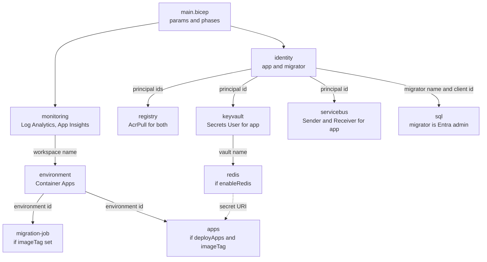
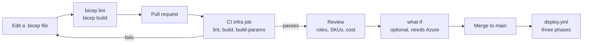

# Chapter 11: Infrastructure as code

> ⏱ About 35 min · You'll learn: Bicep basics (parameters, variables, modules, outputs, conditions, loops, `existing`, `.bicepparam`), how Ledgerly's `main.bicep` deploys in three phases, least-privilege role assignments for managed identities, how lint and what-if catch mistakes before Azure does, and how the database user for a managed identity gets created without anyone clicking.

---

## 📖 Story: "Show me the pull request"

Maya's Azure menu from chapter 10 is on the wiki. Priya has a free afternoon and offers to "just click it together in the portal, it's maybe twenty resources." Tomás Reyes, who owns the platform, doesn't even look up from his screen. "No."

He turns around. "If I click it, there is no record of what I clicked. Next month someone changes a setting during an incident, nobody remembers, and staging and production quietly drift apart. If it isn't in a pull request, it doesn't exist." He opens an empty file called `main.bicep`. "We write it down once. Azure reads it. Anyone can review it, rerun it or delete everything and get it back."

You think of the server build document at Nordbank Insurance: a 40-page Word file with screenshots, version 7, last updated by someone who left in 2019. In your **Habits I brought with me** notebook you write: "The runbook is the documentation." Next to it, Tomás writes in pencil: "The code is the runbook."

---

## 🏚️ Old way → 🚀 New way

| What you did before | What you do now | Why it changed |
|---|---|---|
| A Word document with screenshots of every setting | A `.bicep` file in the same repo as the app | Text can be reviewed, diffed and versioned, and it can't fall out of date with itself |
| Click through the portal, then hope staging matches production | Deploy the same template with a different `.bicepparam` file | Environments differ only where the parameters say so |
| "Who changed this?" answered by guessing | `git log infra/` and the deployment history | Every change is a commit with an author and a reason |
| Ask a DBA to create logins and grant rights by hand | Managed identities and role assignments declared in Bicep, the database user created by the migration job | Permissions are reviewed in a pull request like any other code |
| Find typos when the deployment fails at 2 a.m. | `bicep lint` and `bicep build` in CI, `what-if` before applying | The compiler and a preview catch mistakes before Azure does |
| One big script that only works on a clean server | Idempotent, incremental deployments | Running the same template twice changes nothing the second time |

---

## 🧠 Bicep in ten minutes

**Bicep** is a declarative language for Azure resources. You describe the end state; Azure Resource Manager (ARM) works out what to create or change. `bicep build` compiles it to an ARM JSON template, and that JSON is what Azure actually receives. For a C# developer, it reads like a typed configuration file with functions.

| Concept | What it does | Ledgerly example |
|---|---|---|
| `targetScope` | Where the template deploys: a resource group, subscription, management group or tenant | `targetScope = 'resourceGroup'` |
| `param` + decorators | An input, with type, default and validation | `@minLength(3) @maxLength(12) param appName string = 'ledgerly'` |
| `var` | A computed value, like a `const` | `var name = '${appName}-${take(uniqueString(resourceGroup().id), 6)}'` |
| `resource` | One Azure resource: symbolic name, type and API version | `resource registry 'Microsoft.ContainerRegistry/registries@2023-07-01'` |
| `module` | Another Bicep file, called like a function with `params` | `module sql 'modules/sql.bicep' = { ... }` |
| `output` | A value returned to the caller or the CLI | `output loginServer string = registry.properties.loginServer` |
| Condition | Deploy only if an expression is true | `module redis 'modules/redis.bicep' = if (enableRedis) { ... }` |
| Loop | Create one item per element of an array | `[for principalId in pullPrincipalIds: { ... }]` |
| `existing` | Reference a resource you didn't create in this file, to read its properties or nest children | `resource vault '...' existing = { name: keyVaultName }` |
| `parent` | Declare a child resource without spelling out the full type path | The `imports` queue has `parent: namespace` |
| `.bicepparam` | The modern parameter file, type-checked against the template | `using 'main.bicep'` then `param appName = 'ledgerly'` |

Two details trip up every newcomer:

- **Dependencies are inferred.** When `sql` uses `identities.outputs.migratorClientId`, Bicep knows the identity module must deploy first. You rarely write `dependsOn`.
- **The API version is part of the type.** `Microsoft.App/containerApps@2025-01-01` and `@2024-03-01` are different schemas. A property that exists in one may not exist in the other, which is exactly how lesson 7 below happened.

### 💻 In Ledgerly: parameters that explain themselves

📄 [`sample/infra/main.bicep`](https://github.com/vygantas-meskauskis/cloud-native-dotnet/blob/main/sample/infra/main.bicep)
```bicep
@description('Short name used in every resource name.')
@minLength(3)
@maxLength(12)
param appName string = 'ledgerly'

param location string = resourceGroup().location

@description('Container image tag (the git commit SHA). Empty = deploy the platform only.')
param imageTag string = ''

@description('Deploy the long-running apps. The pipeline sets this after the migration job succeeded.')
param deployApps bool = false
// ...
@description('0 = scale to zero (cheapest), 1 = always warm (no cold start).')
@minValue(0)
param apiMinReplicas int = 0
```

📄 [`sample/infra/main.bicepparam`](https://github.com/vygantas-meskauskis/cloud-native-dotnet/blob/main/sample/infra/main.bicepparam)
```bicep
// Values for the "production" environment. Secrets never go here: there are none to pass,
// because every service authenticates with a managed identity.
using 'main.bicep'

param appName = 'ledgerly'
param jwtAuthority = 'https://login.microsoftonline.com/<your-tenant-id>/v2.0'
param jwtAudience = 'api://ledgerly-api'
param corsOrigins = []
param enableRedis = false
param apiMinReplicas = 0

// imageTag and deployApps are passed by the pipeline on the command line.
```

`using 'main.bicep'` binds the file to the template, so a typo like `param apiMinReplica = 0` is a compile error, not a silently ignored value. A second environment is a second file (`staging.bicepparam`), not a second template. Before your first real deployment, replace `<your-tenant-id>` with your tenant id (chapter 12).

> 💡 A good parameter file reads like the environment's spec sheet: everything that differs, nothing that doesn't, and no secrets.

---

## 🧠 One template, three phases

A naive template deploys everything at once. That fails on day one (the apps reference an image tag that doesn't exist yet in a registry the same deployment creates), and it's wrong after day one (the new API would start before the migrations ran).

Ledgerly's `main.bicep` solves both with two parameters and two conditions. The header comment is the design document.

### 💻 In Ledgerly: phases as conditions

📄 [`sample/infra/main.bicep`](https://github.com/vygantas-meskauskis/cloud-native-dotnet/blob/main/sample/infra/main.bicep)
```bicep
// Ledgerly on Azure. Resource-group scope; the deploy workflow runs it in three phases:
//   1. imageTag = ''                       -> platform only (registry, data, messaging, environment)
//   2. imageTag = <sha>, deployApps = false -> + the migration job with the new image (pipeline runs it)
//   3. imageTag = <sha>, deployApps = true  -> + api, worker, marketdata on the new image
// Deployments are incremental and idempotent: re-running a phase changes only what differs.
targetScope = 'resourceGroup'
// ...
module migrationJob 'modules/migration-job.bicep' = if (!empty(imageTag)) {
  name: 'migration-job'
  params: {
    // ...
    image: '${registry.outputs.loginServer}/ledgerly-migrations:${imageTag}'
    identityId: identities.outputs.migratorId
    // ...
  }
}

module apps 'modules/apps.bicep' = if (deployApps && !empty(imageTag)) {
  name: 'apps'
  params: {
    // ...
    cacheSecretUri: enableRedis ? redis!.outputs.secretUri : ''
    // ...
  }
}
// ...
output apiUrl string = (deployApps && !empty(imageTag)) ? apps!.outputs.apiUrl : ''
```

| Phase | Parameters | What Azure has afterwards | What the pipeline does next |
|---|---|---|---|
| 1 | `imageTag = ''` | Monitoring, identities, registry, Key Vault, Service Bus, SQL, the Container Apps environment (and Redis if enabled) | Builds the four images and pushes them, tagged with the commit SHA |
| 2 | `imageTag = <sha>`, `deployApps = false` | Phase 1, plus `job-migrations` on the new image | Starts the job and waits for success |
| 3 | `imageTag = <sha>`, `deployApps = true` | Everything, with api, worker and marketdata on the new image | Smoke-tests the API |

Three Bicep details make this work:

- **Incremental mode.** A resource-group deployment adds and updates resources, but leaves resources that aren't in the template alone. So phase 1 on the second day doesn't delete the apps that phase 3 created yesterday; it just confirms the platform is unchanged.
- **The `!` operator.** `redis` and `apps` are conditional modules, so their outputs might not exist. `redis!.outputs.secretUri` tells the compiler "I've checked the condition myself"; it's only evaluated when `enableRedis` is true. It works like C#'s null-forgiving operator.
- **Deterministic names.** Every resource name comes from `name` (`ledgerly-` plus six characters derived from the resource group id), so each phase targets the same resources again.

### Faster paths, and why the course doesn't take them

You don't have to write Bicep by hand. Know the alternatives:

| Tool | What it does 🔧 | Why Ledgerly hand-writes instead |
|---|---|---|
| **`aspire deploy`** | Provisions Azure resources and deploys containers from the AppHost model. Now the recommended path for Aspire apps. `aspire publish` emits the generated artifacts, including Bicep. `AddAzureContainerAppEnvironment` and `PublishAsAzureContainerApp` customize the output ([deploy with Aspire](https://aspire.dev/deployment/deploy-with-aspire/), [Container Apps](https://aspire.dev/deployment/azure/container-apps/)) | Great for getting started. The course wants you to see every resource, role and setting, so you can review what a generator gives you |
| **Azure Developer CLI (azd)**, version 1.37.1 | `azd up` provisions (`infra/`) and deploys from `azure.yaml` (`host: containerapp`). `azd pipeline config` creates OIDC credentials and repository variables. For Aspire it is "still supported but no longer the recommended default" ([azd overview](https://learn.microsoft.com/en-us/azure/developer/azure-developer-cli/overview)) | Same reason. `azd pipeline config` is still a handy shortcut for the setup in chapter 12 |
| **Azure Verified Modules (AVM)** | Microsoft-maintained modules in the public registry, for example `br/public:avm/res/storage/storage-account:0.18.0`. Resource modules live under `avm/res`, patterns under `avm/ptn`. Non-AVM modules have been retired from the public registry ([modules](https://learn.microsoft.com/en-us/azure/azure-resource-manager/bicep/modules)) | A good option for a team template. Ledgerly's modules are small on purpose, so every line can be read in a course |

A practical path: start with `aspire publish` to see what it generates, then own the Bicep once you need to change it.

> 💡 Ordering belongs in the template's design, not in a human's memory: conditions plus a pipeline turn "deploy in the right order" into code.

---

## 🗺️ The module graph



---

## 🧠 Identities and least-privilege role assignments

On your old servers, the app pool ran as a domain account and someone added that account to a SQL login and an MSMQ ACL. In Azure, the equivalent is a **managed identity**: an identity in Microsoft Entra ID whose credentials Azure manages for you. A **user-assigned** managed identity is a resource you declare and then attach to apps; it survives redeploys and can be granted rights before any app exists. That's why Ledgerly uses user-assigned identities instead of system-assigned ones, which are created and deleted with each app.

### 💻 In Ledgerly: two identities, two jobs

📄 [`sample/infra/modules/identity.bicep`](https://github.com/vygantas-meskauskis/cloud-native-dotnet/blob/main/sample/infra/modules/identity.bicep)
```bicep
// Two user-assigned managed identities. No passwords or connection-string secrets anywhere:
//  - "app": what api, worker and marketdata run as (least privilege: read/write data, send/receive messages).
//  - "migrator": what the migration job runs as. It is the SQL Entra admin, so it can change the schema.
// ...
resource app 'Microsoft.ManagedIdentity/userAssignedIdentities@2023-01-31' = {
  name: 'id-${name}-app'
  location: location
  tags: tags
}
```

The identity is a principal. Rights come from **role assignments**: a principal, a role definition and a scope. Ledgerly grants the smallest role at the narrowest scope:

| Principal | Role | Scope | Lets it |
|---|---|---|---|
| app, migrator | **AcrPull** | The registry | Pull images. Nothing else |
| app | **Key Vault Secrets User** | The vault | Read secret values. Not list keys, not manage the vault |
| app | **Azure Service Bus Data Sender** + **Data Receiver** | The namespace | Send and receive messages. Not create queues or change settings |
| app | **Azure Service Bus Data Owner** 🔧 | The `imports` queue only | Lets the KEDA scale rule read the queue length (see below) |
| migrator | SQL Entra admin | The SQL server | Change the schema and create database users |
| app | `db_datareader` + `db_datawriter` | The `ledgerly` database | Read and write rows. Not alter tables |

### 💻 In Ledgerly: role assignments with `guid()` names

📄 [`sample/infra/modules/registry.bicep`](https://github.com/vygantas-meskauskis/cloud-native-dotnet/blob/main/sample/infra/modules/registry.bicep)
```bicep
var acrPullRoleId = '7f951dda-4ed3-4680-a7ca-43fe172d538d'
// ...
resource acrPull 'Microsoft.Authorization/roleAssignments@2022-04-01' = [for principalId in pullPrincipalIds: {
  name: guid(registry.id, principalId, acrPullRoleId)
  scope: registry
  properties: {
    roleDefinitionId: subscriptionResourceId('Microsoft.Authorization/roleDefinitions', acrPullRoleId)
    principalId: principalId
    principalType: 'ServicePrincipal'
  }
}]
```

Read it line by line:

- **Built-in role ids are fixed GUIDs.** `7f951dda-...` is AcrPull in every tenant. Using the id instead of the display name makes the template independent of language and renames.
- **The name must be a GUID, and stable.** `guid(registry.id, principalId, acrPullRoleId)` hashes its inputs into a deterministic GUID. Same scope, principal and role give the same name, so a rerun finds the existing assignment instead of failing with "role assignment already exists". Use `newGuid()` here and every deployment tries to create a duplicate.
- **`scope: registry`** puts the assignment on the registry, not the resource group. Least privilege applies to scope as much as to role.
- **`principalType: 'ServicePrincipal'`** tells Azure what kind of principal to expect. A freshly created managed identity can take a moment to replicate in Entra ID, and stating the type avoids a lookup that might fail during that window.

Service Bus needs two roles per principal, so it builds the list with `map` and `flatten`:

📄 [`sample/infra/modules/servicebus.bicep`](https://github.com/vygantas-meskauskis/cloud-native-dotnet/blob/main/sample/infra/modules/servicebus.bicep)
```bicep
resource roles 'Microsoft.Authorization/roleAssignments@2022-04-01' = [for item in flatten(map(dataPrincipalIds, p => [
  { principalId: p, roleId: senderRoleId }
  { principalId: p, roleId: receiverRoleId }
])): {
  name: guid(namespace.id, item.principalId, item.roleId)
  scope: namespace
  // ...
}]
```

If you know LINQ, this is `dataPrincipalIds.SelectMany(p => new[] { (p, sender), (p, receiver) })`.

The same file has one more assignment, and it's there because of a scaling detail. The worker's KEDA scale rule (chapter 18) reads the `imports` queue's message count through the Service Bus management API, and KEDA's docs say that needs **Manage** rights. Sender and Receiver don't include Manage, so without another role the worker would quietly never scale out. The fix grants **Data Owner**, but scoped to the one queue rather than the namespace:

📄 [`sample/infra/modules/servicebus.bicep`](https://github.com/vygantas-meskauskis/cloud-native-dotnet/blob/main/sample/infra/modules/servicebus.bicep)
```bicep
// 🔧 KEDA reads the queue's message count through the management API, which needs Manage rights.
// Sender and Receiver don't include them, so grant Data Owner on this one queue only, not the namespace.
resource scalerRole 'Microsoft.Authorization/roleAssignments@2022-04-01' = {
  name: guid(imports.id, scalerPrincipalId, dataOwnerRoleId)
  scope: imports
  // ...
}
```

`scope: imports` works because a queue is a child resource with its own id, and Azure RBAC can scope a role to any resource. 🔧 Verify the scaler after your first deploy: if the worker stays at one replica while the queue grows, check the scale rule's events in the portal.

Jonas reviews the pull request: the API, worker and marketdata share the `app` identity, so the API could receive from the imports queue even though it never does. A per-app identity is stricter and costs a few more resources. They keep one identity for the beta and record it in an ADR. Least privilege is a dial; know where yours is set.

> 💡 A role assignment is code like any other: reviewed in a pull request, named deterministically, scoped as narrowly as the work allows.

---

## 🧠 Catch it before Azure does: lint, build and what-if

Bicep has a compiler and a linter, and you should treat their output exactly like C# compiler warnings: fix them, then make CI enforce it.

### 💻 In Ledgerly: infrastructure gets a CI job

📄 [`.github/workflows/ci.yml`](https://github.com/vygantas-meskauskis/cloud-native-dotnet/blob/main/.github/workflows/ci.yml)
```yaml
  infra:
    runs-on: ubuntu-latest
    timeout-minutes: 10
    steps:
      - uses: actions/checkout@v7
      - name: Lint and build Bicep
        run: |
          az bicep install
          az bicep lint --file infra/main.bicep
          az bicep build --file infra/main.bicep --stdout > /dev/null
          az bicep build-params --file infra/main.bicepparam --stdout > /dev/null
```

No Azure login is needed: the linter and compiler run offline. `build-params` checks the parameter file against the template's types.

### Lesson 7: two mistakes Bicep caught first

This really happened while building the sample.

**BCP138.** The first version of the API's environment variables put the CORS loop directly inside `concat()`:

```bicep
// illustrative, not in the sample: the first attempt, rejected by bicep build with BCP138
env: concat(commonEnv, [ /* ... */ ], [for (origin, i) in corsOrigins: { name: 'Cors__AllowedOrigins__${i}', value: origin }])
```

`bicep build` refused it: a `for` expression can't be nested inside a function call in that position. The fix was to move the loop into a variable and pass the variable:

📄 [`sample/infra/modules/apps.bicep`](https://github.com/vygantas-meskauskis/cloud-native-dotnet/blob/main/sample/infra/modules/apps.bicep)
```bicep
var corsEnv = [for (origin, i) in corsOrigins: { name: 'Cors__AllowedOrigins__${i}', value: origin }]
// ...
          ], empty(cacheSecretUri) ? [] : [
            { name: 'ConnectionStrings__cache', secretRef: 'cache-connection' }
          ], corsEnv)
```

**BCP037.** The container apps were first declared with API version `2024-03-01`, and the linter warned that `identity` was not a known property on the worker's KEDA scale rule. On that schema, the managed-identity setting for a custom scaler didn't exist, so Azure would likely have ignored it and the scaler would have had no way to authenticate. Moving to `Microsoft.App/containerApps@2025-01-01` fixed it:

📄 [`sample/infra/modules/apps.bicep`](https://github.com/vygantas-meskauskis/cloud-native-dotnet/blob/main/sample/infra/modules/apps.bicep)
```bicep
            name: 'imports-queue'
            custom: {
              type: 'azure-servicebus'
              metadata: {
                namespace: serviceBusNamespace
                queueName: 'imports'
                messageCount: '20'
              }
              identity: identityId
            }
```

The lesson: a warning about an unknown property is not noise. It usually means "this setting will be silently dropped." Since then, lint is a CI job.

### What-if: the diff before the deploy

Lint proves the template is valid. **What-if** shows what it would change in a real resource group: creates, modifies and deletes, without applying anything ([what-if](https://learn.microsoft.com/en-us/azure/azure-resource-manager/bicep/deploy-what-if)).

```bash
# 🧪 needs an Azure login and an existing resource group
az deployment group what-if -g <rg> -f infra/main.bicep -p infra/main.bicepparam
```

> 🧪 **Not run by the author:** this step was written from the docs and validated with `bicep build` only. Expect small differences.

Related options from the docs: `az deployment group create ... --confirm-with-what-if` (`-c`) shows the preview and asks before applying, and `--no-pretty-print` returns JSON, which a PR workflow can post as a comment. Ledgerly doesn't run what-if in CI yet, because that would need Azure credentials on pull requests. It's a good next step once the OIDC setup from chapter 12 exists, with a read-only identity.

> 💡 Lint answers "is this valid?", what-if answers "what will this change?". You want both before anything touches production.

---

## 🗺️ From edit to Azure



---

## 🧠 The database user nobody has to click

There's one permission Bicep can't grant: a **database user** inside Azure SQL. Role assignments live in Azure Resource Manager. Database users live inside the database, and only a principal that can sign in to SQL can create them.

Ledgerly's design:

1. The SQL server has **Entra-only authentication**, and its Entra admin is the **migrator** identity.
2. The migration job runs as the migrator, so it can change the schema.
3. After migrating, the same job creates a database user for the **app** identity and gives it read and write rights, nothing more.

📄 [`sample/infra/modules/sql.bicep`](https://github.com/vygantas-meskauskis/cloud-native-dotnet/blob/main/sample/infra/modules/sql.bicep)
```bicep
    administrators: {
      administratorType: 'ActiveDirectory'
      principalType: 'Application'
      login: adminIdentityName
      sid: adminIdentityClientId // 🔧 for a managed identity, the Learn Bicep sample uses the client id
      tenantId: subscription().tenantId
      azureADOnlyAuthentication: true
    }
```

### Lesson 8: `FROM EXTERNAL PROVIDER` needs Graph, `WITH SID` doesn't

The documented way to create a user for an Entra principal is `CREATE USER [name] FROM EXTERNAL PROVIDER`. To resolve the name, the SQL server looks the principal up in Microsoft Entra ID, which requires the server itself to have permission to read the directory through Microsoft Graph. Granting that is a tenant-level step that many organizations reserve for administrators, and it would have been the one manual step in an otherwise automated setup.

The alternative: tell SQL the identity's id directly. `CREATE USER [name] WITH SID = <id>, TYPE = E` maps an external (Entra) principal without a directory lookup. For a managed identity, the SID is the client id as bytes.

📄 [`sample/src/Ledgerly.MigrationService/Program.cs`](https://github.com/vygantas-meskauskis/cloud-native-dotnet/blob/main/sample/src/Ledgerly.MigrationService/Program.cs)
```csharp
    /// <summary>
    /// CREATE USER ... WITH SID, TYPE = E maps a managed identity (by its client id) without needing Microsoft Graph
    /// permissions on the SQL server. Idempotent, so it is safe on every deployment.
    /// </summary>
    private static async Task EnsureAppUserAsync(LedgerlyDbContext db, string name, Guid clientId, CancellationToken ct)
    {
        var user = name.Replace("]", "]]", StringComparison.Ordinal);
        var sid = "0x" + Convert.ToHexString(clientId.ToByteArray());
        var sql = $"""
            IF NOT EXISTS (SELECT 1 FROM sys.database_principals WHERE name = N'{user.Replace("'", "''", StringComparison.Ordinal)}')
                CREATE USER [{user}] WITH SID = {sid}, TYPE = E;
            ALTER ROLE db_datareader ADD MEMBER [{user}];
            ALTER ROLE db_datawriter ADD MEMBER [{user}];
            """;

#pragma warning disable EF1002 // values come from deployment configuration, are escaped above, and DDL cannot be parameterized
        await db.Database.ExecuteSqlRawAsync(sql, ct);
#pragma warning restore EF1002
    }
```

- `Guid.ToByteArray()` produces the byte order SQL expects for the SID, and `Convert.ToHexString` turns it into a `0x...` literal.
- `IF NOT EXISTS` makes it idempotent, so it runs safely on every deployment.
- DDL can't take parameters, so the name is escaped for both `[...]` and `N'...'`, and the analyzer warning (EF1002) is suppressed with a reason, not blindly.
- It only runs when `Database:AppUser:Name` and `ClientId` are configured. The migration job module sets them from the identity module's outputs, so locally (with Aspire and a SQL container) the step is simply skipped.

Elena asks why this matters for a PM. Tomás: "It means a new environment is `git push` plus one-time OIDC setup. No ticket to the identity team, no DBA."

> 💡 When the "last manual step" needs elevated rights, look for a design that removes the step rather than a person who can do it.

---

## ⚠️ Common traps

| Trap | What happens | Do this instead |
|---|---|---|
| Fixing a production setting in the portal "just this once" | The next deployment silently reverts it, or worse, staging and production drift | Change the Bicep, open a PR, deploy. Use the portal to look, not to change |
| `newGuid()` or a random name for role assignments | Every rerun tries to create a duplicate and fails | `guid(scope.id, principalId, roleId)` |
| Roles at resource-group or subscription scope "to make it work" | The identity can do far more than its job | Assign at the resource (`scope: registry`) with the narrowest data role |
| Ignoring BCP037 "unknown property" warnings | The property is dropped and the feature silently doesn't work | Check the API version, upgrade it, and keep lint in CI |
| Deploying apps and schema changes in one step | New code runs against the old schema for a few minutes | Separate phases: platform, migration job, then apps |
| Secrets in `.bicepparam` | They end up in git history forever | Managed identities first, Key Vault for what's left, never secrets in parameter files |
| Granting the SQL server Graph permissions to create users | A tenant-level permission for one `CREATE USER` | `CREATE USER ... WITH SID = <client id>, TYPE = E` from the migrator |

---

## 🧰 Helpers

**A minimal module template** (copy for each new resource type):

```bicep
// illustrative, not in the sample: a starting point for a new module
param location string
param name string
param tags object

resource thing '<Provider/type>@<api-version>' = {
  name: '<prefix>-${name}'
  location: location
  tags: tags
  properties: {}
}

output id string = thing.id
```

Add role assignments by copying the `acrPull` loop from `registry.bicep` and changing the scope and role id.

**PR review checklist for Bicep:**

- [ ] Every new resource has `tags: tags` and a name derived from `name`.
- [ ] Every role assignment uses `guid()` and the narrowest scope.
- [ ] No secret in parameters or outputs, and a 💰 note for any SKU change.

**Make it permanent:**

- Keep the CI infra job required on pull requests (chapter 8's branch protection).
- Add `bicep lint` to your pre-commit habits: `cd sample && bicep lint infra/main.bicep`.
- Copy the toolkit's `main.bicep` pointer and module layout for new services ([toolkit](../toolkit/README.md)).
- Once OIDC exists (chapter 12), add a what-if job on PRs that touch `sample/infra/**`, with a read-only identity.

---

## 🧪 Try it yourself (optional, ~30 min)

Steps 1 to 4 run locally without Azure.

1. Install Bicep: `az bicep install` if you have the Azure CLI, otherwise the standalone `bicep` CLI.
2. Build and lint:
   ```bash
   cd sample
   bicep lint infra/main.bicep
   bicep build infra/main.bicep --stdout > main.json
   bicep build-params infra/main.bicepparam --stdout
   ```
   Open `main.json` and find the role assignment names: they are `guid(...)` expressions that ARM evaluates at deploy time. Delete `main.json` when you're done.
3. Reproduce lesson 7. In `infra/modules/apps.bicep`, temporarily replace `corsEnv` in the API's `env` with the loop itself: `[for (origin, i) in corsOrigins: { name: 'Cors__AllowedOrigins__${i}', value: origin }]`. Run `bicep build infra/main.bicep` and read the error. Then revert with `git checkout -- infra/modules/apps.bicep`.
4. Add a tag. In `main.bicep`, add `environment: 'production'` to `var tags`, build again and confirm every resource in `main.json` picks it up. Revert.
5. 🧪 With an Azure subscription and a resource group, run what-if:
   ```bash
   az deployment group what-if -g <rg> -f infra/main.bicep -p infra/main.bicepparam
   ```
   > 🧪 **Not run by the author:** this step was written from the docs and validated with `bicep build` only. Expect small differences.

   On an empty group, everything shows as "create". Run phase 1 for real (chapter 12 does this in the pipeline), then run what-if again: it should show almost no changes. That's idempotency.

---

## ✅ Recap

1. Bicep turns infrastructure into reviewed code: parameters and `.bicepparam` files per environment, modules for structure, conditions and loops for variation, and lint plus build in CI.
2. Ledgerly's `main.bicep` deploys in three phases (platform, migration job, apps), and every identity gets the narrowest role at the narrowest scope, with `guid()` names so reruns are idempotent.
3. The migration job creates the app's database user with `CREATE USER ... WITH SID, TYPE = E`, so no portal clicks and no Graph permissions are needed.

**Next → [Chapter 12: CD to Azure with OIDC](12-cd-to-azure-with-oidc.md)**
