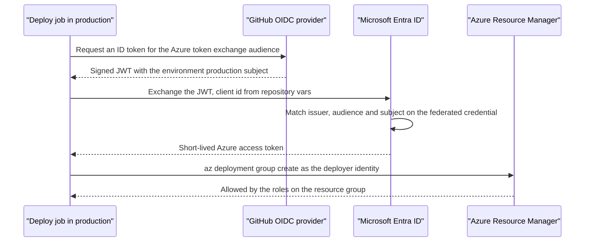
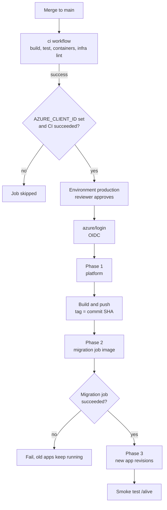
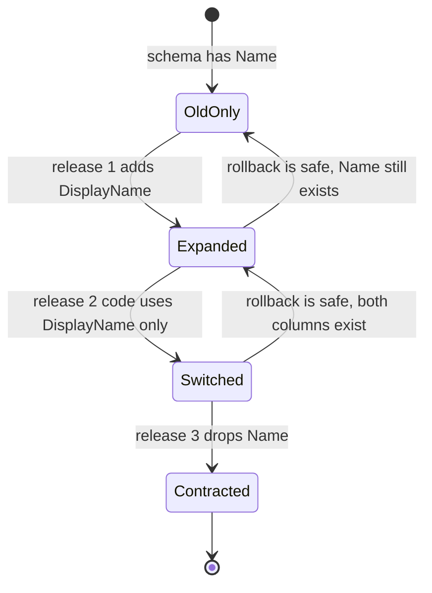

# Chapter 12: CD to Azure with OIDC

> ⏱ About 40 min · You'll learn: how GitHub Actions signs in to Azure with OIDC and no stored secret, how to set up the federated credential and the deployer's roles, how Ledgerly's `deploy.yml` builds once and deploys in three phases with a migration job and a smoke test, and how to roll back and change schemas without downtime.

---

## 📖 Story: The first real deploy

The Bicep from chapter 11 is merged, the CI infra job is green and Elena has a date for the beta. Tomás asks the question that decides the whole design: "How does GitHub get into our Azure subscription?"

You know the answer from Nordbank Insurance. A service account with a password that never expires, pasted into the build server's credential store in 2017. Everyone knew it was there. Nobody knew who else had copied it. When the auditor asked, the answer was a long silence. In your **Habits I brought with me** notebook you write: "The deploy account has a password. Rotation is a project."

Jonas shakes his head before you finish describing it. "No password. No client secret. GitHub proves who it is with a token that lives for a few minutes, and Azure decides whether to trust it. If someone steals that token tomorrow, it's already useless." Maya pulls up `deploy.yml`. "And the deploy is a workflow anyone can read. If it isn't in the file, it doesn't happen in production."

---

## 🏚️ Old way → 🚀 New way

| What you did before | What you do now | Why it changed |
|---|---|---|
| A deploy account with a long-lived password in the build server | OIDC: a short-lived GitHub token exchanged for an Azure token through a federated credential | Nothing long-lived to steal, rotate or leak |
| Right-click, Publish from Visual Studio, or Web Deploy to IIS | A workflow that runs after CI passes on `main`, with an environment approval | Every deploy is reviewed, logged and repeatable |
| Build on the build server, build again for production | Build once per commit, tag images with the commit SHA, run that exact image everywhere | What you tested is what you run |
| Run migration scripts by hand before or after the deploy | A migration job that must succeed before the apps get the new image | The order is code, and a failed migration stops the pipeline |
| "The deploy succeeded" means the copy finished | A smoke test calls the new revision before the pipeline goes green | Accepted by Azure isn't the same as working |
| Rollback means restoring last night's backup of the site folder | Redeploy an earlier commit, or point traffic back at an earlier revision | Images and revisions are immutable, so the old version still exists |
| Schema changes need a maintenance window | Expand and contract migrations across releases | Old and new code can both run against the schema during the switch |

---

## 🧠 OIDC: signing in without a secret

OpenID Connect (OIDC) lets GitHub Actions prove its identity to Azure with a token that GitHub signs and Azure verifies. Nothing secret is stored in GitHub. The setup has two halves:

1. **In GitHub**, the workflow asks for an ID token. That needs `permissions: id-token: write`.
2. **In Azure**, an identity has a **federated credential** that says: "trust tokens from this issuer, for this audience, with exactly this subject." The identity can be an Entra **app registration** or a **user-assigned managed identity** ([GitHub OIDC in Azure](https://docs.github.com/en/actions/how-tos/secure-your-work/security-harden-deployments/oidc-in-azure), [Azure Login with OIDC](https://learn.microsoft.com/en-us/azure/developer/github/connect-from-azure-openid-connect)).

| Federated credential field | Value | What it pins down |
|---|---|---|
| Issuer | `https://token.actions.githubusercontent.com` | Only GitHub Actions tokens |
| Audience | `api://AzureADTokenExchange` | Tokens minted for Azure token exchange |
| Subject (`sub`) | Must match the token's `sub` claim **exactly** | Which repository, and which branch, tag or environment |

The subject is where the security lives ([OIDC reference](https://docs.github.com/en/actions/reference/security/oidc)):

| Workflow context | Subject format |
|---|---|
| Job with `environment: production` | `repo:ORG/REPO:environment:production` |
| Branch | `repo:ORG/REPO:ref:refs/heads/main` |
| Tag | `repo:ORG/REPO:ref:refs/tags/v1` |
| Pull request | `repo:ORG/REPO:pull_request` |

If the job declares an `environment:`, the subject is the **environment** form, not the branch form. Ledgerly's deploy job uses `environment: production`, so its federated credential uses `repo:<owner>/<repo>:environment:production`. That's a strong pin: only jobs that pass the production environment's protection rules can sign in.

🔧 **The subject format is changing for new repositories.** Repositories **created after 2026-07-15** get an immutable subject that includes the owner and repository ids, for example `repo:OWNER@OWNER-ID/REPO@REPO-ID:ref:refs/heads/main`. Older repositories keep the classic format unless they opt in, and a rename or transfer after that date switches a repository to the new format. A fork is a new repository. The environment form follows the same pattern for the prefix; check the docs and the actual claim before you create the credential, because a single character of difference means "no".

### 💻 In Ledgerly: permissions and the login step

📄 [`.github/workflows/deploy.yml`](https://github.com/vygantas-meskauskis/cloud-native-dotnet/blob/main/.github/workflows/deploy.yml)
```yaml
permissions:
  id-token: write # request the OIDC token for azure/login
  contents: read
# ...
      - name: Sign in to Azure (OIDC, no secret)
        uses: azure/login@v3
        with:
          client-id: ${{ vars.AZURE_CLIENT_ID }}
          tenant-id: ${{ vars.AZURE_TENANT_ID }}
          subscription-id: ${{ vars.AZURE_SUBSCRIPTION_ID }}
```

`azure/login@v3` 🔧 requests the GitHub token, sends it to Entra ID and gets back an Azure access token for the identity. Every `az` command after it runs as that identity. There is no `creds` input with a JSON secret: that's the legacy way.

### Why these are variables, not secrets

Ledgerly stores four **repository variables**: `AZURE_CLIENT_ID`, `AZURE_TENANT_ID`, `AZURE_SUBSCRIPTION_ID` and `AZURE_RESOURCE_GROUP`. Many examples use secrets for the first three, and that works too. Ledgerly uses variables on purpose:

- **They're identifiers, not credentials.** A client id without a matching federated credential is useless, in the same way a username without a password is. The trust lives in Azure, pinned to your repository and environment.
- **Variables can gate jobs.** The workflow's `if:` checks `vars.AZURE_CLIENT_ID != ''`, so the deploy switches itself off in forks and in your clone until you set it up. The secrets context can't be used that way in a job's `if:`.
- **Variables are readable in logs**, which makes "which subscription did this deploy to?" a question with an answer.

### What the deployer identity may do

The deployer creates resources **and role assignments** (chapter 11's `guid()` assignments), and pushes images. That needs three things on the resource group:

| Role | Why | Note |
|---|---|---|
| **Contributor** | Create and update every resource in `main.bicep` | Can't create role assignments |
| **Role Based Access Control Administrator** (or User Access Administrator) | Create the AcrPull, Key Vault Secrets User and Service Bus data role assignments | Prefer the narrower RBAC Administrator role, ideally with a condition limiting which roles it can assign. Check the Azure RBAC docs |
| **AcrPush** | `az acr login` plus pushing the images | Contributor may not include registry data-plane push, depending on the registry's permission settings, so grant it explicitly |

Scope all three to **the resource group**, never the subscription. The identity can then do anything inside `rg-ledgerly-prod` and nothing outside it.

> 💡 OIDC moves trust from "who knows the password" to "which repository, which environment": there's nothing in GitHub worth stealing.

---

## 🗺️ The token exchange



---

## 🧠 One-time setup

This is the only manual part, and you do it once per environment. It's written as Azure CLI commands so you can keep it in your repo as a script. You could also let `azd pipeline config` create the credential and variables for you 🔧 ([azd pipelines](https://learn.microsoft.com/en-us/azure/developer/azure-developer-cli/configure-devops-pipeline)).

> 🧪 **Not run by the author:** this step was written from the docs and validated with `bicep build` only. Expect small differences.

```bash
# illustrative, not in the sample: one-time setup for the production environment
# Prerequisites: az login (as someone who can assign roles), gh auth login, and the repo cloned.
RG=rg-ledgerly-prod
LOCATION=westeurope            # pick your region (chapter 10)
REPO=<owner>/<repo>            # check the real sub claim format (classic or immutable)

az group create --name "$RG" --location "$LOCATION"

# A user-assigned managed identity for the pipeline (not the app identities from Bicep).
az identity create --name id-github-deployer --resource-group "$RG"
CLIENT_ID=$(az identity show --name id-github-deployer --resource-group "$RG" --query clientId -o tsv)
PRINCIPAL_ID=$(az identity show --name id-github-deployer --resource-group "$RG" --query principalId -o tsv)

# Trust GitHub tokens from the production environment of this repository only.
az identity federated-credential create \
  --name github-production \
  --identity-name id-github-deployer \
  --resource-group "$RG" \
  --issuer https://token.actions.githubusercontent.com \
  --subject "repo:$REPO:environment:production" \
  --audiences api://AzureADTokenExchange

# Roles on the resource group only.
RG_ID=$(az group show --name "$RG" --query id -o tsv)
for role in "Contributor" "Role Based Access Control Administrator" "AcrPush"; do
  az role assignment create \
    --assignee-object-id "$PRINCIPAL_ID" \
    --assignee-principal-type ServicePrincipal \
    --role "$role" \
    --scope "$RG_ID"
done

# Identifiers, not secrets: store them as repository variables.
gh variable set AZURE_CLIENT_ID --body "$CLIENT_ID"
gh variable set AZURE_TENANT_ID --body "$(az account show --query tenantId -o tsv)"
gh variable set AZURE_SUBSCRIPTION_ID --body "$(az account show --query id -o tsv)"
gh variable set AZURE_RESOURCE_GROUP --body "$RG"
```

Then, in GitHub:

1. Create the **production** environment (Settings → Environments). Add **required reviewers** (up to 6 people or teams, one approval is enough), turn on **prevent self-review**, and restrict **deployment branches** to `main` ([environments](https://docs.github.com/en/actions/reference/workflows-and-actions/deployments-and-environments)). 🔧 On Free, Pro and Team plans, required reviewers and wait timers only work for public repositories.
2. Edit `sample/infra/main.bicepparam`: replace `<your-tenant-id>` in `jwtAuthority` and set `jwtAudience` to your API's app registration (chapter 13).
3. Push to `main`. Watch CI, then the deploy waits for approval.

One caution on the setup itself: the deployer identity lives in the resource group it deploys to. Don't delete that group to "start fresh" unless you're ready to repeat this section. Teams with several environments usually keep pipeline identities in a separate resource group.

> 💡 Keep the one-time setup as a script in the repo: "manual" should mean "run once", not "remember how".

---

## 🧠 The pipeline, step by step

### Trigger, gate and concurrency

📄 [`.github/workflows/deploy.yml`](https://github.com/vygantas-meskauskis/cloud-native-dotnet/blob/main/.github/workflows/deploy.yml)
```yaml
on:
  workflow_run:
    workflows: [ci]
    types: [completed]
    branches: [main]
  workflow_dispatch:
# ...
# Never run two deployments at once, and never cancel one halfway.
concurrency:
  group: deploy-production
  cancel-in-progress: false

env:
  # ...
  RESOURCE_GROUP: ${{ vars.AZURE_RESOURCE_GROUP }}
  # The exact commit CI tested. Every image is tagged with it, so a revision maps back to a commit.
  SHA: ${{ github.event.workflow_run.head_sha || github.sha }}

jobs:
  deploy:
    # workflow_run also fires for pull requests (even from forks whose branch is named main), so only
    # deploy CI runs that came from a push to this repository, never someone else's code.
    if: >
      vars.AZURE_CLIENT_ID != '' &&
      (github.event_name == 'workflow_dispatch' ||
        (github.event.workflow_run.conclusion == 'success' &&
         github.event.workflow_run.event == 'push' &&
         github.event.workflow_run.head_repository.full_name == github.repository))
    runs-on: ubuntu-latest
    timeout-minutes: 45
    environment:
      name: production # protection rules (reviewers, branch filter) live on the environment
      url: ${{ steps.apps.outputs.apiUrl }}
```

- **`workflow_run`** starts this workflow when the `ci` workflow completes for `main`. "Completed" includes failures, so the job's `if:` also requires `conclusion == 'success'`. `workflow_dispatch` adds a manual "Run workflow" button.
- **The two extra checks in `if:`** close a hole Jonas found in review. `branches: [main]` matches the *head branch name*, and CI also runs on pull requests, so a pull request from a fork whose branch happens to be called `main` would complete CI and trigger this workflow. Requiring `event == 'push'` and the same repository means only code that was actually pushed to this repository's `main` can reach Azure.
- **`SHA`** is the commit CI actually tested (`head_sha`), not whatever `main` points to by the time this runs. The checkout step uses `ref: ${{ env.SHA }}`.
- **`concurrency`** with `cancel-in-progress: false`: the docs' example cancels superseded runs ([concurrency](https://docs.github.com/en/actions/how-tos/write-workflows/choose-when-workflows-run/control-workflow-concurrency)). For a deploy that runs migrations, cancelling halfway is worse than waiting, so a second deploy queues instead.
- **`environment: production`** pauses the job until a reviewer approves, makes the OIDC subject the environment form and shows the API URL on the deployment.

### Three phases, built once

| Step | What it runs | Why |
|---|---|---|
| Phase 1: platform | `az deployment group create --name "platform-$SHA"` with only the parameter file | Creates or confirms the registry, data, messaging and environment. Its outputs (registry name, login server, job name) feed the next steps |
| Build and push | `az acr login`, then `dotnet publish ... /t:PublishContainer -p:ContainerImageTag="$SHA"` for four projects | No Dockerfile (chapter 9). Each image is tagged with the commit |
| Phase 2: migration job | Same template, `imageTag="$SHA" deployApps=false` | Points `job-migrations` at the new migrations image |
| Run migrations and wait | Start the job, poll its status | The apps must not change until the schema is ready |
| Phase 3: apps | Same template, `imageTag="$SHA" deployApps=true` | New revisions of api, worker and marketdata on the same SHA |
| Smoke test | `curl -fsS "$apiUrl/alive"` until it answers | Proves the new revision runs |

📄 [`.github/workflows/deploy.yml`](https://github.com/vygantas-meskauskis/cloud-native-dotnet/blob/main/.github/workflows/deploy.yml)
```yaml
      - name: Build and push images (no Dockerfile)
        env:
          LOGIN_SERVER: ${{ steps.platform.outputs.loginServer }}
        run: |
          az acr login --name "${{ steps.platform.outputs.registry }}"
          for project in Ledgerly.Api Ledgerly.Worker Ledgerly.MarketData Ledgerly.MigrationService; do
            dotnet publish "src/$project" -c Release /t:PublishContainer \
              -p:ContainerRegistry="$LOGIN_SERVER" -p:ContainerImageTag="$SHA"
          done
```

**Build once, promote the tag.** CI builds the images too, but tags them `ci-<sha>` and never pushes them: it proves they build. The deploy builds once per commit and pushes once. After that, the migration job and all three apps use the **same tag**, and nothing is rebuilt. When you add a staging environment, keep that rule: build and push in the first environment, then deploy the existing tag to the next one. A revision's image tag always maps back to one commit.

### The migration gate

📄 [`.github/workflows/deploy.yml`](https://github.com/vygantas-meskauskis/cloud-native-dotnet/blob/main/.github/workflows/deploy.yml)
```yaml
      - name: Run migrations and wait
        env:
          JOB: ${{ steps.platform.outputs.job }}
        run: |
          execution=$(az containerapp job start -n "$JOB" -g "$RESOURCE_GROUP" --query name -o tsv)
          echo "Started $execution"
          for i in $(seq 1 60); do
            status=$(az containerapp job execution show -n "$JOB" -g "$RESOURCE_GROUP" \
              --job-execution-name "$execution" --query properties.status -o tsv)
            echo "[$i] $status"
            case "$status" in
              Succeeded) exit 0 ;;
              Failed|Stopped|Degraded) echo "::error::Migration $execution ended as $status. See its logs in Log Analytics."; exit 1 ;;
            esac
            sleep 10
          done
          echo "::error::Migration did not finish within 10 minutes"; exit 1
```

`az containerapp job start` returns immediately with an execution name, so the step polls: up to 60 times, every 10 seconds. The job itself (chapter 11) has `replicaTimeout: 600` and one retry. The migration service sets `Environment.ExitCode = 1` on any failure, so a failed migration becomes a failed execution, the step exits 1 and phase 3 never runs. The old apps keep serving on the old, untouched schema.

### The smoke test

📄 [`.github/workflows/deploy.yml`](https://github.com/vygantas-meskauskis/cloud-native-dotnet/blob/main/.github/workflows/deploy.yml)
```yaml
      # The deployment "succeeding" only means Azure accepted it. This proves the new revision answers.
      - name: Smoke test
        run: |
          for i in $(seq 1 30); do
            if curl -fsS "${{ steps.apps.outputs.apiUrl }}/alive"; then echo; echo "API is up"; exit 0; fi
            sleep 10
          done
          echo "::error::API did not become healthy"; exit 1
```

With `apiMinReplicas = 0`, the first call may hit a cold start, so the loop allows up to five minutes. `/alive` is mapped in every environment by the service defaults (unlike the Aspire template's development-only default), because the Container Apps probes need it too.

> 💡 A pipeline is a sequence of gates: tests, approval, migrations, smoke test. Each one is a place where a bad change stops before users see it.

---

## 🗺️ From merge to running revision



---

## 🧠 Revisions, rollback and zero-downtime schema changes

### Revisions in single mode

Every change to an app's template (a new image, an environment variable, a scale rule) creates a new **revision**, an immutable snapshot ([revisions](https://learn.microsoft.com/en-us/azure/container-apps/revisions)). Ledgerly's apps use `activeRevisionsMode: 'Single'`, the default: the new revision replaces the old one with zero downtime, once its startup and readiness probes pass. If the new revision never becomes ready, it doesn't get traffic, and the smoke test fails the pipeline.

**Multiple** mode keeps several revisions active and lets you split traffic by percentage, for canary or blue/green releases, with **labels** that give a revision a stable URL for testing ([traffic splitting](https://learn.microsoft.com/en-us/azure/container-apps/traffic-splitting)). Ledgerly starts with single mode because it's simpler; Priya has multiple mode on her list for after the beta.

### Rollback

| Situation | What to do |
|---|---|
| The deploy failed before phase 3 | Nothing. The old revisions are still serving |
| A bad change is live, and you have time | **Roll forward:** revert the commit on `main`. CI and deploy ship the revert like any change |
| A bad change is live, and you need it gone now | **Re-run the earlier deploy run** in the Actions tab. It reuses that run's `head_sha`, so it redeploys the previous images. Migrations have nothing to apply, because the schema is already ahead |
| You use multiple revision mode | Shift traffic back to the previous revision |

Break glass, when even a pipeline run is too slow:

```bash
# illustrative, not in the sample: point the API back at the previous image (🧪 check the az containerapp docs)
az containerapp update -n api -g rg-ledgerly-prod --image <loginServer>/ledgerly-api:<previous-sha>
```

That creates a new revision outside the pipeline. The next deploy will overwrite it, so follow up with a revert on `main`.

The rollback rows have one hidden requirement: **the previous code must still work against the current schema.** That's what expand and contract guarantees.

### Expand and contract

Suppose you rename `Portfolio.Name` to `Portfolio.DisplayName`. A single migration that renames the column breaks the old revision for the seconds (or minutes) between phase 2 and phase 3, and it makes rollback impossible. Split it across releases:

| Release | Migration (phase 2) | Code (phase 3) | Old code still works? |
|---|---|---|---|
| 1. Expand | Add `DisplayName`, nullable. Copy existing values | Write both columns, read `DisplayName` with a fallback | ✅ It ignores the new column |
| 2. Switch | Make `DisplayName` required | Read and write only `DisplayName` | ✅ Release 1 code still writes both |
| 3. Contract | Drop `Name` | No change | ✅ Release 2 code doesn't use `Name` |

Each release is safe to roll back by one step. It's slower than one big migration, and that's the price of no maintenance window.

> 💡 Rollback is only real if the previous version can run against today's schema: design migrations so it always can.

---

## 🗺️ Expand and contract as states



---

## ⚠️ Common traps

| Trap | What happens | Do this instead |
|---|---|---|
| A client secret in `AZURE_CREDENTIALS` "because the tutorial did it" | A long-lived secret that can leak and must be rotated | OIDC with a federated credential, no secret at all |
| Federated subject `...:ref:refs/heads/main` while the job uses `environment:` | Login fails: the token's subject is the environment form | Match the subject to the job, and check the real claim (classic or immutable 🔧) |
| Deployer with Owner on the subscription | A compromised workflow can do anything, anywhere | Contributor + RBAC Administrator + AcrPush, on the resource group only |
| `cancel-in-progress: true` on a deploy with migrations | A newer push cancels a run halfway through a migration | `cancel-in-progress: false`: queue, never cancel |
| A `workflow_run` gate that only checks `conclusion` | `branches: [main]` matches the head branch name, so a pull request from a fork whose branch is called `main` can also trigger it after CI | Also require `github.event.workflow_run.event == 'push'` and `github.event.workflow_run.head_repository.full_name == github.repository` |
| Renaming or dropping a column in the same release as the code change | Old revision errors during the switch, and rollback breaks | Expand and contract across releases |
| "Deploy succeeded" as the definition of done | A revision that crashes on startup ships green | A smoke test against the real URL |

---

## 🧰 Helpers

**Hardened gate for any `workflow_run` deploy** (the same condition the sample uses, ready to paste into your own workflows):

```yaml
    if: >
      vars.AZURE_CLIENT_ID != '' &&
      (github.event_name == 'workflow_dispatch' ||
       (github.event.workflow_run.conclusion == 'success' &&
        github.event.workflow_run.event == 'push' &&
        github.event.workflow_run.head_repository.full_name == github.repository))
```

**Pre-flight checklist for the first deploy:**

- [ ] The real `sub` claim matches the federated credential (environment form, classic or immutable).
- [ ] Repository variables set: `AZURE_CLIENT_ID`, `AZURE_TENANT_ID`, `AZURE_SUBSCRIPTION_ID`, `AZURE_RESOURCE_GROUP`.
- [ ] The production environment has reviewers and a `main`-only branch rule.
- [ ] `jwtAuthority` and `jwtAudience` in `main.bicepparam` are real values.
- [ ] A budget exists on the resource group (chapter 10).

**Make it permanent:**

- Commit the one-time setup script (as `docs/setup-production.sh` or similar) so the next environment is a copy and a rename.
- Copy `deploy.yml` from [the toolkit](../toolkit/README.md) and adjust paths, projects and resource names.
- Add "Is this migration expand-only?" to your PR template for any change under `Data/Migrations`.
- Practice a rollback once, on a quiet day, before you need it.

---

## 🧪 Try it yourself (optional, ~45 min)

1. **Locally, no Azure:** read `.github/workflows/deploy.yml` and trace one commit SHA through it: where is it set, which steps use it, and which image tags and deployment names it ends up in? Then check that `bicep build-params infra/main.bicepparam` still passes from `cd sample`.
2. **Locally:** run the migration service against your Aspire SQL with `aspire run` and find its "Database migrated" log line in the dashboard. That line is what the job execution logs show in Azure.
3. 🧪 **With Azure:** run the one-time setup script for your fork, create the production environment and push a commit to `main`. Approve the deployment and watch the three phases.
   > 🧪 **Not run by the author:** this step was written from the docs and validated with `bicep build` only. Expect small differences.
4. 🧪 **With Azure:** make a visible change (for example, a new field in an endpoint response), deploy it, then roll back by re-running the previous deploy run. Confirm with `az containerapp revision list -n api -g <rg> -o table` that a new revision appeared.

---

## ✅ Recap

1. OIDC replaces deploy secrets: GitHub issues a short-lived token, and Azure trusts it through a federated credential pinned to issuer, audience and an exact subject (the environment form for Ledgerly, and the immutable format for new repos 🔧).
2. The deployer needs Contributor, a role-assignment role and AcrPush on the resource group only, and its identifiers live in repository variables because they aren't secrets.
3. `deploy.yml` builds once per SHA and deploys in three gated phases (platform, migration job, apps), then smoke-tests, while revisions plus expand-and-contract migrations make rollback safe.

**Next → [Chapter 13: Identity and secrets](13-identity-and-secrets.md)**
