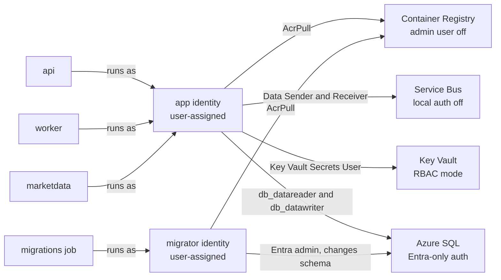
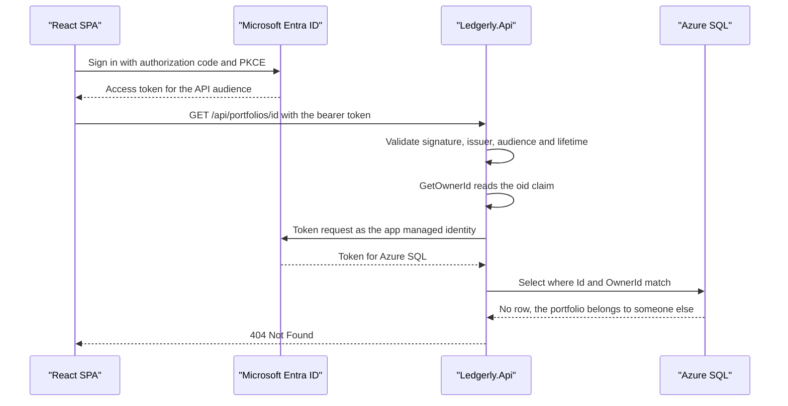

# Chapter 13: Identity and secrets

> ⏱ About 40 min · You'll learn: how Ledgerly reaches SQL, Service Bus, Key Vault and the registry with managed identities instead of passwords, when to use `DefaultAzureCredential` and when to use `ManagedIdentityCredential`, how the API authenticates users with JWT bearer tokens and keeps each user's data private, and which few secrets remain and where they live.

---

## 📖 Story: The connection string in Slack

It's Tuesday morning. Jonas, the security engineer, sends you a screenshot without a greeting. It's a message from the team's Slack channel, eight weeks old, from the time before you joined. Someone was debugging a prototype and pasted a full connection string: `Endpoint=sb://...;SharedAccessKeyName=RootManageSharedAccessKey;SharedAccessKey=...`.

"Is that ours?" he asks.

You check. It belongs to a prototype namespace that nobody deleted. The key still works. Jonas rotates it, deletes the namespace, and then asks the question that matters: "Could the same thing happen with Ledgerly?"

You open `servicebus.bicep` together. One line answers him: `disableLocalAuth: true`. Ledgerly's namespace doesn't accept keys at all. Even if someone pasted the root key in a channel, it would be rejected. The worker connects with a managed identity that has two data roles, and there's nothing to paste.

"Good," Jonas says. "Now show me everything else."

That becomes the afternoon. Maya joins, and the three of you walk through every arrow in the architecture. For each one, Jonas asks the same two questions: "Who is calling?" and "What would an attacker need to steal to pretend to be them?"

In your notebook, under **Habits I brought with me**, you write: *"Encrypt the connection strings section of web.config."* Then you cross out the word "encrypt" and write "delete".

---

## 🏚️ Old way → 🚀 New way

| What you did before | What you do now | Why it changed |
|---|---|---|
| SQL logins with passwords in `web.config`, sometimes encrypted with `aspnet_regiis` | `Authentication=Active Directory Managed Identity` and Entra-only auth on the server | There's no password to leak, rotate or forget in a backup |
| One shared domain service account for every app | User-assigned managed identities with narrow data-plane roles | Each workload gets only the access it needs, and you can see it in Bicep |
| Service Bus or storage keys in config files | Namespace name only, local (key) auth disabled | A leaked key is worthless when the service refuses keys |
| Secrets typed into release variables by an admin | Key Vault references resolved by the platform with the app's identity | The value never appears in the pipeline, the logs or the template outputs |
| Windows auth or forms-auth cookies | JWT bearer tokens from Microsoft Entra ID, `dotnet user-jwts` locally | The API is stateless and serves a SPA and other clients the same way |
| A security review the week before release | Dependabot, CodeQL and push protection on every pull request | Problems surface while the change is small and the author still remembers it |

---

## 🧠 Managed identity everywhere

A **managed identity** is a Microsoft Entra ID identity for a workload. Azure creates and stores its credentials, and the code asks the platform for a token when it needs one. You never see a password, so you can't paste it anywhere.

Container Apps supports two kinds (facts from the [Container Apps managed identity docs](https://learn.microsoft.com/en-us/azure/container-apps/managed-identity)):

- **System-assigned**: one per app, deleted with the app.
- **User-assigned**: a standalone resource that several apps can share.

Ledgerly uses two user-assigned identities, created before the apps exist so that role assignments and the SQL admin can refer to them (chapter 11 explains why the order matters).

### 💻 In Ledgerly: two identities, two jobs

📄 [`sample/infra/modules/identity.bicep`](https://github.com/vygantas-meskauskis/cloud-native-dotnet/blob/main/sample/infra/modules/identity.bicep)

```bicep
// Two user-assigned managed identities. No passwords or connection-string secrets anywhere:
//  - "app": what api, worker and marketdata run as (least privilege: read/write data, send/receive messages).
//  - "migrator": what the migration job runs as. It is the SQL Entra admin, so it can change the schema.
// ...
resource app 'Microsoft.ManagedIdentity/userAssignedIdentities@2023-01-31' = {
  name: 'id-${name}-app'
  location: location
  tags: tags
}

resource migrator 'Microsoft.ManagedIdentity/userAssignedIdentities@2023-01-31' = {
  name: 'id-${name}-migrator'
  location: location
  tags: tags
}
```

Splitting the identities is the important design choice. The apps can read and write rows, but they can't drop a table. Only the short-lived migration job can change the schema.

Now follow each arrow Jonas asked about:

| Arrow | How the app proves who it is | Permission it gets | Where it's set |
|---|---|---|---|
| Container Apps → Container Registry | `registries` entry with the identity, admin user disabled | AcrPull | `registry.bicep`, `apps.bicep` |
| api, worker → Azure SQL | `Authentication=Active Directory Managed Identity;User Id=<client id>` | `db_datareader` and `db_datawriter` | `apps.bicep`, MigrationService |
| migration job → Azure SQL | Same keyword, the migrator's client id | Entra admin of the server | `sql.bicep` |
| worker → Service Bus | Namespace FQDN, no key | Azure Service Bus Data Sender and Data Receiver | `servicebus.bicep` |
| KEDA scaler → Service Bus | `identity: identityId` on the scale rule | Reads the queue length (see the traps) | `apps.bicep` |
| api → Key Vault | Key Vault reference with the identity | Key Vault Secrets User | `keyvault.bicep` |

### 💻 In Ledgerly: SQL without a password

📄 [`sample/infra/modules/apps.bicep`](https://github.com/vygantas-meskauskis/cloud-native-dotnet/blob/main/sample/infra/modules/apps.bicep)

```bicep
var sqlConnection = 'Server=tcp:${sqlServerFqdn},1433;Database=${databaseName};Authentication=Active Directory Managed Identity;User Id=${identityClientId};Encrypt=True;Connect Timeout=60'

var commonEnv = [
  { name: 'AZURE_CLIENT_ID', value: identityClientId } // makes Azure SDK credentials pick the user-assigned identity
  { name: 'APPLICATIONINSIGHTS_CONNECTION_STRING', value: appInsightsConnectionString }
]
```

Read the connection string closely. There's a server, a database, an authentication mode and a `User Id` that is the identity's **client id**, not a user name. Microsoft.Data.SqlClient asks the platform for a token for that identity and sends it to SQL. The [SqlClient Entra authentication docs](https://learn.microsoft.com/en-us/sql/connect/ado-net/sql/azure-active-directory-authentication) describe the options:

- `Authentication=Active Directory Default` walks the whole `DefaultAzureCredential` chain. It's convenient on a laptop, but the docs say it can be slow and isn't recommended for production.
- `Authentication=Active Directory Managed Identity` with `User Id=<client id>` is the production form for a user-assigned identity. That's what Ledgerly uses.

On the server side, `sql.bicep` sets `azureADOnlyAuthentication: true`, which disables SQL authentication entirely ([Entra-only authentication](https://learn.microsoft.com/en-us/azure/azure-sql/database/authentication-azure-ad-only-authentication)). The database user for the app identity is created by the migration service with `CREATE USER ... WITH SID = ..., TYPE = E`, so the SQL server doesn't need Microsoft Graph permissions to look the identity up. Chapter 11 tells the story of how the team found that out.

### 💻 In Ledgerly: Service Bus without a key

📄 [`sample/infra/modules/servicebus.bicep`](https://github.com/vygantas-meskauskis/cloud-native-dotnet/blob/main/sample/infra/modules/servicebus.bicep)

```bicep
// Service Bus Standard (needed for duplicate detection). Local (SAS key) auth is disabled:
// only Entra identities with a data role can send or receive.
// ...
  properties: {
    disableLocalAuth: true
    minimumTlsVersion: '1.2'
  }
```

📄 [`sample/infra/modules/apps.bicep`](https://github.com/vygantas-meskauskis/cloud-native-dotnet/blob/main/sample/infra/modules/apps.bicep)

```bicep
            { name: 'ConnectionStrings__messaging', value: serviceBusFqns } // a namespace, not a key: Entra auth
// ...
            custom: {
              type: 'azure-servicebus'
              metadata: {
                namespace: serviceBusNamespace
                queueName: 'imports'
                messageCount: '20'
              }
              identity: identityId
            }
```

The worker's code doesn't change between your laptop and Azure: it calls `builder.AddAzureServiceBusClient("messaging")`. Locally, Aspire hands it an emulator connection string. In Azure, it gets only the namespace name, and the client authenticates with a token credential. The KEDA scale rule uses the same identity, so the scaler doesn't need a key either.

The registry follows the same pattern: `adminUserEnabled: false` in `registry.bicep`, and `var registries = [ { server: registryServer, identity: identityId } ]` in `apps.bicep`. Container Apps pulls images with the identity and the AcrPull role, so no registry password exists.

> 💡 For every arrow in your architecture, ask "what would an attacker need to steal?" With managed identities the answer becomes "control of the running workload", which is a much higher bar than "one line from a Slack message".

---

## 🗺️ Who can reach what



Every arrow on the right is a role assignment or a database role in the Bicep or the migration service. If it isn't in the code, the access doesn't exist.

---

## 🧠 DefaultAzureCredential or ManagedIdentityCredential?

When Azure SDK clients need a token, they take a `TokenCredential`. The one you see in every quick start is `DefaultAzureCredential`. It tries a chain of credentials in order and uses the first that works. In Azure.Identity 1.21.0 🔧 the order is ([credential chains](https://learn.microsoft.com/en-us/dotnet/azure/sdk/authentication/credential-chains)):

1. Environment
2. Workload Identity
3. Managed Identity
4. Visual Studio
5. Visual Studio Code
6. Azure CLI
7. Azure PowerShell
8. Azure Developer CLI
9. Interactive browser (excluded by default)
10. Broker

That chain is why the same code works on your laptop (Visual Studio or Azure CLI sign-in) and in Azure (managed identity). It's also why it can surprise you. The SDK [best practices](https://learn.microsoft.com/en-us/dotnet/azure/sdk/authentication/best-practices) are direct about it:

- **Use deterministic credentials in production.** Replace `DefaultAzureCredential` with a specific credential such as `ManagedIdentityCredential`, and pass the client id for a user-assigned identity.
- Or compose a `ChainedTokenCredential`, for example `ManagedIdentityCredential` and then `AzureCliCredential`, for a production-safe chain with a developer fallback.
- The reasons: probing adds latency and unpredictable behavior, and environment-dependent fallbacks are hard to debug.
- **Reuse credential instances.** Tokens are cached per instance, so creating a new credential per request throws the cache away.
- 🔧 The environment variable `AZURE_TOKEN_CREDENTIALS` narrows the default chain: `prod` keeps Environment, Workload Identity and Managed Identity, `dev` keeps the developer tools, or you can name one credential.

### 💻 In Ledgerly: no credential code at all

Ledgerly has no `new DefaultAzureCredential()` anywhere in its application code. Two things make that possible:

- **SQL** picks its credential from the connection string keyword. `Active Directory Managed Identity` with a `User Id` is already deterministic.
- **Service Bus** goes through the Aspire client integration, which builds a credential for you when the connection string is just a namespace. Check the Aspire Service Bus integration docs for the current default and for the settings that let you supply your own credential.

The `AZURE_CLIENT_ID` environment variable in `commonEnv` ties it together. A container app can have several user-assigned identities, and the variable tells Azure SDK credentials which one to use. Forget it, and authentication fails in Azure even though everything worked locally.

If you write your own SDK client registration, follow the best-practice pattern:

```csharp
// illustrative, not in the sample
TokenCredential credential = builder.Environment.IsDevelopment()
    ? new DefaultAzureCredential()
    : new ManagedIdentityCredential(ManagedIdentityId.FromUserAssignedClientId(builder.Configuration["AZURE_CLIENT_ID"]));

builder.Services.AddSingleton(credential); // one instance, so its token cache is shared
```

🔧 The `ManagedIdentityId` factory is in recent Azure.Identity versions; check the API reference for the version you use.

> 💡 `DefaultAzureCredential` is a great developer experience and a poor production contract. In Azure, say exactly which identity you mean.

---

## 🧠 Users: JWT bearer and per-user data

Managed identities answer "which workload is calling Azure?". Users are a different question: "which person is calling the API, and which portfolios are theirs?"

The API uses **JWT bearer authentication**. A client gets an access token from an identity provider and sends it in the `Authorization` header. The API checks the signature, issuer, audience and lifetime, and then trusts the claims inside. No session, no cookie, no server-side state.

### 💻 In Ledgerly: two lines and a config section

📄 [`sample/src/Ledgerly.Api/Program.cs`](https://github.com/vygantas-meskauskis/cloud-native-dotnet/blob/main/sample/src/Ledgerly.Api/Program.cs)

```csharp
// ── Security: JWT bearer. Settings come from "Authentication:Schemes:Bearer" ───────────────────
// Locally: `dotnet user-jwts create`. In Azure: Authority = your Entra ID tenant, audience = the API app.
builder.Services.AddAuthentication().AddJwtBearer();
builder.Services.AddAuthorization();
```

`AddJwtBearer()` with no arguments reads its settings from the `Authentication:Schemes:Bearer` configuration section ([configure JWT bearer authentication](https://learn.microsoft.com/en-us/aspnet/core/security/authentication/configure-jwt-bearer-authentication)). That's what lets the same code accept two kinds of tokens:

- **Locally**, `dotnet user-jwts create --project src/Ledgerly.Api` issues a development token. The tool keeps its signing key in your user secrets and writes the issuer and audience it needs into the development configuration. `--name` sets the user name, which is handy for testing two users.
- **In Azure**, Bicep sets the authority and audience as environment variables:

📄 [`sample/infra/modules/apps.bicep`](https://github.com/vygantas-meskauskis/cloud-native-dotnet/blob/main/sample/infra/modules/apps.bicep)

```bicep
            { name: 'Authentication__Schemes__Bearer__Authority', value: jwtAuthority }
            { name: 'Authentication__Schemes__Bearer__ValidAudiences__0', value: jwtAudience }
```

The authority is your Entra ID tenant, and the audience is the API's app registration. The handler downloads the tenant's signing keys from the authority's metadata, so you never configure a key.

**Microsoft.Identity.Web** (4.16.1 🔧) is the other option. `AddMicrosoftIdentityWebApi` reads an `AzureAd` section and adds Entra-specific validation and helpers ([protected web API configuration](https://learn.microsoft.com/en-us/entra/identity-platform/scenario-protected-web-api-app-configuration)). Delegated scopes arrive in the `scp` claim and app roles in the `roles` claim ([scopes and app roles](https://learn.microsoft.com/en-us/entra/identity-platform/scenario-protected-web-api-verification-scope-app-roles)). Ledgerly keeps plain `AddJwtBearer` so local and Entra tokens share one code path. When Leo builds the React SPA, it signs users in with MSAL.js and the authorization code flow with PKCE; the implicit flow isn't supported.

### 💻 In Ledgerly: a stable user id

📄 [`sample/src/Ledgerly.Api/ApiConventions.cs`](https://github.com/vygantas-meskauskis/cloud-native-dotnet/blob/main/sample/src/Ledgerly.Api/ApiConventions.cs)

```csharp
    /// <summary>
    /// Stable user id. Entra ID puts the object id in "oid"; dev tokens from `dotnet user-jwts` use "sub"
    /// (mapped to NameIdentifier by the JWT handler).
    /// </summary>
    public static string GetOwnerId(this ClaimsPrincipal user) =>
        user.FindFirstValue("oid")
        ?? user.FindFirstValue("http://schemas.microsoft.com/identity/claims/objectidentifier")
        ?? user.FindFirstValue(ClaimTypes.NameIdentifier)
        ?? user.FindFirstValue("sub")
        ?? throw new InvalidOperationException("Authenticated user has no id claim.");
```

Each portfolio stores this id as `OwnerId`. Not the email, not the display name: those change, and an id that changes orphans data. The fallbacks exist because the JWT handler can map claim names, so `oid` may arrive under its long URI form and `sub` as `NameIdentifier`.

### 💻 In Ledgerly: authorization is a WHERE clause

📄 [`sample/src/Ledgerly.Api/Endpoints/PortfolioEndpoints.cs`](https://github.com/vygantas-meskauskis/cloud-native-dotnet/blob/main/sample/src/Ledgerly.Api/Endpoints/PortfolioEndpoints.cs)

```csharp
        var group = app.MapGroup("/api/portfolios")
            .WithTags("Portfolios")
            .RequireAuthorization();
// ...
        var ownerId = user.GetOwnerId();
        var portfolio = await db.Portfolios.AsNoTracking()
            .Include(p => p.Transactions)
            .SingleOrDefaultAsync(p => p.Id == id && p.OwnerId == ownerId, ct);

        if (portfolio is null)
        {
            return TypedResults.NotFound();
        }
```

`RequireAuthorization()` on the group means "you must be signed in", and an anonymous call gets 401. The second check is per row: the query filters on both the id and the owner. If you ask for someone else's portfolio, the database returns nothing, and you get **404, not 403**. A 403 would confirm that the id exists. Jonas calls this "don't answer questions nobody should be asking".

> 💡 Authentication is configuration. Authorization is code, and in a multi-user API most of it is a `WHERE OwnerId = @me` that you never forget.

---

## 🗺️ One request, two kinds of identity



Two identities take part in every request: the **user**, proven by the bearer token, and the **workload**, proven by the managed identity. The user never talks to SQL, and the API never sees the user's password.

---

## 🧠 The secrets that remain: Key Vault, CORS and Data Protection

After the identity work, Jonas asks for the list of real secrets in Ledgerly. It's short:

- **The Redis access key**, only when `enableRedis` is on. Redis is optional in Ledgerly (chapter 10).
- Nothing else that grants access. The Application Insights connection string is passed as a plain environment variable in the sample; it tells the SDK where to send telemetry.

### 💻 In Ledgerly: a Key Vault reference

The Redis connection string is built inside Bicep, written straight into Key Vault and never returned as an output. The API gets it through a Key Vault reference:

📄 [`sample/infra/modules/apps.bicep`](https://github.com/vygantas-meskauskis/cloud-native-dotnet/blob/main/sample/infra/modules/apps.bicep)

```bicep
      // A Key Vault reference: Container Apps fetches the value with the managed identity.
      secrets: empty(cacheSecretUri) ? [] : [
        { name: 'cache-connection', keyVaultUrl: cacheSecretUri, identity: identityId }
      ]
// ...
            { name: 'ConnectionStrings__cache', secretRef: 'cache-connection' }
```

Container Apps reads the secret with the app identity, which needs **Key Vault Secrets User** ([Container Apps secrets](https://learn.microsoft.com/en-us/azure/container-apps/manage-secrets)). The value never passes through the GitHub workflow or the deployment outputs.

📄 [`sample/infra/modules/keyvault.bicep`](https://github.com/vygantas-meskauskis/cloud-native-dotnet/blob/main/sample/infra/modules/keyvault.bicep)

```bicep
// Key Vault in RBAC mode (access policies are legacy). Apps read secrets via Key Vault references
// in Container Apps, so the secret value never appears in the pipeline or in app settings.
// ...
    enableRbacAuthorization: true
    enableSoftDelete: true
    softDeleteRetentionInDays: 7
```

Key Vault facts worth knowing ([Key Vault RBAC guide](https://learn.microsoft.com/en-us/azure/key-vault/general/rbac-guide)):

- **Azure RBAC is the recommended permission model**; vault access policies are legacy. 🔧 Starting with ARM API version 2026-02-01, new vaults default to RBAC.
- The data-plane roles are **Key Vault Secrets User** (read), **Key Vault Secrets Officer** (manage) and **Key Vault Administrator**. Apps get Secrets User, at vault scope or narrower.
- If an app reads Key Vault directly, use `Azure.Extensions.AspNetCore.Configuration.Secrets` (1.5.2 🔧) with `AddAzureKeyVault`; `ConnectionStrings--Db` becomes `ConnectionStrings:Db` ([Key Vault configuration provider](https://learn.microsoft.com/en-us/aspnet/core/security/key-vault-configuration)). Ledgerly doesn't need it.

The header of `redis.bicep` admits the gap: "Entra auth is the stronger option, see chapter 13." Azure Managed Redis supports Microsoft Entra ID authentication ([Azure Managed Redis overview](https://learn.microsoft.com/en-us/azure/redis/overview)), and Aspire's `Aspire.Microsoft.Azure.StackExchangeRedis` package is the client side of it. With that in place you could turn off `accessKeysAuthentication` and delete the last secret. Redis is optional, so the team keeps the key for now, and Jonas puts the switch on the backlog with a date.

### CORS for the SPA

Chapter 4 added the CORS policy. Here's how it reaches production: the allowed origins come from `corsOrigins` in `main.bicepparam`, and Bicep turns them into indexed environment variables.

📄 [`sample/infra/modules/apps.bicep`](https://github.com/vygantas-meskauskis/cloud-native-dotnet/blob/main/sample/infra/modules/apps.bicep)

```bicep
var corsEnv = [for (origin, i) in corsOrigins: { name: 'Cors__AllowedOrigins__${i}', value: origin }]
```

📄 [`sample/src/Ledgerly.Api/Program.cs`](https://github.com/vygantas-meskauskis/cloud-native-dotnet/blob/main/sample/src/Ledgerly.Api/Program.cs)

```csharp
app.UseExceptionHandler();
app.UseStatusCodePages();
app.UseCors(ApiPolicies.Spa);
app.UseAuthentication();
app.UseAuthorization();
app.UseRateLimiter();
```

`UseCors` runs before authentication, because a browser's preflight `OPTIONS` request carries no token and must still get CORS headers. Remember what CORS is: a browser rule about which sites may call your API from JavaScript. It isn't authentication. A script or `curl` ignores it, which is why the bearer token and the owner check do the real work.

### Data Protection

ASP.NET Core Data Protection encrypts cookies and antiforgery tokens. Ledgerly's API uses bearer tokens with no cookies, so nothing depends on the key ring today. If you add cookie authentication or a backend-for-frontend later, all replicas must share one key ring, or a cookie written by one replica can't be read by another. Check the ASP.NET Core Data Protection docs for key storage options before you add cookies.

> 💡 Count your secrets. The goal isn't a better vault; it's a shorter list. Every secret you can replace with an identity is one less thing to rotate, scan for and explain.

---

## 🧠 The supply chain is part of security

Jonas's last stop isn't Azure at all. "Half of your code is other people's packages," he says. "Who checks them?"

### 💻 In Ledgerly: one package source

📄 [`sample/nuget.config`](https://github.com/vygantas-meskauskis/cloud-native-dotnet/blob/main/sample/nuget.config)

```xml
  <!-- Only nuget.org, no machine-wide feeds leaking in. Package source mapping blocks dependency-confusion attacks. -->
  <packageSources>
    <clear />
    <add key="nuget.org" value="https://api.nuget.org/v3/index.json" />
  </packageSources>
  <packageSourceMapping>
    <packageSource key="nuget.org">
      <package pattern="*" />
    </packageSource>
  </packageSourceMapping>
```

`<clear />` ignores feeds configured on the machine, and source mapping says which feed each package may come from. When you add a private feed, map your company's prefix to it, so a public package with the same name can't sneak in. NuGet audit proved its worth in chapter 3: it failed the build on a vulnerable transitive `System.Security.Cryptography.Pkcs`, fixed with transitive pinning.

### 💻 In Ledgerly: Dependabot and CodeQL

📄 [`.github/dependabot.yml`](https://github.com/vygantas-meskauskis/cloud-native-dotnet/blob/main/.github/dependabot.yml)

```yaml
  - package-ecosystem: nuget
    directory: /sample
    schedule:
      interval: weekly
    groups:
      # One PR per family instead of twenty. Versions inside a family must move together.
      aspire:
        patterns: ["Aspire.*"]
# ...
  - package-ecosystem: github-actions
    directory: /
```

Dependabot opens pull requests for outdated NuGet packages and GitHub Actions, grouped by family so Aspire packages move together ([Dependabot options](https://docs.github.com/en/code-security/reference/supply-chain-security/dependabot-options-reference)). 🔧 Version updates have a default cooldown of 3 days, so brand-new releases aren't proposed until they've been out for a few days. CI tests every Dependabot PR like any other.

📄 [`.github/workflows/codeql.yml`](https://github.com/vygantas-meskauskis/cloud-native-dotnet/blob/main/.github/workflows/codeql.yml)

```yaml
  schedule:
    - cron: "17 3 * * 1" # weekly, catches new queries against unchanged code
# ...
      - uses: github/codeql-action/init@v4
        with:
          languages: csharp
          build-mode: none # no build needed for C#, analysis reads the source
      - uses: github/codeql-action/analyze@v4
```

CodeQL is static analysis. `build-mode: none` analyzes C# without a build, which keeps the workflow fast ([configure code scanning](https://docs.github.com/en/code-security/how-tos/find-and-fix-code-vulnerabilities/configure-code-scanning/configure-code-scanning)). The weekly run matters: new queries find problems in code that hasn't changed. 🔧 Code scanning is free for public repositories; private and internal ones need GitHub Code Security.

### Secret scanning and push protection

[Secret scanning](https://docs.github.com/en/code-security/secret-scanning/introduction/about-secret-scanning) looks for known secret formats in the repository, and [push protection](https://docs.github.com/en/code-security/secret-scanning/introduction/about-push-protection) blocks a push that contains one. Both are free and automatic for public repositories, and push protection for users is on by default there. 🔧 Repository-level push protection and private repositories need GitHub Secret Protection.

Jonas points out the limit: push protection guards Git, not Slack. The only complete fix for the story at the top of this chapter is the one you already made: have nothing worth pasting.

> 💡 You own every package and action in your build. Pin the sources, let a bot propose updates, let CI test them, and let a scanner read the code every week.

---

## ⚠️ Common traps

| Trap | What happens | Do this instead |
|---|---|---|
| `Authentication=Active Directory Default` in production | The full credential chain is probed on connect: slow, and the docs advise against it | `Active Directory Managed Identity;User Id=<client id>` |
| A user-assigned identity without `AZURE_CLIENT_ID` | It works locally, then fails in Azure because the SDK can't tell which identity to use | Set `AZURE_CLIENT_ID` per app, as `commonEnv` does |
| Leaving local auth on "just in case" | Any leaked key still works, as the Slack story shows | `disableLocalAuth: true` on Service Bus, admin user off on the registry |
| Giving apps Contributor or Key Vault Administrator | A compromised app can change infrastructure or read every secret | Data-plane roles only: Secrets User, Data Sender, Data Receiver, AcrPull |
| Returning 403 for another user's portfolio | Attackers learn which ids exist | Filter by owner in the query and return 404 |
| Keying data on email or display name | Data is orphaned when a user's email changes | Store the `oid` claim through `GetOwnerId` |
| The worker never scales out | The KEDA scaler's identity can't read queue metrics: that needs Manage rights, which Sender and Receiver don't include | Grant Azure Service Bus Data Owner on the queue only, as `servicebus.bicep` does (chapter 11), and watch the scale events after deploying 🔧 |
| Treating CORS as security | `curl` and scripts ignore it | Rely on the bearer token and per-user checks |
| A secret pasted in chat | Push protection can't see it | Rotate it immediately, then remove the need for it |

---

## 🧰 Helpers

**The "no secrets" review for a new arrow** (copy into your design notes):

- [ ] Who calls whom? Name the identity (app or migrator) and the target resource.
- [ ] Can the target use Microsoft Entra ID auth? If yes, disable keys or local users.
- [ ] Which data-plane role is the narrowest that works? Assign it in Bicep with a `guid()` name.
- [ ] If a secret is unavoidable, does it go from Bicep straight into Key Vault, with no output?
- [ ] Is `AZURE_CLIENT_ID` set on the app that uses the identity?

**See what an identity can do** 🧪 (illustrative, not in the sample):

```bash
# illustrative, not in the sample
# principal id of the app identity, from the Bicep output appPrincipalId or the portal
az role assignment list --assignee <app-principal-id> --all -o table
az servicebus namespace show -g <rg> -n <namespace> --query disableLocalAuth
```

> 🧪 **Not run by the author:** this step was written from the docs and validated with `bicep build` only. Expect small differences.

**Make it permanent:**

- Add "No new secrets, or a Key Vault reference with a reason" to your PR checklist. The [toolkit](../toolkit/README.md) has a PR review checklist and a production readiness checklist to extend.
- Turn on Dependabot, CodeQL and push protection on day one of a repository, not after the first incident.
- Look up any unfamiliar term in the [glossary](../GLOSSARY.md).

---

## 🧪 Try it yourself (optional, ~30 min)

1. **Locally, two users:** start everything with `cd sample` and `aspire run`. In a second terminal, create two tokens:
   ```bash
   cd sample
   dotnet user-jwts create --project src/Ledgerly.Api --name alice
   dotnet user-jwts create --project src/Ledgerly.Api --name bob
   ```
   Open `src/Ledgerly.Api/Ledgerly.Api.http`, set `@api` to the API URL from the dashboard and `@token` to Alice's token. Create a portfolio and copy its id from the `Location` header.
2. Switch `@token` to Bob's token and request `GET {{api}}/api/portfolios/<alice's id>`. You get 404. List portfolios as Bob: the list is empty.
3. Remove the `Authorization` header and send the list request again. You get 401.
4. **Locally, no Azure:** from `cd sample`, run `bicep build infra/main.bicep --stdout` and search the output for `password` and `Active Directory`. The only `password=` sits inside the Redis expression that writes straight into Key Vault. `Active Directory Managed Identity` shows up in both SQL connection strings: the apps' and the migration job's.
5. 🧪 **With Azure:** after a deployment, run the two commands from the helpers. Match each role assignment to an arrow in the "who can reach what" diagram, and confirm `disableLocalAuth` is `true`.
   > 🧪 **Not run by the author:** this step was written from the docs and validated with `bicep build` only. Expect small differences.

---

## ✅ Recap

1. Managed identities replace passwords and keys for every Ledgerly arrow into Azure (SQL, Service Bus, KEDA, the registry and Key Vault), and disabling local auth makes leaked keys worthless.
2. Use a deterministic credential in production (`ManagedIdentityCredential` with the client id, or the SQL `Active Directory Managed Identity` keyword) and keep `DefaultAzureCredential` for developer machines.
3. Users authenticate with JWT bearer tokens (`user-jwts` locally, Entra ID in Azure), every query filters by the owner's `oid`, and the few remaining secrets live in Key Vault while Dependabot, CodeQL and push protection guard the supply chain.

**Next → [Chapter 14: Reliability patterns](14-reliability-patterns.md)**
