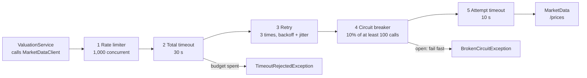
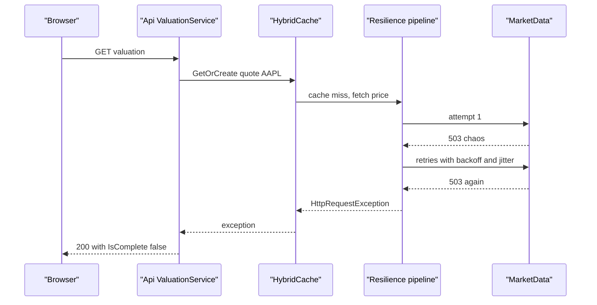
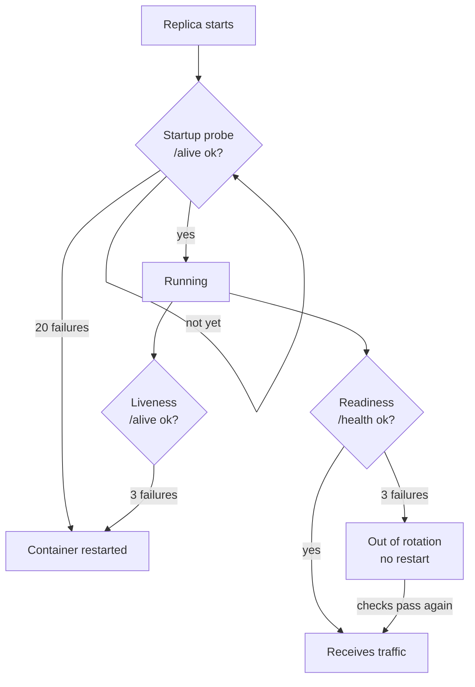
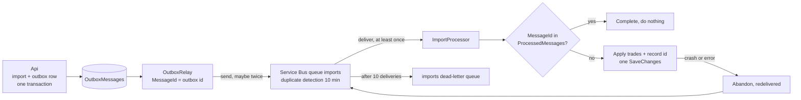

# Chapter 14: Reliability patterns

> ⏱ About 30 min · You'll learn: what the standard resilience handler really does with its defaults, how to degrade gracefully and wire health probes without restarting healthy replicas, and how idempotency, EF retries, rate limits and bulkheads stop one failure from becoming many.

---

## 📖 Story: Priya flips the switch

It is demo day. Elena has invited two advisors to see the beta build, and you are driving. You open a portfolio, click **Valuation**, and the numbers appear in a few hundred milliseconds. Elena nods. Then Priya, sitting at the back with her laptop, says "one second" and types something. You refresh. The spinner turns, and keeps turning. After about fifteen seconds the page fills in: holdings and cost basis are there, but every price says "unavailable" and the total market value is empty.

"I set the market-data failure rate to 100%," Priya says. "That's what happens when the vendor goes down at 9 a.m. on a Monday." Elena asks the question she always asks: "What does the user see?" Priya answers honestly: "A spinner for fifteen seconds, then half a page. That's better than a 500. It's not good enough."

Afterwards Maya pulls you into a room. "At Nordbank, how did you handle the flaky SOAP vendor?" You admit it: a `for` loop, `Thread.Sleep(1000)`, three attempts, and a WCF `sendTimeout` nobody remembered setting. She smiles. "Same instinct, better tools. Let's see what's already protecting us, and what those fifteen seconds are made of." You open your notebook to **Habits I brought with me** and write: *"Retry in a loop with Thread.Sleep."*

> Numbers in the Ledgerly story (latency, request counts, timings) are **illustrative**. The resilience defaults quoted from the docs are real and marked 🔧.

---

## 🏚️ Old way → 🚀 New way

| What you did before | What you do now | Why it changed |
|---|---|---|
| A `for` loop with `Thread.Sleep` around a SOAP or HTTP call | `AddStandardResilienceHandler()`: retries with exponential backoff and jitter, bounded by timeouts | Fixed delays from many callers arrive in waves and hammer a recovering dependency; jitter spreads them out |
| WCF binding timeouts in `web.config`, set once and forgotten | Per-attempt and total timeouts in the pipeline, plus a `CancellationToken` that flows from the HTTP request to EF and `HttpClient` | A slow dependency must not hold your threads and your user longer than the user is willing to wait |
| Catch the exception and show an error page | Graceful degradation: return what you have and say it is partial (`IsComplete = false`) | Most screens have parts that don't depend on the failing service |
| The load balancer pings `default.aspx` or checks "is the app pool running" | Startup, liveness and readiness probes mapped to `/alive` and `/health` | The platform restarts or removes replicas for you, so the checks must mean the right thing |
| MSDTC and the dream of exactly-once delivery | At-least-once delivery plus idempotent consumers (`ProcessedMessages`, Service Bus duplicate detection) | Distributed transactions don't exist across cloud services; duplicates must be harmless instead |
| Deadlock-retry code copied into every repository class | The EF Core execution strategy retries transient SQL errors in one place | Azure SQL has transient faults (failovers, serverless resume) that are normal, not exceptional |
| One slow dependency starved the IIS thread pool | Bulkheads: concurrency limits, `MaxConcurrentCalls`, rate limiting with 429 | Isolating a failure keeps the rest of the system responsive |

> 💡 Reliability is not about preventing failure. It is about deciding, in advance, what happens when each dependency fails.

---

## 🧠 The failures you design for

Before choosing patterns, name the failures. Maya keeps this table on the team wiki, and each row is a question for every new dependency.

| Failure mode | What it looks like | Ledgerly example | Pattern |
|---|---|---|---|
| **Transient error** | A single request fails, the next one works | MarketData returns 503 for one call | Retry with backoff and jitter |
| **Slow dependency** | Requests succeed, but take seconds | MarketData adds 3 s of latency | Timeouts per attempt and in total, cancellation |
| **Hard outage** | Every call fails for minutes | The vendor is down | Circuit breaker, then graceful degradation |
| **Overload** | Too many requests for the capacity | A user scripts 200 CSV uploads | Rate limiting, bulkheads, queue-based load leveling |
| **Duplicate delivery** | The same message arrives twice | The outbox relay crashes after `Send` but before `SaveChanges` | Idempotent consumer, duplicate detection |
| **Poison message** | A message fails every time | An import message for an import row that no longer exists | Dead-letter queue, alert a human |
| **Process death** | A replica is killed mid-request | Scale-in or a new revision sends `SIGTERM` | Graceful shutdown, probes, durable queues |

The first four are about **calls**, the last three are about **work**. Chapter 7 covered the work side in depth (outbox, dead-letter, graceful shutdown). This chapter connects both sides and adds the HTTP pipeline, probes and limits.

> 💡 A retry is a bet that the next attempt will succeed. It is a good bet for transient errors and a terrible bet for outages and overload.

---

## 🧠 The standard resilience handler, defaults and all

The package `Microsoft.Extensions.Http.Resilience` 🔧 is built on Polly v8. One call, `AddStandardResilienceHandler()`, wraps every outgoing `HttpClient` request in a pipeline of five strategies. The older `Microsoft.Extensions.Http.Polly` (`AddPolicyHandler`, Polly v7) is deprecated, so if you find it in old code, migrate.

| Order (outer → inner) | Strategy | Default 🔧 | What it protects |
|---|---|---|---|
| 1 | **Rate limiter** | Concurrency limiter, permit limit 1,000, queue 0 | Your own process: a cap on concurrent outbound calls |
| 2 | **Total request timeout** | 30 s | The caller: no request waits longer than this, retries included |
| 3 | **Retry** | 3 retries, exponential backoff with jitter, base delay 2 s. Handles 5xx, 408, 429 and transient exceptions | Transient errors |
| 4 | **Circuit breaker** | Opens at a 10% failure ratio, minimum throughput 100, sampling duration 30 s, break duration 5 s | The dependency: stop calling it while it's down, and fail fast |
| 5 | **Attempt timeout** | 10 s per attempt | One hung attempt can't eat the whole budget |

Source: [Build resilient HTTP apps](https://learn.microsoft.com/en-us/dotnet/core/resilience/http-resilience).

### 💻 In Ledgerly: one line for every HttpClient

📄 [`sample/src/Ledgerly.ServiceDefaults/Extensions.cs`](https://github.com/vygantas-meskauskis/cloud-native-dotnet/blob/main/sample/src/Ledgerly.ServiceDefaults/Extensions.cs)
```csharp
        builder.Services.ConfigureHttpClientDefaults(http =>
        {
            // Retries with jittered back-off, per-attempt + total timeouts, circuit breaker, rate limiter.
            http.AddStandardResilienceHandler();

            // Resolves "https+http://marketdata" to a real address (Aspire locally, config or DNS in Azure).
            http.AddServiceDiscovery();
        });
```

`ConfigureHttpClientDefaults` applies to **every** client created by `IHttpClientFactory` in that service, including the typed `MarketDataClient`. The client itself stays boring on purpose:

📄 [`sample/src/Ledgerly.Core/Market/MarketDataClient.cs`](https://github.com/vygantas-meskauskis/cloud-native-dotnet/blob/main/sample/src/Ledgerly.Core/Market/MarketDataClient.cs)
```csharp
/// <summary>
/// Typed HttpClient for the market-data service. Base address, retries, timeouts and the circuit breaker
/// are configured at registration time (see ServiceDefaults), not here. This class just speaks HTTP.
/// </summary>
public sealed class MarketDataClient(HttpClient http) : IMarketDataClient
{
    // ...
        var quotes = await http.GetFromJsonAsync<Quote[]>($"/prices?symbols={query}", cancellationToken) ?? [];
    // ...
}
```

No retry loop, no timeout constant, no `try/catch`. Policy lives in one place, code lives in another. That separation is the biggest change from the `Thread.Sleep` habit.

### What the defaults did during the demo

Now you can explain Priya's fifteen seconds:

1. Every call to `/prices` got a 503 from the chaos switch.
2. The retry strategy treated 503 as transient and tried again three times, waiting a little longer each time (starting around 2 s, growing exponentially, with jitter). Those waits add up to roughly the fifteen seconds you saw.
3. The circuit breaker **never opened**. It needs at least 100 calls in its 30-second sampling window before it judges the failure ratio. A demo with three people clicking produces a handful of calls.
4. After the last retry, the handler returned the final 503, `GetFromJsonAsync` threw `HttpRequestException`, and the valuation degraded (next section).

Point 3 is the one that surprises people. The defaults are tuned for services with real traffic. At beta volume, the breaker protects you only when many users hit the outage at once. In production with real load, the breaker opens after enough failures, every call fails immediately with `BrokenCircuitException` for 5 seconds, and the page degrades in milliseconds instead of seconds.



### Tuning it for a user-facing call

For a valuation screen, fifteen seconds is too long. You can tune the standard handler with an options callback:

```csharp
// illustrative, not in the sample
http.AddStandardResilienceHandler(options =>
{
    options.Retry.MaxRetryAttempts = 2;
    options.AttemptTimeout.Timeout = TimeSpan.FromSeconds(3);
    options.TotalRequestTimeout.Timeout = TimeSpan.FromSeconds(8);
});
```

Two rules keep tuning safe. Keep the **total timeout shorter than your caller's patience** (the browser, Leo's SPA, or an upstream service). And change the pipeline in **one** place: adding a second `AddStandardResilienceHandler()` on a typed client that already gets one from `ConfigureHttpClientDefaults` stacks two pipelines, and the retries multiply.

| Use retries when | Avoid retries when |
|---|---|
| The operation is a read (`GET`) or is idempotent | It is a `POST` that creates something and has no idempotency key. Use `o.Retry.DisableForUnsafeHttpMethods()` |
| Errors are transient (503, 408, timeouts, connection resets) | Errors are permanent (400, 401, 404): retrying can't help |
| The dependency is shared and recovers on its own | You are already inside a retry loop higher up (queue redelivery, the caller's retry) |

For non-HTTP work (a database call, a file share, an SDK without built-in retries), `Microsoft.Extensions.Resilience` gives you the same building blocks with `AddResiliencePipeline("name", ...)`.

> 💡 The defaults are a good starting point, not a design. Read them, do the math for your traffic, and tune the call paths that users wait on.

---

## 🧠 Graceful degradation, timeouts and cancellation

Retries and breakers decide **when** to give up. Degradation decides **what to return** when you do. Ledgerly's valuation has two parts: the holdings and cost basis come from your own database, the prices come from the vendor. If the vendor is down, half the answer is still true.

### 💻 In Ledgerly: a partial valuation instead of a 500

📄 [`sample/src/Ledgerly.Api/Services/ValuationService.cs`](https://github.com/vygantas-meskauskis/cloud-native-dotnet/blob/main/sample/src/Ledgerly.Api/Services/ValuationService.cs)
```csharp
    private async Task<decimal?> GetPriceAsync(string symbol, CancellationToken ct)
    {
        try
        {
            return await cache.GetOrCreateAsync(
                $"quote:{symbol}",
                async token =>
                {
                    var quotes = await marketData.GetQuotesAsync([symbol], token);
                    return quotes.TryGetValue(symbol, out var q) ? q.Price : (decimal?)null;
                },
                tags: ["quotes"],
                cancellationToken: ct);
        }
        catch (Exception ex) when (ex is HttpRequestException or BrokenCircuitException or TimeoutRejectedException)
        {
            LogPriceUnavailable(logger, symbol, ex.GetType().Name);
            return null;
        }
    }
```

And in `GetAsync`:

```csharp
        var complete = lines.All(l => l.Price is not null);
        return new PortfolioValuation(
            portfolio.Id,
            portfolio.BaseCurrency,
            lines,
            lines.Sum(l => l.CostBasis),
            complete ? lines.Sum(l => l.MarketValue!.Value) : null,
            complete,
            clock.GetUtcNow());
```

What matters here:

| Line | Why |
|---|---|
| The `catch` names three exception types | These are the three ways the resilience pipeline gives up: final HTTP failure, open circuit, spent timeout. Anything else (a bug) still fails loudly |
| `OperationCanceledException` is **not** caught | If the user closes the tab, the request is aborted and the work should stop, not degrade |
| `HybridCache.GetOrCreateAsync` | A price cached a few seconds ago is still served during an outage, and stampede protection means 50 concurrent requests for `AAPL` make one vendor call (chapter 18) |
| `IsComplete` and a null `TotalMarketValue` | The API is honest. Leo's SPA can show "prices delayed" instead of a wrong total |

When you showed Elena the JSON, she asked for one change in the SPA backlog: a banner that says "Live prices are temporarily unavailable" when `isComplete` is false. That is graceful degradation done properly. It is a **product** decision, not only a technical one.

### Cancellation is part of the timeout story

In minimal APIs, a `CancellationToken` parameter is bound to the request's abort signal. Ledgerly passes `ct` from the endpoint into `ValuationService`, into EF Core and into `HttpClient`. When the user gives up, everything downstream stops. At Nordbank most of your call stacks had no tokens at all, so an abandoned request kept a thread busy until the WCF timeout fired.



> 💡 Every dependency needs a written answer to "what does the user see when this is down?" Even "a 500" is a decision, so make it on purpose.

---

## 🧠 Health probes: liveness, readiness and startup

In IIS, health was "is the app pool running?". In Azure Container Apps, the platform asks your replica three different questions, and it takes **different actions** for each answer. Getting them confused is one of the most common outages in container platforms.

| Probe | Question | Action on failure | Ledgerly path |
|---|---|---|---|
| **Startup** | Has the process finished starting? | Keep waiting, other probes are paused. After too many failures, restart | `/alive` |
| **Liveness** | Is the process responsive at all? | **Restart the container** | `/alive` |
| **Readiness** | Can this replica serve traffic right now? | **Remove it from load balancing** until it recovers. No restart | `/health` |

### 💻 In Ledgerly: two endpoints with different jobs

📄 [`sample/src/Ledgerly.ServiceDefaults/Extensions.cs`](https://github.com/vygantas-meskauskis/cloud-native-dotnet/blob/main/sample/src/Ledgerly.ServiceDefaults/Extensions.cs)
```csharp
    public static TBuilder AddDefaultHealthChecks<TBuilder>(this TBuilder builder) where TBuilder : IHostApplicationBuilder
    {
        builder.Services.AddHealthChecks()
            // Liveness: "the process is responsive". Never check dependencies here, or a DB blip restarts every replica.
            .AddCheck("self", () => HealthCheckResult.Healthy(), ["live"]);

        return builder;
    }

    public static WebApplication MapDefaultEndpoints(this WebApplication app)
    {
        // Readiness: all checks (including DB, Redis, Service Bus registered by Aspire integrations).
        app.MapHealthChecks(ReadinessPath).DisableHttpMetrics();

        // Liveness: only checks tagged "live".
        app.MapHealthChecks(LivenessPath, new HealthCheckOptions
        {
            Predicate = r => r.Tags.Contains("live"),
        }).DisableHttpMetrics();

        return app;
    }
```

Read the comment on the `self` check twice. If liveness checked the database, a 30-second Azure SQL failover would fail liveness on **every** replica at once, the platform would restart all of them, and you would turn a short database blip into a full outage with cold starts on top. Liveness answers only "is this process stuck?".

Readiness (`/health`) runs **all** registered checks. You didn't write a database check: Aspire's `AddSqlServerDbContext` registers one, and the other Aspire client integrations do the same for their resources. By default, `Healthy` and `Degraded` return HTTP 200 and `Unhealthy` returns 503.

The Aspire service defaults template maps these endpoints only in Development. Ledgerly maps them in every environment because Container Apps probes need them, and the default response is a single word ("Healthy") that reveals no details.

📄 [`sample/infra/modules/apps.bicep`](https://github.com/vygantas-meskauskis/cloud-native-dotnet/blob/main/sample/infra/modules/apps.bicep)
```bicep
var probes = [
  {
    type: 'Startup'
    httpGet: { path: '/alive', port: 8080 }
    initialDelaySeconds: 2
    periodSeconds: 3
    failureThreshold: 20
  }
  {
    type: 'Liveness'
    httpGet: { path: '/alive', port: 8080 }
    periodSeconds: 10
    failureThreshold: 3
  }
  {
    type: 'Readiness'
    httpGet: { path: '/health', port: 8080 }
    periodSeconds: 10
    failureThreshold: 3
  }
]
```

The startup probe gives a replica about a minute (20 checks, 3 seconds apart) to start before anything else is judged. After that, three failed liveness checks in a row (about 30 seconds) trigger a restart, and three failed readiness checks take the replica out of rotation.



### A trade-off worth discussing

Readiness that checks a **shared** dependency has its own risk: if the database is down, every API replica becomes unready at once, and callers get an error from the platform instead of your nicely shaped ProblemDetails. Maya's position, which the team wrote down in an ADR: readiness checks only dependencies **without which this replica can do nothing useful**. For the API, that is SQL. MarketData is **not** a readiness dependency, because valuation degrades without it. Never add the vendor to a health check.

> 💡 Liveness asks "should I be restarted?", readiness asks "should I get traffic?". A dependency failure is almost never a reason to restart.

---

## 🧠 Idempotency, EF retries, rate limits and bulkheads

Retries create duplicates. Every layer that retries (the HTTP pipeline, Service Bus redelivery, the outbox relay, a user clicking twice) needs a partner that makes the duplicate harmless.

### 💻 In Ledgerly: an idempotent consumer

📄 [`sample/src/Ledgerly.Worker/ImportProcessor.cs`](https://github.com/vygantas-meskauskis/cloud-native-dotnet/blob/main/sample/src/Ledgerly.Worker/ImportProcessor.cs)
```csharp
        if (await db.ProcessedMessages.AnyAsync(p => p.MessageId == messageId, ct))
        {
            LogDuplicate(logger, messageId);
            await args.CompleteMessageAsync(args.Message, ct);
            return;
        }
        // ...
        try
        {
            var outcome = await ApplyImportAsync(db, import, ct);
            db.ProcessedMessages.Add(new ProcessedMessage { MessageId = messageId, Handler = HandlerName });
            await db.SaveChangesAsync(ct); // trades + import status + idempotency record in ONE transaction
            await args.CompleteMessageAsync(args.Message, ct);
            // ...
        }
        catch (Exception ex) when (ex is not OperationCanceledException)
        {
            // ...
            await args.AbandonMessageAsync(args.Message, cancellationToken: ct); // Service Bus will redeliver
        }
```

The trades, the import status and the "I processed this message" record are saved in **one** `SaveChangesAsync`, so they commit together or not at all. `MessageId` is the primary key of `ProcessedMessages`, so even two replicas racing on the same message can't both commit. There are three layers of protection:

| Layer | Mechanism | Catches |
|---|---|---|
| Service Bus | Duplicate detection: the same `MessageId` within the window is dropped. Ledgerly sets `MessageId` = outbox row id | The relay re-sending after a crash, within 10 minutes |
| Database | `ProcessedMessages` keyed by message id, written in the same transaction | Redelivery after the window, or after an abandon |
| Domain | `ExternalRef` from the broker CSV is unique per portfolio (filtered unique index, chapter 5) | The user uploading the same file twice |

📄 [`sample/infra/modules/servicebus.bicep`](https://github.com/vygantas-meskauskis/cloud-native-dotnet/blob/main/sample/infra/modules/servicebus.bicep)
```bicep
  properties: {
    lockDuration: 'PT1M'
    maxDeliveryCount: 10 // after 10 failed attempts the message moves to imports/$deadletterqueue
    requiresDuplicateDetection: true // the same MessageId within the window is dropped
    duplicateDetectionHistoryTimeWindow: 'PT10M'
    deadLetteringOnMessageExpiration: true
  }
```

Duplicate detection needs the Standard or Premium tier 🔧 and is configured when the queue is created. The 10-minute window is also the default (range 20 s to 7 days) 🔧.

### EF Core: the execution strategy

Azure SQL has transient faults that are part of normal operation: a failover, a connection reset, a serverless database resuming from auto-pause. EF Core's SQL Server provider can retry them through an **execution strategy** (`EnableRetryOnFailure`). Aspire's `AddSqlServerDbContext` turns retries on for you. The catch: once retries are on, a transaction **you** start must run inside the strategy, so the whole unit can be replayed.

📄 [`sample/src/Ledgerly.MigrationService/Program.cs`](https://github.com/vygantas-meskauskis/cloud-native-dotnet/blob/main/sample/src/Ledgerly.MigrationService/Program.cs)
```csharp
            // The execution strategy retries transient failures (e.g. Azure SQL serverless waking up).
            var strategy = db.Database.CreateExecutionStrategy();
            await strategy.ExecuteAsync(async () => await db.Database.MigrateAsync(stoppingToken));
```

A single `SaveChangesAsync` is already one transaction, which is why the import handler doesn't need this wrapper. Reach for `CreateExecutionStrategy().ExecuteAsync(...)` when you call `BeginTransactionAsync` yourself or group several saves.

### Rate limiting and bulkheads

A **bulkhead** (named after ship compartments) limits how much of your capacity one kind of work can take, so a flood in one place can't sink everything. Ledgerly has several, some of which you might not have noticed:

| Bulkhead | Where | Limit | Protects |
|---|---|---|---|
| Per-user rate limit on imports | `Program.cs` | 5 uploads per minute per user (fixed window) | API and worker from one noisy user |
| Outbound concurrency limiter | Standard resilience handler | 1,000 concurrent calls, queue 0 🔧 | The process from unbounded outbound calls |
| `MaxConcurrentCalls = 4` | `ImportProcessor` | 4 imports per worker replica | SQL from too many parallel imports |
| `maxReplicas: 5` on the worker | `apps.bicep` | KEDA adds replicas, up to 5 | SQL again: scale is bounded on purpose |
| CPU and memory per container | `apps.bicep` | 0.5 vCPU, 1 GiB for api and worker | Neighbors in the same environment |

📄 [`sample/src/Ledgerly.Api/Program.cs`](https://github.com/vygantas-meskauskis/cloud-native-dotnet/blob/main/sample/src/Ledgerly.Api/Program.cs)
```csharp
builder.Services.AddRateLimiter(options =>
{
    options.RejectionStatusCode = StatusCodes.Status429TooManyRequests;
    options.AddPolicy(ApiPolicies.Imports, http => RateLimitPartition.GetFixedWindowLimiter(
        partitionKey: http.User.Identity?.Name ?? http.Connection.RemoteIpAddress?.ToString() ?? "anonymous",
        factory: _ => new FixedWindowRateLimiterOptions { PermitLimit = 5, Window = TimeSpan.FromMinutes(1) }));
});
```

Note the first line inside the lambda. The rate limiting middleware's default `RejectionStatusCode` is **503**, not 429. A 503 tells clients and monitoring "the server is broken", while 429 says "you are sending too much". Leo's SPA should back off on 429; your alerts should not page Priya for it. Set it explicitly, as the [rate limiting docs](https://learn.microsoft.com/en-us/aspnet/core/performance/rate-limit) samples do.

> 💡 Every retry needs an idempotency partner, and every queue or scale rule needs an upper bound that your database can survive.

---

## 🗺️ How a duplicate becomes harmless



---

## ⚠️ Common traps

| Trap | What happens | Do this instead |
|---|---|---|
| Liveness probe checks the database | A short SQL failover fails liveness everywhere, every replica restarts, and the outage gets longer | Liveness checks only the process (`self`). Dependencies go in readiness, and only the essential ones |
| Retrying a non-idempotent `POST` | A timeout after the server committed leads to a second order, a second trade, a second import | `o.Retry.DisableForUnsafeHttpMethods()`, or an idempotency key the server checks |
| Stacking two resilience handlers | `ConfigureHttpClientDefaults` adds one, a typed client adds another, and 3 retries become many | Configure the pipeline in one place and read the effective defaults |
| Catching `Exception` around a call, including cancellation | Aborted requests "degrade" instead of stopping, and real bugs return 200 with missing data | Catch the specific resilience outcomes, as `ValuationService` does, and let `OperationCanceledException` flow |
| Trusting the circuit breaker at low traffic | With a minimum throughput of 100 in 30 s 🔧, a quiet service never trips it, and every user pays the full retry time | Do the math for your traffic and tune attempt and total timeouts for user-facing calls |
| Leaving the rate limiter on its default status | Rejections show up as 503s, alerts fire, and clients retry harder | Set `RejectionStatusCode = 429` and let clients back off |
| Unbounded scale-out on a queue | KEDA adds 50 workers, each opens SQL connections, and the database becomes the outage | Set `maxReplicas` and `MaxConcurrentCalls` to what the database can take |

---

## 🧰 Helpers

**The "new dependency" checklist** (paste into your ADR or PR description):

```markdown
- [ ] What does the user see when this dependency is down? (degrade, queue, or fail)
- [ ] Timeouts: attempt and total, shorter than the caller's patience
- [ ] Retries: only for idempotent operations, with backoff and jitter
- [ ] Circuit breaker: does our traffic reach the minimum throughput?
- [ ] Health: readiness only if this replica is useless without it, never liveness
- [ ] Duplicates: what makes a second delivery harmless?
- [ ] Limits: concurrency, rate and scale bounds the dependency can survive
```

**Run chaos against your local system** (MarketData's `/chaos` endpoint exists only in Development):

```bash
# 50% failures and 2 s of latency on every /prices call
curl -X POST "$MARKETDATA_URL/chaos" -H "Content-Type: application/json" -d '{"failureRate":0.5,"latencyMs":2000}'
# back to normal
curl -X POST "$MARKETDATA_URL/chaos" -H "Content-Type: application/json" -d '{"failureRate":0,"latencyMs":0}'
```

**Make it permanent:**

- Keep resilience and health checks in the shared service defaults, so new services get them with one line. The toolkit has a copy as `ServiceDefaults.Extensions.cs`; see [the toolkit](../toolkit/README.md).
- Add the checklist above to `production-readiness-checklist.md` and the probe rule ("no dependencies in liveness") to `pr-review-checklist.md`.
- Turn each degradation decision into a test. Ledgerly has `Valuation_degrades_gracefully_when_market_data_is_down`, which flips `FakeMarketData.IsDown` and asserts `IsComplete` is false ([Chapter 17](17-testing-strategy.md)).
- Never ship a "break me" endpoint: the chaos routes are mapped inside `if (app.Environment.IsDevelopment())`.

---

## 🧪 Try it yourself (optional, ~25 min)

You need a container runtime for Aspire.

1. Start the system and open the Aspire dashboard link from the console:
   ```bash
   cd sample
   aspire run
   ```
2. Create a dev token and use `src/Ledgerly.Api/Ledgerly.Api.http` (or curl) to create a portfolio, record a buy, and call the valuation endpoint. Note the response time and `"isComplete": true`.
   ```bash
   dotnet user-jwts create --project src/Ledgerly.Api
   ```
3. In the dashboard, find the `marketdata` resource and copy its URL into `MARKETDATA_URL`. Turn on full failure with the curl command from Helpers, using `"failureRate":1.0`. Wait about 30 seconds so the cached quote expires (`HybridCache` expiration is 30 s in `Program.cs`).
4. Call the valuation again. Observe: it takes many seconds, returns 200, and `isComplete` is false. In the dashboard **Traces** view, open the trace and count the HTTP client attempts to `marketdata`. In **Structured logs**, find "Price for ... unavailable (HttpRequestException)".
5. Now set `"failureRate":0,"latencyMs":12000`. Call the valuation again. Observe: each attempt hits the 10 s attempt timeout, the 30 s total timeout ends the retries, and the log reason becomes `TimeoutRejectedException`.
6. Reset chaos to zero. If the `/chaos` route isn't reachable on your machine, set `FailureRate` and `LatencyMs` in the `Chaos` section of `src/Ledgerly.MarketData/appsettings.json` instead and restart.

---

## ✅ Recap

1. The standard resilience handler gives every `HttpClient` a rate limiter, total timeout, jittered retries, a circuit breaker and attempt timeouts, but you must check its defaults against your traffic and your users' patience.
2. Degrade on purpose (`IsComplete = false`), flow `CancellationToken` everywhere, keep dependencies out of liveness, and keep only essential ones in readiness.
3. Retries create duplicates and load: pair them with idempotent consumers, the EF execution strategy, a 429 rate limiter and bounded concurrency and scale.

**Next → [Chapter 15: Observability I: logging and OpenTelemetry](15-observability-logging-and-opentelemetry.md)**
