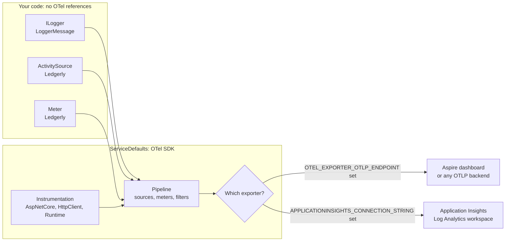
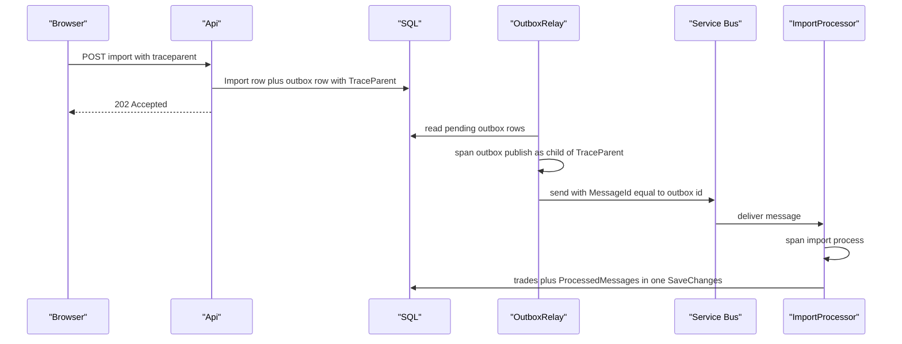

# Chapter 15: Observability I: logging and OpenTelemetry

> ⏱ About 30 min · You'll learn: structured logging with message templates and `[LoggerMessage]`, the OpenTelemetry model of traces, metrics and logs, and how Ledgerly follows one request from the browser through the outbox and Service Bus into the worker.

---

## 📖 Story: the log file that doesn't exist

The first real bug report from a beta tester arrives on a Tuesday. "I uploaded my broker CSV. It said the import finished, but three trades are missing." Elena forwards it with one line: "Can we tell her what happened today, not next week?"

Your hands know what to do. At Nordbank you would RDP into the three IIS servers, open `D:\Logs\Policy\`, and grep each day's log4net file for the customer number. So you ask Tomás, half joking: "Where's the log file for the worker?" He doesn't laugh. "Which replica? The one KEDA started at 10:02 and removed at 10:09? Its file system is gone. There are no files, and there's no box to log in to."

Maya slides her laptop over. The Aspire dashboard is open on a local run, and she types the import id into the structured logs filter. One line appears: `Import 0193... completed_with_errors: 47 imported, 3 skipped`. She clicks the trace id next to it, and the whole story unfolds on one screen: the upload request in the API, the outbox publish in the worker, the Service Bus processing and every SQL call. "Same thing in Application Insights for the beta environment," she says. "Logs aren't files anymore. They're events with properties, and they belong to a trace." In your notebook under **Habits I brought with me**: *"Grep log files on each server."*

> The ids, row counts and timings in this chapter are **illustrative**. Package versions and defaults from the docs are marked 🔧.

---

## 🏚️ Old way → 🚀 New way

| What you did before | What you do now | Why it changed |
|---|---|---|
| log4net or NLog files on each server, RDP and grep | Logs exported as structured events (OTLP) to the Aspire dashboard locally and Application Insights in Azure | Containers are short-lived and have no persistent disk; there is no server to log in to |
| `logger.Info("Import " + id + " done")` | Message templates: `"Import {ImportId} {Outcome}: ..."` with named properties, generated by `[LoggerMessage]` | Properties are queryable fields, not text you parse with regex |
| A correlation id copied by hand into WCF headers | W3C trace context (`traceparent`) propagated by OpenTelemetry, and carried through the outbox in a `TraceParent` column | One trace id links every span and log line across services and queues |
| Performance counters and perfmon on the box | `Meter` counters and histograms, plus built-in ASP.NET Core, `HttpClient` and runtime metrics | Metrics are cheap aggregates that survive sampling and replica churn |
| The Application Insights 2.x SDK with `TelemetryClient.TrackEvent` everywhere | Vendor-neutral APIs (`ILogger`, `ActivitySource`, `Meter`) and an exporter chosen at startup | Code doesn't change when the backend changes, and the classic SDK is now built on OpenTelemetry anyway |
| "Turn on Debug in production" when something breaks | Traces show the path; logs at Information and above carry the facts; sampling keeps the cost bounded | Debug-level volume in the cloud is a cost and a privacy problem |

> 💡 You don't search logs to find out what happened anymore. You find one event, then follow its trace.

---

## 🧠 Structured logging that you can query

The single most important habit to drop is building log messages with string concatenation or interpolation. A **message template** keeps the text and the values separate. The text stays constant (so you can group by it), and each `{Placeholder}` becomes a named property on the log record. The [official guidance](https://learn.microsoft.com/en-us/dotnet/core/extensions/logger-message-generator) is direct about it: use templates, never interpolation.

| Style | Example | What the backend stores |
|---|---|---|
| Interpolation ❌ | `logger.LogInformation($"Import {id} done")` | One unique string per import. Nothing to filter on, and the string is built even when the level is off |
| Template ✅ | `logger.LogInformation("Import {ImportId} done", id)` | A constant template plus a property `ImportId` you can query |
| Source-generated ✅✅ | `[LoggerMessage(...)] static partial void LogImportDone(...)` | Same as the template, with no boxing, no template parsing at runtime, and no allocation when the level is disabled |

### 💻 In Ledgerly: every log call is generated

Ledgerly uses `[LoggerMessage]` everywhere except one deliberate line in the chaos service. The worker's import processor declares its messages at the bottom of the class:

📄 [`sample/src/Ledgerly.Worker/ImportProcessor.cs`](https://github.com/vygantas-meskauskis/cloud-native-dotnet/blob/main/sample/src/Ledgerly.Worker/ImportProcessor.cs)
```csharp
    [LoggerMessage(Level = LogLevel.Information, Message = "Message {MessageId} already processed, completing duplicate")]
    private static partial void LogDuplicate(ILogger logger, string messageId);

    [LoggerMessage(Level = LogLevel.Information, Message = "Import {ImportId} {Outcome}: {RowsImported} imported, {RowsSkipped} skipped")]
    private static partial void LogImportDone(ILogger logger, Guid importId, string outcome, int rowsImported, int rowsSkipped);

    [LoggerMessage(Level = LogLevel.Error, Message = "Import {ImportId} failed on delivery {DeliveryCount}; abandoning for retry")]
    private static partial void LogImportCrashed(ILogger logger, Guid importId, int deliveryCount, Exception ex);
```

Three details are worth copying:

1. The class is `sealed partial class ImportProcessor`. The generator writes the method bodies into the other half of the partial class, which is why the methods must be `partial`.
2. The `Exception` parameter isn't in the template. The generator recognizes it and attaches it to the log record as the exception, with its stack trace.
3. If you add a parameter and forget to use it in the template, the build warns with **SYSLIB1015**. With warnings as errors (chapter 3), that is a build break, which is exactly what you want.

Compare it with the one hand-written call, in the market-data simulator:

📄 [`sample/src/Ledgerly.MarketData/Program.cs`](https://github.com/vygantas-meskauskis/cloud-native-dotnet/blob/main/sample/src/Ledgerly.MarketData/Program.cs)
```csharp
        logger.LogWarning("Chaos: failing /prices request for {Symbols}", symbols);
```

It still uses a template, so `Symbols` is a property. For a throwaway simulator that's fine. In code that runs on every request, prefer the generator.

### Scopes: properties for a whole block

`IncludeScopes = true` (set in the service defaults) means properties from `ILogger.BeginScope` are attached to every log record written inside the scope. Ledgerly doesn't use scopes, because spans already group the work, but they're handy when several log lines need the same business key:

```csharp
// illustrative, not in the sample
using (logger.BeginScope(new Dictionary<string, object?>
{
    ["ImportId"] = import.Id,
    ["PortfolioId"] = import.PortfolioId,
}))
{
    // every log written here carries ImportId and PortfolioId
}
```

> 💡 Write log messages for the query you'll run at 2 a.m.: a constant template, the business ids as properties, and the exception as an exception.

---

## 🧠 OpenTelemetry: one model for traces, metrics and logs

OpenTelemetry (OTel) is a vendor-neutral standard for telemetry. In .NET, the beautiful part is that the **APIs are already in the runtime**. Your code doesn't reference OpenTelemetry at all; only the composition root does.

| Signal | .NET API | Question it answers | Ledgerly example |
|---|---|---|---|
| **Traces** (spans) | `ActivitySource` and `Activity` in `System.Diagnostics` | "What happened in this one request, and where did the time go?" | `outbox publish imports`, `import process` |
| **Metrics** | `Meter`, `Counter<T>`, `Histogram<T>` in `System.Diagnostics.Metrics` | "How much, how often, how fast, in aggregate?" | `ledgerly.imports.processed`, `http.server.request.duration` |
| **Logs** | `ILogger` | "What fact did the code want to record?" | `Import {ImportId} {Outcome}: ...` |

A **span** in OTel is an `Activity` in .NET (the names differ for historical reasons). Each span has a trace id shared by the whole operation, its own span id and a parent span id. Log records written while a span is active automatically get its trace id and span id. That's how Maya jumped from one log line to the whole trace.

Three more concepts finish the model:

- **Resource attributes** describe *who* is sending: `service.name`, `service.version`, the host. `OTEL_SERVICE_NAME` sets `service.name`, and `OTEL_RESOURCE_ATTRIBUTES` adds others. In Azure, `apps.bicep` sets `OTEL_SERVICE_NAME` to `api`, `worker` or `marketdata` for each container app. Application Insights shows it as the cloud role name.
- **OTLP** (OpenTelemetry Protocol) is the wire format. An app exports to an OTLP endpoint over gRPC (default port 4317) or HTTP/protobuf (default port 4318) 🔧, configured with `OTEL_EXPORTER_OTLP_ENDPOINT`, `OTEL_EXPORTER_OTLP_PROTOCOL` and `OTEL_EXPORTER_OTLP_HEADERS` ([OTLP exporter spec](https://opentelemetry.io/docs/specs/otel/protocol/exporter/)). Aspire injects these variables for every project it runs.
- **Semantic conventions** are agreed attribute names such as `http.request.method`, `http.response.status_code`, `url.full` and `server.address`. ASP.NET Core 8 and later emits built-in metrics like `http.server.request.duration` that follow them. Use the conventions where they fit and a reverse-DNS-style prefix (`ledgerly.`) for your own names.



> 💡 Instrument with the .NET APIs, export with OpenTelemetry. The backend becomes a startup decision, not a code change.

---

## 🧠 How ServiceDefaults wires it

Every Ledgerly service calls `builder.AddServiceDefaults()`. That one line is where all the OTel decisions live.

### 💻 In Ledgerly: signals, sources and filters

📄 [`sample/src/Ledgerly.ServiceDefaults/Extensions.cs`](https://github.com/vygantas-meskauskis/cloud-native-dotnet/blob/main/sample/src/Ledgerly.ServiceDefaults/Extensions.cs)
```csharp
    public static TBuilder ConfigureOpenTelemetry<TBuilder>(this TBuilder builder) where TBuilder : IHostApplicationBuilder
    {
        builder.Logging.AddOpenTelemetry(logging =>
        {
            logging.IncludeFormattedMessage = true;
            logging.IncludeScopes = true;
        });

        builder.Services.AddOpenTelemetry()
            .WithMetrics(metrics => metrics
                .AddAspNetCoreInstrumentation()
                .AddHttpClientInstrumentation()
                .AddRuntimeInstrumentation()
                .AddMeter(TelemetryName))
            .WithTracing(tracing => tracing
                .AddSource(builder.Environment.ApplicationName)
                .AddSource(TelemetryName)
                .AddSource("Azure.*")
                .AddAspNetCoreInstrumentation(options =>
                    // Probes hit these every few seconds: keep them out of traces.
                    options.Filter = context =>
                        !context.Request.Path.StartsWithSegments(ReadinessPath)
                        && !context.Request.Path.StartsWithSegments(LivenessPath))
                .AddHttpClientInstrumentation());

        builder.AddOpenTelemetryExporters();
        return builder;
    }
```

Line by line:

| Line | What it does |
|---|---|
| `IncludeFormattedMessage = true` | Sends the rendered text ("Import 0193... completed: 47 imported") alongside the template and properties |
| `AddMeter(TelemetryName)` / `AddSource(TelemetryName)` | Subscribes to Ledgerly's own meter and activity source, both named `"Ledgerly"`. Without these lines, custom telemetry is silently dropped |
| `AddSource("Azure.*")` | Collects spans from Azure SDK clients such as Service Bus |
| The `Filter` on ASP.NET Core instrumentation | Drops `/health` and `/alive` requests. Container Apps probes call them every few seconds on every replica, and you don't want them in traces or in your bill |
| `.DisableHttpMetrics()` on the health endpoints (in `MapDefaultEndpoints`) | The same idea for metrics: probes don't skew request-duration percentiles |

### Choosing the exporter at startup

📄 [`sample/src/Ledgerly.ServiceDefaults/Extensions.cs`](https://github.com/vygantas-meskauskis/cloud-native-dotnet/blob/main/sample/src/Ledgerly.ServiceDefaults/Extensions.cs)
```csharp
    private static TBuilder AddOpenTelemetryExporters<TBuilder>(this TBuilder builder) where TBuilder : IHostApplicationBuilder
    {
        // Locally Aspire sets this and the dashboard receives OTLP. Any OTLP backend works the same way.
        if (!string.IsNullOrWhiteSpace(builder.Configuration["OTEL_EXPORTER_OTLP_ENDPOINT"]))
        {
            builder.Services.AddOpenTelemetry().UseOtlpExporter();
        }

        // In Azure the Container App gets this setting and telemetry goes to Application Insights.
        if (!string.IsNullOrWhiteSpace(builder.Configuration["APPLICATIONINSIGHTS_CONNECTION_STRING"]))
        {
            builder.Services.AddOpenTelemetry().UseAzureMonitor();
        }

        return builder;
    }
```

The code never asks "am I in Azure?". It asks "where am I told to send telemetry?". Locally, Aspire sets the OTLP endpoint and the dashboard receives everything. In Azure, `apps.bicep` puts `APPLICATIONINSIGHTS_CONNECTION_STRING` into `commonEnv` for every container app (chapter 16 follows it from there). With neither variable, as in integration tests, nothing is exported.

### Two distros, pick one 🔧

`UseAzureMonitor()` comes from the **Azure Monitor OpenTelemetry Distro** (`Azure.Monitor.OpenTelemetry.AspNetCore`, 1.6.0 in the sample 🔧). The current docs recommend a newer option for new apps, the **Microsoft OpenTelemetry Distro** (package `Microsoft.OpenTelemetry`, 1.2.0 🔧), which can export to Azure Monitor, any OTLP endpoint or Agent 365:

```csharp
// illustrative, not in the sample
using Microsoft.OpenTelemetry;

builder.UseMicrosoftOpenTelemetry(o => o.Exporters = ExportTarget.AzureMonitor);
```

The docs say existing users of the Azure Monitor distro need to take **no action**, which is why Ledgerly stays on `UseAzureMonitor()` for now. The one hard rule: **don't initialize both distros** in the same app. And if you inherit an older app on the classic Application Insights SDK, know that SDK 3.x (`Microsoft.ApplicationInsights.AspNetCore` 3.2.0 🔧) is itself built on OpenTelemetry, that many 2.x packages were removed, and that 2.x and 3.x packages must not be mixed. See [Enable Azure Monitor OpenTelemetry](https://learn.microsoft.com/en-us/azure/azure-monitor/app/opentelemetry-enable?tabs=aspnetcore) and the [migration guide](https://learn.microsoft.com/en-us/azure/azure-monitor/app/migrate-to-opentelemetry?tabs=dotnet).

### The Aspire dashboard

Locally you don't need any cloud resource to see all three signals. `aspire run` starts the dashboard with an OTLP receiver, and it shows resources, console output, **structured logs** (filterable by property), **traces** (a waterfall per trace) and **metrics**. It is the fastest feedback loop you'll have: add a span, run, look. Chapter 6 covers the dashboard's other views.

> 💡 Configure telemetry in one shared place, choose the exporter from configuration, and filter out probe noise before it costs you anything.

---

## 🧠 Custom spans, custom metrics and one trace through the queue

Built-in instrumentation covers HTTP in and out, and the Azure SDKs. Your business operations need their own names.

### 💻 In Ledgerly: one source, one meter

📄 [`sample/src/Ledgerly.Core/Diagnostics/LedgerlyTelemetry.cs`](https://github.com/vygantas-meskauskis/cloud-native-dotnet/blob/main/sample/src/Ledgerly.Core/Diagnostics/LedgerlyTelemetry.cs)
```csharp
public static class LedgerlyTelemetry
{
    public const string SourceName = "Ledgerly";

    public static readonly ActivitySource ActivitySource = new(SourceName);

    private static readonly Meter Meter = new(SourceName);

    public static readonly Counter<long> TransactionsRecorded =
        Meter.CreateCounter<long>("ledgerly.transactions.recorded", unit: "{transaction}", description: "Trades recorded via API or import.");

    public static readonly Counter<long> ImportsProcessed =
        Meter.CreateCounter<long>("ledgerly.imports.processed", unit: "{import}", description: "Broker imports processed, tagged by outcome.");

    public static readonly Histogram<double> ImportDuration =
        Meter.CreateHistogram<double>("ledgerly.imports.duration", unit: "s", description: "Time to process one broker import.");
    // ...
}
```

`Ledgerly.Core` references no OpenTelemetry package. `ActivitySource` and `Meter` are plain .NET types, and the service defaults subscribe to the name `"Ledgerly"`. Two notes on choices you might make differently:

- **Static vs `IMeterFactory`.** Since .NET 8, `IMeterFactory` is registered in DI and is the recommended way to create meters in ASP.NET Core apps (the container owns the meter's lifetime). Ledgerly uses a static class for simplicity, because the meter is shared by the API and the worker. For a new library, consider the factory ([metrics instrumentation](https://learn.microsoft.com/en-us/dotnet/core/diagnostics/metrics-instrumentation)).
- **Counters vs histograms.** A counter answers "how many"; a histogram answers "how long" and gives you percentiles. Units follow the OTel convention: `s` for seconds, `{import}` for a count of things.

Using them is one line each, with tags as key/value pairs:

📄 [`sample/src/Ledgerly.Worker/ImportProcessor.cs`](https://github.com/vygantas-meskauskis/cloud-native-dotnet/blob/main/sample/src/Ledgerly.Worker/ImportProcessor.cs)
```csharp
        var request = args.Message.Body.ToObjectFromJson<ImportRequested>();
        using var activity = LedgerlyTelemetry.ActivitySource.StartActivity("import process");
        activity?.SetTag("ledgerly.import.id", request?.ImportId);
        // ...
            LedgerlyTelemetry.ImportsProcessed.Add(1, new KeyValuePair<string, object?>("outcome", outcome));
            LedgerlyTelemetry.ImportDuration.Record(Stopwatch.GetElapsedTime(started).TotalSeconds);
```

Note `activity?.`: `StartActivity` returns **null** when nothing is listening (in unit tests, for example), so always use the null-conditional operator.

### Carrying the trace across the outbox

HTTP calls propagate trace context automatically: `HttpClient` adds a `traceparent` header and ASP.NET Core reads it. A database row doesn't. The outbox is a gap where the trace would normally break: the API commits a row, and seconds later a different process publishes it. Ledgerly closes the gap by storing the W3C trace context with the row.

📄 [`sample/src/Ledgerly.Core/Messaging/Outbox.cs`](https://github.com/vygantas-meskauskis/cloud-native-dotnet/blob/main/sample/src/Ledgerly.Core/Messaging/Outbox.cs)
```csharp
    // W3C trace context of the request that created the message, so the trace continues in the worker.
    public string? TraceParent { get; init; }
    // ...
        db.OutboxMessages.Add(new OutboxMessage
        {
            Type = typeof(T).Name,
            Destination = destination,
            Payload = JsonSerializer.Serialize(message),
            TraceParent = System.Diagnostics.Activity.Current?.Id,
        });
```

`Activity.Current?.Id` is the W3C `traceparent` string of the current span (version, trace id, span id, flags). The relay then starts its span **as a child of that id**:

📄 [`sample/src/Ledgerly.Worker/OutboxRelay.cs`](https://github.com/vygantas-meskauskis/cloud-native-dotnet/blob/main/sample/src/Ledgerly.Worker/OutboxRelay.cs)
```csharp
            // Continue the trace of the HTTP request that created the message.
            using var activity = LedgerlyTelemetry.ActivitySource.StartActivity(
                $"outbox publish {message.Destination}", ActivityKind.Producer, message.TraceParent);
```

`ActivityKind.Producer` tells backends this span hands work to a queue. Inside it, the Service Bus SDK sends the message, and its own spans (collected through `AddSource("Azure.*")`) belong to the same trace. On the consumer side, the processor callback runs inside the SDK's processing span, and `import process` becomes a child of whatever `Activity.Current` is at that moment.

Ledgerly relies on the Azure SDK to carry context across the broker. The SDK's exact propagation behavior isn't something this course verified, so if you see the trace split in two at the queue, carry it yourself. The pattern is the same as the outbox:

```csharp
// illustrative, not in the sample
// Producer: copy the current trace context onto the message.
var outgoing = new ServiceBusMessage(payload) { MessageId = id };
if (Activity.Current?.Id is { } traceParent)
{
    outgoing.ApplicationProperties["traceparent"] = traceParent;
}

// Consumer: continue that trace explicitly.
var parentId = args.Message.ApplicationProperties.TryGetValue("traceparent", out var value) ? value as string : null;
using var activity = LedgerlyTelemetry.ActivitySource.StartActivity("import process", ActivityKind.Consumer, parentId);
```

> 💡 Anywhere work crosses a boundary that isn't HTTP (a table, a queue, a file), the trace breaks unless you carry `traceparent` across it yourself.

---

## 🗺️ One import, one trace

This is the trace Maya opened in the story. Every arrow below is a span or a log record with the same trace id, as long as the context is carried across the outbox row and the queue.



When you search Application Insights for the beta tester's import id, you land on the last log line ("Import ... completed_with_errors: 47 imported, 3 skipped"). From there, the trace id leads back to the upload request, and the import's `Error` field (returned by `GET /api/imports/{importId}`) lists the first rows that failed to parse. That's the answer Elena wanted the same day.

---

## 🧠 What not to send: PII, secrets and cardinality

Observability data is data. It is stored, retained, queried by many people and billed by volume. Three rules keep it safe and affordable.

**1. No secrets, no unnecessary personal data.** Log ids, not content. Ledgerly logs `ImportId`, `MessageId`, `Symbol` and counts. It never logs the CSV content, the JWT, connection strings or the user's name. Jonas has a short list for PR reviews:

| Never log | Log instead |
|---|---|
| Tokens, keys, connection strings, passwords | Nothing. If you must, a fixed marker like "token present: true" |
| File contents and request bodies | Ids, sizes, row counts, line numbers of errors |
| Names, emails, account numbers | The internal owner id, or nothing |
| Full exception messages from third parties that echo input | Your own message plus the exception object (and review what the exception contains) |

Remember that spans carry attributes too. `url.full` on an outgoing request includes the query string, so never put secrets in URLs.

**2. Mind metric cardinality.** Every unique combination of tag values on a metric becomes a separate time series. `outcome` on `ledgerly.imports.processed` has three values ("completed", "completed_with_errors", "rejected"), which is perfect. `AlertsTriggered` is tagged by `symbol`, which is fine while the simulator knows a short fixed list of symbols, and worth revisiting if users can enter any ticker. A tag like `userId` or `importId` on a metric is a mistake: put high-cardinality values on **spans and logs**, where each event is stored individually, and keep metric tags to small, bounded sets.

| Value | On a span or log? | As a metric tag? |
|---|---|---|
| `ImportId`, `MessageId`, `PortfolioId` | ✅ Yes | ❌ No, unbounded |
| `outcome`, HTTP status code, operation name | ✅ Yes | ✅ Yes, a small set |
| `symbol` | ✅ Yes | ⚠️ Only while the list is bounded |
| User id or email | ⚠️ Internal id only | ❌ Never |

**3. Choose levels on purpose.** `Information` for business facts you want in production ("Import ... completed"). `Warning` for degraded but handled situations ("Price for AAPL unavailable"). `Error` for failures that need attention ("Import ... failed on delivery 3"). `Debug` and `Trace` for local investigation only. Generated `[LoggerMessage]` methods cost almost nothing when a level is disabled, so you can leave debug messages in the code without paying for them.

> 💡 Ids on spans, small enums on metrics, nothing secret anywhere. Cardinality and PII mistakes are both cheap to make and expensive to clean up.

---

## ⚠️ Common traps

| Trap | What happens | Do this instead |
|---|---|---|
| String interpolation in log calls | Every message is unique, nothing is queryable, and the string is built even when the level is off | Message templates, ideally `[LoggerMessage]` |
| Forgetting `AddSource` / `AddMeter` for your own names | Custom spans and metrics are silently dropped, and you think the code doesn't run | Subscribe to your names in one shared place (`"Ledgerly"` in the service defaults) |
| Calling `activity.SetTag` without `?.` | `NullReferenceException` whenever no listener is attached, typically in tests | `activity?.SetTag(...)` |
| Initializing both `UseAzureMonitor()` and `UseMicrosoftOpenTelemetry()` 🔧 | Duplicate or conflicting pipelines, per the docs | Pick one distro per app |
| Health probes in traces | Thousands of meaningless spans per hour per replica, and an inflated bill | Filter `/health` and `/alive` out, as `ConfigureOpenTelemetry` does |
| User ids or import ids as metric tags | Cardinality explosion, slow queries, cost | High-cardinality values go on spans and logs only |
| Assuming the trace survives a queue or a table | The worker's span starts a new trace, and you can't connect cause and effect | Store `traceparent` (outbox `TraceParent` column) and start the next span from it |

---

## 🧰 Helpers

**A `[LoggerMessage]` starter you can paste into any class:**

```csharp
// illustrative, not in the sample
public sealed partial class SomethingHandler(ILogger<SomethingHandler> logger)
{
    [LoggerMessage(Level = LogLevel.Information, Message = "Order {OrderId} placed with {LineCount} lines")]
    private static partial void LogOrderPlaced(ILogger logger, Guid orderId, int lineCount);

    [LoggerMessage(Level = LogLevel.Error, Message = "Order {OrderId} failed")]
    private static partial void LogOrderFailed(ILogger logger, Guid orderId, Exception ex);
}
```

**OTLP variables worth knowing** (Aspire sets these for you locally):

| Variable | Purpose |
|---|---|
| `OTEL_SERVICE_NAME` | `service.name`, shown as the role name in Application Insights |
| `OTEL_RESOURCE_ATTRIBUTES` | Extra resource attributes, for example `deployment.environment=beta` |
| `OTEL_EXPORTER_OTLP_ENDPOINT` | Where to send OTLP |
| `OTEL_EXPORTER_OTLP_PROTOCOL` | `grpc` or `http/protobuf` |
| `OTEL_EXPORTER_OTLP_HEADERS` | Auth headers for a hosted OTLP backend |

**Make it permanent:**

- Keep telemetry setup only in the shared service defaults (`ServiceDefaults.Extensions.cs` in [the toolkit](../toolkit/README.md)), so every new service is observable on day one.
- Treat warnings as errors so **SYSLIB1015** (an unused `[LoggerMessage]` parameter) fails the build.
- Add "no interpolated log messages, no PII, no high-cardinality metric tags, new spans use `activity?.`" to `pr-review-checklist.md`, and ask Copilot to check it via `copilot-instructions.md` (both in [the toolkit](../toolkit/README.md)).
- Put a `ledgerly.` prefix on every custom span attribute and metric name, and record the naming rule in an ADR.

---

## 🧪 Try it yourself (optional, ~25 min)

You need a container runtime for Aspire.

1. Start everything and open the dashboard link printed in the console:
   ```bash
   cd sample
   aspire run
   ```
2. Create a token, then use `src/Ledgerly.Api/Ledgerly.Api.http` to create a portfolio and upload a small broker CSV to the imports endpoint.
   ```bash
   dotnet user-jwts create --project src/Ledgerly.Api
   ```
3. In **Structured logs**, filter by the `worker` resource and find "Import ... completed". Expand it and look at the properties: `ImportId`, `Outcome`, `RowsImported`, `RowsSkipped`, plus the trace id.
4. Click the trace id. In the waterfall, find the API's `POST` span, the `outbox publish imports` span, and the `import process` span. Check whether they share one trace id or the trace splits at Service Bus. Either answer is a finding worth writing down.
5. Open **Metrics**, choose the `worker`, and find `ledgerly.imports.processed`. Look at the `outcome` dimension. Then find `http.server.request.duration` on the `api` and check that no `/health` or `/alive` requests appear in **Traces**.
6. Break something on purpose: in `src/Ledgerly.Api/Services/ValuationService.cs`, remove ` ({Reason})` from the `LogPriceUnavailable` template so the `reason` parameter is unused. Build with `dotnet build Ledgerly.slnx` and look for **SYSLIB1015**; with warnings as errors it fails the build. Revert the change.

---

## ✅ Recap

1. Logs are structured events, not lines in a file: use message templates and `[LoggerMessage]`, and put business ids in properties so you can query them.
2. OpenTelemetry unifies traces (`Activity`), metrics (`Meter`) and logs (`ILogger`). The service defaults subscribe to `"Ledgerly"`, filter probe noise, and pick OTLP or Azure Monitor from configuration (one distro, never two).
3. Traces cross HTTP automatically but not tables or queues: Ledgerly stores `TraceParent` in the outbox and continues it in the relay, and you keep secrets, PII and high-cardinality tags out of telemetry.

**Next → [Chapter 16: Observability II: Azure Monitor, KQL and SLOs](16-observability-azure-monitor-kql-slos.md)**
