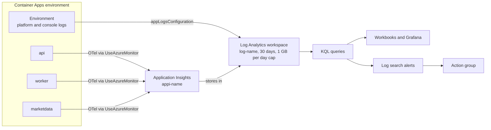
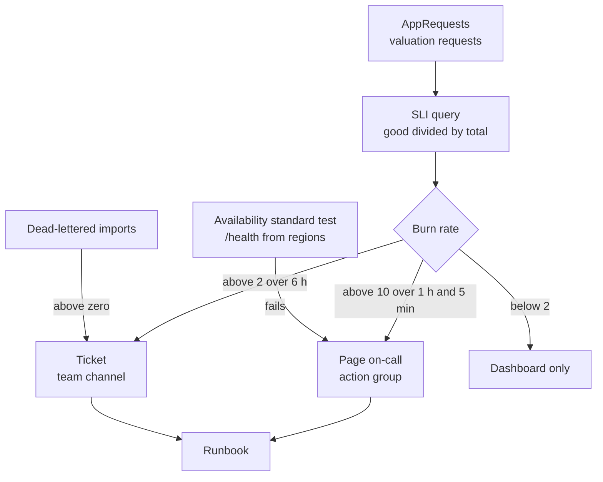

# Chapter 16: Observability II: Azure Monitor, KQL and SLOs

> ⏱ About 35 min · You'll learn: where Ledgerly's telemetry lands in Azure, how to answer real questions with KQL, and how to turn "is it healthy?" into SLIs, SLOs, error budgets and alerts that don't wake people up for nothing.

---

## 📖 Story: prove it with a number

Elena wants to open the beta to five hundred more users next month. In the planning meeting she asks the obvious question: "Is the app healthy enough for that?" You say yes. It feels healthy: the dashboard was green when you last looked, and nobody has complained since the import fix.

Priya puts her coffee down. "Is the app healthy? Prove it with a number." She isn't being difficult. She's the one who will carry the pager when five hundred more people arrive, and she has been burned before by "it feels fine". At her last job, an alert fired on every single exception, and after two weeks everyone had a mail rule that moved those alerts to a folder nobody opened. "I don't want more alerts," she says. "I want fewer, better ones. Tell me what 'healthy' means for Ledgerly, measure it, and page me only when users are actually hurting."

You think back to Nordbank. Health there was SCOM turning a server icon red, and a monthly uptime number someone typed into a slide. You open your notebook under **Habits I brought with me** and write: *"Healthy = the server is up."* Then you open the Application Insights resource that `monitoring.bicep` created and start learning KQL.

> All targets, percentages, request counts and budgets in this chapter are **illustrative**. Product behavior and dates from the docs are marked 🔧.

---

## 🏚️ Old way → 🚀 New way

| What you did before | What you do now | Why it changed |
|---|---|---|
| SCOM or perfmon watching CPU and disk on named servers | Application Insights and a Log Analytics workspace receiving OpenTelemetry from every replica | There are no named servers, and CPU doesn't tell you whether users are happy |
| Grep and Excel to answer a question about last week | KQL queries over `AppRequests`, `AppDependencies`, `AppTraces` and friends | Telemetry is a queryable dataset, not a pile of text |
| An email for every exception | Alerts on symptoms users feel (error-budget burn rate), routed by action groups | Noisy alerts get ignored, and ignored alerts are worse than none |
| "Uptime 99.9%" typed into a monthly slide | SLIs computed from real requests, SLOs agreed with the product owner, error budgets that drive priorities | A target you don't measure is a wish |
| A ping to `default.aspx` from a monitoring box | Availability **standard tests** from several Azure regions | URL ping tests are deprecated 🔧, and one location can't tell you about the internet |
| Log everything at Debug "just in case" | Sampling, log levels, a daily cap and retention chosen on purpose | Ingestion is billed by volume 💰 |

> 💡 Healthy isn't a feeling or a green icon. It's a number your users would agree with, measured continuously.

---

## 🧠 Where the telemetry lands

In chapter 15 you saw the switch in the service defaults: when `APPLICATIONINSIGHTS_CONNECTION_STRING` is set, `UseAzureMonitor()` exports traces, metrics and logs to Application Insights. In Azure, Bicep sets that variable for every container app, and the resource it points to is created by one small module.

### 💻 In Ledgerly: one workspace, one Application Insights

📄 [`sample/infra/modules/monitoring.bicep`](https://github.com/vygantas-meskauskis/cloud-native-dotnet/blob/main/sample/infra/modules/monitoring.bicep)
```bicep
// Observability backbone: one Log Analytics workspace (logs of the platform + apps) and
// one workspace-based Application Insights resource (OpenTelemetry traces, metrics, logs).
// ...
resource workspace 'Microsoft.OperationalInsights/workspaces@2023-09-01' = {
  name: 'log-${name}'
  location: location
  tags: tags
  properties: {
    sku: { name: 'PerGB2018' }
    retentionInDays: 30
    workspaceCapping: { dailyQuotaGb: 1 } // 💰 a hard daily cap keeps a learning subscription safe
  }
}

resource appInsights 'Microsoft.Insights/components@2020-02-02' = {
  name: 'appi-${name}'
  location: location
  tags: tags
  kind: 'web'
  properties: {
    Application_Type: 'web'
    WorkspaceResourceId: workspace.id
  }
}
```

📄 [`sample/infra/modules/apps.bicep`](https://github.com/vygantas-meskauskis/cloud-native-dotnet/blob/main/sample/infra/modules/apps.bicep)
```bicep
var commonEnv = [
  { name: 'AZURE_CLIENT_ID', value: identityClientId } // makes Azure SDK credentials pick the user-assigned identity
  { name: 'APPLICATIONINSIGHTS_CONNECTION_STRING', value: appInsightsConnectionString }
]
```

`WorkspaceResourceId` is the important line. **Classic Application Insights resources are retired**; every Application Insights resource is now **workspace-based**, storing its data in a Log Analytics workspace and billed through Log Analytics ([create a workspace-based resource](https://learn.microsoft.com/en-us/azure/azure-monitor/app/create-workspace-resource)). The Container Apps environment (`environment.bicep`) also sends its platform and console logs to the same workspace, so one place holds everything.

### Two names for the same data

You'll query the same telemetry from two places, and the table names differ. The Application Insights **Logs** blade shows the classic names; the Log Analytics workspace shows the `App*` names. This course uses the workspace names, because that's where the data really lives and where cross-resource queries work.

| Application Insights name | Workspace table | What lands there from Ledgerly |
|---|---|---|
| `requests` | `AppRequests` | Incoming HTTP requests (server spans) |
| `dependencies` | `AppDependencies` | Outgoing calls: `HttpClient` to marketdata, SQL, Service Bus |
| `traces` | `AppTraces` | `ILogger` records, including every `[LoggerMessage]` |
| `exceptions` | `AppExceptions` | Exceptions recorded on logs and spans |
| `customMetrics` | `AppMetrics` | `Meter` instruments, for example `ledgerly.imports.processed` |
| `availabilityResults` | `AppAvailabilityResults` | Availability test results |

Columns are renamed too: `timestamp` becomes `TimeGenerated` and `cloud_RoleName` becomes `AppRoleName` ([data model](https://learn.microsoft.com/en-us/azure/azure-monitor/app/data-model-complete)). `AppRoleName` comes from `OTEL_SERVICE_NAME`, which is why `apps.bicep` sets it to `api`, `worker` and `marketdata`. Your custom spans also appear as requests or dependencies depending on their kind; check the data model page when a span isn't where you expect it.

The portal experiences sit on top of the same data. **Application Map** draws `api`, `worker`, `marketdata`, SQL and Service Bus as a graph keyed by role name, with call volume and failure rates ([Application Map](https://learn.microsoft.com/en-us/azure/azure-monitor/app/app-map)). **Transaction search** and the **end-to-end transaction** view follow one W3C trace across services, which is the cloud version of what you did in the Aspire dashboard. **Failures**, **Performance** and **Live Metrics** cover the rest.



> 💡 One workspace per environment, every service tagged with its role name: that's what makes "show me everything about this request" a single query.

---

## 🧠 KQL: the queries you'll actually run

Kusto Query Language (KQL) reads top to bottom: start with a table, then pipe through filters and aggregations. If you know SQL and LINQ, you'll be productive in an hour. The pattern from the docs is the one you'll use most:

```kusto
AppRequests
| where TimeGenerated > ago(1h)
| summarize count(), p95=percentile(DurationMs, 95) by Name, bin(TimeGenerated, 5m)
```

The eight queries below are **starting points**, written for Ledgerly's names. `TimeGenerated`, `AppRoleName`, `Name` and `DurationMs` come straight from the docs; other columns (`Success`, `Target`, `Properties`, `Message`, `Sum`, `ItemCount`) come from the workspace schema, so check them in the Logs view's schema pane before you build alerts on them 🔧. The full set, with comments, is in `kql-queries.md` in [the toolkit](../toolkit/README.md).

**1. Failure rate per service, hourly**

```kusto
AppRequests
| where TimeGenerated > ago(24h)
| summarize total = count(), failed = countif(Success == false) by AppRoleName, bin(TimeGenerated, 1h)
| extend failurePct = round(100.0 * failed / total, 2)
| order by TimeGenerated desc
```

**2. p95 latency per operation**

```kusto
AppRequests
| where TimeGenerated > ago(1h)
| where AppRoleName == "api"
| summarize requests = count(), p95 = percentile(DurationMs, 95) by Name
| order by p95 desc
```

Operation names come from route templates (for example the valuation route with `{id:guid}`), so all portfolios group into one row. That's the low-cardinality naming from chapter 15 paying off.

**3. Market data dependency health**

```kusto
AppDependencies
| where TimeGenerated > ago(6h)
| where Target has "marketdata"
| summarize calls = count(), failed = countif(Success == false), p95 = percentile(DurationMs, 95) by bin(TimeGenerated, 5m)
| render timechart
```

During Priya's chaos demo in chapter 14, this chart would show a wall of failures and a p95 near the attempt timeout.

**4. What users saw: partial valuations**

```kusto
AppTraces
| where TimeGenerated > ago(6h)
| where Message has "partial valuation"
| summarize partialPrices = count() by bin(TimeGenerated, 5m)
```

This counts `LogPriceUnavailable` from `ValuationService`. Query 3 tells you the vendor is failing; query 4 tells you how many prices users didn't get. Elena cares about the second one.

**5. Import throughput by outcome**

```kusto
AppMetrics
| where TimeGenerated > ago(24h)
| where Name == "ledgerly.imports.processed"
| extend outcome = tostring(Properties["outcome"])
| summarize imports = sum(Sum) by outcome, bin(TimeGenerated, 1h)
| render columnchart
```

Metrics arrive pre-aggregated, so you sum the `Sum` column rather than counting rows. The `outcome` tag is one of "completed", "completed_with_errors" or "rejected".

**6. Imports heading for the dead-letter queue**

```kusto
union AppTraces, AppExceptions
| where TimeGenerated > ago(24h)
| where isnotempty(Properties["DeliveryCount"])
| extend importId = tostring(Properties["ImportId"]), delivery = toint(Properties["DeliveryCount"])
| summarize lastDelivery = max(delivery), lastSeen = max(TimeGenerated) by importId
| where lastDelivery >= 8
```

`LogImportCrashed` logs "Import {ImportId} failed on delivery {DeliveryCount}; abandoning for retry". With `maxDeliveryCount: 10`, an import that reaches delivery 10 and fails is in the dead-letter queue next. The query unions both tables because a log with an exception attached may be stored as an exception. Note the gap Priya found: the `ImportNotFound` path dead-letters **without** logging, so this query can't see it. Service Bus also exposes namespace metrics in Azure Monitor (dead-lettered message counts among them, check the docs), and an alert on that metric covers every path.

**7. Cold starts per service**

```kusto
AppTraces
| where TimeGenerated > ago(7d)
| where Message has "Application started"
| summarize starts = count() by AppRoleName, bin(TimeGenerated, 1d)
| order by TimeGenerated desc
```

ASP.NET Core logs "Application started" once per process at Information level, and Ledgerly's `appsettings.json` keeps that category at Information. With `apiMinReplicas = 0` (the default in `main.bicepparam`), every idle period ends with a cold start for the first user. If this number is high and users complain about the first request, that's the evidence for setting it to 1 💰.

**8. Top exceptions**

```kusto
AppExceptions
| where TimeGenerated > ago(24h)
| summarize occurrences = count() by AppRoleName, ExceptionType, OuterMessage
| top 10 by occurrences
```

> 💡 Write queries in terms of what users experience (requests, partial results, stuck imports), then add the cause queries (dependencies, exceptions) you'll use to explain it.

---

## 🧠 SLIs, SLOs and error budgets

This is the answer to Priya's question. The vocabulary comes from the Google SRE Workbook ([implementing SLOs](https://sre.google/workbook/implementing-slos/)):

| Term | Meaning | Ledgerly example (illustrative) |
|---|---|---|
| **SLI** (indicator) | A measured ratio of good events to all events | Valuation requests that return 2xx in under 1 s, divided by all valuation requests |
| **SLO** (objective) | A target for the SLI over a window | 99.5% over 28 days |
| **Error budget** | 1 − SLO: how much badness you're allowed | 0.5% of valuation requests per 28 days |
| **Burn rate** | How fast you're spending the budget compared to "exactly on target" | A burn rate of 1 spends the budget in exactly 28 days. A burn rate of 10 spends it in 2.8 days |

You and Elena wrote three SLOs, using `slo-worksheet.md` from [the toolkit](../toolkit/README.md):

| User journey | SLI: good events | SLO |
|---|---|---|
| View portfolio and valuation | `api` requests on portfolio routes that succeed in under 1 s | 99.5% over 28 days |
| Record a trade | `POST` transaction requests that don't return 5xx | 99.9% over 28 days |
| Import a broker file | Imports that reach a final status within 5 minutes of upload | 99% over 28 days |

Two discussions came up that you'll have too:

- **Is a partial valuation "good"?** The request returns 200, so a request-based SLI counts it as good. Elena disagreed: users see "prices delayed". The team kept the request SLI simple and added query 4 as a separate **quality** indicator with its own looser target. Be explicit about such choices rather than letting the query decide.
- **Why not 100%?** Because nothing is, and because a 100% target means you can never deploy, experiment or take a dependency on a vendor. The budget is permission to take risks. When it's healthy, ship features. When it's spent, the next sprint goes to reliability. That trade-off is the real value of an SLO.

The math, with illustrative traffic: if the API serves 200,000 valuation requests in 28 days, a 99.5% SLO allows 1,000 bad ones. If a bad deploy causes 2% of requests to fail, the burn rate is 2% ÷ 0.5% = 4, and the whole month's budget is gone in a week.

### An SLI and burn rate in KQL

```kusto
// illustrative SLO: 99.5% of valuation requests succeed in under 1 s
let slo = 0.995;
AppRequests
| where TimeGenerated > ago(1h)
| where AppRoleName == "api" and Name has "valuation"
| summarize total = count(), good = countif(Success == true and DurationMs < 1000)
| extend sli = todouble(good) / total
| extend burnRate = (1.0 - sli) / (1.0 - slo)
```

Run it over 1 hour and over 6 hours. A high burn rate over a **short** window means something broke now; a moderate burn rate over a **long** window means a slow leak. The SRE Workbook recommends alerting on burn rate instead of raw thresholds, and checking a short and a long window together keeps alerts both fast and quiet.

> 💡 An SLO is a product decision with a number on it. Agree on it with the product owner, publish it, and let the error budget settle the "features or reliability?" argument.

---

## 🧠 Dashboards and alerts that don't cry wolf

### Workbooks and Grafana

A **Workbook** is an interactive report in the portal that combines KQL queries, metrics and parameters (a time range, an environment). Ledgerly's "Service health" workbook has four tiles: SLI per journey (the burn-rate query), failure rate per service (query 1), market data health (queries 3 and 4) and import outcomes (query 5). If your team already lives in Grafana, **Azure Managed Grafana** and the built-in **Dashboards with Grafana** in Application Insights 🔧 read the same data ([Grafana dashboards](https://learn.microsoft.com/en-us/azure/azure-monitor/app/grafana-dashboards)).

### Alert types

| Alert type | Evaluates | Use it for in Ledgerly |
|---|---|---|
| **Metric alert** | A platform or custom metric against a threshold, evaluated frequently | Service Bus dead-lettered messages above zero (check the metric name in the Service Bus docs) |
| **Log search alert** | A KQL query on a schedule | SLO burn rate, imports at delivery 8 or more |
| **Activity log alert** | Control-plane events in the subscription | Someone deleted or reconfigured a resource |
| **Smart detection** | Anomalies Application Insights finds by itself | A free extra signal, not a paging source |

**Action groups** define who gets told and how: email, SMS, voice, push, webhooks, Logic Apps, Functions and more. They're reused across alerts. Email receivers now require one-time-passcode verification 🔧, so new recipients have a step to complete. **Alert processing rules** suppress notifications during planned maintenance ([alerts overview](https://learn.microsoft.com/en-us/azure/azure-monitor/alerts/alerts-overview), [action groups](https://learn.microsoft.com/en-us/azure/azure-monitor/alerts/action-groups)).

Priya's alerting policy, which the team adopted:

| Severity | Condition (illustrative) | Goes to |
|---|---|---|
| Page | Burn rate above 10 over 1 hour **and** above 10 over 5 minutes | On-call phone |
| Ticket | Burn rate above 2 over 6 hours | Team channel, handled next working day |
| Ticket | Dead-lettered imports above zero | Team channel, with the runbook link |
| No alert | A single exception, a single failed request, high CPU without user impact | Dashboards only |

The second, short window on the page condition makes the alert stop firing quickly once the problem is fixed. Every alert that pages must link a runbook (`runbook-template.md` in [the toolkit](../toolkit/README.md)); chapter 19 covers on-call and postmortems.

### Availability tests

Burn-rate alerts need traffic. At 3 a.m. there may be none, so an outage can go unnoticed until the first user arrives. An **availability test** sends synthetic requests from several Azure regions. Use **standard tests**: they support SSL certificate checks, HTTP verbs and custom headers. **URL ping tests are deprecated and retire on 2028-09-30** 🔧 (the date was extended, so older articles say 2026). See [availability tests](https://learn.microsoft.com/en-us/azure/azure-monitor/app/availability). Results land in `AppAvailabilityResults`.

For Ledgerly, point the test at the API's `/health` endpoint. It checks that the replica can reach its essential dependencies, it is mapped in every environment, and it reveals nothing beyond one word. If `apiMinReplicas` is 0, remember that the test itself keeps waking the API, which removes cold starts for users but also costs replica time 💰.

> 💡 Page on symptoms that burn the error budget, ticket on causes, and put everything else on a dashboard. Fewer alerts, each one meaning "a human must act now".

---

## 🗺️ From bad requests to a page



---

## 🧠 Sampling and cost 💰

Log Analytics ingestion is often the **surprise cost** of a cloud-native system. Every request, dependency call, log line and metric point is billed by volume, and a chatty service at Debug level can cost more than the service itself. The levers, from most to least effective:

| Lever | Where in Ledgerly | Trade-off |
|---|---|---|
| **Don't produce noise** | Probes filtered out of traces; health endpoints excluded from HTTP metrics; `Microsoft.EntityFrameworkCore.Database.Command` and `Azure.Messaging.ServiceBus` at Warning in `appsettings.json` | None, really. Do this first |
| **Sampling** | The distro's default sampling 🔧 | You keep representative traces, not every one |
| **Retention** | `retentionInDays: 30` in `monitoring.bicep` | Longer retention for audits costs more |
| **Daily cap** | `dailyQuotaGb: 1` in `monitoring.bicep` | A hard cap: once it's hit, you're blind until the next day |

**Sampling.** Per the [sampling docs](https://learn.microsoft.com/en-us/azure/azure-monitor/app/opentelemetry-sampling), the Microsoft distro defaults to **rate-limited sampling of 5 traces per second** 🔧, fixed-percentage sampling is the alternative, and **trace-based log sampling** is on by default in .NET: logs that belong to a trace that wasn't sampled are dropped too. That keeps traces complete (you never get half a trace), but it means a rare log line can disappear at high volume. Two consequences for your queries:

- **Ratios stay correct, raw counts don't.** Failure rates and SLIs (ratios) are fine on sampled data. For absolute counts, the workspace tables carry an `ItemCount` column that says how many original items each stored row represents; `sum(ItemCount)` estimates the real total 🔧.
- **Metrics are aggregated, not sampled per trace.** `Meter` counters are summed in the process before export, so `ledgerly.imports.processed` stays a reliable count even when traces are sampled. Use metrics for counts you must trust.

**The daily cap is a safety net, not a budget.** One GB a day is right for a learning subscription: a logging bug can't produce a shocking bill. For the production environment, the team raised it and set a Cost Management budget with alerts instead (chapter 19), because going blind at 4 p.m. during an incident is worse than paying for a few extra gigabytes.

To see what's filling the workspace, count rows by table and service:

```kusto
union withsource = TableName AppRequests, AppDependencies, AppTraces, AppExceptions, AppMetrics
| where TimeGenerated > ago(1d)
| summarize rows = count() by TableName, AppRoleName
| order by rows desc
```

For prices, use the [Azure Pricing Calculator](https://azure.microsoft.com/en-us/pricing/calculator/); per-GB ingestion and retention prices change and vary by region 🔧.

> 💡 Cut noise at the source first, sample second, cap last. Metrics are your exact counters; traces and logs are your representative evidence.

---

## ⚠️ Common traps

| Trap | What happens | Do this instead |
|---|---|---|
| Querying classic names in one place and `App*` tables in another | Queries "don't work" when copied between the Application Insights blade and the workspace | Pick the workspace names (`AppRequests`, `TimeGenerated`, `AppRoleName`) and keep a shared query file |
| Alerting on every exception or a fixed error count | Alert fatigue, mail rules, and the one alert that matters gets missed | Alert on SLO burn rate over two windows; send causes to dashboards and tickets |
| Counting rows on sampled data | Request totals look far lower than reality | Use ratios, `sum(ItemCount)` 🔧, or metrics for exact counts |
| Setting a 100% SLO, or none | Either nothing can ever ship, or "healthy" stays a feeling | Pick a target users would accept, and an error budget policy agreed with the product owner |
| Relying only on request-based alerts | At night there's no traffic, so an outage stays silent until the first user hits it | Add an availability standard test (not URL ping, which retires 🔧) |
| A low daily cap in production | Telemetry stops mid-incident, exactly when you need it | Use the cap for dev and learning, and budgets plus sampling for production 💰 |
| Assuming every failure path logs | `ImportNotFound` dead-letters silently, and log queries miss it | Pair log alerts with platform metrics (dead-lettered message counts) |

---

## 🧰 Helpers

**The SLO one-pager** (the full version is `slo-worksheet.md` in [the toolkit](../toolkit/README.md)):

```markdown
Journey:            View portfolio valuation
SLI (good events):  api requests on valuation route, Success == true and DurationMs < 1000
SLI (all events):   api requests on valuation route
SLO:                99.5% over 28 days
Error budget:       0.5% of requests
Page:               burn rate > 10 over 1 h and 5 min
Ticket:             burn rate > 2 over 6 h
Budget policy:      when spent, the next sprint prioritizes reliability work
Owner:              Priya (SRE) and Elena (product)
```

**Make it permanent:**

- Keep the queries in version control: `kql-queries.md` in [the toolkit](../toolkit/README.md) is the team's shared file, and every alert references a query in it.
- Define workbooks and alert rules as Bicep next to `monitoring.bicep` once they stabilize, so a new environment gets them on day one. Tomás's rule applies: if it's not in git, it doesn't exist.
- Add "which SLO does this change affect?" and "does every new failure path log or emit a metric?" to `pr-review-checklist.md`.
- Review SLOs and the error budget in a monthly meeting with Elena, and record target changes in an ADR (`adr-template.md`).

---

## 🧪 Try it yourself (optional, ~40 min)

These steps need the Azure environment from chapter 12. If you don't have it, run the KQL in your head against the tables above, and do step 1 only.

1. Locally, start the system with `cd sample` and `aspire run`, create some traffic with `src/Ledgerly.Api/Ledgerly.Api.http`, and look at the **Traces** and **Metrics** views in the dashboard. Every concept in this chapter has a local twin there.

> 🧪 **Not run by the author:** this step was written from the docs and validated with `bicep build` only. Expect small differences.

2. In the Azure portal, open the Application Insights resource `appi-<name>`, then **Application Map**. Check that `api`, `worker` and `marketdata` appear with their dependencies.
3. Open the Log Analytics workspace `log-<name>`, then **Logs**. Run queries 1, 2 and 7 from this chapter. Note which columns exist in the schema pane and adjust the queries if your schema differs.
4. Save the burn-rate query, then create a **log search alert** from it that fires when `burnRate` is above 10. Create an **action group** with your email (complete the verification step 🔧).
5. Create an **availability standard test** against `https://<api-fqdn>/health`. Wait for results, then query `AppAvailabilityResults`.
6. Optional: if your environment allows it, temporarily raise market data failures (in Azure, only through configuration, because `/chaos` exists only in Development) and watch queries 3 and 4 react. Reset it afterwards.
7. Fill in `slo-worksheet.md` for one Ledgerly journey you care about.

---

## ✅ Recap

1. Ledgerly's telemetry lands in one workspace-based Application Insights resource backed by Log Analytics; query it with KQL using the `App*` tables, `TimeGenerated` and `AppRoleName`.
2. "Healthy" is an SLI with an SLO and an error budget agreed with the product owner, and alerts page only when the burn rate says users are hurting, with availability tests covering quiet hours.
3. Ingestion is the surprise cost 💰: cut noise at the source, rely on sampling and exact metrics, and treat the daily cap as a learning-environment safety net.

**Next → [Chapter 17: Testing strategy](17-testing-strategy.md)**
