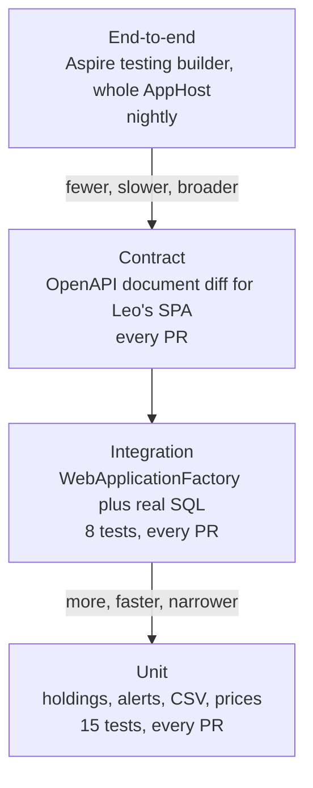
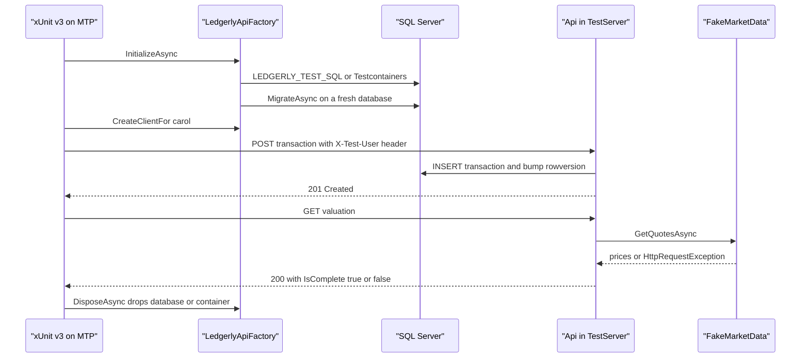

# Chapter 17: Testing strategy

> ⏱ About 30 min · You'll learn: how to shape a test pyramid for a small cloud-native system, how to run integration tests against a real SQL Server with `WebApplicationFactory` and Testcontainers, why the .NET 10 SDK pushed Ledgerly onto Microsoft.Testing.Platform, and where end-to-end and contract tests fit.

---

## 📖 Story: The 409 on every trade

It is Tuesday morning and Elena forwards a message from a beta tester: "I can't record any trades. Every time I press Save it says the portfolio changed and I should retry. I retried eleven times." You try it on the beta environment and get the same answer, a `409 Conflict` with "Portfolio changed while recording the trade. Retry the request."

The unit tests are green. `HoldingCalculator` is correct, the CSV parser is correct, and the price generator is correct. The bug isn't in any of them. It lives in the seam between your code and the database: a small refactor added the new `Transaction` through `portfolio.Transactions` instead of through the `DbContext`, and EF Core decided the row already existed. Nothing in the test suite sent a real trade to a real database.

Maya pulls up a chair. "At Nordbank, how did you test the data layer?" You think about it. A test database on a shared server that someone restored every few weeks, a few NUnit tests that only ran on the build machine, and a lot of manual clicking before each release. "So mostly in production," she says, kindly. You open your notebook to **Habits I brought with me** and write: *"Unit tests for logic, manual testing for everything else."*

"Let's write the test that would have caught it," Maya says. "Then let's make sure it can't be skipped by accident."

> Numbers in the Ledgerly story (test durations, tester counts) are **illustrative**. The 23 tests in the sample (15 unit, 8 integration against real SQL Server) are real.

---

## 🏚️ Old way → 🚀 New way

| What you did before | What you do now | Why it changed |
|---|---|---|
| MSTest or NUnit tests run by `vstest.console` on the build server | xUnit v3 test projects that are executables, run by Microsoft.Testing.Platform through `dotnet test` | The .NET 10 SDK supports MTP mode natively, and xUnit v3 is built for it |
| A shared test database restored "every few weeks" | A throwaway SQL Server per test run (Testcontainers) or a unique LocalDB database per run | Tests that share state fail randomly, and nobody trusts them |
| The EF in-memory provider, or mocked repositories | The real API in memory (`WebApplicationFactory<Program>`) against a real SQL Server | The bugs that hurt are in the seams: SQL translation, keys, concurrency tokens, migrations |
| `DateTime.Now` in domain code and `Thread.Sleep` in tests | `TimeProvider` in code, `FakeTimeProvider` in tests | Time becomes a dependency you control, so tests are fast and deterministic |
| Manual regression clicking before each release | End-to-end smoke tests of the whole system, and contract checks for the SPA | Releases are frequent now, so humans can't be the regression suite |
| Coverage from a separate tool with its own runner | `dotnet test --coverage` with `Microsoft.Testing.Extensions.CodeCoverage` | One runner, one command |

> 💡 A test suite is a portfolio. You spend most on cheap, fast tests and buy a few expensive ones only where the cheap ones can't see.

---

## 🧠 Concept 1: A test pyramid for this system

The classic pyramid says: many unit tests, fewer integration tests, very few end-to-end tests. The shape depends on where your bugs live. Ledgerly has a small domain and a lot of plumbing (HTTP, auth, EF Core, SQL, Service Bus, a second service). So the useful layers are:

| Layer | What it proves in Ledgerly | Speed | Where it runs |
|---|---|---|---|
| Unit | Holding math, alert rules, CSV parsing, price generation | Milliseconds | Every build, every PR |
| Integration (in-process API plus real SQL) | Endpoints, auth, validation, EF mappings, concurrency, degradation | Seconds | Every PR (CI has Docker) |
| Contract | The OpenAPI document Leo's SPA depends on hasn't changed by accident | Seconds | Every PR |
| End-to-end (whole AppHost) | Services find each other, health checks pass, messages flow | Minutes | Nightly, or before a release |

Unit tests in Ledgerly follow two habits that pay off quickly. First, **time is injected**. `PriceGenerator` takes a `TimeProvider`, so the test controls the clock instead of sleeping:

### 💻 In Ledgerly: a clock you can move

📄 [`sample/tests/Ledgerly.UnitTests/PriceTests.cs`](https://github.com/vygantas-meskauskis/cloud-native-dotnet/blob/main/sample/tests/Ledgerly.UnitTests/PriceTests.cs)

```csharp
    [Fact]
    public void Prices_are_stable_within_a_minute_and_move_over_time()
    {
        // TimeProvider makes "time" a dependency you can control in tests. No more DateTime.Now in domain code.
        var clock = new FakeTimeProvider(new DateTimeOffset(2026, 10, 28, 12, 0, 0, TimeSpan.Zero));
        var generator = new PriceGenerator(clock);

        var first = generator.GetQuote("aapl");
        clock.Advance(TimeSpan.FromSeconds(20));
        var sameMinute = generator.GetQuote("AAPL");
        clock.Advance(TimeSpan.FromHours(3));
        var later = generator.GetQuote("AAPL");
        // ...
    }
```

Three hours pass in a microsecond. `FakeTimeProvider` comes from the `Microsoft.Extensions.TimeProvider.Testing` package, and production code gets `TimeProvider.System` instead.

Second, **every production bug becomes a test**. The old IIS server had a Lithuanian culture, and "190,10" broke imports. The fix was invariant-culture parsing. The test pins the culture to `lt-LT` and proves the fix holds:

### 💻 In Ledgerly: the culture regression test

📄 [`sample/tests/Ledgerly.UnitTests/BrokerCsvParserTests.cs`](https://github.com/vygantas-meskauskis/cloud-native-dotnet/blob/main/sample/tests/Ledgerly.UnitTests/BrokerCsvParserTests.cs)

```csharp
    [Fact]
    public void Decimal_parsing_ignores_server_culture()
    {
        // The old IIS box had lt-LT culture and "190,10" broke imports. Invariant culture, always.
        var previous = Thread.CurrentThread.CurrentCulture;
        Thread.CurrentThread.CurrentCulture = new System.Globalization.CultureInfo("lt-LT");
        try
        {
            var result = BrokerCsvParser.Parse($"{Header}\n2026-09-01,buy,AAPL,5,190.10,BRK-1");
            Assert.Equal(190.10m, Assert.Single(result.Trades).Price);
        }
        finally
        {
            Thread.CurrentThread.CurrentCulture = previous;
        }
    }
```

Note the `try/finally`. A test that changes shared state (culture, environment variables, a static flag) must put it back, or the next test inherits it and fails for no visible reason.

Ledgerly uses **xUnit v3** (`xunit.v3` 4.0.2 🔧). xUnit v2 is in maintenance mode: critical fixes only, with all new features going to v3. v3 test projects are executables (`OutputType Exe`), which is what lets them run on Microsoft.Testing.Platform (Concept 3). If your team prefers another framework, MSTest and NUnit also support MTP, and **TUnit** (1.76.28 🔧) is a newer, MTP-only, source-generated framework that runs tests in parallel by default.

> 💡 Unit tests are for logic that has no I/O. If a test needs a mock of `DbContext` to say anything, it probably belongs one layer up.

---

## 🧠 Concept 2: Integration tests against a real database

`WebApplicationFactory<TEntryPoint>` (package `Microsoft.AspNetCore.Mvc.Testing`, 10.0.14 🔧) starts your real API in memory on a `TestServer` ([integration tests docs](https://learn.microsoft.com/en-us/aspnet/core/test/integration-tests)). Requests go through the real middleware, routing, authentication, validation and EF Core code. Only the network socket is missing. Because `Program.cs` uses top-level statements, it ends with `public partial class Program;` so the test project can see it.

The question is what to put behind it. Ledgerly answers: a **real SQL Server**, never the EF in-memory provider. The factory looks for one in two places.

### 💻 In Ledgerly: where the database comes from

📄 [`sample/tests/Ledgerly.IntegrationTests/LedgerlyApiFactory.cs`](https://github.com/vygantas-meskauskis/cloud-native-dotnet/blob/main/sample/tests/Ledgerly.IntegrationTests/LedgerlyApiFactory.cs)

```csharp
public sealed class LedgerlyApiFactory : WebApplicationFactory<Program>, IAsyncLifetime
{
    // ...
    public async ValueTask InitializeAsync()
    {
        var external = Environment.GetEnvironmentVariable("LEDGERLY_TEST_SQL");
        if (!string.IsNullOrWhiteSpace(external))
        {
            var csb = new Microsoft.Data.SqlClient.SqlConnectionStringBuilder(external)
            {
                InitialCatalog = $"LedgerlyTests_{Guid.NewGuid():N}",
            };
            _connectionString = csb.ConnectionString;
        }
        else
        {
            try
            {
                _container = new MsSqlBuilder("mcr.microsoft.com/mssql/server:2022-latest").Build();
                await _container.StartAsync();
                _connectionString = _container.GetConnectionString();
            }
            catch (Exception ex) when (ex is not OutOfMemoryException)
            {
                SkipReason = $"No SQL Server available (set LEDGERLY_TEST_SQL or start Docker): {ex.GetType().Name}";
                return;
            }
        }

        await using var scope = Services.CreateAsyncScope();
        await scope.ServiceProvider.GetRequiredService<LedgerlyDbContext>().Database.MigrateAsync();
    }
```

There are three ideas packed in here:

- **A fresh database per run.** With `LEDGERLY_TEST_SQL` (LocalDB on a Windows laptop), the factory creates `LedgerlyTests_<guid>` and deletes it in `DisposeAsync`. Without it, **Testcontainers** (`Testcontainers.MsSql` 4.16.0 🔧) starts a throwaway SQL Server container, which needs Docker. Either way, no test ever shares data with another run.
- **The real migrations run.** `MigrateAsync` applies the same migrations production uses, so a broken migration fails a test, not a deployment.
- **No SQL, no failure.** If neither source works, the factory records a `SkipReason`, and each test calls `Assert.SkipWhen(...)`. A laptop without Docker still gets a green unit-test run. Keep that convenience in mind, because Concept 4 comes back to its cost.

The rest of the factory swaps the parts you don't want to be real:

```csharp
    protected override void ConfigureWebHost(IWebHostBuilder builder)
    {
        builder.UseEnvironment("Testing");

        // UseSetting is applied before Program.cs reads configuration, so Aspire's client integration sees it.
        builder.UseSetting("ConnectionStrings:ledgerlydb", _connectionString ?? "Server=unused;Database=unused");

        builder.ConfigureLogging(logging => logging.SetMinimumLevel(LogLevel.Warning));

        builder.ConfigureTestServices(services =>
        {
            services.RemoveAll<IMarketDataClient>();
            services.AddSingleton<IMarketDataClient>(MarketData);

            services.AddAuthentication(TestAuthHandler.SchemeName)
                .AddScheme<AuthenticationSchemeOptions, TestAuthHandler>(TestAuthHandler.SchemeName, _ => { });
        });
    }
```

- **Market data** is replaced by `FakeMarketData`, a dictionary of prices plus an `IsDown` switch that throws `HttpRequestException`. That's how `Valuation_degrades_gracefully_when_market_data_is_down` proves the `IsComplete = false` path from [Chapter 14](14-reliability-patterns.md) without a second service.
- **Authentication** is replaced by `TestAuthHandler`, which signs in whoever is named in an `X-Test-User` header. `factory.CreateClientFor("alice")` returns an `HttpClient` that is "logged in" as alice, so `Users_cannot_see_each_others_portfolios` can test ownership with two clients in three lines. The handler is in the test project only, and its doc comment says so: "Test code only!"
- **The connection string** goes in through `UseSetting`, because Aspire's SQL client integration reads configuration while `Program.cs` builds the host, and later overrides would arrive too late.

### 💻 In Ledgerly: the bug that started this chapter

With that factory in place, you write a test that buys 5 shares and checks for `201 Created`. It fails with `409`. Now you can see the trap, and the fix sits in the endpoint with a comment so nobody "simplifies" it back:

📄 [`sample/src/Ledgerly.Api/Endpoints/PortfolioEndpoints.cs`](https://github.com/vygantas-meskauskis/cloud-native-dotnet/blob/main/sample/src/Ledgerly.Api/Endpoints/PortfolioEndpoints.cs)

```csharp
        // EF trap: the Id is already set (Guid v7, generated in C#). Adding via portfolio.Transactions would make EF
        // assume the row EXISTS and send an UPDATE (0 rows -> DbUpdateConcurrencyException). Add it explicitly.
        db.Transactions.Add(transaction);
        portfolio.UpdatedAt = DateTimeOffset.UtcNow; // bumps rowversion: two parallel "sell all" requests cannot both win

        try
        {
            await db.SaveChangesAsync(ct);
        }
        catch (DbUpdateConcurrencyException)
        {
            return TypedResults.Problem("Portfolio changed while recording the trade. Retry the request.", statusCode: StatusCodes.Status409Conflict);
        }
```

The entity key is a client-generated `Guid.CreateVersion7()`. When EF discovers a new object in a tracked navigation collection and its key is already set, it assumes the row exists and sends an `UPDATE`. Zero rows are affected, and EF reports that as a concurrency conflict. The endpoint's honest `409` handler then made the bug look like a user problem. [Chapter 5](05-data-ef-core-and-azure-sql.md) covers the EF side. The testing lesson is simpler: **no unit test could see this**, because it only happens when EF talks to a real database.

> 💡 Mock what you don't own and can't run (a vendor API). Run what you can (your database, your API, your migrations).

---

## 🗺️ How the pieces fit

The first diagram is Ledgerly's test portfolio. Width is roughly "how many tests", and the label says when each layer runs.



The second diagram is one run of the integration test class. The factory is created once per test class (`IClassFixture<LedgerlyApiFactory>`), so the database and the in-memory server are shared by the eight tests, and each test uses its own user and its own portfolio.



---

## 🧠 Concept 3: Microsoft.Testing.Platform on the .NET 10 SDK

The first time you ran the new suite with the .NET 10 SDK, `dotnet test` didn't run a single test. It stopped with:

```text
Testing with VSTest target is no longer supported by Microsoft.Testing.Platform on .NET 10 SDK
```

Here's what happened. `dotnet test` has **two modes**. **VSTest mode** is the default and was the only mode before .NET 10. **MTP mode** is new in the .NET 10 SDK 🔧. Microsoft.Testing.Platform is a lightweight runner embedded in the test project itself, so a v3 test project is just an executable you can also start with `dotnet run`. Running MTP projects through VSTest mode is now legacy, and MTP v2 removes that support when you use the .NET 10 SDK. That's the wall Ledgerly hit with xUnit v3 4.x: the old path was closed.

The fix is one setting at the repository root:

### 💻 In Ledgerly: opting in to MTP

📄 [`sample/global.json`](https://github.com/vygantas-meskauskis/cloud-native-dotnet/blob/main/sample/global.json)

```json
{
  "sdk": {
    "version": "10.0.100",
    "rollForward": "latestFeature"
  },
  "test": {
    "runner": "Microsoft.Testing.Platform"
  }
}
```

MTP mode requires MTP 1.7 or later 🔧 ([dotnet test docs](https://learn.microsoft.com/en-us/dotnet/core/testing/unit-testing-with-dotnet-test)). After the switch, you name the solution with `--solution`, and MTP options go directly on the command line (in VSTest mode they came after `--`).

Then you clean up the test projects. The VSTest-era packages (`Microsoft.NET.Test.Sdk`, `xunit.runner.visualstudio`, `coverlet.collector`) are gone. Coverage now comes from an MTP extension:

📄 [`sample/tests/Ledgerly.IntegrationTests/Ledgerly.IntegrationTests.csproj`](https://github.com/vygantas-meskauskis/cloud-native-dotnet/blob/main/sample/tests/Ledgerly.IntegrationTests/Ledgerly.IntegrationTests.csproj)

```xml
  <PropertyGroup>
    <IsPackable>false</IsPackable>
    <IsTestProject>true</IsTestProject>
    <OutputType>Exe</OutputType>
  </PropertyGroup>

  <ItemGroup>
    <PackageReference Include="xunit.v3" />
    <PackageReference Include="Microsoft.Testing.Extensions.CodeCoverage" />
    <PackageReference Include="Microsoft.AspNetCore.Mvc.Testing" />
    <PackageReference Include="Testcontainers.MsSql" />
  </ItemGroup>
```

There are no versions here because Central Package Management keeps them in `Directory.Packages.props` ([Chapter 3](03-a-solution-set-up-like-a-pro.md)). The CI step uses the same command you run locally, plus coverage and a TRX report:

📄 [`.github/workflows/ci.yml`](https://github.com/vygantas-meskauskis/cloud-native-dotnet/blob/main/.github/workflows/ci.yml)

```yaml
      # Integration tests start a throwaway SQL Server container with Testcontainers (Docker is on the runner).
      - name: Test
        run: >
          dotnet test --solution Ledgerly.slnx -c Release --no-build
          --coverage --coverage-output-format cobertura
          --report-xunit-trx
```

The workflow then uploads `sample/TestResults/` as an artifact even when tests fail, so a red build always comes with evidence ([Chapter 9](09-ci-with-github-actions.md)).

One MTP behavior surprises people coming from VSTest: **when zero tests run, MTP returns exit code 8**, and `dotnet test` fails. Tomás hit it on the first nightly job, where a test filter had a typo and matched nothing. Under the old runner, that job would have stayed green forever. "I ran nothing" is not "everything passed". If a project legitimately runs no tests in some configuration, MTP lets you ignore specific exit codes; check the MTP docs for the current option 🔧, and scope it to that one job.

> 💡 A runner change is a good moment to delete packages. Every test package you no longer need is one less Dependabot PR and one less audit warning.

---

## 🧠 Concept 4: Tests that lie, and tests that hide

A passing test is a claim: "this behavior works". Two things can make the claim false, and Ledgerly met both.

**A test that passes for the wrong reason.** The first version of the oversell test bought 5 shares, sold 6, and expected `400 Bad Request`. It passed. Weeks later, during the 409 investigation, you noticed something odd: the setup buy had been failing too (with the 409), so the portfolio held nothing, and selling 6 of nothing is also a validation error. The test proved a sentence that was true for an unrelated reason. The fix is to assert the setup, not just the outcome:

### 💻 In Ledgerly: asserting the arrange step

📄 [`sample/tests/Ledgerly.IntegrationTests/PortfolioApiTests.cs`](https://github.com/vygantas-meskauskis/cloud-native-dotnet/blob/main/sample/tests/Ledgerly.IntegrationTests/PortfolioApiTests.cs)

```csharp
    [Fact]
    public async Task Overselling_is_a_validation_error()
    {
        var client = ClientFor("carol");
        var portfolio = await CreatePortfolioAsync(client);

        await BuyAsync(client, portfolio.Id, "AAPL", 5);
        var oversell = await PostTradeAsync(client, portfolio.Id, "AAPL", TransactionType.Sell, 6);

        Assert.Equal(HttpStatusCode.BadRequest, oversell.StatusCode);
    }
    // ...
    private static async Task BuyAsync(HttpClient client, Guid portfolioId, string symbol, decimal quantity)
    {
        var response = await PostTradeAsync(client, portfolioId, symbol, TransactionType.Buy, quantity);
        Assert.Equal(HttpStatusCode.Created, response.StatusCode);
    }
```

`BuyAsync` now fails loudly if the buy doesn't return `201 Created`, and `CreatePortfolioAsync` calls `EnsureSuccessStatusCode()`. A helper that hides a failed precondition is a test that lies. Whenever a test expects an error, ask "could this error come from the setup?" And watch every new test fail once before you trust it.

**A test that hides.** The factory skips integration tests when there's no SQL Server, which is friendly on a laptop. In CI it's a risk: if Docker were ever missing on the runner, eight tests would report "skipped" and the build would stay green, which is exactly how a regression slips through. Two cheap defenses:

- Read the TRX report or the console summary in CI, and treat a non-zero skipped count on the integration project as a problem.
- Make "SQL is required" explicit for CI. Ledgerly doesn't do this yet; here's one way to add it:

```csharp
// illustrative, not in the sample
catch (Exception ex) when (ex is not OutOfMemoryException)
{
    // Set LEDGERLY_REQUIRE_SQL=true in the CI workflow so a missing database fails the run instead of skipping it.
    if (string.Equals(Environment.GetEnvironmentVariable("LEDGERLY_REQUIRE_SQL"), "true", StringComparison.OrdinalIgnoreCase))
    {
        throw;
    }

    SkipReason = $"No SQL Server available (set LEDGERLY_TEST_SQL or start Docker): {ex.GetType().Name}";
    return;
}
```

**Flaky tests** are the third kind of liar: sometimes green, sometimes red, with no code change. In a cloud-native system, the usual causes are shared state, real time and real networks. Ledgerly's tests avoid all three on purpose:

| Cause | How Ledgerly avoids it |
|---|---|
| Two tests share data | A fresh database per run, a different user per test (`alice`, `bob`, `carol`...), unique portfolio names (`P-{Guid}`) |
| Shared switches leak between tests | `FakeMarketData.IsDown` is reset in `finally`, and the culture test restores the culture |
| Real time | `FakeTimeProvider` instead of `Thread.Sleep` or `DateTime.Now` |
| Real network to a vendor | `FakeMarketData` replaces `IMarketDataClient` in integration tests |
| Hanging tests | Every call passes `TestContext.Current.CancellationToken`, so the runner can cancel cleanly |

When a test flakes, don't add a retry. Open an issue, skip the test with a reason that links to it, and fix it within the sprint. A suite people re-run "until it's green" has stopped being a test suite.

> 💡 Distrust a test you've never seen fail. Distrust a green build that skipped things even more.

---

## 🧠 Concept 5: The whole system, and the contract with Leo

Integration tests run one service in one process. They can't tell you whether the API can find `marketdata` through service discovery, whether the worker's health checks pass with a real Service Bus emulator, or whether the migration service finishes before the API starts. The AppHost from [Chapter 6](06-local-dev-with-aspire.md) already describes all of that, and the **Aspire testing builder** (package `Aspire.Hosting.Testing`) can run it inside a test, with real containers. Ledgerly doesn't have this test yet. A first smoke test could look like this:

```csharp
// illustrative, not in the sample
// Test project references Aspire.Hosting.Testing and the Ledgerly.AppHost project.
public sealed class SystemSmokeTests
{
    [Fact]
    public async Task Api_is_healthy_when_the_whole_system_runs()
    {
        var builder = await DistributedApplicationTestingBuilder.CreateAsync<Projects.Ledgerly_AppHost>();
        await using var app = await builder.BuildAsync();
        await app.StartAsync();

        // Wait until the "api" resource reports healthy before calling it (see the Aspire testing docs).
        var http = app.CreateHttpClient("api");
        var response = await http.GetAsync(new Uri("/health", UriKind.Relative), TestContext.Current.CancellationToken);

        Assert.Equal(HttpStatusCode.OK, response.StatusCode);
    }
}
```

This test starts SQL Server, Redis, the Service Bus emulator and four .NET projects. That's real coverage, but it's slow and needs a container runtime, so it belongs in a **nightly** job. Keep end-to-end tests few and broad ("the system starts and is healthy", "an import gets processed"), never one per business rule.

**Contract tests** protect the boundary with Leo's React SPA. Leo generates TypeScript types from the API's OpenAPI document (served at `/openapi/v1.json`, and only in Development in Ledgerly's `Program.cs`). When you renamed `totalMarketValue` in a branch last month, his build broke a day later, after the merge. The fix is to make the contract a reviewed file. ASP.NET Core can generate the OpenAPI document at **build time** with `Microsoft.Extensions.ApiDescription.Server`. Commit the generated document, and let CI fail when the build produces a different one that nobody committed:

```bash
# illustrative, not in the sample
# After adding Microsoft.Extensions.ApiDescription.Server to Ledgerly.Api and pointing its output at sample/contracts/
dotnet build Ledgerly.slnx -c Release
git diff --exit-code -- contracts/
```

Now a contract change shows up as a diff in the PR, and a CODEOWNERS rule puts Leo on the review. Additive changes (a new optional field) are usually safe. Renames, removals and type changes are breaking. Note that .NET 10 generates OpenAPI 3.1 by default 🔧, which matters if Leo's code generator only understands 3.0. For snapshots of other outputs (JSON responses, generated SQL), **Verify** (`Verify.XunitV3` 33.3.4 🔧) does approval testing for xUnit v3.

So where does each test run?

| Trigger | What runs | Why |
|---|---|---|
| Every PR | Build with warnings as errors, unit, integration (Testcontainers), contract diff, coverage | Fast enough to block a merge, and it covers the seams |
| Nightly | Aspire end-to-end smoke tests, longer chaos scenarios from [Chapter 14](14-reliability-patterns.md) | Slow or needs the whole system, so it shouldn't hold up a PR |
| After each deploy | A smoke call to `/health` and one read-only endpoint in the target environment | Proves this deployment, not just this code ([Chapter 12](12-cd-to-azure-with-oidc.md)) |
| Before big launches | Load tests ([Chapter 18](18-performance-and-scale.md)) | Answers "how much", which no functional test does |

> 💡 Each layer answers a different question. Unit: "is the rule right?" Integration: "does it work with the real database?" End-to-end: "does the system start and talk?" Contract: "will Leo's app still work?"

---

## ⚠️ Common traps

| Trap | What happens | Do this instead |
|---|---|---|
| Testing data code with the EF in-memory provider | It doesn't translate SQL or behave like SQL Server, so bugs in keys, concurrency or queries pass the tests | Run against real SQL Server: Testcontainers in CI, LocalDB or a container locally |
| Keeping VSTest settings on the .NET 10 SDK with xUnit v3 4.x | "Testing with VSTest target is no longer supported..." and nothing runs | Opt in to MTP in `global.json`, then drop `Microsoft.NET.Test.Sdk`, `xunit.runner.visualstudio` and `coverlet.collector` |
| Helpers that ignore the setup result | A test passes because the setup failed (Ledgerly's oversell test) | Assert every arrange step, and watch each new test fail once |
| Skipped tests that nobody reads | Integration tests silently stop running and regressions slip through a green build | Check skip counts in CI, or make the database required there |
| One shared database for all test runs | Tests depend on each other's data and fail randomly | A fresh database per run, a different user per test |
| `Thread.Sleep` and `DateTime.Now` in tests | Slow, timing-dependent, flaky tests | `TimeProvider` in code and `FakeTimeProvider` in tests |
| End-to-end tests for every rule | A slow suite that people skip | A few broad end-to-end smoke tests, nightly. Push rules down to unit tests |
| Silencing exit code 8 globally | A typo in a filter means nothing runs, and CI stays green | Treat exit code 8 as a failure, except in the one job that really expects no tests |

---

## 🧰 Helpers

**A test checklist for every PR** (paste into the PR description or `pr-review-checklist.md`):

```markdown
- [ ] New logic has unit tests (no I/O, no mocks of DbContext)
- [ ] New or changed endpoints have an integration test against real SQL
- [ ] Every new test was seen failing once before it passed
- [ ] Setup steps are asserted, not assumed
- [ ] No Thread.Sleep, DateTime.Now or shared static state in tests
- [ ] A bug fix comes with the test that reproduces the bug
- [ ] OpenAPI changes are intended, and Leo is on the review
```

**Run the suite locally:**

```bash
cd sample
dotnet build Ledgerly.slnx
dotnet test --solution Ledgerly.slnx
```

```powershell
# No Docker on this laptop? Point the integration tests at LocalDB instead.
$env:LEDGERLY_TEST_SQL='Server=(localdb)\MSSQLLocalDB;Integrated Security=true;TrustServerCertificate=true'
dotnet test --solution Ledgerly.slnx
```

**Make it permanent:**

- Copy `Directory.Packages.props` and `ci.yml` from [the toolkit](../toolkit/README.md): they already carry the MTP-era test packages and the `dotnet test --solution ... --coverage` step.
- Put the `"test": { "runner": "Microsoft.Testing.Platform" }` block in every new repository's `global.json` on day one.
- Add "a bug fix includes a regression test" and "assert the setup" to `pr-review-checklist.md`, and add a "Tests" section to `pull_request_template.md`.
- `copilot-instructions.md` already tells Copilot that tests run on MTP and need SQL Server. Add your own rules (`FakeTimeProvider`, assert the setup), so generated tests follow the house style ([Chapter 20](20-ai-assisted-dotnet-development.md)).
- In your notebook, cross out *"Unit tests for logic, manual testing for everything else"* and write *"Every bug becomes a test at the lowest layer that can see it."*

---

## 🧪 Try it yourself (optional, ~25 min)

You need Docker (for Testcontainers) or LocalDB (with `LEDGERLY_TEST_SQL`) for the integration tests. The unit tests run anywhere.

1. Run the whole suite and confirm 23 tests pass (15 unit, 8 integration):
   ```bash
   cd sample
   dotnet build Ledgerly.slnx
   dotnet test --solution Ledgerly.slnx
   ```
   If you have neither Docker nor LocalDB, notice how the eight integration tests are reported as skipped with the reason "No SQL Server available...".
2. **Reproduce the EF trap.** In `src/Ledgerly.Api/Endpoints/PortfolioEndpoints.cs`, replace `db.Transactions.Add(transaction);` with `portfolio.Transactions.Add(transaction);`. Run the tests again. Observe which tests fail and with which status code. The unit tests stay green. Revert the change.
3. **Make a test lie.** In `tests/Ledgerly.IntegrationTests/PortfolioApiTests.cs`, replace the two lines inside `BuyAsync` with `_ = await PostTradeAsync(client, portfolioId, symbol, TransactionType.Buy, quantity);` and repeat step 2. Observe that `Overselling_is_a_validation_error` now passes even though buying is broken. Restore both changes.
4. **Break the culture fix.** In `src/Ledgerly.Core/Imports/BrokerCsvParser.cs`, find the line that parses the price with `CultureInfo.InvariantCulture` and change it to `CultureInfo.CurrentCulture`. Run the tests and watch `Decimal_parsing_ignores_server_culture` catch it. Revert.
5. **See the coverage.** Run `dotnet test --solution Ledgerly.slnx --coverage --coverage-output-format cobertura` and find the `.cobertura.xml` files in the `TestResults` output. Which endpoint has the lowest coverage?
6. **Read the runner.** Remove the `test` block from `global.json`, run `dotnet test` again, and read the error. Put it back.

---

## ✅ Recap

1. Shape the pyramid around where your bugs live: fast unit tests for rules, integration tests with `WebApplicationFactory<Program>` against a real SQL Server for the seams, and a few nightly end-to-end tests with the Aspire testing builder.
2. On the .NET 10 SDK, xUnit v3 runs on Microsoft.Testing.Platform: opt in through `global.json`, drop the VSTest packages, use `--coverage`, and treat exit code 8 ("zero tests ran") as a real failure.
3. Make tests honest: assert the setup, watch new tests fail once, keep state isolated, notice skipped tests, and turn Leo's API contract into a reviewed file.

**Next → [Chapter 18: Performance and scale](18-performance-and-scale.md)**
