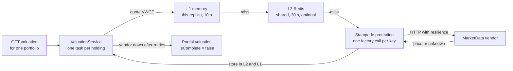
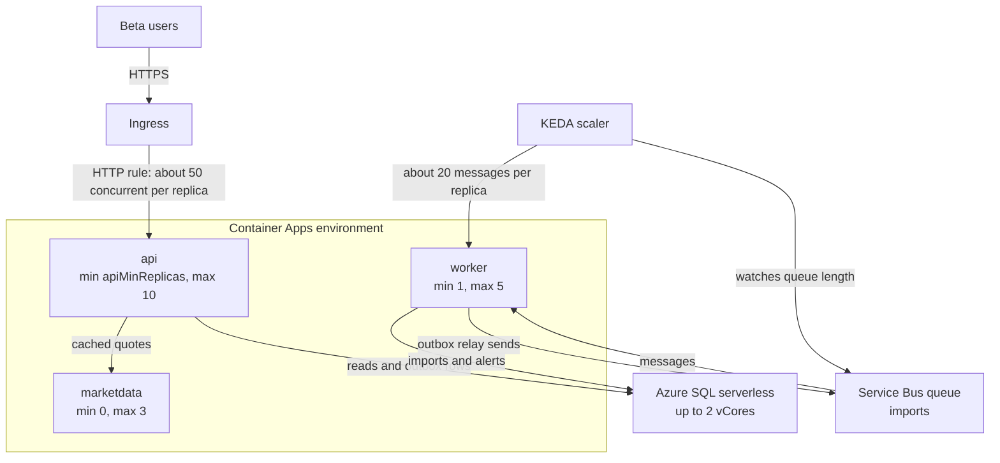

# Chapter 18: Performance and scale

> ⏱ About 35 min · You'll learn: how to find the real bottleneck before you touch code, when to use HybridCache and when to use output caching, and how Container Apps scale rules, EF Core habits and load tests fit together.

---

## 📖 Story: The newsletter

On Tuesday morning a popular personal-finance newsletter mentions Ledgerly's public beta. By ten o'clock signups are running at roughly eight times the normal rate (all numbers in this chapter are illustrative). Elena posts a screenshot of the signup graph in the team channel with three rocket emojis. Ten minutes later Priya posts a different graph: the p95 latency of `GET /api/portfolios/{id}/valuation` has gone from about 180 ms to over 2 seconds.

Your reflex comes straight from Nordbank Insurance: "Let's add a server." Back there, when the quote screen got slow before the annual renewal season, someone raised a ticket for two more VMs and the problem went away for a year. Maya shakes her head. "We can add ten replicas with one parameter. That's the easy part. The question is whether replicas fix it, or whether they just make the real bottleneck hurt faster. Measure first."

You open your notebook to the page titled **Habits I brought with me** and write: *"Slow? Buy a bigger box."* Then, under it: *"Find out where the time goes."*

---

## 🏚️ Old way → 🚀 New way

| What you did before | What you do now | Why it changed |
|---|---|---|
| Buy a bigger VM or add a server when it's slow | Measure with traces, counters and KQL, fix the bottleneck, then scale out with rules | Replicas are cheap to add, so adding them without measuring just moves the problem (often to the database) |
| `MemoryCache` or `HttpRuntime.Cache` on each server, with hand-written locking | `HybridCache`: in-process L1, optional Redis L2, stampede protection and tags | One API covers both levels, and only one caller rebuilds an expired entry |
| `.Result` and `.Wait()` in controllers "because it's simpler" | Async all the way, with `CancellationToken` passed through | Blocking calls starve the thread pool under load, long before CPU is busy |
| Load test once before go-live with a big vendor tool | Small load tests with pass/fail criteria, run on demand or from a pipeline | Performance regressions are bugs, so they need a repeatable test |
| A `Stopwatch` loop in a console app to compare two methods | BenchmarkDotNet in Release mode, with memory diagnostics | JIT warm-up, tiering and GC make hand-made timing loops misleading |
| A fixed number of servers sized for the yearly peak | `minReplicas`, `maxReplicas` and KEDA scale rules for HTTP traffic and queue length | Capacity follows demand, and 💰 you stop paying for the peak all year |
| "The ORM is slow" | EF Core with no-tracking reads, projections, indexes and pooling | EF Core sends the SQL you let it send. Your SQL instincts still apply |

> 💡 Performance work is a loop: measure, change one thing, measure again. Skip the first step and you are guessing with production traffic.

---

## 🧠 Measure first: counters, traces, load tests and benchmarks

Priya's dashboard told you *that* the valuation endpoint is slow. It didn't tell you *why*. Each of these tools answers a different question:

| Question | Tool | What you look at |
|---|---|---|
| Which endpoints are slow, and since when? | KQL over `AppRequests` in Application Insights (chapter 16) | p95 by operation name in 5-minute bins |
| Where does one slow request spend its time? | A trace in the Aspire dashboard locally, or end-to-end transaction details in Application Insights | Long spans: SQL, the market-data HTTP call, the cache |
| Is the process healthy right now? | `dotnet-counters` | Thread-pool queue length, thread count, GC, exceptions, request rate |
| What is the CPU doing? | `dotnet-trace` | A `.nettrace` file you open in Visual Studio or PerfView |
| How does the system behave at 10× traffic? | A load test (Azure Load Testing, k6) | p95 and error rate under load, plus server-side metrics |
| Is method A faster than method B? | BenchmarkDotNet | Mean time and allocations per call |

Start at the top and go down only as far as you need. Most problems are found in the first two rows. Priya's first query is the one from chapter 16:

```kusto
AppRequests
| where TimeGenerated > ago(1h)
| summarize count(), p95=percentile(DurationMs, 95) by Name, bin(TimeGenerated, 5m)
```

The trace for a slow valuation shows the answer. The SQL is fast. The time goes to the market-data vendor, which is slow because every valuation asks for every symbol, and many users hold the same handful of ETFs.

### The diagnostic CLI tools

The `dotnet-*` diagnostic tools attach to a running .NET process and need no profiler installed:

| Tool | Use it for |
|---|---|
| `dotnet-counters monitor -p <pid> --counters System.Runtime,Microsoft.AspNetCore.Hosting` | Live metrics: thread pool, GC, request rate and duration |
| `dotnet-trace collect -p <pid>` | A CPU and events trace (`.nettrace`) for Visual Studio or PerfView |

New in .NET 10, `dnx` runs a tool without installing it first: `dnx dotnet-counters ...` 🔧. Sources: [dotnet-counters](https://learn.microsoft.com/en-us/dotnet/core/diagnostics/dotnet-counters) and [dotnet-trace](https://learn.microsoft.com/en-us/dotnet/core/diagnostics/dotnet-trace).

### Load tests and micro-benchmarks

These two get confused, but they answer different questions:

| | Load test | Micro-benchmark |
|---|---|---|
| Question | "How does the deployed system behave with N users?" | "Which of these two methods is faster, and how much does it allocate?" |
| Scope | The whole system: ingress, replicas, database, vendor | One method, in-process |
| Tools | **Azure Load Testing** 🔧 (URL quick tests, JMeter or Locust scripts, fail criteria such as p95 or error %, GitHub Actions integration), or **Grafana k6** 🔧 (JavaScript scripts with thresholds) | **BenchmarkDotNet** 🔧 (`[Benchmark]`, `[MemoryDiagnoser]`, always in Release) |
| Where it runs | Against a test environment, never against real users | On a quiet machine |
| Cost | 💰 Azure Load Testing is billed per virtual-user-hour 🔧, and the target environment scales up during the test | Free |

Azure Load Testing runs JMeter and Locust scripts, not k6 scripts natively 🔧 ([overview](https://learn.microsoft.com/en-us/azure/app-testing/load-testing/overview-what-is-azure-load-testing)). k6 2.x is a new major line 🔧 ([k6 releases](https://github.com/grafana/k6/releases/latest)); see also [BenchmarkDotNet releases](https://github.com/dotnet/BenchmarkDotNet/releases/latest). The Helpers section has a k6 script and a benchmark class for Ledgerly.

> 💡 A trace tells you where one request spent its time. A load test tells you which resource gives up first. You need both, in that order.

---

## 🧠 Caching: HybridCache for data, output caching for responses

The trace showed the real problem: the same quote is fetched from the vendor hundreds of times a minute. A price that is 30 seconds old is fine for a portfolio overview, so the answer is a cache. Before you write `new MemoryCache(...)` like you did at Nordbank, look at the two caches ASP.NET Core gives you:

| | `HybridCache` (data caching) | Output caching (response caching) |
|---|---|---|
| What is cached | A value your code computes: a quote, a DTO, a list | The whole HTTP response for an endpoint |
| Setup | `AddHybridCache()`, then `GetOrCreateAsync(key, factory)` | `AddOutputCache()`, `UseOutputCache()`, then `.CacheOutput()` on an endpoint |
| Levels | In-process L1, plus an optional `IDistributedCache` L2 such as Redis | In-memory by default; a Redis store is available (`Microsoft.AspNetCore.OutputCaching.StackExchangeRedis`) |
| Concurrency | Stampede protection: concurrent callers for the same key wait for one factory call | Handled by the middleware |
| Invalidation | Expiry, remove by key, or by tag | Expiry, or `IOutputCacheStore.EvictByTagAsync` |
| Use it when | Different responses share expensive building blocks (the same quote appears in many portfolios) | Many callers get exactly the same response (a public list of symbols) |
| Avoid it when | The value must be exact, like a balance after a trade | The response depends on the user, unless you vary the cache key by user |

`Microsoft.Extensions.Caching.Hybrid` is GA (10.11.0 🔧). Docs: [HybridCache](https://learn.microsoft.com/en-us/aspnet/core/performance/caching/hybrid) and [output caching](https://learn.microsoft.com/en-us/aspnet/core/performance/caching/output).

### 💻 In Ledgerly: HybridCache with an optional Redis L2

📄 [`sample/src/Ledgerly.Api/Program.cs`](https://github.com/vygantas-meskauskis/cloud-native-dotnet/blob/main/sample/src/Ledgerly.Api/Program.cs)
```csharp
// ── Caching: HybridCache (in-memory L1). Redis becomes the shared L2 when a "cache" connection exists.
if (!string.IsNullOrEmpty(builder.Configuration.GetConnectionString("cache")))
{
    builder.AddRedisDistributedCache("cache");
}

builder.Services.AddHybridCache(options => options.DefaultEntryOptions = new HybridCacheEntryOptions
{
    Expiration = TimeSpan.FromSeconds(30),
    LocalCacheExpiration = TimeSpan.FromSeconds(10),
});
```

What matters here:

- **Redis is optional.** `AddRedisDistributedCache` registers an `IDistributedCache`, and `HybridCache` picks it up as L2. Locally, the AppHost provides a Redis container called `cache`, so you get both levels. In Azure, `enableRedis` defaults to `false` in `main.bicep` 💰, so the API runs with L1 only until you decide the extra service is worth paying for.
- **Two expiry times.** An entry lives 10 seconds in each replica's memory (`LocalCacheExpiration`) and 30 seconds in Redis (`Expiration`). The short L1 time limits how far two replicas can disagree.

### 💻 In Ledgerly: one vendor call per symbol, not per request

📄 [`sample/src/Ledgerly.Api/Services/ValuationService.cs`](https://github.com/vygantas-meskauskis/cloud-native-dotnet/blob/main/sample/src/Ledgerly.Api/Services/ValuationService.cs)
```csharp
    private async Task<decimal?> GetPriceAsync(string symbol, CancellationToken ct)
    {
        try
        {
            return await cache.GetOrCreateAsync(
                $"quote:{symbol}",
                async token =>
                {
                    var quotes = await marketData.GetQuotesAsync([symbol], token);
                    return quotes.TryGetValue(symbol, out var q) ? q.Price : (decimal?)null;
                },
                tags: ["quotes"],
                cancellationToken: ct);
        }
        catch (Exception ex) when (ex is HttpRequestException or BrokenCircuitException or TimeoutRejectedException)
        {
            LogPriceUnavailable(logger, symbol, ex.GetType().Name);
            return null;
        }
    }
```

Read it the way Maya would, asking "what happens when it fails?":

| Situation | What happens |
|---|---|
| 300 valuations ask for `quote:VWCE` in the same second, and the entry has expired | Stampede protection: one factory call goes to the vendor, the other callers wait for its result |
| The vendor knows the symbol | The price is stored in L1 and L2, and the next callers never leave the process (or Redis) |
| The vendor doesn't know the symbol | The factory returns `null`, and `null` is cached too. Unknown symbols don't hit the vendor on every request |
| The vendor is down | The factory throws, so there is nothing to store. The `catch` sits outside `GetOrCreateAsync`, so the `null` it returns is not cached, and the next request tries again |
| You need to drop all prices at once | Every entry carries the `quotes` tag, so one remove-by-tag call (`RemoveByTagAsync`) clears them |

### 💻 In Ledgerly: output caching for a public list

The fake vendor uses the other kind of cache for a response that is the same for everyone:

📄 [`sample/src/Ledgerly.MarketData/Program.cs`](https://github.com/vygantas-meskauskis/cloud-native-dotnet/blob/main/sample/src/Ledgerly.MarketData/Program.cs)
```csharp
builder.Services.AddOutputCache();
// ...
app.UseOutputCache();

app.MapGet("/symbols", () => PriceGenerator.KnownSymbols)
    .CacheOutput(policy => policy.Expire(TimeSpan.FromMinutes(10)));
```

The list of known symbols changes rarely and contains nothing personal, so the whole response can be reused for 10 minutes. A valuation is the opposite: it is different for every user, so caching the response would be wrong. Caching its building blocks (quotes) is right.

> 💡 Cache the expensive, shared parts with `HybridCache`. Use output caching only for responses that really are identical for every caller.

---

## 🗺️ How a valuation finds its prices



---

## 🧠 Async all the way, and why `.Result` hurts more here

At Nordbank, a `.Result` in an ASP.NET MVC controller could deadlock, because the classic `SynchronizationContext` tried to resume on the thread you had just blocked. ASP.NET Core has no such context, so the deadlock is gone. The habit is still harmful, because the failure mode changed: **thread-pool starvation**.

Each blocked call holds a thread-pool thread while it waits for I/O. Under light load you never notice. Under the newsletter spike, every request blocks a thread for the full duration of the vendor call. The pool injects new threads slowly, requests queue up, and latency explodes while the CPU sits mostly idle. In `dotnet-counters` this shows up as a growing thread-pool queue length and a climbing thread count.

```csharp
// illustrative, not in the sample: the old habit
app.MapGet("/api/quotes/{symbol}", (string symbol, IMarketDataClient client) =>
{
    var quotes = client.GetQuotesAsync([symbol], CancellationToken.None).Result; // blocks a pool thread
    return quotes[symbol].Price;
});

// illustrative, not in the sample: the same endpoint, async all the way
app.MapGet("/api/quotes/{symbol}", async (string symbol, IMarketDataClient client, CancellationToken ct) =>
{
    var quotes = await client.GetQuotesAsync([symbol], ct);
    return quotes[symbol].Price;
});
```

| Do | Avoid |
|---|---|
| `async Task` all the way from the endpoint to the I/O call | `.Result`, `.Wait()`, `GetAwaiter().GetResult()` in request paths |
| Pass the request's `CancellationToken` down | `CancellationToken.None` in request code |
| Run independent I/O calls concurrently with `Task.WhenAll` | Concurrent queries on one `DbContext` (it isn't thread-safe) |
| Move CPU-heavy work to the worker | `Task.Run` in an endpoint to "make it async" |

### 💻 In Ledgerly: concurrent price lookups, one database query

📄 [`sample/src/Ledgerly.Api/Services/ValuationService.cs`](https://github.com/vygantas-meskauskis/cloud-native-dotnet/blob/main/sample/src/Ledgerly.Api/Services/ValuationService.cs)
```csharp
    public async Task<PortfolioValuation?> GetAsync(Guid portfolioId, string ownerId, CancellationToken ct)
    {
        var portfolio = await db.Portfolios.AsNoTracking()
            .Include(p => p.Transactions)
            .SingleOrDefaultAsync(p => p.Id == portfolioId && p.OwnerId == ownerId, ct);

        if (portfolio is null)
        {
            return null;
        }

        var holdings = HoldingCalculator.Calculate(portfolio.Transactions);
        var prices = await Task.WhenAll(holdings.Select(h => GetPriceAsync(h.Symbol, ct)));
        // ...
    }
```

The database is queried once, then the price lookups run concurrently. That is safe because `GetPriceAsync` never touches the `DbContext`. Eight holdings cost one round trip for the slowest price, not eight in a row.

Don't expect the build to catch every blocking call for you. Analyzers flag some async mistakes, but a `.Result` buried in a helper method usually survives until a load test or a trace finds it. That is why "is every I/O call awaited?" belongs in code review.

> 💡 In ASP.NET Core, `.Result` rarely deadlocks. It does something worse: it works fine in testing and falls over under the first real spike.

---

## 🧠 EF Core performance: your SQL instincts still apply

The trace showed the SQL was fast today. It won't stay that way by accident. EF Core sends the SQL you let it send, so the habits you built tuning stored procedures at Nordbank translate directly:

| Habit | EF Core version | In Ledgerly |
|---|---|---|
| Read-only queries shouldn't pay for change tracking | `AsNoTracking()` on reads | Every read endpoint and `ValuationService` |
| Select only the columns you need | Project with `.Select(...)` into a DTO | `ListNotifications` |
| Avoid N+1 round trips | Load related data in the same query with `Include`, or project it | `ValuationService.GetAsync` loads transactions with the portfolio |
| Index the columns you filter on | `HasIndex(...)` in `OnModelCreating`, shipped as a migration | Owner, alert and outbox indexes |
| Don't open a new connection per call | Connection pooling plus `DbContext` pooling | The Aspire client integration enables `DbContext` pooling |
| Cap the result size | `Take(n)` with a stable `OrderBy` | Notifications are capped at 50 |
| Update many rows without loading them | `ExecuteUpdateAsync` / `ExecuteDeleteAsync` | `DeleteAlert` uses `ExecuteDeleteAsync` |

### 💻 In Ledgerly: a no-tracking projection with a cap

📄 [`sample/src/Ledgerly.Api/Endpoints/AlertEndpoints.cs`](https://github.com/vygantas-meskauskis/cloud-native-dotnet/blob/main/sample/src/Ledgerly.Api/Endpoints/AlertEndpoints.cs)
```csharp
    private static async Task<Ok<NotificationResponse[]>> ListNotifications(ClaimsPrincipal user, LedgerlyDbContext db, CancellationToken ct)
    {
        var ownerId = user.GetOwnerId();
        var items = await db.Notifications.AsNoTracking()
            .Where(n => n.OwnerId == ownerId)
            .OrderByDescending(n => n.CreatedAt)
            .Take(50)
            .Select(n => new NotificationResponse(n.Id, n.Message, n.CreatedAt))
            .ToArrayAsync(ct);
        return TypedResults.Ok(items);
    }
```

The generated SQL selects three columns, filters by owner, sorts and stops at 50 rows. The filter is backed by an index:

📄 [`sample/src/Ledgerly.Core/Data/LedgerlyDbContext.cs`](https://github.com/vygantas-meskauskis/cloud-native-dotnet/blob/main/sample/src/Ledgerly.Core/Data/LedgerlyDbContext.cs)
```csharp
        modelBuilder.Entity<PriceAlert>(e =>
        {
            // ...
            e.HasIndex(a => new { a.IsActive, a.Symbol });
        });

        modelBuilder.Entity<Notification>(e =>
        {
            // ...
            e.HasIndex(n => n.OwnerId);
        });
```

An honest note: `ValuationService` loads **every** transaction of a portfolio. For 40 trades that is nothing. For ten years of broker history, it is the next thing a trace will show you, and the fix (store calculated holdings) is a design decision for an ADR.

Compiled queries help only for very hot, simple queries where LINQ translation shows up in a CPU trace:

```csharp
// illustrative, not in the sample
private static readonly Func<LedgerlyDbContext, string, IAsyncEnumerable<Portfolio>> PortfoliosByOwner =
    EF.CompileAsyncQuery((LedgerlyDbContext db, string ownerId) =>
        db.Portfolios.AsNoTracking().Where(p => p.OwnerId == ownerId));

// usage: await foreach (var portfolio in PortfoliosByOwner(db, ownerId)) { ... }
```

For what is new in EF Core 10, see [What's new in EF Core 10](https://learn.microsoft.com/en-us/ef/core/what-is-new/ef-core-10.0/whatsnew).

> 💡 EF Core doesn't make SQL slow. Unbounded, tracked, unindexed queries do, in any data-access technology.

---

## 🧠 Scaling out in Container Apps

Once the vendor calls were cached, Priya's p95 dropped back below 300 ms. The next question was Elena's: "If the next newsletter is twice as big, are we fine?" Now scaling matters.

Container Apps scales with **KEDA-based scale rules**: HTTP concurrency, TCP, and custom KEDA scalers such as Service Bus queue length. The defaults and limits 🔧:

| Setting | Default | Notes |
|---|---|---|
| `minReplicas` | 0 | 0 means scale to zero: no usage charges when idle, but a cold start on the first request 💰 |
| `maxReplicas` | 10 | Configurable up to 1,000 🔧 |
| HTTP scale rule | 10 concurrent requests per replica | Ledgerly raises it to 50 for the API |

Idle replicas (min above 0, not processing) are billed at a reduced idle rate 💰. Docs: [scaling](https://learn.microsoft.com/en-us/azure/container-apps/scale-app) and [billing](https://learn.microsoft.com/en-us/azure/container-apps/billing).

### 💻 In Ledgerly: the API scales on HTTP concurrency

📄 [`sample/infra/modules/apps.bicep`](https://github.com/vygantas-meskauskis/cloud-native-dotnet/blob/main/sample/infra/modules/apps.bicep)
```bicep
      scale: {
        minReplicas: apiMinReplicas // 0 = no cost when idle but a cold start; 1 = always warm
        maxReplicas: 10
        rules: [
          { name: 'http', http: { metadata: { concurrentRequests: '50' } } }
        ]
      }
```

When replicas are handling more than about 50 concurrent requests each, Container Apps adds replicas, up to 10. When traffic drops, it removes them again, down to `apiMinReplicas`.

### 💻 In Ledgerly: the cold-start decision is a parameter

📄 [`sample/infra/main.bicep`](https://github.com/vygantas-meskauskis/cloud-native-dotnet/blob/main/sample/infra/main.bicep)
```bicep
@description('0 = scale to zero (cheapest), 1 = always warm (no cold start).')
@minValue(0)
param apiMinReplicas int = 0
```

This one number is a product decision, so Elena should be in the conversation:

| `apiMinReplicas` | User experience | Cost 💰 |
|---|---|---|
| 0 (sample default) | The first request after a quiet period waits for a replica to start | No usage charges while idle, and the monthly free grant 🔧 covers a lot of learning traffic |
| 1 | Always warm, no cold start | One replica billed at the idle rate around the clock |

For a learning subscription, 0 is right. For the public beta, the team sets 1 in the parameter file, through a pull request, because "if it's not in git, it doesn't exist."

### 💻 In Ledgerly: the worker scales on queue length

📄 [`sample/infra/modules/apps.bicep`](https://github.com/vygantas-meskauskis/cloud-native-dotnet/blob/main/sample/infra/modules/apps.bicep)
```bicep
      scale: {
        // 1, not 0: the outbox relay and price alerts poll on a timer, so one replica must always run.
        minReplicas: 1
        maxReplicas: 5
        rules: [
          {
            // KEDA watches the queue length and adds replicas when imports pile up.
            name: 'imports-queue'
            custom: {
              type: 'azure-servicebus'
              metadata: {
                namespace: serviceBusNamespace
                queueName: 'imports'
                messageCount: '20'
              }
              identity: identityId
            }
          }
        ]
      }
```

KEDA reads the length of the `imports` queue (using the managed identity, no connection string) and adds worker replicas as messages pile up, aiming at roughly 20 waiting messages per replica, up to 5. Check the KEDA scaler details in the [scaling docs](https://learn.microsoft.com/en-us/azure/container-apps/scale-app).

### Scaling moves the bottleneck

Adding replicas is never free of side effects. In Ledgerly, three show up right away:

| Side effect | Why | What to do |
|---|---|---|
| The database becomes the limit | The serverless Azure SQL database in `sql.bicep` scales up to 2 vCores. Ten API replicas can send more work than that | Watch SQL CPU during load tests. Cache reads, fix queries, then raise the max vCores 💰 |
| The import rate limit grows | The rate limiter in `Program.cs` is in memory, per replica: 5 imports per minute per user **per replica** | Accept it as "roughly 5", or move the limit to a shared store if it must be exact |
| Price alerts are evaluated more than once | `AlertEvaluator` runs inside every worker replica, and its own comment says to run one replica or move it to a scheduled Container Apps job | Move the timer work to a scheduled job, or keep the worker at one replica (chapter 19 shows what this costs at 2 a.m.) |

> 💡 Scale rules are easy to add. The hard part is knowing which shared resource the extra replicas will hit next.

---

## 🗺️ Who scales on what



---

## ⚠️ Common traps

| Trap | What happens | Do this instead |
|---|---|---|
| Scaling out before measuring | Ten replicas hammer the same slow vendor or a 2-vCore database, and latency gets worse | Read one slow trace and the counters first, then decide between caching, fixing and scaling |
| `.Result` or `.Wait()` in a request path | Fine in testing. Under load the thread pool starves and latency jumps while CPU looks idle | Async all the way, with the request's `CancellationToken` passed down |
| Output-caching a per-user response | One user can see another user's data, or a stale balance | Output-cache only public, identical responses. Use `HybridCache` with user-scoped keys for the rest |
| Assuming L1 is shared | Each replica has its own memory cache, so replicas can disagree for up to `LocalCacheExpiration` | Keep L1 short, add Redis as L2 when consistency matters, and evict by tag on writes |
| Load testing a scaled-to-zero app and blaming the code | The first minute is dominated by cold starts and scale-out, not by your code | Warm up first, or set min replicas for the test, and read p95 after the ramp |

---

## 🧰 Helpers

**Watch a local process** (after `aspire run`): `dnx dotnet-counters ps` to find the PID, then `dnx dotnet-trace collect -p <pid>` for a CPU trace.

**Find the slow endpoints** in Application Insights (the toolkit's `kql-queries.md` has more):

```kusto
AppRequests
| where TimeGenerated > ago(1h)
| summarize count(), p95=percentile(DurationMs, 95) by Name, bin(TimeGenerated, 5m)
```

**A k6 load test for the valuation endpoint:**

```javascript
// illustrative, not in the sample (k6 2.x 🔧: check the current script API)
import http from 'k6/http';
import { check, sleep } from 'k6';

export const options = {
  vus: 50,
  duration: '2m',
  thresholds: {
    http_req_duration: ['p(95)<500'], // fail the run if p95 is 500 ms or more
    http_req_failed: ['rate<0.01'],   // or if more than 1% of requests fail
  },
};

export default function () {
  const res = http.get(`${__ENV.API}/api/portfolios/${__ENV.PORTFOLIO}/valuation`, {
    headers: { Authorization: `Bearer ${__ENV.TOKEN}` },
  });
  check(res, { 'status is 200': (r) => r.status === 200 });
  sleep(1);
}
```

Run it with `k6 run -e API=https://... -e PORTFOLIO=<id> -e TOKEN=<token> valuation.js` against a test environment, never against production users.

**A micro-benchmark for the holdings calculation:**

```csharp
// illustrative, not in the sample: a separate console project referencing Ledgerly.Core
// run with: dotnet run -c Release
using BenchmarkDotNet.Attributes;
using BenchmarkDotNet.Running;
using Ledgerly.Core.Domain;

BenchmarkRunner.Run<HoldingBenchmarks>();

[MemoryDiagnoser]
public class HoldingBenchmarks
{
    private Transaction[] _trades = [];

    [Params(100, 10_000)]
    public int Count { get; set; }

    [GlobalSetup]
    public void Setup() => _trades = [.. Enumerable.Range(0, Count).Select(i => new Transaction
    {
        Symbol = i % 2 == 0 ? "AAPL" : "MSFT",
        Type = TransactionType.Buy,
        Quantity = 1,
        Price = 100 + i,
        TradeDate = new DateOnly(2026, 1, 1).AddDays(i % 300),
    })];

    [Benchmark]
    public int Calculate() => HoldingCalculator.Calculate(_trades).Count;
}
```

**Make it permanent:**

- Add a load test with fail criteria (p95 and error %) to a pipeline that runs against a test environment. Azure Load Testing integrates with GitHub Actions 🔧.
- Keep the scale settings (`apiMinReplicas`, max replicas, scale rules) in Bicep, so every change goes through a pull request.
- Add performance questions to your PR checklist: is every I/O call awaited, are reads bounded and indexed, is any cache key missing the user scope, is there a vendor or database call per item in a loop? The toolkit's `pr-review-checklist.md` is a starting point; see [the toolkit](../toolkit/README.md).
- Record the decision behind each cache (what, how long, why it's safe to be stale) in a short ADR, so the next person doesn't "fix" a deliberate 30-second staleness.

---

## 🧪 Try it yourself (optional, ~30 min)

1. Start the system (you need Docker Desktop or Podman):
   ```bash
   cd sample
   aspire run
   ```
2. Create a token with `dotnet user-jwts create --project src/Ledgerly.Api`. Use `src/Ledgerly.Api/Ledgerly.Api.http` to create a portfolio and record a few trades in different symbols (for example `VWCE`, `AAPL` and `MSFT`).
3. Call the valuation request twice within a few seconds. In the Aspire dashboard, open **Traces**. Observe: the first trace has HTTP spans to `marketdata`, the second has none, because the quotes came from the cache.
4. Make the vendor slow. Find the `marketdata` URL in the dashboard, then:
   ```bash
   curl -X POST <marketdata-url>/chaos -H "Content-Type: application/json" -d '{"failureRate": 0, "latencyMs": 2000}'
   ```
   In PowerShell: `Invoke-RestMethod -Method Post -Uri <marketdata-url>/chaos -ContentType 'application/json' -Body '{"failureRate": 0, "latencyMs": 2000}'`.
   Call the valuation again a few times over a minute. Observe: one slow call, then fast calls while the cache holds, then slow again after the entries expire.
5. While the chaos is on, watch the API with `dnx dotnet-counters monitor -p <pid> --counters System.Runtime,Microsoft.AspNetCore.Hosting` (find the PID with `dnx dotnet-counters ps`).
6. Reset the vendor with the same request and `{"failureRate": 0, "latencyMs": 0}`.
7. Read `sample/infra/modules/apps.bicep` and answer: with 10 API replicas, what is the real import limit per user? Which worker component should not run on 5 replicas, and why?

---

## ✅ Recap

1. Measure first: KQL for which endpoint, a trace for where the time goes, counters for process health, load tests for the system and BenchmarkDotNet for single methods.
2. Cache shared building blocks with `HybridCache` (stampede protection, L1 plus optional Redis L2, tags), keep requests async all the way, and give EF Core the same care you gave your SQL.
3. Container Apps scales the API on HTTP concurrency and the worker on queue length with KEDA. Every new replica moves pressure to a shared resource, and `apiMinReplicas` trades cold starts against 💰.

**Next → [Chapter 19: Running production](19-running-production.md)**
