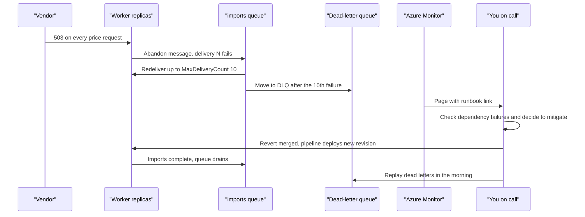
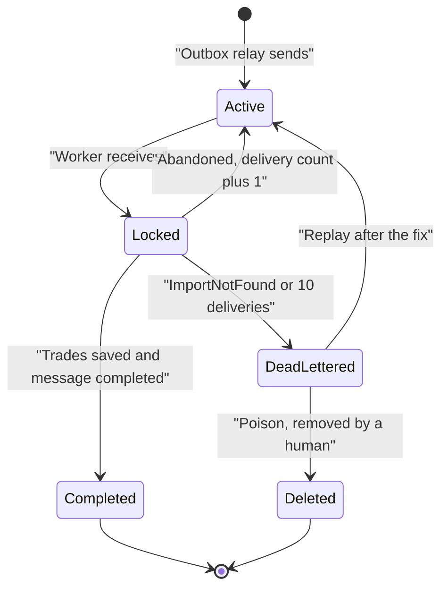

# Chapter 19: Running production

> ⏱ About 35 min · You'll learn: how to run on-call with actionable alerts and runbooks, how to use feature flags, revisions and dead-letter replay to recover safely, and how to learn from an incident with a blameless postmortem, ADRs and a cost review.

---

## 📖 Story: The 2 a.m. page

It is your first week on the on-call rotation. Priya is your secondary. At 01:52 your phone buzzes: **"Sev 2: imports dead-letter count above 0 and queue length rising for 10 minutes."** You open the laptop on the kitchen table. The market-data vendor has been returning errors since about 01:38 (all times and numbers in this chapter are illustrative). Valuations are degrading gracefully, exactly as designed in chapter 14. Imports are not.

Two weeks ago, a pull request added "value at import time" to CSV imports: the worker now asks the vendor for a closing price for every imported trade. (This change is part of the story; it is **not in the sample**.) It had no fallback and no flag. Now every import message waits for the resilience timeout or hits an open circuit breaker, gets abandoned, comes back, fails again, and after ten attempts lands in the dead-letter queue. KEDA sees the queue growing and scales the worker to five replicas, which doesn't help at all.

At Nordbank, this would have been the moment you opened RDP to three servers and started reading log files. Here there is a runbook link in the alert, a dashboard, and a calm message from Priya: "Mitigate first. Debug in the morning."

---

## 🏚️ Old way → 🚀 New way

| What you did before | What you do now | Why it changed |
|---|---|---|
| Every error email goes to the whole team, and everybody ignores most of them | An on-call rotation with a primary and a secondary, paged only by alerts that need a human now | Noisy alerts train people to ignore the one that matters |
| A wiki page "how to restart the service", last updated years ago | A runbook in the repo, linked from the alert, updated after every incident | The runbook is read at 2 a.m. by a tired person, so it must be short, current and findable |
| A hotfix copied to the servers in the middle of the night | Turn a feature flag off, or revert the change and let the pipeline roll forward | The pipeline is the tested path. A manual change at 3 a.m. is the untested path |
| A rollback plan of "restore last week's VM snapshot" | Immutable revisions, a smoke test after each deploy, and small changes that are easy to revert | Small deploys are easy to undo. Big ones are not |
| Failed messages in a poison table nobody looked at | A dead-letter queue with an alert, a known cause per reason, and a replay tool | Dead-lettered messages are never deleted automatically, so someone has to own them |
| "Root cause: human error" | A blameless postmortem with a timeline, contributing factors and owned actions | Blame hides the system problem. The next person will make the same mistake |
| The monthly invoice as the first cost signal | Tags, budgets with alerts, and a cost review after incidents and every month 💰 | Autoscaling means cost follows load, including the load an incident creates |

> 💡 Running production is a practiced skill, not a heroic one. The goal is a boring 2 a.m.: a clear alert, a short runbook and a safe switch.

---

## 🧠 On-call that people can live with: alerts and runbooks

Priya's rule for alerts is simple: **"If nobody needs to do anything right now, it's not a page."** Everything else is a ticket, a dashboard or a weekly report.

| A good page | A noisy page |
|---|---|
| Fires on a **symptom users feel**: failed imports, error rate, SLO burn rate | Fires on a cause that may not matter: one CPU spike, one exception |
| Has a clear owner and a severity | Goes to a shared mailbox |
| Links to a runbook with the first three steps | Says "Error in worker" and nothing else |
| Has a threshold and a time window that ignore one-off blips | Fires and resolves five times an hour |
| Can be silenced during planned maintenance | Wakes people during a deploy everyone knew about |

Azure Monitor gives you the building blocks:

| Building block | What it does in Ledgerly |
|---|---|
| **Metric alerts** | Dead-letter count and queue length on the `imports` queue |
| **Log search alerts** (KQL) | Failed requests or dependency failures above a threshold, or SLO burn rate (chapter 16) |
| **Action groups** | Who gets notified and how: email (🔧 email receivers now need OTP verification), SMS, voice, push, webhook, Logic App and more. Reused across alerts |
| **Alert processing rules** | Suppress notifications during a maintenance window |

Alert on **burn rate** for SLOs rather than raw thresholds: the error budget is 1 − SLO, and the question that matters is "how fast are we spending it?" See [alerts overview](https://learn.microsoft.com/en-us/azure/azure-monitor/alerts/alerts-overview), [action groups](https://learn.microsoft.com/en-us/azure/azure-monitor/alerts/action-groups) and the [SRE Workbook on SLOs](https://sre.google/workbook/implementing-slos/).

### The runbook

A runbook is not documentation of the system. It is a checklist for a specific alert. The toolkit's `runbook-template.md` has this shape:

| Section | What goes in it | Example for "imports dead-lettering" |
|---|---|---|
| Symptom | What the alert means for users | Imports stay "Pending". Users don't see new trades |
| Impact check | One query or dashboard that sizes the problem | Queue length, DLQ count and import failures in the last hour |
| Likely causes | The usual suspects, most common first | Vendor down, SQL unavailable, a bad deploy |
| Mitigation | Safe, reversible steps, in order | Check vendor dependency failures, flip the flag, revert the last deploy |
| Escalation | When and whom to wake up | No improvement in 20 minutes: page the secondary, then Maya |
| Recovery | What to do after mitigation | Replay the DLQ, check for duplicates, post an update |

The first query in that runbook looks at dependencies, because the trace context from chapter 15 tells you which service is failing:

```kusto
AppDependencies
| where TimeGenerated > ago(1h)
| summarize calls = count(), failed = countif(Success == false) by Target, AppRoleName, bin(TimeGenerated, 5m)
| order by TimeGenerated desc
```

> 💡 An alert without a runbook is a riddle. Write the runbook on the day you create the alert, not the morning after the first page.

---

## 🧠 Feature flags as kill switches

At 02:10, Priya asks the obvious question: "Can we just turn it off?" For the import enrichment, the answer was no. The pull request shipped without a flag. For price alerts, there is a flag, and that is where you learn the most important lesson of the night.

### 💻 In Ledgerly: the PriceAlerts flag

📄 [`sample/src/Ledgerly.Api/appsettings.json`](https://github.com/vygantas-meskauskis/cloud-native-dotnet/blob/main/sample/src/Ledgerly.Api/appsettings.json)
```json
  "FeatureManagement": {
    "PriceAlerts": true
  },
```

📄 [`sample/src/Ledgerly.Api/Endpoints/AlertEndpoints.cs`](https://github.com/vygantas-meskauskis/cloud-native-dotnet/blob/main/sample/src/Ledgerly.Api/Endpoints/AlertEndpoints.cs)
```csharp
        var alerts = app.MapGroup("/api/alerts")
            .WithTags("Alerts")
            .RequireAuthorization()
            .AddEndpointFilter(RequireFeature(Features.PriceAlerts));
        // ...

    /// <summary>Feature flag gate: when the flag is off the endpoints behave as if they do not exist.</summary>
    private static Func<EndpointFilterInvocationContext, EndpointFilterDelegate, ValueTask<object?>> RequireFeature(string feature) =>
        async (context, next) =>
        {
            var features = context.HttpContext.RequestServices.GetRequiredService<IFeatureManager>();
            return await features.IsEnabledAsync(feature) ? await next(context) : TypedResults.NotFound();
        };
```

The flag is read with `IFeatureManager.IsEnabledAsync`, registered by `builder.Services.AddFeatureManagement()` in the API's `Program.cs`. When it is off, every alert endpoint returns 404, the same behavior `[FeatureGate]` has for controllers.

Now look at what it does **not** do. `AlertEvaluator` in the worker keeps polling the vendor every 30 seconds, on every worker replica, because the worker never registers feature management and never checks the flag. Turning `PriceAlerts` off would have hidden the alert screens from users and changed nothing about the load on the vendor. **A kill switch only kills the code that checks it.**

To make the flag a real kill switch, the worker needs the same check:

```csharp
// illustrative, not in the sample: the worker honoring the same flag
// Program.cs: builder.Services.AddFeatureManagement();
// AlertEvaluator: inject IFeatureManager features, then at the top of EvaluateAsync:
if (!await features.IsEnabledAsync("PriceAlerts"))
{
    return;
}
```

### How fast can you flip it?

Today the flag lives in configuration. Changing it in Azure means setting the environment variable `FeatureManagement__PriceAlerts` on the container app. An environment variable change creates a **new revision**, so flipping the flag is effectively a deploy. That is the comment in `Program.cs` coming due: "from configuration now, Azure App Configuration later".

| Where the flag lives | How you flip it | How long it takes |
|---|---|---|
| `appsettings.json` / environment variables (Ledgerly today) | Change the value through Bicep and the pipeline | A full deploy and a new revision |
| Azure App Configuration with refresh | Toggle it in App Configuration | About the refresh interval (30 seconds by default) 🔧, no redeploy |

The App Configuration version, from the docs (`Microsoft.Azure.AppConfiguration.AspNetCore` 8.6.1 🔧, with the **App Configuration Data Reader** role for the managed identity):

```csharp
// illustrative, not in the sample
builder.Configuration.AddAzureAppConfiguration(o =>
    o.Connect(new Uri(builder.Configuration["AppConfig:Endpoint"]!), new DefaultAzureCredential())
     .UseFeatureFlags());          // loads flags with no label, refreshed every 30 s by default
builder.Services.AddAzureAppConfiguration();
builder.Services.AddFeatureManagement();
// ...
app.UseAzureAppConfiguration();    // enables dynamic refresh
```

`Microsoft.FeatureManagement.AspNetCore` (4.8.0 🔧) also has percentage, time-window and targeting filters, which turn the same mechanism into gradual rollouts. Docs: [feature management reference](https://learn.microsoft.com/en-us/azure/azure-app-configuration/feature-management-dotnet-reference) and [FeatureManagement-Dotnet](https://github.com/microsoft/FeatureManagement-Dotnet).

| Flag type | Use it for | Remove it when |
|---|---|---|
| Kill switch | Any feature that calls a dependency you don't control | Rarely: it is permanent operational tooling |
| Release flag | Shipping code dark and turning it on later | The feature is fully on and stable |
| Rollout flag (percentage, targeting) | Trying a change on a few users first | The rollout reaches 100% |

> 💡 Every new call to a dependency you don't control should ship behind a flag, and every service that makes that call must check it.

---

## 🧠 Safe deploys, rollback and roll forward

At 02:20 the team chose the safest fix available: **revert the enrichment pull request** and let the normal pipeline ship the revert. Nobody touched Azure by hand.

### 💻 In Ledgerly: one deploy at a time, and proof it answers

📄 [`.github/workflows/deploy.yml`](https://github.com/vygantas-meskauskis/cloud-native-dotnet/blob/main/.github/workflows/deploy.yml)
```yaml
# Never run two deployments at once, and never cancel one halfway.
concurrency:
  group: deploy-production
  cancel-in-progress: false
# ...
      # The deployment "succeeding" only means Azure accepted it. This proves the new revision answers.
      - name: Smoke test
        run: |
          for i in $(seq 1 30); do
            if curl -fsS "${{ steps.apps.outputs.apiUrl }}/alive"; then echo; echo "API is up"; exit 0; fi
            sleep 10
          done
          echo "::error::API did not become healthy"; exit 1
```

Three properties made the revert safe at 2 a.m.:

| Property | Where it comes from | Why it matters during an incident |
|---|---|---|
| Deploys never overlap or stop halfway | `concurrency` with `cancel-in-progress: false` | A second urgent merge waits instead of corrupting the first deploy |
| Every image is tagged with the commit SHA | `SHA` in `deploy.yml` | You know exactly which commit each revision runs |
| Migrations run before the apps change | Phases 2 and 3 of the deploy | Old code never runs against a schema it doesn't understand, as long as migrations stay backward compatible |

Notice the limit of the smoke test: it proves the **API** answers `/alive`, nothing about the worker or imports. After the incident, "check a worker signal after deploy" went on the production readiness checklist.

### Revisions: single mode today, traffic splitting next

Every app in `apps.bicep` uses `activeRevisionsMode: 'Single'`. A revision is an immutable snapshot (image, environment variables, scale rules), and in single mode the new revision replaces the old one with zero downtime.

| Option | How it works | Use it when |
|---|---|---|
| **Revert and roll forward** (Ledgerly today) | `git revert`, merge, and the pipeline deploys a new revision | Always available, always tested, and it keeps git as the truth |
| **Multiple revision mode** | Several revisions stay active, and you split traffic by percentage | You want canary releases, or an instant switch back to the previous revision |
| **Labels** | A revision gets a stable URL | You want to smoke-test a new revision before it receives real traffic |

Docs: [revisions](https://learn.microsoft.com/en-us/azure/container-apps/revisions) and [traffic splitting](https://learn.microsoft.com/en-us/azure/container-apps/traffic-splitting).

A database never "rolls back" with the code, so a revert only works if the schema change was additive. The team's rule: migrations add, later releases remove (if ever).

> 💡 The fastest safe rollback is the one your pipeline already does every day. Practice it before you need it.

---

## 🗺️ The night, as a sequence



---

## 🧠 Dead letters: handle them, then replay them

By 02:50 the queue was draining, but 37 messages sat in the dead-letter queue. Those are 37 users whose imports say "Pending". Dead-lettered messages are never deleted automatically, so they are your job.

### 💻 In Ledgerly: how a message ends up in the DLQ

📄 [`sample/infra/modules/servicebus.bicep`](https://github.com/vygantas-meskauskis/cloud-native-dotnet/blob/main/sample/infra/modules/servicebus.bicep)
```bicep
  properties: {
    lockDuration: 'PT1M'
    maxDeliveryCount: 10 // after 10 failed attempts the message moves to imports/$deadletterqueue
    requiresDuplicateDetection: true // the same MessageId within the window is dropped
    duplicateDetectionHistoryTimeWindow: 'PT10M'
    deadLetteringOnMessageExpiration: true
  }
```

📄 [`sample/src/Ledgerly.Worker/ImportProcessor.cs`](https://github.com/vygantas-meskauskis/cloud-native-dotnet/blob/main/sample/src/Ledgerly.Worker/ImportProcessor.cs)
```csharp
        if (import is null)
        {
            // Poison message: retrying will never help. Park it in the DLQ for a human to look at.
            await args.DeadLetterMessageAsync(args.Message, "ImportNotFound", $"No import for message {messageId}", ct);
            return;
        }
        // ...
        catch (Exception ex) when (ex is not OperationCanceledException)
        {
            activity?.AddException(ex);
            activity?.SetStatus(ActivityStatusCode.Error);
            LogImportCrashed(logger, import.Id, args.Message.DeliveryCount, ex);
            await args.AbandonMessageAsync(args.Message, cancellationToken: ct); // Service Bus will redeliver
        }
```

There are two kinds of dead letters, and they need different handling:

| Dead-letter reason | Meaning | What to do |
|---|---|---|
| `ImportNotFound` (set by Ledgerly) | Poison: the message points at an import that doesn't exist. Retrying will never help | Investigate, then delete or fix by hand |
| `MaxDeliveryCountExceeded` (set by Service Bus) | Transient: it failed 10 times, here because the vendor was down | Fix the cause, then replay |

### Replaying safely

Replay means: receive from `imports/$deadletterqueue`, send a copy to `imports`, complete the dead-lettered original. Two details make it safe in Ledgerly:

- **Idempotency.** `ImportProcessor` records each processed `MessageId` in `ProcessedMessages` in the same transaction as the trades. A replayed message that was somehow processed already is completed as a duplicate.
- **Duplicate detection.** The queue drops a `MessageId` it has seen in the last 10 minutes. A copy of a received message keeps its `MessageId`, so a replay within 10 minutes of the original send is silently dropped. Hours later, as here, it goes through.

```csharp
// illustrative, not in the sample: replay transient dead letters after the cause is fixed
await using var client = new ServiceBusClient(fullyQualifiedNamespace, new DefaultAzureCredential());
await using var receiver = client.CreateReceiver("imports", new ServiceBusReceiverOptions { SubQueue = SubQueue.DeadLetter });
await using var sender = client.CreateSender("imports");

while (true)
{
    var batch = await receiver.ReceiveMessagesAsync(maxMessages: 50, maxWaitTime: TimeSpan.FromSeconds(5));
    if (batch.Count == 0)
    {
        break;
    }

    foreach (var message in batch)
    {
        if (message.DeadLetterReason != "MaxDeliveryCountExceeded")
        {
            continue; // poison: leave it, it returns to the DLQ when its lock expires
        }

        await sender.SendMessageAsync(new ServiceBusMessage(message)); // keeps body, properties and MessageId
        await receiver.CompleteMessageAsync(message);
    }
}
```

The identity running this needs both the Data Sender and Data Receiver roles on the namespace. Docs: [dead-letter queues](https://learn.microsoft.com/en-us/azure/service-bus-messaging/service-bus-dead-letter-queues) and [duplicate detection](https://learn.microsoft.com/en-us/azure/service-bus-messaging/duplicate-detection).

> 💡 A dead-letter queue is an inbox with your name on it. Alert on it, know what each reason means, and keep a tested replay tool.

---

## 🗺️ The life of an import message



---

## 🧠 After the incident: postmortem, ADRs and the cost review

At 03:05 the vendor recovered. Then one more thing went wrong: several users got **two** notifications for the same price alert. The worker was still at three replicas after the scale-out, each running `AlertEvaluator`, and each found the same active alerts in the same 30-second tick. The class comment had warned about this ("Run the worker with ONE replica (or move this to a scheduled Container Apps job)"), and the scale rule had quietly broken that assumption.

### The blameless postmortem

The next afternoon Priya runs the review. The rule: **describe what the system allowed, not who made a mistake.** The person who merged the enrichment PR is in the room and explains their reasoning, because that reasoning is the most useful data in the review. The toolkit's `postmortem-template.md` gives the structure: summary, impact, timeline, contributing factors, what went well, actions with owners.

The timeline (illustrative):

| Time | What happened | Signal |
|---|---|---|
| 01:38 | Vendor starts returning 503 for all price requests | Dependency failures in `AppDependencies` |
| 01:40 | Valuations return `IsComplete = false`. No page, by design | Partial-valuation warnings in logs |
| 01:52 | DLQ count above 0 and queue length rising for 10 minutes. You are paged | Metric alert, action group |
| 01:58 | You acknowledge and open the runbook. Dependency query shows the vendor at 100% failures | KQL from the runbook |
| 02:05 | KEDA has scaled the worker to 5 replicas. It doesn't help: every import calls the vendor | Replica count |
| 02:10 | You page Priya. The team finds that `PriceAlerts` doesn't stop the worker's vendor calls | Code reading |
| 02:20 | Revert of the enrichment PR merged with an expedited review | Pull request |
| 02:34 | Deploy finished, smoke test passed, imports complete again | Deploy run, queue length falling |
| 02:50 | Queue back to normal. 37 messages in the DLQ | Metric |
| 03:05 | Vendor recovers. Duplicate alert notifications go out from 3 worker replicas | User reports in the morning |
| 09:30 | DLQ replayed. All 37 imports complete, no duplicate trades | Import status, idempotency log lines |

Contributing factors, not causes:

| Factor | Action | Owner |
|---|---|---|
| A new vendor call shipped without a flag or fallback | PR checklist item: "new dependency call ships behind a kill switch with a fallback" | You |
| The `PriceAlerts` flag didn't reach the worker | Add feature management to the worker, and check the flag in `AlertEvaluator` | You |
| Timer work ran on every scaled-out replica | Move alert evaluation to a scheduled Container Apps job (record it as an ADR) | Maya |
| Flipping a flag requires a deploy | Evaluate Azure App Configuration for flags | Tomás |
| The smoke test only proves the API is alive | Add a worker check to the production readiness checklist | Priya |

### The ADR

Moving alert evaluation into a scheduled job changes the architecture, so Maya writes it down with the toolkit's `adr-template.md`: context (timer work in a scaled worker), decision (a Container Apps job with a Schedule trigger, see [jobs](https://learn.microsoft.com/en-us/azure/container-apps/jobs)), alternatives (keep the worker at one replica, or add a distributed lock), and consequences (one more deployable, but scaling the worker becomes safe). The next person who asks "why is this a job?" finds the answer in git.

### The cost review 💰

Elena asks her usual question: "What did the night cost?" Autoscaling means an incident has a price, so the team looks at three things:

| Cost driver | What happened that night | Lever |
|---|---|---|
| Worker replicas | 5 replicas for over an hour instead of 1 | Max replicas in Bicep; the scale rule now only scales import work |
| Log ingestion | Five replicas logging failures every few seconds | Log Analytics ingestion is often the surprise cost. Sampling, log levels and a daily cap |
| Vendor calls | Retries multiplied by replicas | Caching, circuit breakers, and the kill switch |

📄 [`sample/infra/modules/monitoring.bicep`](https://github.com/vygantas-meskauskis/cloud-native-dotnet/blob/main/sample/infra/modules/monitoring.bicep)
```bicep
  properties: {
    sku: { name: 'PerGB2018' }
    retentionInDays: 30
    workspaceCapping: { dailyQuotaGb: 1 } // 💰 a hard daily cap keeps a learning subscription safe
  }
```

A hard cap is right for a learning subscription. In production, a cap reached during an incident stops the telemetry you need most, so many teams use a budget alert instead.

📄 [`sample/infra/main.bicep`](https://github.com/vygantas-meskauskis/cloud-native-dotnet/blob/main/sample/infra/main.bicep)
```bicep
var tags = {
  app: appName
  'managed-by': 'bicep'
}
```

Every resource gets these tags, so cost analysis can group by `app`. Budgets add the alarm:

| Budget fact | Detail |
|---|---|
| Scopes and resets | Subscription, resource group, management group or billing scope, reset monthly, quarterly or annually |
| Thresholds | On actual or forecasted cost, notifying by email or an action group |
| What budgets don't do | Stop resources. They only notify, unless you wire automation to the action group |
| Delay | Cost data lands within 8 to 24 hours, and budgets are evaluated every 24 hours |

So a budget will not catch a runaway incident within the hour. That is the job of `maxReplicas` and your alerts. See [create a budget](https://learn.microsoft.com/en-us/azure/cost-management-billing/costs/tutorial-acm-create-budgets) and the [pricing calculator](https://azure.microsoft.com/en-us/pricing/calculator/).

### The production readiness checklist

The last action has the longest life. The toolkit's `production-readiness-checklist.md` lists what a service needs before real users: health probes, alerts with runbooks, kill switches, a DLQ owner, scale limits, budgets and tags, and a tested rollback. After this night it gained two lines.

> 💡 A postmortem is worth exactly as much as its actions. Give every action an owner and put the permanent ones in a checklist.

---

## ⚠️ Common traps

| Trap | What happens | Do this instead |
|---|---|---|
| Paging on causes instead of symptoms | People get woken for one CPU spike, then start ignoring pages | Page on what users feel (errors, SLO burn, stuck imports). Everything else is a ticket |
| A flag that only one service checks | You flip it at 2 a.m. and the load doesn't change | Every service that runs the feature checks the same flag. Test the "off" path |
| Fixing production by hand at night | The fix is lost on the next deploy, or breaks something untested | Revert and roll forward through the pipeline. Change Bicep, not the portal |
| Replaying the DLQ without idempotency | Replayed messages create duplicate trades | Keep the `ProcessedMessages` check, and replay only reasons you understand |
| Scaling out a worker that runs timers | Duplicate notifications when the dependency recovers | Timer work runs once: a scheduled job, or a single instance |
| A postmortem that names a person | People hide mistakes, and the system problem stays | Blameless format, contributing factors and actions with owners |
| Treating a budget as a safety net | The alert arrives a day after the money is spent | Hard limits (`maxReplicas`, caps) for safety, budgets for trends |

---

## 🧰 Helpers

**Incident first steps** (paste into your runbook):

1. Acknowledge the page and post "Investigating" in the incident channel.
2. Size the impact: which users, which feature, since when.
3. Check the last deploy and the dependency failures query.
4. Mitigate with the safest reversible step: flag off, revert, or scale limit.
5. Escalate if there is no improvement in 20 minutes.
6. When stable, write down the timeline while you still remember it.

**Exceptions by service** (KQL, next to the dependency query from the runbook section):

```kusto
AppExceptions
| where TimeGenerated > ago(1h)
| summarize count() by AppRoleName, ExceptionType, bin(TimeGenerated, 5m)
```

**Templates in the toolkit:** `runbook-template.md`, `postmortem-template.md`, `adr-template.md`, `production-readiness-checklist.md` and `kql-queries.md`. See [the toolkit](../toolkit/README.md).

**Make it permanent:**

- Create every alert in Bicep together with its action group, and put the runbook link in the alert description.
- Add "new external call ships behind a kill switch with a fallback" to the PR template and the review checklist.
- Add "DLQ owner and replay tool", "timer work runs once" and "post-deploy check for every app" to the production readiness checklist.
- Schedule a monthly 30-minute cost review using tags and budget alerts, and do a quick one after every incident.
- Practice: once a quarter, run a game day with the chaos switch in a test environment and follow the runbook as written.

---

## 🧪 Try it yourself (optional, ~30 min)

1. Start the system:
   ```bash
   cd sample
   aspire run
   ```
2. Create a token with `dotnet user-jwts create --project src/Ledgerly.Api`, then use `src/Ledgerly.Api/Ledgerly.Api.http` to create a portfolio, a trade and a price alert.
3. Break the vendor. Find the `marketdata` URL in the Aspire dashboard, then:
   ```bash
   curl -X POST <marketdata-url>/chaos -H "Content-Type: application/json" -d '{"failureRate": 1, "latencyMs": 0}'
   ```
   In PowerShell: `Invoke-RestMethod -Method Post -Uri <marketdata-url>/chaos -ContentType 'application/json' -Body '{"failureRate": 1, "latencyMs": 0}'`.
4. In the dashboard, open **Structured logs** for the worker. Observe: "Alert evaluation failed; will retry on next tick" every 30 seconds. The loop survives. Call the valuation request and observe `isComplete: false`.
5. Turn the flag off for the API: stop the AppHost, set `"PriceAlerts": false` in `src/Ledgerly.Api/appsettings.json`, and run `aspire run` again. Call `GET /api/alerts`. Observe: 404. Then check the worker logs. Observe: it still evaluates alerts. That is the kill-switch lesson.
6. Restore the flag and reset the vendor with `{"failureRate": 0, "latencyMs": 0}`.
7. Write a five-line runbook for "vendor down" using the shape in this chapter, and one action you would add to the production readiness checklist.

---

## ✅ Recap

1. Page only on symptoms users feel, and give every alert a runbook with safe, reversible first steps.
2. Recover through tested paths: feature flags that every affected service checks, revert and roll forward through the pipeline, and an idempotent dead-letter replay.
3. Learn without blame: a timeline, contributing factors, owned actions, an ADR for design changes, and a cost review, all ending up in your checklists.

**Next → [Chapter 20: AI-assisted .NET development](20-ai-assisted-dotnet-development.md)**
