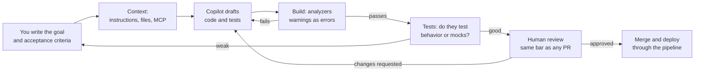
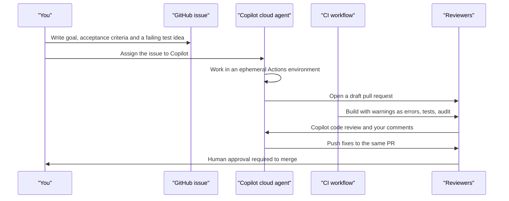

# Chapter 20: AI-assisted .NET development

> ⏱ About 30 min · You'll learn: which GitHub Copilot surface to use for which job, how to give AI the context it needs with custom instructions, prompt files and MCP, and how to review AI output with the same bar and guardrails as any pull request.

---

## 📖 Story: Use AI like a senior

On Monday you find two pull requests from the weekend. The first one, from a junior contractor, "adds retry logic" to the worker: 400 lines, a hand-written retry loop around every Service Bus call, a new package nobody asked for, and tests that assert the mocks were called. The description says "generated with AI, all tests pass". The second one, from Priya, is 60 lines: a new KQL alert in Bicep and a runbook update. Her description says: "Copilot drafted the query, I checked it against a week of real data and fixed the time window."

Maya reviews both in the stand-up. "Same tool, different results. The tool didn't write the first PR badly. Nobody owned it." Then she says the sentence that ends up on the first page of your notebook's last section: **"Use AI like a senior, not like a junior."** A junior accepts what the tool produces. A senior decides what to ask for, gives it the right context, and checks the result against the bar they would apply to any colleague.

You have 15 years of .NET judgment. That turns out to be exactly the skill that makes these tools useful. At Nordbank you never had them. Here, the question is not whether to use AI, but where your judgment has to stay in the loop.

---

## 🏚️ Old way → 🚀 New way

| What you did before | What you do now | Why it changed |
|---|---|---|
| Searching forums for an API example, then adapting it by hand | Asking Copilot in the IDE, with your code as context, then verifying against the docs | The draft is faster. Verification is still yours |
| Writing boilerplate (DTOs, mappings, test setup) by hand | Letting agent mode draft it, then reviewing it like a PR | Boilerplate is where AI is strongest and the risk is lowest |
| Tribal knowledge about "how we do things here" | A short `.github/copilot-instructions.md` that the tools read | The model can't guess your conventions. Write the ones that matter down |
| Reviewing code by trusting the author | One bar for every change, human or AI: tests, analyzers, warnings as errors, human review | "The AI wrote it" is not a reason to lower the bar, or to raise it unfairly |
| The upgrade project nobody wanted to start | An agent drafting the mechanical parts of an upgrade, step by step, behind a green build | The boring 80% gets cheaper. The tricky 20% still needs you |
| Copying production data into a test to reproduce a bug | Synthetic data, and no secrets or customer data in prompts | Prompts are data leaving your machine. Treat them like any other data flow |

> 💡 AI changes how fast you produce a draft. It doesn't change who is responsible for what gets merged.

---

## 🧠 The Copilot surfaces, and which one to use when

GitHub Copilot is not one tool. It shows up in several places, and each is good at a different size of job. Everything in this table is volatile 🔧: names, plans and features change often, so check [Copilot plans](https://docs.github.com/en/copilot/get-started/plans) and [Copilot on GitHub](https://docs.github.com/en/copilot/concepts/copilot-surfaces/copilot-on-github) before you rely on a detail.

| Surface 🔧 | What it does | Use it for |
|---|---|---|
| **Completions and chat in the IDE** | Inline suggestions and a chat that sees your open files | Small, local edits: a method, a test case, "explain this LINQ query" |
| **Agent mode** (VS Code and Visual Studio) | An autonomous loop in the IDE that edits several files, builds and runs tests | A contained multi-file change you watch while it happens |
| **Copilot CLI** | A terminal agent (it needs Node.js 22 or later) | Work that lives in the terminal: scripts, git, build failures, running commands |
| **Copilot cloud agent** (formerly "Copilot coding agent") | You assign an issue to Copilot, or start a task from the agents panel. It works in an ephemeral GitHub Actions environment and opens a draft pull request | Well-specified issues you would give to a new teammate. Paid plans only |
| **Copilot code review** | Copilot as a reviewer on a PR, requested by hand or automatic through repo or org settings or rulesets | A first pass on every PR, before a human looks |

The plans are Free, Student, Pro, Pro+, Max, Business and Enterprise 🔧. Premium usage is billed in "GitHub AI Credits" 💰, and each plan includes a monthly allowance. For Business and Enterprise, an org admin must enable the cloud agent. Elena's question applies here too: before you turn on automatic agents and reviews for a whole org, look at what the usage will cost.

### Picking the right size

The surfaces differ in one thing that matters more than features: **how long you are out of the loop.**

| Surface | How long it runs without you | What you must provide up front |
|---|---|---|
| Completions | A line or a block | Nothing: your code is the context |
| Chat and agent mode | Minutes, and you watch it | A clear goal and the files that matter |
| Copilot CLI | Minutes, with your approval for commands | A goal and permission boundaries |
| Cloud agent | Until it opens a PR | A written issue with acceptance criteria, as for a new colleague |

The longer it runs alone, the better your specification must be. An issue that says "fix imports" produces a guess. An issue that says "when the CSV has a header row with a byte-order mark, the parser skips the first column; add a failing test in `BrokerCsvParserTests`, then fix the parser" produces a reviewable PR.

> 💡 Match the surface to the size of the job, and the size of the job to how good your specification is.

---

## 🧠 Giving AI context: custom instructions, prompt files and MCP

The model sees your code, but it doesn't know your rules. It can't tell that Ledgerly uses central package management, `TimeProvider`, `[LoggerMessage]` and the outbox pattern unless something tells it. Three mechanisms provide that context.

### Custom instructions

A file called `.github/copilot-instructions.md` in the repository (or `AGENTS.md`) is read as extra context for Copilot requests in that repo 🔧. It is the team's "how we do things here", written for a reader that is fast, literal and new every time.

### 💻 In Ledgerly: the instructions template

The sample repo doesn't ship one in `.github/`, but the toolkit has a template written for this codebase. An excerpt:

📄 [`toolkit/copilot-instructions.md`](https://github.com/vygantas-meskauskis/cloud-native-dotnet/blob/main/toolkit/copilot-instructions.md)
```markdown
## C# style

- C# 14 with nullable reference types on. File-scoped namespaces, primary constructors and records where they fit.
- `async` all the way with `CancellationToken` passed through. Never `.Result`, `.Wait()` or `async void`.
- Inject `TimeProvider` instead of using `DateTime.Now` or `DateTime.UtcNow`.
<!-- ... -->

## Messaging

- Never publish to Service Bus directly from a request. Write an outbox message in the same `SaveChanges` call; the worker relays it.
- Consumers must be idempotent: check `ProcessedMessages` before doing work.
<!-- ... -->

## When you're not sure

- Say so, and point to the file or doc you would check. Don't invent APIs or package versions.
- Prefer small, reviewable changes with a test that fails without the change.
```

What makes a good instructions file:

| Do | Don't |
|---|---|
| Write rules the model can't infer from the code ("never publish from a request, use the outbox") | Restate C# basics the model already knows |
| Name exact commands (`dotnet test --solution Ledgerly.slnx`) | Write a 20-page style guide nobody maintains |
| Say what is forbidden and why, in one line | Paste secrets, URLs of internal systems or customer names |
| Review changes to it in PRs, like code | Let each developer keep a private version |

The weekend contractor's PR would have looked very different with this file in place: "consumers must be idempotent" and the resilience conventions are exactly what the hand-written retry loop ignored.

### Prompt files

Prompt files are reusable, task-shaped prompts stored in the repository, such as "add an endpoint following our conventions" or "write a migration that is backward compatible". 🔧 The file location, format and which surfaces support them change, so check the current GitHub Copilot docs before you set them up. The idea is what matters: if you type the same careful prompt three times, save it in git, where the team can review and improve it.

### MCP servers

The Model Context Protocol (MCP) lets an AI tool call other tools: read your issues, query a database schema, look at a running system. Copilot supports MCP servers 🔧. One you already have: **`aspire mcp`** is an MCP server for AI agents built into the Aspire CLI, so an agent can see the resources, logs and traces of the app you started with `aspire run`, instead of guessing from source code.

Jonas has one rule for MCP: **every MCP server is a new integration with access to something.** Ask the same questions as for any dependency: who wrote it, what can it read, what can it change, and where do its credentials come from? Prefer read-only access, and never point an agent at production data with write permissions.

> 💡 Context is the difference between a generic answer and a Ledgerly answer. Put the rules in git, and treat tool access as a security decision.

---

## 🗺️ The senior loop



---

## 🧠 Reviewing AI output: one bar, enforced by machines first

Maya's review rule: **an AI-written PR gets exactly the same review as a human-written one.** Not lower, because the tool sounds confident. Not higher out of suspicion, because then people stop saying which PRs used AI. What changes is where you look harder.

### Tests first, and read the tests

The single best guardrail is a test you wrote (or at least read carefully) **before** accepting the implementation. A test that encodes the business rule tells you whether the draft is right. A test generated together with the code mostly tells you the code does what the code does.

### 💻 In Ledgerly: a test that encodes a rule

📄 [`sample/tests/Ledgerly.UnitTests/HoldingCalculatorTests.cs`](https://github.com/vygantas-meskauskis/cloud-native-dotnet/blob/main/sample/tests/Ledgerly.UnitTests/HoldingCalculatorTests.cs)
```csharp
    [Fact]
    public void Selling_keeps_the_average_cost_of_the_rest()
    {
        var holdings = HoldingCalculator.Calculate(
        [
            Trade("AAPL", TransactionType.Buy, 10, 100m, 1),
            Trade("AAPL", TransactionType.Sell, 4, 150m, 2),
        ]);

        var aapl = Assert.Single(holdings);
        Assert.Equal(6, aapl.Quantity);
        Assert.Equal(100m, aapl.AverageCost);
```

This test states a real rule of average-cost accounting: selling doesn't change the average cost of what's left. If an AI "refactor" of `HoldingCalculator` breaks that rule, this test fails, no matter how plausible the new code looks. Compare it with the contractor's tests, which verified that a mock was called three times. Those would pass for almost any implementation.

### Let the build say no

The second guardrail is the build itself. Ledgerly's build is strict, and that strictness applies to every author:

📄 [`sample/Directory.Build.props`](https://github.com/vygantas-meskauskis/cloud-native-dotnet/blob/main/sample/Directory.Build.props)
```xml
    <!-- Quality gates: warnings fail the build, analyzers and code style run in every build (also in CI). -->
    <TreatWarningsAsErrors>true</TreatWarningsAsErrors>
    <AnalysisLevel>latest-recommended</AnalysisLevel>
    <EnforceCodeStyleInBuild>true</EnforceCodeStyleInBuild>
```

📄 [`.github/workflows/ci.yml`](https://github.com/vygantas-meskauskis/cloud-native-dotnet/blob/main/.github/workflows/ci.yml)
```yaml
      # Warnings are errors, analyzers + code style run, NuGet audit fails on vulnerable packages.
      - name: Build
        run: dotnet build Ledgerly.slnx -c Release --no-restore
```

Nullable warnings, unused usings, code style and vulnerable packages all fail the build before a human spends a minute on review. Agent mode runs the build in its loop, so with these settings it fixes many problems itself. One thing to watch: a tool under pressure to make the build green may add a `#pragma warning disable` or a `NoWarn` entry. The template instructions say "never suppress them without a comment explaining why", and your review should check for it.

### Where to look harder in an AI-written PR

| Look for | Why AI gets it wrong | Ledgerly example |
|---|---|---|
| Invented APIs or package versions | The model fills gaps with plausible names | A HybridCache method that doesn't exist |
| New dependencies | A package is the easy answer | A retry library next to the standard resilience handler |
| Ignored conventions | The model doesn't know your rules | Publishing to Service Bus from an endpoint instead of the outbox |
| Missing failure paths | Happy paths dominate training data | No `CancellationToken`, no fallback when market data is down |
| Security shortcuts | Examples online often use keys | A connection string with a key instead of managed identity |
| Tests that test mocks | Generated together with the code | Asserting call counts instead of results |

The toolkit's `pr-review-checklist.md` has the full list, and it applies to every PR, whoever wrote it. Copilot code review can take a first pass, but a human approves.

> 💡 Make the machines say no first (tests, analyzers, warnings as errors), so human review can spend its time on design and failure paths.

---

## 🧠 Where AI shines for you, where it doesn't, and what never goes in a prompt

You are a senior .NET developer moving from .NET Framework to cloud native. Here is an honest map, based on the work in this course:

| Task | How well AI helps | Your job |
|---|---|---|
| Upgrading .NET Framework code (the changes from chapter 2) | Strong on mechanical changes: project files, `System.Web` replacements, async signatures | Plan the order, keep the build green at each step, and decide what to redesign instead of port |
| Writing tests | Strong at setup and test data. Weak at deciding what to test | Write the test names (the rules) first, then let it fill in bodies |
| Drafting KQL | Good first drafts of summarize and join queries | Run it against real data, and check time windows and bins |
| Drafting Bicep | Good at resource shapes and properties | `az bicep lint`, `az deployment group what-if`, and check identities and roles |
| Explaining unfamiliar code or errors | Very good, especially stack traces and config | Verify against the docs before acting |
| Architecture decisions | It produces confident options. It doesn't know your constraints | Decide, and write the ADR yourself |
| Security-sensitive code (auth, crypto, permissions) | Plausible and sometimes subtly wrong | Use the framework's built-in features, and get Jonas to review |
| Production incidents | Can draft queries and summaries | Mitigate with the runbook first. Don't experiment on production |

For Bicep, the what-if step deserves its own line. It previews create, modify and delete operations before anything changes:

```bash
az deployment group what-if -g <rg> -f main.bicep -p main.bicepparam
```

An AI draft that would delete and recreate a database shows up there as a delete, in plain text. See [Bicep what-if](https://learn.microsoft.com/en-us/azure/azure-resource-manager/bicep/deploy-what-if).

### What never goes into a prompt

Jonas's rules, which apply to every AI tool, including approved ones:

| Never | Because | Instead |
|---|---|---|
| Secrets: keys, connection strings, tokens | Prompts and logs are data that leaves your machine | Managed identity, and placeholder values in examples |
| Customer data or production records | Privacy and compliance obligations follow the data | Synthetic test data |
| Code from a project your license doesn't allow you to share | The license applies to the code, not to the tool | Check with your organization first |
| Accepting large generated blocks you don't understand | You can't maintain or license-check what you don't understand | Ask for smaller pieces, read each one |

Your organization's Copilot policies (which features are enabled, what data handling applies, how suggestions that match public code are treated) are set by admins 🔧. Know what yours are before you rely on a feature.

> 💡 AI is strongest where the result is easy to check. Invest your attention where checking is hard: design, security and failure paths.

---

## 🗺️ The cloud agent's pull request



---

## 🧠 Building AI features into Ledgerly: a short pointer

Using AI to write code is one thing. Putting AI **inside** your app is another, and .NET has standard building blocks for it.

| Library | What it is | When you'd use it |
|---|---|---|
| **Microsoft.Extensions.AI** (GA, 10.11.0 🔧) | Common abstractions `IChatClient` and `IEmbeddingGenerator<TInput,TEmbedding>`, implemented by provider libraries (OpenAI, Azure OpenAI, Ollama, Foundry and others), plus middleware | Any AI call from a .NET app. Apps reference `Microsoft.Extensions.AI`, libraries only `Microsoft.Extensions.AI.Abstractions` |
| **Microsoft Agent Framework** (`Microsoft.Agents.AI`, GA, 1.26.0 🔧) | Agents and multi-agent workflows for .NET and Python, built on `IChatClient`, with graph-based workflows, checkpointing, human-in-the-loop and a DevUI. It succeeds Semantic Kernel and AutoGen | When one prompt isn't enough: multi-step agents with tools and approvals |

The middleware is the part a cloud-native developer will like: `UseOpenTelemetry()` puts AI calls into the same traces as everything else (chapter 15), `UseLogging()` logs them, `UseDistributedCache()` caches identical requests, and `UseFunctionInvocation()` lets the model call your C# functions.

A small, realistic first feature: explain a failed CSV import in plain language.

```csharp
// illustrative, not in the sample
// Program.cs: the inner client comes from a provider package (OpenAI, Azure OpenAI, Ollama, Foundry, ...)
builder.Services.AddChatClient(innerClient)
    .UseOpenTelemetry()
    .UseLogging();

public sealed class ImportErrorExplainer(IChatClient chat)
{
    public async Task<string> ExplainAsync(string errorSummary, CancellationToken ct)
    {
        ChatResponse response = await chat.GetResponseAsync(
            $"Explain this CSV import error to a non-technical user in two sentences: {errorSummary}",
            cancellationToken: ct);
        return response.Text;
    }
}
```

Everything from earlier chapters still applies, and Maya's question comes first: "What happens when it fails?" An AI provider is an external dependency like the market-data vendor. It needs a timeout, a fallback (show the original error message), a kill-switch flag (chapter 19), cost monitoring 💰 and a decision about what user data may be sent. Docs: [Microsoft.Extensions.AI](https://learn.microsoft.com/en-us/dotnet/ai/microsoft-extensions-ai) and [Microsoft Agent Framework](https://github.com/microsoft/agent-framework).

> 💡 An AI model in your app is just another unreliable, metered dependency. Wrap it in the same resilience, flags and telemetry as the rest.

---

## ⚠️ Common traps

| Trap | What happens | Do this instead |
|---|---|---|
| Accepting a large AI diff because "the tests pass" | The tests were generated with the code and assert mocks, so the bug ships | Write or read the tests first. Ask for small PRs |
| No instructions file | Every suggestion ignores your conventions, and reviewers fix the same things every week | A short `.github/copilot-instructions.md`, reviewed in PRs |
| Assigning vague issues to the cloud agent | The draft PR solves a different problem | Acceptance criteria and the files involved, as for a new colleague |
| Letting AI silence warnings | `#pragma warning disable` hides the problem the build found | Treat any suppression as a review finding that needs a reason |
| Pasting a production error with customer data into chat | Personal data leaves your control | Redact, or reproduce with synthetic data |
| Installing MCP servers without review | An agent gets access you never approved | Review MCP servers like dependencies, read-only first |
| Trusting AI on versions and APIs | Invented packages, wrong method names | Check NuGet and the docs. The build and NuGet audit catch some, not all |

---

## 🧰 Helpers

**A good issue for the cloud agent** (template):

```markdown
## Goal
One sentence: what should be true when this is done.

## Acceptance criteria
- [ ] A failing test in <test file> that shows the problem
- [ ] The fix, with the test passing
- [ ] No new packages, no suppressed warnings

## Context
Files involved: <paths>. Conventions: see .github/copilot-instructions.md.

## Out of scope
What not to change.
```

**Prompts that work like a senior:**

- "Before writing code, list the edge cases and failure modes for this method."
- "Write only the test names for this business rule. I'll review them before you write bodies."
- "Which part of this change are you least sure about, and what should I check in the docs?"
- "Rewrite this using our outbox pattern instead of publishing directly. See `ImportEndpoints.cs`."

**Verifying a Bicep draft:**

```bash
az bicep lint --file main.bicep
az deployment group what-if -g <rg> -f main.bicep -p main.bicepparam
```

**In the toolkit:** `copilot-instructions.md` (copy it to `.github/` and edit) and `pr-review-checklist.md`. See [the toolkit](../toolkit/README.md).

**Make it permanent:**

- Commit `.github/copilot-instructions.md` and review changes to it like code.
- Keep `TreatWarningsAsErrors`, analyzers and NuGet audit on in CI, so the bar is the same for every author.
- Add "AI-assisted? Which parts did you verify, and how?" to the PR template.
- Require a human approval to merge, even with automatic Copilot code review enabled.
- Write down which AI tools, MCP servers and data are allowed in a short ADR, and revisit it twice a year 🔧.

---

## 🧪 Try it yourself (optional, ~30 min)

1. In your own fork of the course repo, copy `toolkit/copilot-instructions.md` to `.github/copilot-instructions.md`.
2. Open `sample/tests/Ledgerly.UnitTests/HoldingCalculatorTests.cs`. Write **only the name** of a new test for a rule you know, for example "selling everything removes the holding". Then ask Copilot chat or agent mode to write the body.
3. Run the tests:
   ```bash
   cd sample
   dotnet test --solution Ledgerly.slnx
   ```
   Read the generated test. Does it test the rule, or does it just repeat the implementation?
4. Ask Copilot to "add retry logic to the market data client". Compare its answer with what the sample already does in `src/Ledgerly.Api/Program.cs` (the standard resilience handler from chapter 14). Did it notice? Would your instructions file have helped?
5. Ask it to draft a KQL query for "failed imports per hour in the last day". Read every line and decide which table and columns you would check before trusting it.
6. Build to see the guardrail: `dotnet build Ledgerly.slnx`. Add an unused `using` to any file and build again. Observe: the build fails. Remove it.

---

## ✅ Recap

1. Pick the Copilot surface by how long it runs without you, and give it context through committed instructions, prompt files and carefully reviewed MCP servers.
2. Review AI output with the same bar as any PR: tests that encode rules, analyzers and warnings as errors first, then human judgment on design, security and failure paths.
3. Use AI where results are easy to check, keep secrets and customer data out of prompts, and treat AI inside your app as one more unreliable, metered dependency.

**Next → [Chapter 21: Your toolkit](21-your-toolkit.md)**
