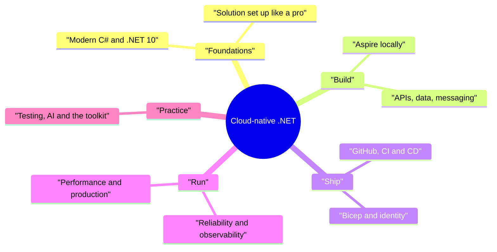
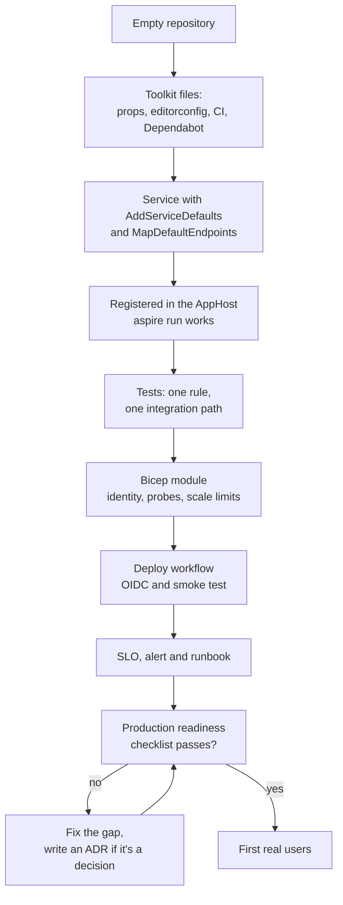

# Chapter 21: Your toolkit

> ⏱ About 25 min · You'll learn: what is in the toolkit and when to reach for each file, the whole habits notebook in one table, a day-one checklist for a new service, and what to learn next (and when you would actually need it).

---

## 📖 Story: Closing the notebook

It is a Friday afternoon, a few months after your first day. Ledgerly's beta is stable, the 2 a.m. page has a runbook, and the last three deploys were so boring that nobody mentioned them at stand-up. Maya asks you to lead the next service: a small "statements" worker that builds monthly PDF statements for users. Elena wants it in the beta next quarter. Tomás has already created the repository, and the first thing he put in it was a link to the toolkit.

You open your "Habits I brought with me" notebook one last time. The first page still has your notes from day one: "No servers to RDP into? Logs are queries?" Every habit since then has a line crossed out and a new practice written next to it. Some crossings-out were easy (`DateTime.Now`). Some took an incident (the flag that didn't reach the worker). You realize the notebook is no longer a list of things you used to do wrong. It is a checklist for the next service.

So this chapter is the handover: from the course to your own work. Here is everything you can copy, the whole notebook in one table, and an honest map of what to learn next.

---

## 🏚️ Old way → 🚀 New way

| What you did before | What you do now | Why it changed |
|---|---|---|
| Starting a new service by copying the last project and deleting what you don't need | Starting from a known-good toolkit: build settings, service defaults, CI, deploy and checklists | The defaults carry every lesson you already paid for |
| Knowledge lived in senior people's heads | Knowledge lives in git: instructions, ADRs, runbooks, checklists | People change teams. The repository stays |
| Learning the next big technology because it's popular | Learning what the next problem needs, when you hit it | Every new platform has a running cost in complexity |
| "We'll add monitoring and alerts before go-live" | Telemetry, health probes, alerts and a runbook from day one | Retrofitting observability is slower and always incomplete |
| A big upgrade project every few years | Small, regular updates: Dependabot, NuGet audit, an LTS plan | Small steps are cheap. Big jumps are risky and expensive |
| A personal notebook of lessons | A shared checklist the whole team uses and improves | A lesson that only you know protects only your code |

> 💡 The toolkit isn't the end of the course. It's the starting point for every service you build after it.

---

## 🧠 The toolkit, file by file

Everything below is in the `toolkit/` folder. The [toolkit README](../toolkit/README.md) explains how to copy each file into a new repository. Treat the files as starting points: edit them for your team, then keep them under review like code.

| File | What it is | When you use it |
|---|---|---|
| `README.md` | The index of the toolkit, with copy instructions | First, when you start a new repository |
| `cheat-sheet-old-to-new.md` | The .NET Framework habit next to its modern replacement, on one page | When you catch yourself typing an old pattern, or when you onboard a colleague with the same background |
| `production-readiness-checklist.md` | What a service must have before real users touch it | Before the first production deploy, and after every incident that adds a line |
| `pr-review-checklist.md` | The review bar for every PR, human or AI-written | Every review, especially large or AI-assisted ones |
| `kql-queries.md` | Ready-made KQL for requests, dependencies, exceptions and SLOs | During an incident, and when you build alerts and workbooks |
| `slo-worksheet.md` | A worksheet to choose SLIs, SLO targets and error budgets | When a service gets its first users, and when Elena asks "is it healthy?" |
| `runbook-template.md` | The structure of a short runbook for one alert | The same day you create an alert |
| `postmortem-template.md` | A blameless postmortem: timeline, factors, owned actions | After every incident that hurt users, within a few days |
| `adr-template.md` | An architecture decision record: context, decision, consequences | When you make a choice that someone will later ask "why?" about |
| `copilot-instructions.md` | A template for repository custom instructions for GitHub Copilot | Copy it to `.github/copilot-instructions.md` in every new repo and edit it |
| `pull_request_template.md` | A PR description template with the questions reviewers need | Copy it to `.github/` so every PR starts with it |
| `Directory.Build.props` | Shared build settings: `net10.0`, nullable, warnings as errors, analyzers, code style | At the root of every new solution, on day one |
| `Directory.Packages.props` | Central package management: one place for all package versions | At the root of every new solution, before the first package is added |
| `.editorconfig` | Code style and analyzer severities | Next to the props files, so the IDE and CI agree |
| `ServiceDefaults.Extensions.cs` | `AddServiceDefaults()`: OpenTelemetry, health checks, service discovery, resilience | In every service, as the first line after the builder is created |
| `ci.yml` | The CI workflow: build with warnings as errors, tests, infrastructure lint | In `.github/workflows/` of every new repo |
| `deploy.yml` | The CD workflow: OIDC login, images tagged with the commit, migrations job, smoke test | When the service gets its first Azure environment |
| `dependabot.yml` | Dependabot updates for NuGet packages and GitHub Actions | In `.github/` on day one, so updates stay small |
| `main.bicep` (pointer) | A pointer to the sample's Bicep entry point and modules | When you write the infrastructure for a new service |

### 💻 In Ledgerly: one line that carries ten chapters

The toolkit's `ServiceDefaults.Extensions.cs` comes from this file. Look at how much one method gives every service:

📄 [`sample/src/Ledgerly.ServiceDefaults/Extensions.cs`](https://github.com/vygantas-meskauskis/cloud-native-dotnet/blob/main/sample/src/Ledgerly.ServiceDefaults/Extensions.cs)
```csharp
    public static TBuilder AddServiceDefaults<TBuilder>(this TBuilder builder) where TBuilder : IHostApplicationBuilder
    {
        builder.ConfigureOpenTelemetry();
        builder.AddDefaultHealthChecks();

        builder.Services.AddServiceDiscovery();

        builder.Services.ConfigureHttpClientDefaults(http =>
        {
            // Retries with jittered back-off, per-attempt + total timeouts, circuit breaker, rate limiter.
            http.AddStandardResilienceHandler();

            // Resolves "https+http://marketdata" to a real address (Aspire locally, config or DNS in Azure).
            http.AddServiceDiscovery();
        });

        return builder;
    }
```

Telemetry (chapters 15 and 16), health checks for Container Apps probes (chapter 14), service discovery (chapter 6) and resilience for every `HttpClient` (chapter 14). A new service that calls `builder.AddServiceDefaults()` starts where Ledgerly ended, not where it began.

> 💡 Copy the toolkit on day one, not "when we have time". Defaults are cheapest before the first line of business code.

---

## 🗺️ The course in one picture



---

## 🧠 The habits notebook, closed

Here is the whole notebook in one table. Each row is a habit you brought from Nordbank, the practice that replaced it, and where it happened.

| Old habit | New practice | Chapter |
|---|---|---|
| Servers you log in to, logs you open as files | Disposable containers, logs as queries, boring deploys | [1](01-from-legacy-to-cloud-native.md) |
| C# 5 style: `DateTime.Now`, sync I/O, null checks everywhere | Modern C#: records, nullable types, `TimeProvider`, async all the way | [2](02-modern-dotnet-in-one-sitting.md) |
| "Works on my machine" builds with versions in every project | One-command builds, central package management, warnings as errors, NuGet audit | [3](03-a-solution-set-up-like-a-pro.md) |
| Controllers returning whatever, errors as strings | Minimal APIs, validation, `ProblemDetails`, OpenAPI, rate limits | [4](04-designing-the-api.md) |
| Hand-run SQL scripts and "last write wins" | EF Core migrations as a deploy step, concurrency tokens | [5](05-data-ef-core-and-azure-sql.md) |
| A wiki page of local setup steps | An Aspire AppHost: F5 starts the whole system | [6](06-local-dev-with-aspire.md) |
| Windows Services and SQL Agent jobs | Queues, the outbox, idempotent consumers, dead-letter handling | [7](07-background-work-and-messaging.md) |
| Long-lived branches and email reviews | GitHub flow, rulesets, CODEOWNERS, small PRs | [8](08-github-as-the-teams-home.md) |
| A build server someone configured by hand | CI as code in GitHub Actions, Dependabot, CodeQL | [9](09-ci-with-github-actions.md) |
| "We'll get a bigger VM" | Choosing managed services by need and cost 💰 | [10](10-choosing-azure-services.md) |
| Clicking resources together in the portal | Bicep in git, what-if before every change | [11](11-infrastructure-as-code.md) |
| Publish profiles and a deploy password in a secret | OIDC, environments with approvals, build once and promote | [12](12-cd-to-azure-with-oidc.md) |
| Connection strings with passwords in config | Managed identity everywhere, JWT for users | [13](13-identity-and-secrets.md) |
| "The vendor is never down" | Timeouts, retries, circuit breakers, graceful degradation | [14](14-reliability-patterns.md) |
| `Console.WriteLine` and log files | Structured logs, OpenTelemetry traces and metrics | [15](15-observability-logging-and-opentelemetry.md) |
| "It seems fine" | KQL, SLOs, error budgets and alerts with numbers | [16](16-observability-azure-monitor-kql-slos.md) |
| Manual testing before release | A test pyramid with real dependencies in containers | [17](17-testing-strategy.md) |
| Guessing at performance, caching "everything" | Measure first, HybridCache, async, scale rules with limits | [18](18-performance-and-scale.md) |
| Heroic nights and "human error" | Runbooks, kill switches, roll forward, blameless postmortems | [19](19-running-production.md) |
| Either ignoring AI or trusting it blindly | AI as a drafting tool, held to the same review bar | [20](20-ai-assisted-dotnet-development.md) |

A pattern runs through the right-hand column: almost every new practice moves something **from a person's memory into a file in git**. The build settings, the infrastructure, the pipeline, the alert, the runbook, the instructions for the AI. That is what Tomás meant on your first week: "If it's not in git, it doesn't exist."

The toolkit's `cheat-sheet-old-to-new.md` is the code-level version of this table: the specific API or pattern you used to write, and what you write now.

> 💡 You didn't stop being a senior .NET developer. You moved your judgment into files the whole team can use.

---

## 🧠 The day-one checklist for a new service

Maya hands you a single page for the statements service. It is the production readiness checklist turned around: what to do on **day one**, so the list before go-live is short.

### 💻 In Ledgerly: a whole service on one screen

The worker is a good model for a new service. Everything it needs is wired in a few lines:

📄 [`sample/src/Ledgerly.Worker/Program.cs`](https://github.com/vygantas-meskauskis/cloud-native-dotnet/blob/main/sample/src/Ledgerly.Worker/Program.cs)
```csharp
var builder = WebApplication.CreateBuilder(args);

builder.AddServiceDefaults();
builder.AddSqlServerDbContext<LedgerlyDbContext>("ledgerlydb");
builder.AddAzureServiceBusClient("messaging");
// ...
builder.Services.AddSingleton(TimeProvider.System);
// ...
// Give in-flight messages time to finish when Container Apps stops a replica (SIGTERM).
builder.Services.Configure<HostOptions>(o => o.ShutdownTimeout = TimeSpan.FromSeconds(25));

var app = builder.Build();
app.MapDefaultEndpoints();
app.Run();
```

And it joins the local system with one registration in the AppHost:

📄 [`sample/src/Ledgerly.AppHost/AppHost.cs`](https://github.com/vygantas-meskauskis/cloud-native-dotnet/blob/main/sample/src/Ledgerly.AppHost/AppHost.cs)
```csharp
builder.AddProject<Projects.Ledgerly_Worker>("worker")
    .WithReference(db)
    .WithReference(messaging)
    .WithReference(marketData)
    .WaitFor(messaging)
    .WaitForCompletion(migrations)
    .WithHttpHealthCheck("/health");
```

### The checklist

**Repository (hour one)**

- [ ] `Directory.Build.props`, `Directory.Packages.props` and `.editorconfig` from the toolkit. The build is green with warnings as errors.
- [ ] `ci.yml`, `dependabot.yml`, `pull_request_template.md` and `.github/copilot-instructions.md` committed.
- [ ] Branch protection or a ruleset on `main`: PRs, reviews and a green CI run required.

**Code (day one)**

- [ ] `builder.AddServiceDefaults()` and `app.MapDefaultEndpoints()`: telemetry, health probes and resilience from the first commit.
- [ ] Registered in the AppHost, so `aspire run` starts it with its dependencies.
- [ ] `TimeProvider`, `CancellationToken` everywhere, `[LoggerMessage]` for logs.
- [ ] If it consumes messages: idempotent handler, explicit complete, abandon and dead-letter, graceful shutdown.
- [ ] One unit test for the core rule and one integration test through the real entry point.

**Azure (before the first deploy)**

- [ ] Bicep module with tags, `minReplicas` and `maxReplicas` set on purpose 💰, and health probes.
- [ ] A managed identity with only the roles it needs. No connection strings with secrets.
- [ ] The deploy workflow with OIDC, an environment and a smoke test that proves the new revision answers.

**Running it (before real users)**

- [ ] One SLO with an alert on burn rate, and a runbook linked from the alert.
- [ ] A kill-switch flag for every external dependency, checked by every service that calls it.
- [ ] An owner for the dead-letter queue, and a budget alert on the resource group 💰.
- [ ] An ADR for every decision someone will question later (like "why a scheduled job and not a timer?").

> 💡 Most of this list is copying files and adding one line each. That's the point: the expensive lessons are already encoded.

---

## 🗺️ A new service, from empty repo to first user



---

## 🧠 What to learn next, and when you'd need it

The cloud-native world has far more technology than any one team needs. Here is an honest map. "When you'd need it" matters more than "what it is": learn each one when a real problem asks for it.

| Topic | What it is | When you'd need it | When you wouldn't |
|---|---|---|---|
| **Kubernetes and AKS** | Full Kubernetes API control on Azure, as AKS Standard or AKS Automatic. Container Apps runs on Kubernetes but doesn't expose its API | You need custom operators, special networking or scheduling, or a platform team already runs Kubernetes | Your services fit Container Apps. Ledgerly does |
| **Dapr** | A set of building blocks (state, pub/sub, service invocation) as a sidecar. Optional per app in Container Apps | Many services in different languages need the same building blocks | A .NET-only system using Aspire integrations and the Azure SDKs directly. Nothing in this course needs it |
| **Event-driven architecture** | Service Bus topics and subscriptions: publish once, each subscription gets a copy, with SQL or correlation filters | A second consumer wants the same events, like the statements service listening for completed imports | One producer, one consumer: a queue is simpler |
| **Platform engineering** | A team that builds paved roads (templates, pipelines, environments) for other teams | Several teams build services the same way and keep solving the same setup problems | One team, a few services. The toolkit is your paved road |
| **.NET 11** 🔧 | The next release, STS (2 years of support). At RC3 as of late October 2026, GA expected at .NET Conf in November 2026 | You want a specific new feature and can upgrade again within two years | You prefer the 3-year LTS cycle. .NET 10 is supported until 2028-11-14 |
| **`aspire deploy`** 🔧 | The AppHost provisions Azure resources and deploys containers, now the recommended Aspire deploy path | New projects or prototypes where the AppHost model is enough | You need full Bicep control and review, as Ledgerly's `infra/` does |
| **Azure App Configuration** | Central configuration and feature flags with refresh, no redeploy | Flags must flip in seconds, or many services share settings | One service with a few settings in environment variables |
| **Microsoft Agent Framework** 🔧 | Agents and multi-agent workflows on `IChatClient`, GA | Your product needs multi-step AI with tools and approvals | One prompt with `IChatClient` is enough |

Release dates and support windows change, so check the [.NET support policy](https://dotnet.microsoft.com/en-us/platform/support/policy/dotnet-core) and [what's new in .NET 11](https://learn.microsoft.com/en-us/dotnet/core/whats-new/dotnet-11/overview). For compute choices, Microsoft's [container options comparison](https://learn.microsoft.com/en-us/azure/container-apps/compare-options) is the place to start. For events, see [queues, topics and subscriptions](https://learn.microsoft.com/en-us/azure/service-bus-messaging/service-bus-queues-topics-subscriptions).

### How to learn the next thing

The method that worked for this course works for the next topic too:

1. **Start from a problem**, not a technology: "two services need the same import events" leads to topics, not the other way round.
2. **Build the smallest version in the sample**, locally with `aspire run`, before it goes near production.
3. **Write the ADR**: what you chose, what you didn't, what it costs to run 💰 and to operate.
4. **Add the lesson to the toolkit**, so the next service gets it for free.

> 💡 The best next technology is the one your next real problem needs. Everything else can wait in a bookmark.

---

## ⚠️ Common traps

| Trap | What happens | Do this instead |
|---|---|---|
| Copying the toolkit once and never updating it | Each repository drifts, and lessons from new incidents never reach the old services | Treat the toolkit as a repository with PRs, and update it after postmortems |
| Leaving the readiness checklist until go-live week | Alerts, runbooks and identities get rushed or skipped | Use the day-one checklist, so go-live is a short final check |
| Adopting Kubernetes or Dapr "to be ready" | Weeks of platform work and a new on-call surface, with no user benefit | Wait for a problem that needs it, and write an ADR when it comes |
| Upgrading to every new STS release without a plan | Frequent upgrade work, or running an unsupported version | Choose LTS or STS on purpose, and put the end-of-support date in your calendar |
| Keeping the notebook private | Your team repeats the mistakes you already learned from | Turn lessons into checklist lines, instructions and templates in git |
| Treating checklists as bureaucracy | People tick boxes without thinking | Keep them short, explain each line, delete lines that never catch anything |

---

## 🧰 Helpers

**Starting a new service, in order:**

1. Read the [toolkit README](../toolkit/README.md) and copy the build, style and workflow files.
2. Add `ServiceDefaults` and register the service in the AppHost.
3. Write the first rule as a test, then the code.
4. Write the Bicep module and the deploy workflow before the first user story is finished.
5. Walk through `production-readiness-checklist.md` with Priya before real users arrive.

**Questions to ask in any design review** (from the whole team):

- Maya: "What happens when it fails?"
- Tomás: "Is it in git?"
- Priya: "How will we know it's healthy, and who gets paged?"
- Jonas: "Which identity does this use, and what can it access?"
- Elena: "What does the user see, and what does it cost?" 💰
- Leo: "What's the contract, and what does an error look like?"

**Make it permanent:**

- Put the toolkit in its own repository (or a template repository), owned by the team, with PRs for changes.
- Link `production-readiness-checklist.md` and `pr-review-checklist.md` from your PR template.
- After every postmortem, ask: "Which toolkit file should change so this can't happen in the next service?"
- Review the "what to learn next" table every six months against the problems you actually hit 🔧.

---

## 🧪 Try it yourself (optional, ~30 min)

1. Run the finished sample one more time, and walk through the dashboard as if you were showing it to a colleague from your old team:
   ```bash
   cd sample
   aspire run
   ```
2. Build and test it the way CI does, and notice how little you have to remember:
   ```bash
   dotnet build Ledgerly.slnx
   dotnet test --solution Ledgerly.slnx
   ```
3. Open the [toolkit README](../toolkit/README.md). For each file, decide whether you would copy it unchanged, edit it, or skip it for your next service. Write down why.
4. Take the day-one checklist above and fill it in for a service you know from your own work. Which lines would have prevented an incident you remember?
5. Open your own notebook (or start one) and add one habit this course didn't cover, with its new practice. Then turn it into a line in a checklist.

---

## ✅ Recap

1. The toolkit turns every lesson of this course into files you copy on day one: build settings, service defaults, workflows, templates and checklists.
2. Almost every new habit moved knowledge from someone's memory into git, where the whole team can use and improve it.
3. Learn the next technology when a real problem needs it, write the decision down, and feed the lesson back into the toolkit.

**Back to → [Start](../README.md)**
