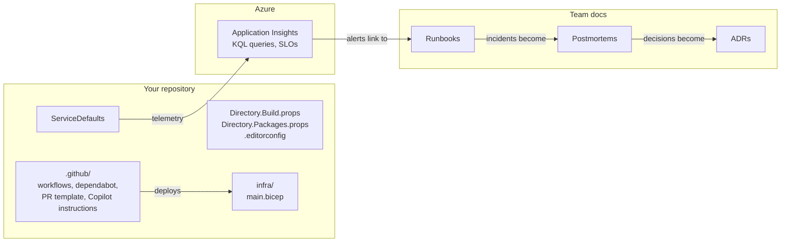

# Toolkit

Copy-ready files from the course. The checklists and templates are written for your next real service, not for Ledgerly. The config files come straight from the working sample, so you know they build.

> 🔧 Versions, defaults and product names in these files were correct in October 2026. Check them when you copy a file into a new repo.

## Checklists and cheat sheets

| File | What it is | When to use it | Chapter |
|---|---|---|---|
| [Cheat sheet: old to new](cheat-sheet-old-to-new.md) | One table that maps every .NET Framework / IIS habit to its modern replacement | Keep it open for the first months | All |
| [Production readiness checklist](production-readiness-checklist.md) | What must be true before a service takes real traffic | Before the first production deploy, then once a quarter | 19 |
| [PR review checklist](pr-review-checklist.md) | What a reviewer checks beyond "does it compile" | Every pull request, yours and AI-written ones | 8, 20 |
| [KQL queries](kql-queries.md) | Starting-point queries for requests, dependencies, logs, custom metrics and imports | When you build dashboards, alerts or investigate an incident | 16, 19 |
| [SLO worksheet](slo-worksheet.md) | Fill-in worksheet: user journeys, SLIs, SLOs, error budgets, alerts | When you define what "healthy" means | 16 |

## Templates

| File | What it is | Where it goes | Chapter |
|---|---|---|---|
| [Runbook template](runbook-template.md) | One page per alert: what it means, how to check, how to fix | Next to the alert, linked from the alert text | 19 |
| [Postmortem template](postmortem-template.md) | Blameless incident review | A `docs/postmortems/` folder or your wiki | 19 |
| [ADR template](adr-template.md) | Architecture decision record | `docs/adr/NNNN-title.md` | 1, 19 |
| [Copilot instructions](copilot-instructions.md) | Repository custom instructions for GitHub Copilot | `.github/copilot-instructions.md` | 20 |
| [Pull request template](pull_request_template.md) | Pre-filled PR description | `.github/pull_request_template.md` | 8 |

## Config files from the sample

These files are not shown on this page because they are not Markdown. Open them on GitHub and copy them.

| File | What it gives you | Where it goes | Chapter |
|---|---|---|---|
| [Directory.Build.props](https://github.com/vygantas-meskauskis/cloud-native-dotnet/blob/main/toolkit/Directory.Build.props) | Target framework, nullable, warnings as errors, analyzers, code style in build | Solution root | 3 |
| [Directory.Packages.props](https://github.com/vygantas-meskauskis/cloud-native-dotnet/blob/main/toolkit/Directory.Packages.props) | Central package management with transitive pinning | Solution root | 3, 9 |
| [.editorconfig](https://github.com/vygantas-meskauskis/cloud-native-dotnet/blob/main/toolkit/.editorconfig) | Code style and analyzer severities | Solution root | 3 |
| [ServiceDefaults.Extensions.cs](https://github.com/vygantas-meskauskis/cloud-native-dotnet/blob/main/toolkit/ServiceDefaults.Extensions.cs) | OpenTelemetry, health endpoints, resilience and service discovery in one call | A `ServiceDefaults` project shared by every service | 6, 14, 15 |
| [ci.yml](https://github.com/vygantas-meskauskis/cloud-native-dotnet/blob/main/toolkit/ci.yml) | Build, test with coverage, container images, Bicep lint | `.github/workflows/ci.yml` | 9 |
| [deploy.yml](https://github.com/vygantas-meskauskis/cloud-native-dotnet/blob/main/toolkit/deploy.yml) | OIDC login, three-phase Bicep deploy, migration job, smoke test | `.github/workflows/deploy.yml` | 12 |
| [dependabot.yml](https://github.com/vygantas-meskauskis/cloud-native-dotnet/blob/main/toolkit/dependabot.yml) | Grouped weekly updates for NuGet and GitHub Actions | `.github/dependabot.yml` | 8, 9 |
| [main.bicep](https://github.com/vygantas-meskauskis/cloud-native-dotnet/blob/main/sample/infra/main.bicep) | The whole Azure environment (lives in `sample/infra`, with its modules) | `infra/` | 10, 11 |

### Adapting the config files

| File | Change before you use it |
|---|---|
| `Directory.Packages.props` | Remove the packages you don't use. Keep `CentralPackageTransitivePinningEnabled`. |
| `ci.yml`, `deploy.yml` | Paths (`sample/`, `Ledgerly.slnx`), the project list in the container matrix, and the resource names. |
| `deploy.yml` | Set the repository variables `AZURE_CLIENT_ID`, `AZURE_TENANT_ID`, `AZURE_SUBSCRIPTION_ID` and `AZURE_RESOURCE_GROUP` (chapter 12). Until `AZURE_CLIENT_ID` exists, the workflow skips itself. |
| `dependabot.yml` | The `directory` value and the package groups. |
| `main.bicep` | `appName`, the JWT authority and audience, and the CORS origins in `main.bicepparam`. |

## How the pieces fit

**Back to → [Chapter 21: Your toolkit](../chapters/21-your-toolkit.md)**
